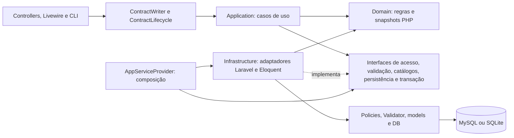

# Arquitetura do Contracts

## Diagnóstico completo da suíte — 14/11/2026

A suíte PHP foi executada diretamente, sem o timeout do Composer: `docker compose exec -T app php vendor/bin/phpunit --do-not-cache-result --colors=never --log-junit=build/suite-diagnosis-20261113/phpunit.xml`. O nome do diretório preserva a data usada no início da investigação. Todos os testes de banco usaram a configuração forçada de `phpunit.xml`: SQLite em memória e storage/cache temporários de `tests/bootstrap.php`. Não houve teste ou restauração no banco operacional.

| Verificação | Resultado |
| --- | --- |
| PHPUnit completo | 1.096 testes: 1.080 aprovados, 15 falhas, 1 ignorado; 10.649 asserções; 7min29,583s; 215,50 MB |
| Architecture, incluída no PHPUnit completo | 3 testes aprovados |
| Unit, incluída no PHPUnit completo | 86 testes aprovados |
| Feature, incluída no PHPUnit completo | 1.006 testes: 991 aprovados e 15 falhas |
| Concurrency | 1 ignorado: exige MySQL explicitamente descartável e isolado; não executado no banco local |
| `docker compose run --rm --no-deps node npm test` | 205 testes: 203 aprovados e 2 falhas |
| `docker compose exec -T app composer check:static` | Sem erros; análise de Domain/Application configurada no PHPStan |
| `docker compose exec -T app vendor/bin/pint --test` | 460 arquivos aprovados |
| `docker compose run --rm --no-deps node npm run build` | Aprovado |
| `powershell -NoProfile -ExecutionPolicy Bypass -File tests/Operations/test-portable-backup.ps1` | Aprovado; quatro cenários sintéticos, sem Docker/banco |
| `docker compose exec -T app python3 tests/Operations/test_backup_verification.py` | 3 testes: 1 aprovado e 2 falhas; Docker simulado |

O limite de 300 segundos pertence ao processo iniciado pelo Composer, não à utilização do sistema. A execução completa consumiu cerca de 449 segundos, portanto esse limite é insuficiente neste ambiente. O teste mais lento foi `ReportScaleTest::test_export_totals_and_rows_for_zero_one_one_hundred_and_legacy_scale` (32,166s), que valida CSV, Excel e PDF com até 2.145 contratos sintéticos. A análise de tempos não indica um único teste travado; o tempo é acumulado por toda a suíte. Para validação completa, executar PHPUnit diretamente ou configurar timeout apenas para o comando de validação, sem enfraquecer as asserções.

Foi extraído um snapshot de `HEAD` (`fa325f1`) com `git archive`, sem trocar a árvore de trabalho. Seus 86 testes unitários passaram. Os mesmos 15 testes PHP problemáticos foram reexecutados em um container separado com código do snapshot, vendor montado somente para leitura e SQLite em memória: 14 falharam também no GitHub; somente o teste de apresentação da Nova ATA passou no snapshot e falhou localmente. Não foram alterados arquivos de código ou testes para fazer a comparação.

As 15 falhas PHP, com a primeira asserção que interrompe cada teste:

| Teste e asserção | Diagnóstico | Origem confirmada |
| --- | --- | --- |
| `AtasOverviewTest::test_new_ata_products_is_disabled_until_an_ata_is_saved_or_loaded`, linha 82 | Espera “Cadastro de produtos”; o cabeçalho foi alterado por solicitação para “PRODUTOS”. As demais expectativas de posição dos controles e modo manual desse teste também precisam acompanhar o layout solicitado, preservando a validação de bloqueio antes de carregar a ata. | Alterações locais |
| `ContractAmendmentsTest::test_contract_summary_embeds_paginated_amendments_with_actions_and_contract_scope`, linha 96 | Espera “Excluir contrato” na ordem antiga da tela de detalhes; o bloco não é renderizado por `contracts/show.blade.php`. | Reproduzida em HEAD |
| `ContractAttachmentsTest::test_private_upload_download_audit_and_current_scope`, linha 59 | O upload inicial passa, mas a tela não apresenta “Instrumento assinado”. A falha ocorre antes das asserções posteriores de download e escopo desse teste. | Reproduzida em HEAD |
| `ContractBrowsingTest::test_contract_information_panel_shows_saved_updated_values`, linha 76 | Espera a sequência de detalhes/aditivos/“Excluir contrato” da apresentação anterior. | Reproduzida em HEAD |
| `ContractBrowsingTest::test_detail_renders_all_fields_masks_personal_documents_and_escapes_source_text`, linha 686 | Espera “Data inválida na origem.” no detalhamento completo que a view resumida não apresenta. | Reproduzida em HEAD |
| `ContractIssuancePermissionTest::test_user_needs_explicit_issuance_permission_for_creation_and_documents_but_can_consult`, linha 82 | As proibições iniciais sem permissão passam; após conceder permissão, espera “Exportar resumo PDF”, ausente na view atual. | Reproduzida em HEAD |
| `ContractWritingTest::test_save_confirmation_renders_with_maintenance_audit_metadata`, linha 112 | Espera “Histórico de alterações”, não renderizado na view resumida. | Reproduzida em HEAD |
| `ContractWritingTest::test_accumulated_footer_requires_a_saved_contract_and_registered_nonzero_amendment`, linha 135 | Espera HTML e `value="R$ 12.345,67"`; o input atual tem `data-money` e decimal bruto com quatro casas para formatação no navegador. | Reproduzida em HEAD |
| `ContractWritingTest::test_editor_action_toolbar_respects_persistence_and_delete_permission`, linha 426 | Espera `id="delete-contract"` na tela de detalhes; há link para esse destino no formulário, mas o destino não é renderizado na view de detalhes. | Reproduzida em HEAD |
| `ContractWritingTest::test_financial_panel_displays_readonly_totals_and_allows_creation_before_item_totals`, linha 501 | Espera texto HTML “R$ 125,00”, mas recebe `125.0000` em elemento `data-money`; o teste PHP não executa o formatador JavaScript. | Reproduzida em HEAD |
| `ContractWritingTest::test_heading_shows_generated_number_after_save_and_supplier_and_instructions_are_positioned`, linha 958 | Espera “Rua do fornecedor” no detalhamento completo que não é renderizado na view resumida. | Reproduzida em HEAD |
| `ContractWritingTest::test_create_renders_sections_and_persists_native_contract_and_audit`, linha 1025 | Espera “Histórico de alterações” após cadastrar o contrato; a view atual não renderiza esse bloco. | Reproduzida em HEAD |
| `HistoricalAmendmentImportTest::test_imported_amendment_is_visible_and_masked_but_cannot_be_edited_by_regular_users`, linha 146 | O fixture cria `VL_ADT=1234.5678`, e a lista mostra corretamente “R$ 1.234,57”; a asserção espera “R$ 999,00”, que é o acumulado do contrato do fixture, não o valor do aditivo. | Reproduzida em HEAD |
| `HistoryAndOperationsTest::test_ambiguous_history_requires_admin_review_and_never_changes_money_or_end_dates`, linha 99 | Conciliação, bloqueio de usuário comum e preservação de valor/vigência passam antes de falhar ao procurar “Texto preservado”; a view resumida não apresenta o histórico. | Reproduzida em HEAD |
| `SelectedFundTest::test_editing_a_contract_preserves_its_existing_manager`, linha 147 | O gestor histórico é encontrado; falha porque proíbe o rótulo “Gestor do Fundo”, hoje mostrado em campo somente para leitura do catálogo. A falha não demonstra substituição do gestor histórico. | Reproduzida em HEAD |

Dez falhas se concentram na divergência entre a view resumida `resources/views/contracts/show.blade.php` e as expectativas de detalhamento, documentos, histórico ou ações. O controller ainda consulta anexos, histórico e auditorias que essa view não utiliza. A correção exige confirmar o caminho funcional para essas informações: restaurar os blocos/ações necessários ou atualizar as expectativas para a navegação vigente, mantendo testes próprios de autorização, mascaramento e persistência. Não basta remover as asserções que falham. Nos testes com várias etapas, a primeira falha impede a execução das verificações posteriores.

JavaScript: a execução do snapshot completo de recursos de HEAD teve 193 testes, com 192 aprovados e uma falha. A comparação usou código e testes do mesmo commit, incluindo os arquivos de Blade e CSS lidos por alguns testes. Os resultados locais são:

| Teste | Causa e evidência | Origem |
| --- | --- | --- |
| `dfd-product-filter.test.mjs:34` | `window is not defined` ao chamar `window.alert` em `dfd-product-filter.js:180`. Em prova controlada, com `window.alert` simulado sem editar arquivos, aparece uma segunda divergência na linha 92: o código limpa `appliedQuery` quando a pesquisa não encontra produto, enquanto o teste espera manter o filtro após desmarcar a seleção. É necessário simular a API e alinhar a regra de pesquisa inexistente com o requisito. | Também falha em HEAD |
| `fund-heading.test.mjs:5` | `MutationObserver is not defined` em `fund-heading.js:16`. O teste já simula DOM, fontes e ResizeObserver, mas não o novo observador de texto. Com MutationObserver simulado por preload, as asserções existentes passam. É uma lacuna introduzida no teste pela alteração local de ajuste de fonte; isso não demonstra falha dessa API no navegador. A correção deve também testar o ajuste quando o texto muda. | Alterações locais |

Operação de backup Linux: `scripts/verify-backup.sh:20` e `:58` chamam `TarFile.extractall(..., filter='data')`. O Python 3.11.2 instalado neste container expõe a assinatura `(self, path='.', members=None, *, numeric_owner=False)`, sem `filter`. Assim, o pacote válido é recusado antes do Docker simulado, e o teste de limpeza não encontra a chamada `docker rm` porque nenhum container chegou a ser criado. As duas falhas têm essa mesma causa de compatibilidade. O terceiro teste, de rejeição de traversal, passa por retorno não zero, mas neste runtime esse resultado também pode decorrer da incompatibilidade; não prova que o arquivo malicioso foi especificamente identificado. É necessário usar um runtime com extração segura compatível e repetir os testes, preservando a proteção contra caminhos externos. O script e seus testes não têm alterações locais em relação a HEAD.

Prioridades recomendadas: primeiro reconciliar os caminhos de documentos/histórico/exclusão da tela de detalhes sem perder cobertura de segurança; depois alinhar os testes ao layout solicitado da ATA, à formatação monetária e ao fixture do aditivo; corrigir as simulações JavaScript e confirmar a regra da pesquisa DFD; ajustar o ambiente Python e a execução longa do PHPUnit. Os 10 testes de `SaveAtaProductTest` passaram na suíte completa. Nenhuma correção de código ou teste foi aplicada durante este diagnóstico.

Evidências completas em `build/suite-diagnosis-20261113/`: `phpunit.log`, `phpunit.xml`, `phpunit-baseline.log`, `phpunit-baseline.xml`, `php-failures-compared.json` e `javascript-baseline-complete.log`. A execução JavaScript local está em `build/suite-diagnosis-javascript-20261113.log`. As primeiras tentativas de baseline JS com recursos incompletos foram desconsideradas e substituídas pela comparação completa. Não houve ensaio visual autenticado, execução dos scripts de navegador dependentes de credenciais, MySQL de concorrência ou commit.

## Gravação de produtos e totais por ficha da ATA

`POST /atas/{ata}/products` (`atas.products.store`) usa `Infrastructure/Atas/SaveAtaProduct`. Dentro de uma transação, bloqueia/revalida primeiro o ator e depois a ata ativa, verifica acesso ao Fundo atual da sessão e policy de escrita da ata, valida campos e versão, grava o produto original, cria ou acumula a ficha e registra auditoria inseparável. A versão da ata aumenta uma vez. Não retorna snapshots ou modelos internos. Versão antiga retorna 409 sem dados atuais, e repetição de Item ativo é recusada sem duplicar valores. Item original excluído logicamente pode ser reativado com seu estado anterior integralmente auditado; aditivos permanecem intactos.

Ficha, Item, Código, UND, QTD, VL. Unitário e Descrição são obrigatórios. QTD deve ser positiva; preços não podem ser negativos. Decimais usam strings e BCMath, com limite de decimal(18,4). O servidor calcula QTD × preço e trunca para as duas a quatro casas solicitadas; ignora totais e identificações da ata/processo enviados pelo cliente. Fora do modo manual, consulta novamente o catálogo pelo processo persistido e Item, exige correspondência única, usa os campos canônicos e recusa QTD superior ao Disponível. O catálogo não é debitado nesta operação.

A migration aditiva `2026_11_13_000004_add_native_ata_product_fields.php` acrescenta `COD_PROD` e `FICHA` opcionais a `tb_PRODUTOS_ATA`, preservando registros históricos. A ficha é identificada por `ATA`, `Processo` e `Ficha` em `tb_ValorFicha_ATA`: primeira gravação cria a linha; produtos posteriores somam `VL_TOTAL` ao `VALOR` existente. O lock da ata serializa essa operação, inclusive a criação da primeira ficha; duplicidades históricas de ficha ou identificação de ata/processo são recusadas para evitar atualização ambígua entre Fundos. Na leitura, fichas com identificação ambígua não são expostas.

A interface mantém a Ficha digitada, bloqueia cliques concorrentes, apresenta erros na janela padrão e recarrega a ata após o sucesso, atualizando produtos, códigos, fichas, totais, versão e quadro por ficha. As consultas de produtos originais continuam excluindo os aditivos. O botão de Salvar produto fica disponível somente para ata carregada e fora de operações pendentes; o servidor reautoriza toda gravação.

Validação específica executada: `SaveAtaProductTest` passou (10 testes, 88 asserções, SQLite em memória e storage temporário); `AtaLookupTest` e `AtaProductLookupTest` também passaram (12 testes, 90 asserções). JavaScript de consulta, produtos e gravação passou (22 testes). `composer check:architecture` passou (3 testes, 4 asserções), `composer test:unit` passou (86 testes, 210 asserções), Pint dos PHP alterados, `php artisan view:cache`, `npm run build` e `git diff --check` passaram. Migration aditiva aplicada no MySQL local; rotas confirmadas por `route:list --name=atas.products`. Sem teste de escrita no banco operacional, sem ensaio visual autenticado e sem commit.

`composer check` também foi executado: Pint geral passou (460 arquivos), mas PHPUnit sinalizou falhas e atingiu o timeout de 300 segundos antes de produzir o resumo dos 1.096 testes. Não se declara aprovação da suíte geral nem se atribuem essas falhas à nova gravação sem diagnóstico individual. Log local preservado em `build/ata-product-save-composer-check-20261113.log`.

## Lista de produtos do processo no editor de ATA

A lupa de Item consulta o item preenchido; vazia, abre o catálogo do processo da ata salva. `GET /atas/{ata}/products/catalog` autoriza a ata, deriva o processo no servidor e retorna projeção explícita sem fornecedor ou fontes privadas, paginada em 50 registros e com `private, no-store`. Revalida ator, acesso, versão e processo após a leitura. Selecionar um registro consulta novamente o item; ambiguidades continuam recusadas. A janela descarta respostas antigas e fecha ao trocar de ata. Validação: `AtaProductLookupTest` (7 testes, 47 asserções, SQLite em memória), Architecture, Pint, compilação Blade e build aprovados; sem escrita no banco operacional.

## Produtos originais no editor de ATA

A consulta `GET /atas/lookup` carrega apenas produtos ativos com `ADITIVO = 0` e `ID_ADITIVO` nulo. O total retornado soma somente os produtos originais. Os produtos dos aditivos permanecem no banco; os relatórios mantêm seus critérios próprios. Esta regra substitui a inclusão de aditivos no editor descrita no histórico abaixo. Validação: `AtaLookupTest` passou (5 testes, 43 asserções, SQLite em memória), assim como Architecture (3 testes, 4 asserções) e Pint dos dois arquivos PHP alterados. Sem testes no banco operacional.

## Verificação antes dos commits e push — 13/11/2026

Por solicitação do usuário, as alterações foram organizadas em correção do envio de fornecedor, funcionalidades de atas/participantes/produtos e documentação. Referências locais não rastreadas, `build/`, dependências, configurações privadas, backups e assets compilados ficaram fora dos commits. O fetch anterior confirmou `main` e `origin/main` em `3d30f46` antes dos commits; não foi necessário reaplicar alterações locais por pull.

Verificação final no Docker: Pint geral passou (457 arquivos); `composer check:architecture` passou (3 testes, 4 asserções); `composer test:unit` passou (86 testes, 210 asserções). O filtro `AtaProductLookupTest|AtaRegistrationTest|RemoveSavedAtaParticipantTest|SavedAtaParticipantsTest|AtaFichaValuesSchemaTest|AtaFundNumberMigrationTest|AtaReferenceImportTest|ReconcileAtaProcessValidityTest|AtaLookupTest|AtaParticipantsTest|AtasOverviewTest|ContractProductsTest|SupplierRegistrationTest` passou (150 testes, 1.467 asserções, SQLite em memória e storage temporário). Os cinco arquivos JavaScript de consulta/preenchimento/validação de atas e cadastro de fornecedor passaram (46 testes). `npm run build`, `git diff --check` e a verificação de stage passaram. Ensaios Chrome de envio de fornecedor, consulta de Item da ata e exclusão/substituição de participantes passaram com APIs simuladas, sem escrita no banco operacional. A suíte PHP geral não foi repetida nesta conferência; continuam registradas abaixo suas falhas e o timeout anterior de `composer check`.

## Consulta de Item para produtos da ATA — 13/11/2026

Após carregar uma ata salva, Item e sua lupa ficam disponíveis em Cadastro de produtos da ATA. Digitar inicia uma consulta após uma breve pausa; sair do campo ou clicar na lupa consulta imediatamente. `GET /atas/{ata}/products/item-lookup` (`atas.products.item-lookup`) recebe somente Item. `AtaProductLookup` revalida ator/sessão e acesso ao Fundo da ata no backend, obtém o Processo da ata persistida e consulta `tb_Produtos` por igualdade de Item e Processo com TRIM, preservando zeros à esquerda. Não aplica filtro adicional por fornecedor. O parâmetro HTTP Processo não controla a consulta. Atas excluídas ou fora do escopo não retornam dados; ator, acesso, processo e versão são verificados novamente antes do retorno.

A projeção explícita retorna Código (`Cod_Prod`), Marca, UND (`Unidade`), Disponível (`QTD` do catálogo, o saldo atual), VL. Unitário (`VL_Unitario`) e Descrição (`Discriminacao`). Os decimais são normalizados por strings e apresentados com quatro casas, inclusive saldo zero; valores inválidos são recusados. Não são retornados fornecedor, fontes privadas ou models completos. Item inexistente retorna 404, duplicidade entre fornecedores para o mesmo Item/Processo retorna 409, sem escolher uma linha arbitrária; inconsistência cadastral retorna 422. Respostas de sucesso usam `private, no-store` e a rota limita frequência.

`ata-products.js` limpa os dados anteriores ao mudar o Item ou a ata, cancela requisições antigas e descarta respostas atrasadas ou de Processo diferente do exibido. A descrição é preenchida como valor de textarea, sem interpretar HTML. Erros são informados na janela padrão da suíte ao concluir a entrada ou usar a lupa; pausas durante a digitação mostram apenas o status para não interromper o preenchimento. Ficha, QTD e ações de gravação de produtos permanecem indisponíveis nesta etapa; campos de dados consultados são somente leitura. Não há consumo de saldo, escrita em produtos ou em valores de ficha.

Verificações executadas no Docker: `AtaProductLookupTest|AtasOverviewTest|ContractProductsTest` passou inicialmente (58 testes, 686 asserções); após acrescentar o cenário de mudança de Processo durante a consulta, `AtaProductLookupTest` passou novamente (6 testes, 32 asserções). Testes de banco somente em SQLite em memória/storage temporário. `node --test tests/JavaScript/ata-products.test.mjs tests/JavaScript/ata-process-fields.test.mjs tests/JavaScript/ata-save.test.mjs tests/JavaScript/ata-lookup.test.mjs` passou (35 testes). `composer check:architecture` (3/4), `composer test:unit` (86/210), Pint dos quatro PHP, `npm run build`, `php artisan view:cache`, `git diff --check`, rota e `contracts:check-operations` passaram. Chrome com Blade/Alpine/assets reais e APIs simuladas (`node build/check-ata-item-lookup.cjs`) confirmou Item habilitado após consulta da ata, preenchimento dos seis campos com decimais exatos, limpeza e aviso para inexistente. Sem migration ou escrita de teste no banco operacional; suíte geral não repetida, mantendo as limitações anteriores de `composer check`.

## Tabela de valores de fichas das atas — 13/11/2026

Criada `tb_ValorFicha_ATA` com exatamente os quatro campos solicitados, todos obrigatórios: `ATA` varchar(32), `Processo` varchar(64), `Ficha` varchar(64) e `VALOR` decimal(18,4). ATA guarda o número documental; Processo/Ficha permanecem texto para preservar zeros à esquerda. O índice composto `ata_ficha_values_lookup` abrange ATA/Processo/Ficha, sem introduzir regra de unicidade ou chave estrangeira por número de ata. Não há preenchimento automático, importação ou integração de escrita na interface nesta etapa. `tb_ValorFicha` dos contratos permanece preservada.

A migration aditiva `2026_11_13_000003_create_ata_ficha_values.php` foi aplicada no MySQL local por `docker compose exec -T app php artisan migrate --path=database/migrations/2026_11_13_000003_create_ata_ficha_values.php --force`; `php artisan db:table tb_ValorFicha_ATA` confirmou as quatro colunas e decimal(18,4). Repetir `up()` preserva a tabela; `down()` não elimina os valores financeiros.

Validação: `php artisan test --filter=AtaFichaValuesSchemaTest --compact` passou (2 testes, 8 asserções, SQLite em memória e storage temporário), incluindo preservação dos identificadores textuais, quatro casas decimais em valores sintéticos, repetição/rollback sem perda e preservação do catálogo dos contratos. `composer check:architecture` passou (3 testes, 4 asserções), `composer test:unit` passou (86 testes, 210 asserções), Pint dos dois PHP e `git diff --check` passaram. Sem inserções de teste no banco operacional; build não necessário para esta alteração de schema. A suíte geral não foi repetida, mantendo o registro anterior de falhas e timeout.

## Alinhamento do cadastro de produtos da ATA — 13/11/2026

Total da Ficha foi alinhado à borda direita de VL. Total. Em larguras superiores a 900 px, o painel de consulta da ATA usa uma grade que mantém campos e ações na coluna esquerda e estende a lista de Ficha pelas duas linhas da coluna direita. A borda inferior da lista alinha com a borda inferior de Total da Ficha. As regras são limitadas ao preview das atas e preservam a disposição anterior em telas menores e nos contratos. `npm run build` e `git diff --check` passaram. Chrome com fixture Blade/Alpine real conferiu 1600×1000, 1280×900 e 800×900 sem erros JavaScript; nas duas larguras de desktop, a altura da lista aumentou de 151,578125 para 219,75 px e a borda inferior ficou em 305,75 px, igual à do total. Medidas e capturas desta etapa estão em `build/ata-ficha-total-*.json` e `build/ata-products-*.png`. Sem mudança de HTML, JavaScript, backend, dados ou migrations; não houve repetição das suítes PHP para esta alteração exclusivamente de CSS.

Na apresentação de produtos da ata, o cabeçalho Ficha/Processo integra a coluna dos campos de entrada. Processo e a linha horizontal terminam na mesma borda direita de VL. Total. A lista de valores por Ficha ocupa a coluna à direita desde o topo desse cabeçalho, estendendo sua altura para preservar a borda inferior. O componente mantém a estrutura anterior para contratos; as duas regras adicionais de CSS são limitadas a `.contract-products-preview`.

Verificações: `npm run build`, `php artisan view:cache` e `git diff --check` passaram. `AtasOverviewTest` passou (9 testes, 123 asserções) e `ContractProductsTest` passou (44 testes, 532 asserções), no Docker com SQLite em memória/storage temporário. Chrome com fixture Blade/Alpine real e APIs simuladas conferiu 1600×1000, 1280×900 e adaptação em 800×900, sem erros JavaScript. Medidas antes/depois confirmaram a mesma borda inferior da lista (237,578125 px) nas duas larguras de desktop; Processo, linha e VL. Total alinharam suas bordas direitas com diferença inferior a 1 px. As capturas e medidas ficam em `build/ata-products-*.png` e `build/ata-product-layout-*.json`. Sem mudanças de dados, backend ou migrations; suítes gerais não repetidas para este ajuste visual.

## Exclusão de participantes e substituição do gerenciador — 13/11/2026

Confirmação para Participante: o Excluir da linha abre um `alertdialog` no padrão visual da suíte, com o nome institucional renderizado por `x-text` e as ações Cancelar/Excluir participante. Abrir a janela não envia requisição; Cancelar, Esc e limpar a consulta descartam a seleção pendente. Confirmar dispara a exclusão da linha escolhida com a versão apropriada da ata ou rascunho. O fluxo de substituição do gerenciador permanece específico para essa função. Validação desta inclusão: `node --test tests/JavaScript/ata-process-fields.test.mjs` passou (16 testes); `AtasOverviewTest` passou (9 testes, 123 asserções, SQLite em memória/storage temporário); `npm run build`, `php artisan view:cache` e `git diff --check` passaram. Chrome com HTML Blade/Alpine real e APIs simuladas confirmou abertura sem DELETE, nome do Fundo, cancelamento sem mutação, confirmação da linha correta e manutenção do fluxo de troca do gerenciador. Sem alteração de backend, migration ou testes no banco operacional; suítes gerais não repetidas nesta inclusão de interface.

O Excluir da linha de uma ata carregada usa `DELETE /atas/{ata}/participants/{participant}` (`atas.saved-participants.destroy`). `RemoveSavedAtaParticipant` bloqueia primeiro o ator, revalida sessão e política do órgão atual, bloqueia os Fundos em ordem de ID, a ata e seus vínculos. Exige versão atual e que o vínculo ativo pertença à ata indicada. Participantes comuns são excluídos logicamente, preservando o ID, os snapshots e o histórico.

Para um gerenciador, a tela abre a janela padrão “Substituir Fundo Gerenciador”, explica que a ata não pode ficar sem gerenciador e exige outro Fundo antes de “Substituir e excluir”. Cancelar não envia nenhuma mutação. O servidor também impõe a regra, usando o papel persistido e a identidade do órgão/CNPJ da ata; rótulos do navegador não autorizam a exclusão. Atas históricas sem vínculo ativo de gerenciador exigem a mesma correção antes de excluir outra linha.

O novo Fundo precisa ser ativo, diferente do Fundo excluído inclusive por CNPJ, autorizado para escrita pelo ator e ter cadastro completo dos dados obrigatórios do gerenciador. `AtaManagingFundSnapshot` centraliza a captura/validação dos snapshots, compartilhada com a criação de atas. Um participante existente é promovido; um vínculo excluído pode ser restaurado; um Fundo novo é vinculado. Os demais papéis ativos de gerenciador são convertidos em participante. A alteração atualiza órgão, CNPJ, endereço e snapshots do gestor em `tb_ATA`, remove logicamente a linha selecionada, incrementa a versão e grava `ata_saved_participant_removed` com os estados anteriores/posteriores na mesma transação. Conflito com outra ata de mesmo número/processo/órgão impede a operação. Falha de auditoria reverte inclusive a troca e a exclusão. Produtos, vigência e numeração permanecem preservados.

A resposta é uma projeção institucional da lista e versão, sem os snapshots pessoais de gestor; após uma troca, o painel recarrega a ata pela consulta autorizada existente para atualizar cabeçalho e Dados Gerenciador. Reenvios de criação de um rascunho já consumido também reautorizam o órgão atual da ata, pois o órgão guardado no rascunho pode ser anterior à troca. Atas sem `fund_id` continuam restritas a administrador para esta manutenção. Não houve migration ou exclusão de teste no banco operacional.

Validação no Docker: `php artisan test --filter='RemoveSavedAtaParticipantTest|AtaRegistrationTest|SavedAtaParticipantsTest|AtaParticipantsTest|AtaLookupTest|AtasOverviewTest' --compact` passou (57 testes, 525 asserções), com SQLite em memória e storage temporário. `node --test tests/JavaScript/ata-process-fields.test.mjs tests/JavaScript/ata-save.test.mjs tests/JavaScript/ata-lookup.test.mjs` passou (28 testes). `composer check:architecture` (3/4), `composer test:unit` (86/210), Pint dos sete PHP envolvidos, `npm run build`, `php artisan view:cache`, `git diff --check`, confirmação da rota e `contracts:check-operations` passaram. Chrome com Blade/Alpine/assets reais e APIs simuladas (`node build/check-ata-remove.cjs`) confirmou exclusão da linha correta, cancelamento sem envio, bloqueio sem substituto, confirmação e atualização do cabeçalho. A suíte geral não foi repetida, mantendo o registro anterior de falhas e timeout de `composer check`.

## Número da ata em tb_FUNDOS_ATA — 13/11/2026

`tb_FUNDOS_ATA.ATA` armazena o número documental como texto de até 32 caracteres, por exemplo `107/25`, copiado de `tb_ATA.ATA` sem reformatar. `ID_ATA` permanece como chave estrangeira técnica para preservar vínculos existentes e distinguir atas históricas com o mesmo número. A unicidade continua sendo por `ID_ATA` e CNPJ; não se substitui o vínculo por uma comparação textual de número.

A migration aditiva `2026_11_13_000002_add_ata_number_to_ata_funds.php` cria o campo e preenche valores nulos pelo vínculo existente, incluindo registros excluídos logicamente, sem modificar os demais campos ou timestamps. O preenchimento e o evento de sistema `ata_fund_numbers_backfilled` ficam na mesma transação. A criação da coluna pode ser retomada após falha de auditoria no MySQL; reaplicar o preenchimento não sobrescreve números existentes. Novas atas, inclusão/restauração de participantes e importações documentais passam a preencher `ATA` junto com `ID_ATA`. O importador também verifica o número armazenado ao conferir uma carga repetida.

Aplicado no MySQL local por `docker compose exec -T app php artisan migrate --path=database/migrations/2026_11_13_000002_add_ata_number_to_ata_funds.php --force`: 213 vínculos preenchidos, nenhum número ausente ou divergente do registro pai. Conferência somente de leitura antes/depois confirmou a mesma quantidade e o mesmo SHA-256 dos campos anteriores, incluindo datas e exclusões lógicas. Não houve exclusão ou renumeração de registros.

Testes no Docker, SQLite em memória/storage temporário: `php artisan test --filter='AtaFundNumberMigrationTest|AtaRegistrationTest|SavedAtaParticipantsTest|AtaReferenceImportTest|ReconcileAtaProcessValidityTest' --compact` passou (49 testes, 268 asserções). `composer check:architecture` passou (3 testes, 4 asserções), `composer test:unit` passou (86 testes, 210 asserções), Pint dos dez PHP envolvidos e `git diff --check` passaram. O teste da migration cobre formatos históricos, números repetidos em atas diferentes, preservação dos campos, soft delete, repetição e rollback por falha na auditoria. Sem mudanças em assets; build e suíte geral não repetidos nesta etapa (a limitação anterior de `composer check` permanece registrada abaixo).

## Fundos participantes após salvar ou consultar uma ata — 13/11/2026

Em Nova ATA, a seleção de Fundos Participantes e Adicionar ficam desativados até carregar uma ata persistida, tanto após Salvar quanto pela consulta de Nº ATA. O estado carregado guarda separadamente ID e versão da ata, sem reutilizar a versão/token do rascunho. Limpar a consulta volta a desativar a seleção. Fundos já vinculados deixam de aparecer nas opções quando têm ID correspondente.

`POST /atas/{ata}/participants` (`atas.saved-participants.store`) recebe somente versão e ID do Fundo. `SavedAtaParticipants` bloqueia primeiro o ator, valida sessão e política de escrita do órgão da ata, bloqueia os Fundos por ID e depois a ata. A autorização é repetida com a ata bloqueada antes de verificar conflitos. Atas históricas sem `fund_id` exigem administrador. O servidor valida Fundo ativo/CNPJ e duplicidade por ID ou documento normalizado; obtém nome e CNPJ do cadastro, número/processo da ata persistida e grava o vínculo em `tb_FUNDOS_ATA`. Restaura vínculos excluídos logicamente mantendo o ID e o antes na auditoria. O papel Gerenciador é reconhecido pelo órgão ou CNPJ da ata, sem mudar seu gerenciador histórico.

A versão da ata e o evento `ata_saved_participant_added` são gravados na mesma transação; falhas de auditoria desfazem tudo. Conflitos retornam mensagem sem snapshots atuais; o usuário deve consultar novamente pelo Nº ATA. A resposta projeta explicitamente somente versão e lista institucional, com `private, no-store`. O fluxo não modifica rascunhos consumidos, produtos, vigência ou sequência anual; exclusão de participantes de atas salvas permanece desabilitada. Não houve migration.

Validação executada no Docker: `php artisan test --filter='SavedAtaParticipantsTest|AtaRegistrationTest|AtaParticipantsTest|AtaLookupTest|AtasOverviewTest' --compact` passou (45 testes, 441 asserções); após acrescentar o reconhecimento do gerenciador histórico, `SavedAtaParticipantsTest` passou novamente (7 testes, 48 asserções). `node --test tests/JavaScript/ata-process-fields.test.mjs tests/JavaScript/ata-save.test.mjs tests/JavaScript/ata-lookup.test.mjs` passou (24 testes). `composer check:architecture` (3/4), `composer test:unit` (86/210), Pint dos PHP envolvidos, `npm run build`, `php artisan view:cache` e `git diff --check` passaram. Chrome com fixture Blade/Alpine real e APIs simuladas confirmou bloqueio inicial, liberação após salvar e após consultar, e inclusão com versão da ata. Testes de banco somente em SQLite em memória/storage temporário; nenhuma gravação de teste no banco operacional. `composer check` completo não foi repetido: permanecem as limitações de falhas e timeout registradas na seção de gravação abaixo.

## Gravação de Nova ATA — 13/11/2026

`POST /atas` (`atas.store`) recebe token do rascunho, versão, Fundo Gerenciador, data, processo, licitação, número da licitação e documento do fornecedor. `AtaRegistration` executa toda a operação na mesma transação: bloqueia primeiro o ator autenticado, revalida atividade/versão de sessão e Fundo da sessão; valida identidade/propriedade e versão do rascunho; aplica `AtaWritePolicy` ao órgão de destino. Administradores ou usuários com escopo integral do Fundo podem criar atas; escopos somente de Secretaria não autorizam uma escrita sem campo de Secretaria.

Os Fundos envolvidos são bloqueados por ID crescente, antes dos gestores, fornecedor e contador anual. Os dados completos do gerenciador e fornecedor são obtidos dos cadastros atuais autorizados, sem confiar nos snapshots enviados pelo navegador. Campos obrigatórios e regras PF/PJ são repetidos no servidor, incluindo e-mail e pelo menos Celular ou WhatsApp. O ano/número vêm exclusivamente de `AtaNumbering::next()`. A gravação cria `tb_ATA` e o gerenciador/participantes em `tb_FUNDOS_ATA`, vincula os participantes ativos do rascunho e registra `ata_created` com os snapshots e Fundos na auditoria síncrona. Não gera produtos, efeitos financeiros ou vigência automaticamente.

A migration aditiva `2026_11_13_000001_enable_native_ata_registration.php` preserva histórico e acrescenta snapshots de cargo do gestor, RG/documento profissional/PIS do fornecedor e `ata_participant_drafts.ata_id`. Esse vínculo permite repetir um envio sem emitir outra numeração ou auditoria e impede alteração posterior dos participantes do rascunho consumido. A resposta HTTP contém somente ID, número e versão, com `private, no-store`; a tela recarrega a ata pela consulta autorizada existente, com os novos campos pessoais mascarados conforme o perfil. A edição de atas já salvas continua fora deste fluxo.

Instalação local: `docker compose exec -T app php artisan migrate --path=database/migrations/2026_11_13_000001_enable_native_ata_registration.php --force` executado com sucesso. Build e cache de views atualizados. Testes de banco executados exclusivamente com SQLite em memória e storage temporário; o ensaio de navegador usou HTML Blade/Alpine/assets reais com todas as APIs simuladas, sem criar atas operacionais.

Comandos executados no Docker: `php artisan test --filter='AtaRegistrationTest|AtaParticipantsTest|AtaLookupTest|AtaNumberingTest|AtasOverviewTest' --compact` passou (48 testes, 435 asserções). Após a atualização do texto da janela de produtos, o teste específico correspondente passou novamente (1 teste, 23 asserções). `node --test tests/JavaScript/ata-save.test.mjs tests/JavaScript/ata-lookup.test.mjs` passou (13 testes). `composer check:architecture` passou (3 testes, 4 asserções); `composer test:unit` passou (86 testes, 210 asserções); Pint dos nove PHP envolvidos passou; `npm run build`, `php artisan view:cache`, `git diff --check`, confirmação da rota e `contracts:check-operations` passaram. Ensaio Chrome `node build/check-ata-save.cjs` passou: campos ausentes impedem POST; ficha completa envia uma vez, confirma, carrega o número emitido e entra em consulta. O script e os arquivos de fixture são artefatos locais de validação.

`composer check` passou no Pint geral (446 arquivos), mas a suíte PHP apresentou falhas e excedeu o timeout de 300 segundos do Composer, após progresso de 854/1053 testes e antes do resumo. O log local está em `build/native-ata-composer-check.log`; a suíte geral não foi considerada aprovada e as falhas não foram atribuídas a uma causa sem resumo/diagnóstico. Não houve ensaio de concorrência MySQL nem gravação de teste no banco operacional. Sem commit ou publicação.

## Envio de Novo fornecedor após consulta do documento (13/11/2026)

O envio aguardava a consulta de CPF/CNPJ e chamava `requestSubmit()` em uma microtask. Quando a consulta já estava resolvida, essa chamada podia ocorrer antes do encerramento do evento nativo de envio, sendo ignorada pelo navegador sem mensagem. `supplier-registration.js` agora retoma o envio em uma nova tarefa, preservando a validação nativa, o botão acionado e a conferência do documento antes da retomada.

Problema reproduzido no Chrome com HTML renderizado por teste isolado e assets reais: clique sem POST nem erro; após a correção, um POST recebido. `scripts/browser-supplier-save.cjs` passou com consulta concluída e com consulta pendente, verificando exatamente um envio em cada cenário. Todas as respostas são simuladas e não há gravação no banco operacional. `node --test tests/JavaScript/supplier-registration.test.mjs` passou (11 testes); `SupplierRegistrationTest` passou antes da correção JavaScript (12 testes, 246 asserções, SQLite em memória). `npm run build` e `git diff --check` passaram. Sem alteração de regras de persistência ou migrations.

## Validação do botão Salvar de Nova ATA (13/11/2026)

O botão inicia habilitado em novos rascunhos; fica indisponível durante operações em andamento e na consulta de atas salvas. `resources/js/ata-save.js` verifica Fundo Gerenciador, Data_ATA, Processo ATA, Licitação e Nº Licit, todos os campos apresentados em Dados Gerenciador e os dados obrigatórios do fornecedor. CNPJ exige representante, CPF/RG do representante; CPF exige RG do fornecedor. Ambos exigem documento, nome, endereço, e-mail e pelo menos Celular ou WhatsApp. Ausências abrem a janela padrão da suíte com os campos e suas abas, selecionando a primeira aba com pendência. Na primeira etapa, esta validação era somente de interface; a gravação transacional e a repetição das regras no servidor foram implementadas em seguida, conforme a seção Gravação de Nova ATA acima.

Verificação: testes JavaScript de validação/consulta passaram (9 testes); `AtasOverviewTest` passou (9 testes, 123 asserções, SQLite em memória e storage temporário). Após ajuste da propagação do evento de seleção de aba, os 6 testes de validação passaram novamente. `npm run build`, `php artisan view:cache` e `git diff --check` passaram. Sem teste visual autenticado, migrations ou gravação no banco operacional.

## Transferência local entre máquinas Windows

`scripts/backup.ps1` cria snapshots em `backup/AAAAMMDD-HHMMSS-mmm`, com `database.sql` (incluindo BLOBs em hexadecimal), `storage.tar.gz`, `environment.env`, `source.zip` e `manifest.json` com SHA-256. O ZIP usa a lista de arquivos versionados e não ignorados do Git, incluindo alterações locais e referências, excluindo `backup`, `backups` e `build`; dependências, dumps legados e demais arquivos ignorados não são copiados. O banco exportado é o MySQL Docker local (`APP_ENV=local`, `DB_HOST=db`). O script pausa web/worker/scheduler que estavam ativos e os reinicia no bloco de finalização. Falhas não atualizam `LATEST`, preservando snapshots anteriores. Arquivos binários passam por `docker compose cp`, sem redirecionamento binário do PowerShell.

Copie a pasta `backup` inteira para a raiz do checkout de destino, com Docker Desktop aberto, e execute `powershell -ExecutionPolicy Bypass -File .\backup\restaurar.ps1`. O restaurador verifica hashes, preserva a `APP_KEY`, recupera o código local e os arquivos privados, instala dependências, aplica migrations pendentes e compila os assets. Exige código versionado sem alterações no destino e ausência de `compose.override.yaml`. Preserva o `.env` anterior dentro de `backup` e cria um override local ignorado pelo Git, com projeto e imagens exclusivos: os novos volumes não sobrescrevem bancos existentes. A porta 8000 deve estar disponível para abrir a nova instalação. O fluxo é para desenvolvimento; os backups contêm dados pessoais/segredos e precisam de transporte protegido. O script Bash anterior permanece disponível.

`powershell -ExecutionPolicy Bypass -File .\backup\restaurar.ps1 -VerifyOnly` confere a integridade sem restaurar. `tests/Operations/test-portable-backup.ps1` usa arquivos sintéticos temporários para verificar aceitação e recusa de pacotes incompletos/corrompidos e caminhos externos, sem acessar Docker ou bancos. Código de retorno não zero de comandos Docker interrompe o fluxo. Se uma restauração falhar após criar o override, a instalação parcial fica preservada para diagnóstico; não há exclusão automática de volumes nem reaplicação sobre dados existentes.

Validação em 12/11/2026: `powershell -ExecutionPolicy Bypass -File scripts/backup.ps1` gerou o pacote real e retomou os serviços originais; hashes conferidos por `backup/restaurar.ps1 -VerifyOnly`. `powershell -NoProfile -ExecutionPolicy Bypass -File tests/Operations/test-portable-backup.ps1` aprovado (pacote válido, corrupção, arquivo ausente e caminho externo). Importação do SQL em container MySQL 8.4 descartável, sem rede e com dados em tmpfs, aprovada: 52 tabelas, 2.145 contratos, 17 usuários e 88 atas. Container descartável removido; nenhum restore no banco instalado. `tar -tzf` confirmou a leitura do pacote de storage; parser do PowerShell e `git diff --check` passaram. A comparação adicional de INSERTs não foi concluída: a primeira chamada auxiliar falhou por quoting de `python -c` no Windows e a segunda por limpeza prematura do arquivo temporário. Não se afirma comparação integral dos registros. O restaurador completo (build, migrations e abertura da interface no destino) não foi executado; sem `composer check` ou build nesta alteração operacional.

Nova ATA (11/11/2026): `AtaParticipants` permite incluir o gerenciador como participante e excluir logicamente registros próprios com versão e auditoria transacional. `Infrastructure/Atas/AtaContractor` compõe leituras autorizadas de Fundo/gestor, com projeção explícita e CPF/RG por perfil. A busca de fornecedor admite contatos institucionais opcionais somente para quem possui acesso ao catálogo; a opção HTTP não amplia permissões. Data_ATA, dados do gerenciador e fornecedor ainda não gravam uma ata. [Contratos, apresentação e validação](atas-overview.md#nova-ata-apresentação-e-preenchimento--11112026).

Participantes de uma nova ata (11/11/2026): `AtaController` consome `Infrastructure/Atas/AtaParticipants` para gravar rascunhos próprios em `ata_participant_drafts` e a lista em `tb_Participantes`. A operação bloqueia/revalida ator antes do rascunho, verifica contexto da sessão e versão, valida Fundos atuais e persiste snapshots explícitos com auditoria na mesma transação. A leitura global das opções de Fundo não concede acesso a rascunhos de outros usuários. O token criptografado vincula a navegação ao autor/versão de sessão, sem substituir identidade ou autorização. `ATA` fica nula até a futura gravação; não há criação nem numeração de ata nesta etapa. [Estrutura, contratos HTTP e validação](atas-overview.md#cadastro-de-participantes-antes-de-salvar-a-ata--11112026).

Origem das opções de Fundo em atas (10/11/2026): `AtaReportQuery` lista todos os fundos ativos de `contract_funds`, inclusive sem atas, conforme solicitação do usuário, em lugar dos nomes presentes nas atas. A projeção das opções inclui apenas o nome institucional. O filtro segue comparando esse nome a `tb_ATA.FUNDO`; consulta global de atas e autorização dos contratos permanecem como antes. Banco local: 8 fundos ativos. Testes específicos: 18 aprovados/169 asserções. [Regras e validação](ata-reports.md).

Filtros do cabeçalho de atas (10/11/2026): por nova orientação do usuário, o relatório apresenta Ano, Fundo, Licitação e Nº Licit na mesma linha, separados por barras. `AtaReportQuery` acrescenta `report_fund`, filtrando o nome gerenciador de `tb_ATA.FUNDO` (TRIM/igualdade) e consultando opções institucionais/licitatórias das atas ativas. A base continua global por padrão, sem depender do Fundo da sessão ou multiplicar participantes. Os parâmetros combinados alimentam lista, totais, paginação, título e PDF; os controles de licitação foram retirados do popover para evitar duplicação. Testes: 17 aprovados/156 asserções; arquitetura, unitários, build e conferência visual passaram. [Regras e validação](ata-reports.md).

Final no relatório de atas (10/11/2026): por determinação do usuário, `AtaReportQuery` deriva a data exibida de `tb_ADT_ATA.FINAL` do último aditivo por data/ID, vinculado por número/ano e processo original, com fallback a `tb_ATA.FINAL_ATA`. Filtros de término e vigência são aplicados sobre a data efetiva antes da paginação/somas; a mesma projeção alimenta o PDF e seu hash de integridade. É uma leitura, sem atualizar datas persistidas ou os indicadores do acompanhamento. Testes dirigidos: 22 aprovados/186 asserções. [Regra e validação](ata-reports.md).

Valor registrado no relatório de atas (10/11/2026): por determinação do usuário, `AtaReportQuery` soma os produtos originais e todos os produtos de aditivos ativos vinculados por `ID_ATA`, usando `VL_TOTAL` e BCMath. Tela, PDF e total filtrado compartilham a regra. Os registros, vigências e indicadores do acompanhamento permanecem preservados. Testes dirigidos: 19 aprovados/165 asserções. [Regra e validação](ata-reports.md).

Fornecedor no relatório de atas (10/11/2026): `AtaReportQuery` acrescenta à projeção o último aditivo de `tb_ADT_ATA` por data/ID, vinculado por número/ano normalizado e processo original. Painel e PDF mostram número e processo na coluna Fornecedor, sem selecionar o PDF binário; a projeção adicional participa da revalidação de integridade do relatório. Testes específicos: 12 aprovados/95 asserções. [Regras e validação](ata-reports.md).

Relatórios de atas (10/11/2026): o menu Relatórios tem submenus para o painel existente de contratos (`reports.index`, URL preservada) e o novo painel global `/reports/atas`. `Infrastructure/Atas/AtaReportQuery` revalida o ator e entrega projeção explícita de `tb_ATA`, com exercício pelo número documental, filtros combinados, paginação e somas decimais dos itens originais ativos. Não há campos ou recorte por Fundo/Secretaria, por orientação do usuário. `AtaReportPdf` captura a projeção, renderiza fora da transação e revalida ator e hash dos dados antes da entrega privada e auditoria transacional. Dados pessoais de snapshots e PDFs anexados não entram na projeção. Sem mudanças de schema ou dados operacionais. [Fluxo e validação](ata-reports.md).

Cadastro de aditivos de atas (09/11/2026): `tb_ADT_ATA` possui `ATA`, `Proc_ATA`, `ADT`, `Data_ADT`, `Proc_ADT`, `Tipo_ADT`, `Doc_ADT`, `INICIO`, `FINAL` e `Período`, além da chave técnica `ID`. `Doc_ADT` é `LONGBLOB` nullable no MySQL e armazena o próprio PDF. `Infrastructure/Atas/RegisterAtaAmendments` recebe revisão documental privada vinculada ao SHA-256, valida arquivos/campos antes da transação e grava cadastro, binário e auditoria de sistema inseparáveis. O comando `atas:register-amendments` simula por padrão e compartilha a trava das manutenções de atas. Impede arquivos externos/alterados, identidades duplicadas, sobrescrita de dados/PDFs e qualquer cadastro/anexo de pasta excluída pela política, inclusive `Nova pasta`. Foram cadastrados 48 aditivos e anexados 47 PDFs; 104/2025 sem assinatura fica sem anexo. Sem efeitos em vigências, produtos, numeração ou consumidores de `tb_ADITIVOS_ATA`. [Conferência, execução e validação](ata-amendment-register.md).

Validação desta carga: 85 testes específicos/402 asserções, Architecture (3/4), Unit (86/210), Pint geral (430 arquivos), build e conferência dos binários passaram. `composer check`, com timeout de 1.200 segundos, concluiu 999 testes/9.833 asserções com 12 falhas de HTML de contratos e um teste MySQL ignorado. As mesmas 12 falhas, nas mesmas linhas de asserção, foram reproduzidas em cópia isolada de `e5dba3f`, anterior às alterações de atas; a suíte geral permanece não aprovada. [Locais e evidência](ata-amendment-register.md#validação-do-cadastro-e-dos-anexos).

PDF da ata (09/11/2026): `tb_ATA.Doc_ATA` passou a `LONGBLOB` nullable no MySQL, armazenando o próprio PDF em binário dentro do banco, como `tb_ADT_ATA.Doc_ADT`. A conversão preserva os cadastros, recusa caminhos textuais existentes e não reconverte/trunca binários no rollback. Não foram criados endpoints, upload/download ou anexação automática de arquivos. A reimportação preserva o PDF preenchido. [Estrutura e validação](atas-reference-import.md).

Processos de aditivos não assinados (09/11/2026): `config/atas.php` e `Infrastructure/Atas/AtaAmendmentSourcePolicy` excluem a árvore Nova pasta das leituras de aditivos/produtos e dos efeitos de vigência, por orientação explícita do usuário. `AtaProcessEvidenceReader` lê as cópias originais dos PDFs de processos fora da transação; `ReconcileAtaProcessValidity` confere fontes/identidade e persiste cadastros/datas, contador e auditoria de sistema na mesma transação, preservando eventual extensão assinada de outra origem. Foram confirmadas 21 vigências originais e cadastradas seis atas ausentes, sem importar seus produtos. Base consolidada: 88 atas, 30 vigentes e 58 vencidas. [Datas, regras, pendências cadastrais e validação](ata-process-validity-review.md).

Apresentação do painel de atas (09/11/2026): a lista do relatório, sua pesquisa/paginação visível e o botão Consultar atas foram retirados de `/atas` por solicitação do usuário. Indicadores, gráficos, alertas e exercício foram preservados. A assinatura e as projeções de `AtasOverviewQuery` continuam compatíveis; não há mutação de dados ou mudança de autorização. Testes do painel: 11 aprovados, 114 asserções. [Comportamento e validação](atas-overview.md).

Produtos dos aditivos de atas (09/11/2026): `tb_PRODUTOS_ATA` distingue itens originais (`ADITIVO=0`) e itens de aditivos (`ADITIVO`, `DATA_ADT`, `PROC_ADT`, `ID_ADITIVO`). `ID_ATA` pode ficar nulo para histórico cuja ata original está ausente, preservando FK para o aditivo. `Infrastructure/Atas/ImportAtaAmendmentProducts` prepara extração privada de PDF/OCR fora da transação e grava produtos, manifesto e auditoria sob locks; repetições e vínculos posteriores não duplicam itens. A importação original e o painel selecionam somente itens originais, preservando os valores atuais. Foram importados 675 produtos de 47 dos 48 aditivos; a 080/2025 não discrimina itens. [Contrato, dados e validação](ata-amendment-products.md).

Complementação de atas (09/11/2026): a pasta `Reference/ATAS/2025` acrescentou 57 atas/889 itens, incluindo a documental 058/2026. Os modelos anteriores e múltiplas versões PDF são conferidos antes da transação. Após completar quatro datas com auditoria, a manutenção vinculou 26 dos 48 aditivos e definiu a vigência de todas as 82 atas; 22 originais continuam ausentes. Contadores globais: 2025=109, 2026=58. [Resultado consolidado e validação](atas-2025-import.md). Os parágrafos abaixo registram as etapas anteriores da mesma entrega.

Vigência de atas (09/11/2026): por regra explícita do usuário, `atas:update-validity --apply` define início pela `DATA_ATA` e término pelo aditivo confirmado ou duração original (`Domain/Atas/AtaTerm`, sem subtrair um dia). `Infrastructure/Atas/UpdateAtaValidity` registra `tb_ADITIVOS_ATA`, derivação privada em `tb_ATA.validity_basis`, versão e auditoria na mesma transação. A leitura recursiva usa PDF/OCR fora da transação; vínculos exigem ano/número, processo base e pregão, com CNPJ quando identificado. As 25 atas foram atualizadas pelo período original; 48 aditivos de 2025 ficaram pendentes por ausência das atas correspondentes. A importação original reconhece a derivação auditada sem sobrescrever datas. [Regras, execução e validação](ata-validity-update.md).

Painel global de atas (09/11/2026): por orientação explícita do usuário, `/atas` passa a consultar todas as atas ativas, independentemente do Fundo selecionado e dos participantes. `Infrastructure/Atas/AtasOverviewQuery` revalida ator/sessão e projeta somente dados de acompanhamento, com somas decimais de itens ativos, pesquisa e paginação. `Domain/Atas/AtaValidity` classifica intervalos com referência explícita; datas ausentes permanecem indeterminadas. O cabeçalho de ATAS identifica a base global; contratos preservam seus escopos. [Comportamento e validação](atas-overview.md).

Numeração de atas (09/11/2026): `tb_N_ATA` guarda `ANO` único e o último `NUMERO`, sem Fundo. `Infrastructure/Atas/AtaNumbering` reserva números sob lock em transação, consulta o histórico de todos os órgãos incluindo excluídos e usa o ano atual para novas alocações. A importação reserva mínimos por ano do número documental, com auditoria inseparável. `atas:sync-numbering --apply` inicializou 2026 em 57, sem consumir o próximo `058/26`. [Regras e validação](ata-numbering.md).

Atas de Registro de Preços (09/11/2026): `Infrastructure/Atas` interpreta o XLSX e os documentos locais antes da transação; `atas:import-reference` simula por padrão e `--apply` grava `tb_ATA`, `tb_FUNDOS_ATA`, `tb_PRODUTOS_ATA` e auditoria de sistema na mesma transação. Preserva nomes da planilha, decimais exatos, proveniência, exclusão lógica e conflitos sem sobrescrita. Órgãos são associados somente por CNPJ único ativo. Datas de vigência dependentes de publicação ausente permanecem nulas. Não há novo endpoint nem mudança em Domain/Application. [Estrutura, execução e conferência documental](atas-reference-import.md).

Carregar histórico no Diário do Fiscal (03/11/2026): o link Carregar na lista abre a página do fiscal fora do iframe com `edit` e `diary_contract`, já na aba do diário. O ID seleciona o contrato, sem conceder acesso: `InspectorContracts` compartilha entre listagem e histórico a revalidação do ator, permissão de catálogo, policy de leitura, visibilidade, Fundo/Secretaria e vínculo do fiscal. A leitura de `tb_Historico` usa número e Fundo salvos; chaves ambíguas entre contratos, inclusive excluídos, recebem 409 para evitar mistura entre órgãos. A projeção explícita separa Contrato e Data nas colunas próprias; Histórico organiza Fundo, Fiscal, Decreto, Tipo, Licitação, Processo e Objeto, com escape HTML. Remove somente o prefixo da data no formato gerado pelo cadastro, preservando o texto restante; entradas livres permanecem intactas. Respostas privadas sem cache; não altera dados históricos.

Validação do carregamento: `docker compose exec -T app php artisan test --filter='InspectorContractsTest|InspectorRegistrationTest' --compact` passou (22 testes, 245 asserções, SQLite em memória), cobrindo destino do link, aba selecionada, separação da data, múltiplas entradas, escape HTML, estado vazio, vínculos, exclusão, ambiguidades e revogação de escopos. Pint dos três PHP alterados, `composer check:architecture` (3 testes), `composer test:unit` (81 testes), build Docker (`npm run build`) e `git diff --check` passaram. Sem ensaio visual autenticado ou execução da suíte completa nesta etapa.

Preenchimento retroativo do histórico (03/11/2026): `contracts:backfill-history 2026` simula a seleção pelo ano de `data_contrato`, incluindo contratos excluídos logicamente; `--apply` inclui os registros ausentes em `tb_Historico`. A composição é compartilhada com novos cadastros por `ContractHistoryEntry`, usando os snapshots salvos. A rotina CLI de sistema bloqueia contratos em ordem de ID, evita repetir número/Fundo já presentes e grava os IDs de origem/destino em `ActivityEvent` na mesma transação. Não altera contratos nem substitui históricos existentes. Registros sem número ou Fundo são contabilizados como inválidos. Execução autorizada no ambiente local: 122 contratos conferidos, 122 históricos inseridos, zero inválidos; nova conferência encontrou 122 existentes e zero ausentes. Testes `BackfillContractHistoryTest|ContractNumberingTest` passaram (13 testes, 91 asserções, SQLite em memória), assim como Architecture (3 testes), Pint dos cinco PHP envolvidos e `git diff --check`. Suíte completa e build não executados nesta etapa.

Histórico de contratos (03/11/2026): `tb_Historico` possui `ID` autoincremental, `Contrato` e `Fundo` como textos de até 255 caracteres, `Historico` como texto longo e `Fiscal` ampliado para texto pela migration `2026_11_03_000002_expand_history_inspector_text.php`. Os cinco campos são obrigatórios, sem timestamps adicionais ou chaves estrangeiras. Os rollbacks preservam os dados. Na criação pelo fluxo `SaveContract`, `EloquentContractStore` insere o número definitivo, o Fundo salvo e o nome do fiscal seguido de quebra de linha e decreto, derivados dos snapshots autorizados. `Historico` recebe `dd/mm/aaaa - Tipo - Modalidade Nº da Licitação - Processo - OBJETO: Objeto`, usando `data_contrato`. A inserção participa da mesma transação do contrato, contador e auditoria: qualquer falha reverte o conjunto. Edições preservam a entrada inicial; não há preenchimento retroativo nem novo endpoint.

Validação do histórico: `docker compose exec -T app php artisan test --filter='ContractNumberingTest|ContractHistoryTableTest' --compact` passou (12 testes, 85 asserções, SQLite em memória), incluindo snapshots autorizados, preservação em edição e rollback por falhas no histórico ou na auditoria. `composer check:architecture` passou (3 testes); `composer test:unit` passou (81 testes); Pint dos PHP alterados passou após ajuste de estilo. A suíte completa e build não foram executados nesta alteração de backend.

Filtro de vigência dos contratos do fiscal (03/11/2026): a mesma rota aceita somente `status=vigente|vencido`, com padrão `vigente`. `InspectorContracts` aplica `withReportValidity` antes da paginação e mantém o status nos links. Reutiliza a regra dos relatórios: término atualizado posterior a hoje é vigente; término até hoje é vencido; ausência de término não integra essas duas seleções. Não recebe habilidades, ator ou órgão do navegador como autorização.

Contratos do Fiscal (03/11/2026): `GET /inspectors/{inspector}/contracts` usa `Infrastructure/Inspectors/InspectorContracts` para revalidar o ator, a permissão de catálogo e o acesso ao fiscal, aplicar a policy de leitura e `Contract::visibleTo`, e retornar uma projeção paginada privada em HTML. O vínculo considera Fundo/Secretaria salvos e CPF do fiscal; contratos sem CPF usam o nome salvo apenas quando não há homônimos no mesmo órgão. Nenhum snapshot recebido do cliente concede acesso. O dialog do diário carrega essa rota em iframe a cada abertura, com as seis colunas solicitadas, término atualizado e último aditivo (ou resumo legado). Não há gravação nem alteração nas fronteiras de Domain/Application.

Administração no PDF de DFD (30/10/2026): `DfdPdf` registra os anos vigentes no evento transacional da primeira emissão bem-sucedida e reutiliza essa captura nas reimpressões da mesma DFD. Emissões legadas sem anos registrados usam a administração inicial 2025/2028. O cabeçalho é um bloco único, com apenas a logomarca da esquerda. Não há nova tabela ou entrada HTTP; autorização, captura, revalidação e auditoria permanecem no adaptador. [Semântica e validação](dfd-pdf-2026-10-29.md).

Seletor de classe DFD (29/10/2026): o menu abre um dialog nativo; `DfdController::classes` revalida ator/Fundo e projeta somente classes distintas de produtos ativos de `tb_Produtos_Prodata`, com cache privado desativado. O módulo JavaScript pesquisa/seleciona sem persistir documentos. A importação ganhou `--catalog-only` para preparar exclusivamente o catálogo, com origem/auditoria transacionais. [Interface, instalação local e validação](dfd-compra-menu-2026-10-29.md).

Numeração de DFD (29/10/2026): `Infrastructure/Dfd/DfdNumbering` bloqueia o contador anual global de `tb_N_DFD` dentro da transação de cadastro/auditoria de `DfdRegistration`. A sequência é compartilhada entre Fundos, usa o ano atual do servidor e considera números históricos/excluídos. `tb_DFD` recebe os dados e `tb_Produtos_DFD` recebe os produtos com o número do documento pai. Não altera a numeração de contratos. [Contrato, migration e validação](dfd-numbering-2026-10-29.md).

Importação de DFD (29/10/2026): `DfdLegacyImport` preserva também a origem de `tb_N_DFD`, mantendo contadores sem ano separados dos controles anuais. Após importar documentos/produtos, sincroniza os máximos históricos por ano sem consumir números nem reduzir reservas existentes, com auditoria na mesma transação e locks dos Fundos antes dos contadores/documentos. Secretarias são associadas somente por correspondência normalizada única da área requisitante do Município. A importação local autorizada incluiu 5 DFDs, 22 produtos e 1 contador legado, sem conflitos; detalhes no guia de numeração acima.

PDF de DFD (29/10/2026): `Infrastructure/Dfd/DfdPdf` atende a rota autenticada `dfd-compra.pdf`, captura projeções autorizadas do documento/produtos/dotação/administração com `DfdAccess`, renderiza fora da transação e reautoriza/confere o conteúdo antes da entrega privada e auditoria. O template segue o PDF de referência, inclui paginação de produtos extensos e usa imagens locais. [Modelo, fluxo e validação](dfd-pdf-2026-10-29.md).

Consulta de contratos (29/10/2026): a listagem duplicada do Acervo/Contratos vigentes foi retirada; consultas ficam em Relatórios. Links para o painel antigo foram removidos e `/contracts` redireciona para `/reports`. `ContractListingQuery` atende apenas a consulta administrativa de excluídos em `/contracts/deleted`, preservando restauração e histórico. [Escopo e compatibilidade](contract-listing-retirement-2026-10-29.md).

Índice de reajuste (28/10/2026): `contracts.indice_reajuste` é um campo nativo separado do mapa legado de 80 campos. O formulário apresenta seleção obrigatória ao lado de Escopo, sem valor inicial. `LaravelContractInputValidator` valida as opções; `SaveContract` mantém persistência e auditoria transacionais existentes. Atualizações parciais preservam campos omitidos; nenhum cálculo ou alteração documental é aplicado. [Contrato e validação](contract-adjustment-index.md).

Conciliação explícita do acumulado (28/10/2026): `contracts:reconcile-accumulated-values [--apply] [--json]` usa `Infrastructure/Contracts/ReconcileContractAccumulatedValues` para conferir valor original + soma decimal exata dos VL_ADT normalizados. Só corrige divergências calculáveis, por manutenção CLI de sistema, com locks de contrato/aditivos, ContractMapper, versão e auditoria na mesma transação. Ausências, rascunhos, aditivos históricos pendentes e estouro de limite são reportados sem gravação. Não altera os aditivos ou aplica efeitos de prazo; a regra é restrita a esta rotina autorizada. [Contrato e validação](accumulated-value-reconciliation.md).

Pessoa do fornecedor nos relatórios (28/10/2026): `report_person` aceita vazio, PF ou PJ em `ReportController::index`, compartilhado pelo painel e PDF. A consulta usa `supplier_document_key` normalizado do contrato (11 caracteres para CPF/PF; 14 para CNPJ/PJ), junto aos escopos e demais filtros. Sem seleção, não restringe a pessoa; documentos ausentes ou de comprimento desconhecido não são classificados automaticamente. Controles radio compartilham nome/formulário; Limpar remove a seleção preservando os valores dos controles. Nenhuma alteração de persistência ou fronteiras. [Contrato e validação](report-combined-filters.md#pessoa-do-fornecedor-pf-e-pj).

Filtros combinados dos relatórios (28/10/2026): o filtro Final preserva Tipo do contrato (Objeto), Processo, Licitação, Nº da licitação, Fornecedor e a opção Somente Vigentes. Todos os critérios informados são aplicados em conjunto, inclusive na paginação e no PDF do painel; os indicadores continuam ativos e a limpeza de um filtro preserva os demais. Final continua consultando todos os exercícios, com Ano desabilitado, preservando Fundo/Secretaria e autorização. Esta regra substitui as descrições históricas abaixo que indicam limpeza dos demais filtros ao aplicar Final. [Comportamento e validação](report-combined-filters.md).

Ano nos relatórios (27/10/2026): o seletor usa os mesmos itens do Início: exercícios dos contratos visíveis do Fundo da sessão, em ordem decrescente, incluindo o ano atual identificado e “Todos os anos”. O ano atual permanece o padrão; `report_year=all` representa ausência de recorte anual, e links antigos com valor vazio continuam compatíveis. Paginação, filtros bloqueados e PDF preservam essa escolha. O filtro Final continua desconsiderando o exercício e apresenta “Todos os anos” no seletor desabilitado. O título compartilhado pelo painel e PDF usa “todos os anos”.

Validação desse ajuste: `docker compose exec -T app composer check:architecture` (3 testes), `docker compose exec -T app composer test:unit` (81 testes), `docker compose run --rm --no-deps node npm run build` e `git diff --check` passaram. Os filtros PHPUnit `ContractBrowsingTest::test_.*report|ContractBrowsingTest::test_list_filters|ContractBrowsingTest::test_final_filter` (15 testes) e `ContractBrowsingTest::test_panel_pdf` (3 testes) passaram. Após acrescentar asserções de seleção e paginação, os testes específicos também passaram. A execução completa de `ContractBrowsingTest` teve 28 testes aprovados e 2 falhas na tela de detalhes, fora dos arquivos de apresentação alterados neste ajuste. `docker compose exec -T app composer check` passou no Pint (357 arquivos), mas a suíte completa terminou com 835 testes: 822 aprovados, 12 falhas e 1 ignorado, incluindo asserções de apresentação dos detalhes/aditivos e do formulário de contratos (SelectedFundTest). Essas asserções não foram alteradas. Testes usam SQLite em memória; sem validação visual autenticada.

Atas: `/atas` (`atas.dashboard`) abre `AtasOverview`, agora integrado à base global de atas e itens, com indicadores, gráficos, lista, pesquisa e exercício na URL. A implementação preparatória de outubro, que mostrava gráficos vazios, foi substituída pela consulta documentada no [painel global](atas-overview.md). Os botões CONTRATOS e ATAS mantêm seus destinos; o cadastro de novas atas continua reservado para evolução própria.

Alertas do Início: o link de antecedência abre um diálogo de 1 a 365 dias. `Overview::saveAlertDays` chama `Infrastructure/Accounts/UpdateExpirationAlertDays`, que bloqueia e revalida o ator autenticado, autoriza a leitura de contratos, valida o intervalo e salva a preferência pessoal com auditoria na mesma transação. Mantém a ativação atual dos avisos e recalcula os alertas no Fundo/exercício selecionados, sem sair do painel. A lista em duas colunas com rolagem inclui todos os contratos contados no período, sem o antigo limite de cinco, selecionando somente ID, número, término atualizado e fornecedor. O endpoint existente do calendário permanece compatível.

Relatórios (26/10/2026): leituras do painel, Acervo, calendário, Início e exportações usam início de vigência, término atualizado e valor acumulado, sem fallback aos originais ou exclusão por revisão. Escopos específicos do model mantêm a regra de leitura separada da classificação histórica e da escrita. [Critérios e compatibilidade](report-criteria-2026-10-26.md).

Importação dos aditivos: `Infrastructure/Contracts/ImportHistoricalAmendments` copia históricos vinculados para `tb_Aditivos`, com origem única, autoria de sistema, status `importado`, auditoria e versão transacionais. O histórico original é preservado; nenhuma alteração financeira ou de vigência é aplicada. [Comando, fronteira de manutenção e pendências](historical-amendment-import.md).

O botão **Contrato** também emite **Credenciamento Saúde**, usando o Word fornecido, os dados profissionais salvos e a conferência de produtos e dotações. [Campos, referências do modelo e validação](health-accreditation-contract.md).

Contrato de Obras: `SupplyContractPdf::modelFor` seleciona `works` pelo tipo persistido. O interpretador usa o Word fornecido, a tabela de seis colunas e as dotações conferidas por ficha; `#Texto_Dotacao` concorda com a quantidade de linhas emitidas. Reutiliza captura, autorização, revalidação e auditoria existentes. [Fluxo e validação](works-contract.md).

Data de criação de contratos (22/10/2026): `ContractCreationDate` é a porta de Application para preencher `data_cont_verd` apenas na criação. O adapter HTTPS obtém a data no fuso de Brasília antes da transação; falhas usam a data do sistema do servidor, sem aviso. Edições preservam o valor e ignoram manipulação do cliente. Nenhuma dependência de Laravel/HTTP entrou em Domain/Application. [Fluxo e testes](contract-creation-date.md).

Número do contrato (22/10/2026): a coluna física agora é `contracts.Contrato`. O atributo público/lógico `numero` é preservado no model e traduzido explicitamente por `ContractMapper`, sem contaminar Domain/Application com nomes de persistência. Consultas SQL e projeções usam `Contrato`; filtros e auditorias continuam com os contratos anteriores. [Migração, compatibilidade e validação](contract-number-column.md).

Painel de fichas após separação dos aditivos (22/10/2026): `FichaValuesCatalog::panel` fornece a projeção adicional `ficha_panel` com linhas e resumo coerentes, preservando os campos anteriores da API. A lista usa valores originais filtrados e totais exatos dos produtos originais, sem duplicar as duas fontes; exclui fichas exclusivas da tabela de aditivos. A consulta permanece autorizada pelo contrato e não grava valores. [Contrato e validação](original-contract-ficha-panel.md).

Produtos de aditivos (22/10/2026): `tb_Prtodutos_Aditivos` separa os itens classificados por `Domain/Contracts/ProductOrigin`, preservando os campos de produto e acrescentando `ADT`/`Proc_ADT`. `Infrastructure/Contracts/SeparateAmendmentProducts` executa manutenção transacional auditada com identidade de sistema e arquivamento lógico da origem, sem efeitos financeiros. A importação roteia os novos registros por origem e mantém idempotência nas duas tabelas. Leitores/documentos do contrato continuam apenas com produtos originais; fichas exclusivas de aditivos consideram também a nova tabela. [Estrutura, manutenção e validação](amendment-product-separation.md).

Estado atual de Dotação e Ficha (21/10/2026): Cadastros → Dotação abre diretamente o formulário com lista integrada; a antiga listagem redireciona. O cadastro de dotação acionado pelos produtos abre em painel modal com iframe autenticado, sem nova guia. Ficha é entrada de texto sem seleção; consulta ao perder o foco, seleção explícita pelo painel de fichas e atualização após salvar usam o endpoint autorizado. Essas regras substituem os passos intermediários de navegação registrados abaixo.

Contrato de Serviços Diversos: `SupplyContractPdf::modelFor` seleciona a chave interna `services` pelo tipo persistido; `SupplyContractTemplate` usa o modelo Word fornecido e a tabela de seis colunas. Reutiliza `OriginalContractProducts`, conferência decimal, autorização, captura/revalidação transacionais e auditoria privada existentes. Sem novas camadas, rotas ou migrations. [Contrato e validação](services-contract.md).

Cadastro de Dotação implementado: o painel anteriormente em branco passou a usar `BudgetController`, `Infrastructure/Budgets/BudgetRegistration` e o compositor PHP puro `Domain/Contracts/BudgetCode`. Salvar/Novo/Excluir preservam escopos, revisão HMAC, auditoria transacional e exclusão lógica. O código é recomposto pelo servidor quando seus componentes mudam, iniciando em Gestão; Órgão fica separado. Textos históricos são preservados quando os componentes não mudam. A migration aditiva acrescenta `tb_Dotacao.deleted_at` e os leitores operacionais/documentais ignoram excluídos. Após salvar, o Cadastro de produtos refaz a consulta autorizada na aba original. Esta implementação substitui a descrição do painel vazio no histórico abaixo. [Contrato completo, composição e instalação](budget-registration.md).

Navegação para cadastro de dotação: o botão da mensagem de ficha não encontrada abre o painel `/catalogs/budgets/create` em nova aba, preservando o cadastro de produtos aberto. O formulário contextual anterior foi retirado da interface; o painel de destino permanece em branco para evolução posterior. A permissão `budget` é exigida na apresentação e no destino. Os 13 testes JavaScript de produtos/fichas e o build Docker passaram após esse ajuste.

Cadastro de dotação (21/10/2026): a listagem de Dotação oferece “Cadastro de Dotação”, abrindo `/catalogs/budgets/create`, um painel em branco reservado para evolução posterior, protegido pela permissão de catálogo `budget` e sem persistência nessa tela. Na mensagem de ficha não encontrada do Cadastro de produtos, usuários com a mesma permissão podem cadastrar Ficha/Descrição/Dotação em uma caixa própria. `POST /contracts/{contract}/products/budgets` usa `BudgetRegistration`: lock de ator/contrato via `ContractAccess`, policy, versão, destino de catálogo e Fundo/Secretaria atuais derivados no servidor, validação, rejeição de ficha duplicada e `ActivityEvent` na mesma transação. Um lock compartilhado de cache serializa esse novo fluxo de cadastro. Não altera contratos, produtos, valores ou versões do contrato. Após salvar, a interface consulta novamente a ficha. A nova tela em branco é independente desse formulário contextual.

Validação: suíte `ContractProductsTest` anterior com 37 testes passou (430 asserções); o teste adicional da tela em branco passou isoladamente (8 asserções), após corrigir uma asserção que incluía indevidamente o formulário de logout do layout. Os 13 testes JavaScript existentes, Architecture (3 testes), Pint dos quatro PHP alterados, build Docker e `git diff --check` passaram. Testes usam SQLite isolado; nenhum cadastro foi criado no banco instalado. Sem validação visual autenticada no navegador.

Consulta de ficha (21/10/2026): ao atualizar Ficha, a interface preenche automaticamente Descrição (`tb_Dotacao.Descricao`) e Dotação (`tb_Dotacao.Dotacao`) pelo endpoint autorizado existente. Diferença de Fundo/Secretaria passa a ser aviso informativo, sem confirmação bloqueante; essa regra substitui o OK/Cancelar descrito no histórico abaixo. Campo vazio, ficha ausente e troca de ficha limpam os dados anteriores; respostas antigas continuam descartadas. Não há gravação automática. Validação: os 13 testes JavaScript de produtos/fichas, build Docker e `git diff --check` passaram; sem conferência visual autenticada no navegador.

Edição de produtos (21/10/2026): preço unitário e descrição são editáveis apenas no Lançamento Manual. Produtos do catálogo mantêm esses campos somente para leitura; `ProcurementProducts` recusa mudanças de preço e descrição enviadas pelo cliente nesse modo. O botão de liberação de preço foi removido. A descrição continua ajustando a altura até cinco linhas, com rolagem para conteúdo maior. Locks, versão, saldo e auditoria transacional permanecem no fluxo existente.

Validação dessa edição: `docker compose exec -T app php artisan test --filter=ContractProductsTest --compact` (35 testes, 409 asserções, SQLite isolado); `node --test tests/JavaScript/contract-products.test.mjs tests/JavaScript/contract-product-fichas.test.mjs` (10 testes); `docker compose exec -T app composer check:architecture` (3 testes); Pint dos dois PHP alterados, build via `docker compose run --rm --no-deps node npm run build` e `git diff --check` passaram. Sem conferência visual autenticada no navegador.

Painel Ficha/Valor: `FichaValuesCatalog` exige `Proc_ADT` vazio e `N_ADT` nulo ou zero e confere a soma decimal das fichas originais com `valor_total`, sem efeitos financeiros. O painel mostra Ficha/Valor e alerta quando a soma ultrapassa o valor do contrato. O endpoint de produtos acrescenta `ficha_summary` para o rodapé e a mensagem de conferência. A migration 000005 permite ausência de `N_ADT`; o importador preserva essa ausência e a proveniência. [Filtros, migração e validação](original-contract-ficha-panel.md).

Cadastro de produtos: `Infrastructure/Contracts/OriginalContractProducts` delimita a lista e as fichas ao contrato original pelo vínculo autorizado, Fundo/número/Processo e proveniência legada (`ADT`/`Proc_ADT`). `ProcurementProducts` recusa edição/estorno de itens classificados como aditivos nesse cadastro, sob a transação e os locks existentes. Histórico e contratos HTTP são preservados. [Regras e validação](product-ficha-selection-2026-10-19.md).

Contrato de Locação de Imóvel: `SupplyContractPdf` preserva a interface de compatibilidade e seleciona `property-lease` pelo tipo persistido. O interpretador Word aceita somente as chaves internas fixas; preserva Fornecimento como padrão. Projeções de locador, valores mensal/global e Decreto/Matrícula do gestor são capturadas e revalidadas pelo adaptador antes da entrega privada e auditoria transacional. [Modelo, vínculos e validação](property-lease-contract.md).

Documentos assinados: seis referências anuláveis ao final de `contracts` apontam para `contract_attachments`, protegidas contra atribuição em massa e ocultas na serialização. O painel Publicação foi retirado da interface em 29/10/2026; sua rota de consulta redireciona para Relatórios. As rotas compatíveis usam `Infrastructure/Documents/SignedDocuments` para upload privado com `ContractAccess::lockForSave`, versão, auditoria transacional, histórico de substituições e download reautorizado com SHA-256. `signed_category` identifica o histórico de cada categoria; Fundo da sessão e escopos atuais continuam obrigatórios. [Campos](signed-document-fields-2026-10-20.md) e [retirada do painel](publication-panel-retirement-2026-10-29.md).

Tipos históricos: o formulário oferece ajuda e correções de grafia confirmadas com aceite opcional, persistidas pelo fluxo de gravação existente. A manutenção CLI explícita usa adaptador de Infrastructure, identidade de sistema, locks, versão e auditoria transacional. [Comportamento e execução](historical-contract-types.md).

PDF de OS: `ServiceOrderTemplate` seleciona chaves fixas Obras/Serviços/Genérico pelo tipo persistido e identifica layout/modelo por SHA-256. `ServiceOrderPdf` captura projeções, configuração de administração e responsável do contratante sob locks, renderiza fora da transação e reautoriza/revalida antes da entrega privada e auditoria. O CPF/CNPJ do fornecedor respeita o perfil. [Modelos e validação](service-order-models-2026-10-20.md).

Ordens de Serviço: `ContractServiceOrder` usa `tb_OS`, renomeada preservando o schema Laravel e os registros. `Services/Legacy/ServiceOrderImporter` lê literais da origem `tb_OS`, exige vínculo único por número/Fundo/processo e preserva proveniência integral em `legacy_records`, com transação, versão e auditoria de sistema inseparáveis. Não aplica efeitos históricos de prazo, vigência ou valores; conflitos permanecem como pendências. [Renomeação e importação](service-order-import-2026-10-20.md).

Abertura pela lupa: o formulário de edição usa snapshots do contrato e restauração de valores anteriores delimitada por `_contract_form_id`, apenas como indicação de apresentação. O Fundo no cabeçalho é o nome salvo, sem alterar o contexto da sessão. A consulta inicial de fiscal é preservada somente na criação ou após mudança explícita de Secretaria; fiscal histórico ausente não é substituído na abertura. Endpoints, policies e regras de gravação permanecem iguais. [Comportamento e validação](contract-search-saved-form.md).

Extrato de Locação de Imóvel: `SupplyContractExtract` mantém sua interface de compatibilidade e seleciona `property-lease` pelo tipo persistido após lock/autorização. `SupplyExtractTemplate` aceita chaves internas fixas, preservando `supply` como padrão. O DOCX específico projeta imóvel, destinação, término original e valores mensal/inicial salvos. Por definição do usuário, o gestor vem do snapshot do contrato, com revalidação de nome/CPF/cargo sob lock antes da entrega; o Extrato de Fornecimento segue a mesma regra de término original e gestor salvo. A entrega revalida também o tipo/modelo e o hash do modelo selecionado, com auditoria transacional. [Campos e validação](property-lease-extract.md).

Importação operacional do banco de modelo: `Services/Legacy/ContractProductImporter` lê somente literais de `tb_Produtos_Contratos`, confirma número/Fundo/fornecedor/processo e registra produtos com proveniência única em `legacy_record_id`. É uma operação CLI de sistema, com ator nulo explícito, lock de importação, transação, versão e auditoria; não expõe autorização por parâmetros HTTP. A fonte já contém saldos consumidos: os produtos importados usam `product_id=null`, sem nova baixa ou devolução no catálogo. Totais e efeitos financeiros/vigência não são recalculados. [Procedimento](model-data-import-2026-10-19.md).

Seleção editável de ficha em produtos: `Contract::productFichas()` preenche a lista no HTML inicial a partir dos produtos ativos do contrato autorizado. `ContractProductController::index` aceita `ficha` e retorna `items` filtrados, mais todas as `fichas` desse contrato. O campo único usa input/datalist e admite valores novos, que só entram nas opções depois de salvar um produto. O painel mantém o texto digitado e descarta consultas antigas ao trocar ficha/versão/modo. Gravação, escopos e auditoria continuam nos adaptadores existentes. [Contrato HTTP e validação](product-ficha-selection-2026-10-19.md).

Contrato de Fornecimento: `Infrastructure/Documents/SupplyContractPdf` captura projeções autorizadas do contrato, produtos e códigos de `tb_Dotacao` pelas fichas desses produtos. `SupplyContractFigures` consolida itens, valida multiplicações/somas com decimais exatos e soma os totais dos produtos por ficha, exigindo soma das dotações igual ao total do contrato. Não depende de registros financeiros nem persiste efeitos financeiros. Renderiza o Word confiável por `SupplyContractTemplate` fora da transação e revalida fontes, permissões e modelo antes da entrega/auditoria transacional. `ContractDocumentController` expõe o PDF privado e apresenta divergências como 422; a escolha do modelo usa somente o tipo persistido. [Campos, fontes e validação](supply-contract-pdf-2026-10-19.md).

Decretos de fiscais: `Infrastructure/Documents/InspectorDecree` captura fontes autorizadas e revisão HMAC, agrupa automaticamente fiscais ativos do mesmo número/data, escolhe o modelo individual/coletivo, renderiza PDF fora da transação e revalida antes da entrega/auditoria. Usa sempre Município e Prefeito, independente da assinatura delegada nos contratos. `InspectorDecreeController` mantém o transporte HTTP privado. [Operação e validação](inspector-decrees-2026-10-18.md).

Gestor de Contratos: `Infrastructure/ContractStewards/ContractStewardRegistration` implementa o cadastro administrativo derivado do Fiscal em `contract_stewards`, com validação contextual, revisão HMAC, exclusão lógica e auditoria transacional. `StewardLegacyTable` mantém os campos equivalentes em `tb_Gestor_Cont` na mesma transação. `ContractStewardController` mantém a projeção HTTP e busca por CPF privadas. `CopyFundManager` permite cópia explícita e idempotente de uma origem importada de `tb_Gestor`, com identidade de sistema, execução rastreável e auditoria transacional. O novo papel não altera `tb_Gestor`, a assinatura do Executivo ou os snapshots dos contratos. [Contrato e instalação](contract-steward-registration-2026-10-18.md).

`StewardAssignments` garante exclusividade do Gestor de Contratos: no Município, um para Todas as Secretarias ou um por Secretaria; nos demais Fundos, um por Fundo e nenhuma Secretaria. Escritas bloqueiam ator, Fundos em ordem de ID e registro, verificando ocupação sob lock na mesma transação de persistência/auditoria. Cópias por CLI respeitam a mesma regra e exclusões/transferências liberam o vínculo anterior.

Cadastro de Gestor do Fundo: `Infrastructure/Managers/ManagerRegistration` mantém os campos de `tb_Gestor` em `tb_Gestor`, com locks ator/Fundos em ordem de ID/registro, revisão HMAC e auditoria transacional. A ficha administrativa projeta explicitamente os campos; exclusão lógica preserva importações e snapshots. `ManagerSignatory` centraliza o responsável do Município: um único gestor com Assinatura ativa ou, na ausência dele, o Prefeito. Contratos completos de Fornecimento e publicações resolvem o responsável sob lock e o revalidam após renderizar; novos contratos e novos aditivos usam a mesma regra. [Contrato e instalação](manager-fund-registration-2026-10-18.md).

Consulta pública de CNPJ: `Infrastructure/Companies/CnpjLookup` encapsula o HTTP à BrasilAPI com URL fixa, timeouts e projeção explícita. O controller autenticado revalida administrador antes e depois da consulta; a interface preenche campos vazios ou apresenta comparação, sem persistência automática. Nenhum HTTP externo ocorre em transações de escrita. [Fonte e validação](cnpj-consultation-2026-10-18.md).

Cadastro de Fundos: `Infrastructure/Funds/FundRegistration` mantém os detalhes legados em `contract_funds`, com locks ator/Fundo, revisão HMAC, validação contextual e auditoria inseparável. Exclusão lógica é recusada para Fundos vinculados e revalidada nas seleções, sessões, escopos, contratos e importadores. Identidades textuais já vinculadas são preservadas, assim como snapshots dos contratos e rotas de compatibilidade. [Campos, instalação e validação](fund-registration-2026-10-18.md).

Busca de fiscal por CPF: `POST /inspectors/lookup` revalida o administrador atual e retorna apenas a URL da ficha existente, com cache privado e sem payload pessoal. Comparação normaliza CPF importado/nativo; exclusões lógicas são ignoradas e ambiguidades recebem 409. A interface descarta respostas antigas e aguarda a consulta antes de criar. [Comportamento e validação](inspector-registration-2026-10-18.md).

Cadastro de fiscais: `Infrastructure/Inspectors/InspectorRegistration` implementa criação/edição e exclusão lógica administrativas com locks ator/fiscal, validação contextual, revisão HMAC e auditoria na transação. Exclusão exige confirmação e grava `deleted_at`; listagem, edição e resolução automática excluem esses registros, preservando importações e snapshots dos contratos. `InspectorController` mantém a projeção explícita da ficha, sem payload pessoal na lista; `/catalogs/list/inspector` permanece compatível. `legacy_id` opcional distingue cadastros nativos sem alterar importações ou snapshots dos contratos. [Instalação e validação](inspector-registration-2026-10-18.md).

Extratos de Fornecimento: `Infrastructure/Documents/SupplyContractExtract` projeta somente os marcadores do modelo autorizado, renderiza fora da transação e reautoriza antes de entregar o PDF privado, com auditoria inseparável da autorização final. `SupplyExtractTemplate` interpreta a cópia confiável do DOCX; o controller mantém o transporte HTTP. [Contrato e validação](supply-contract-extract-2026-10-17.md).

O painel de produtos consulta `Infrastructure/Contracts/FichaValuesCatalog` após autorizar o contrato. A origem é `tb_ValorFicha`, com correspondência simultânea de Contrato, Fundo e Proc_Cont persistidos no contrato autorizado; CPF/CNPJ não restringe essa consulta. A projeção retorna somente ficha e valor e é recarregada a cada abertura do cadastro e após alterações dos produtos. A consulta de dotação pelo campo Ficha permanece independente. A importação isolada `contracts:import-ficha-values` mantém rastreabilidade e preserva divergências existentes. A sincronização dos valores com os produtos ainda depende da definição funcional para produtos sem ficha.

Produtos de processos licitatórios: `Infrastructure/Contracts/ProcurementProducts` distribui o catálogo preexistente de `tb_Produtos` aos contratos do mesmo processo, com ficha textual opcional, baixa/estorno, versão, total e auditoria na mesma transação. No modo padrão filtra o fornecedor; com **Exibir produtos do processo** ativo, o saldo da origem pode ser consumido por fornecedores diferentes (credenciamento), mantendo autorização e locks. O modo é gravado em `process_catalog` e auditado, preservando a regra nos estornos. A busca por Item revalida o mesmo contexto no servidor. Os dados do item são snapshots; digitar uma ficha não cria vínculo financeiro. Por solicitação explícita do usuário, `BudgetCatalog` consulta `tb_Dotacao` apenas pela Ficha após autorizar o contrato; Fundo e Secretaria servem somente à comparação informativa. Correspondência ou equivalência preenche sem alerta; divergência exige OK/Cancelar. O parâmetro compatível `budget_id` restringe-se às dotações financeiras ativas do contrato, e os escopos de contratos/produtos permanecem aplicados no backend. A integração de IA foi retirada, sem apagar dados ou tabelas da migration anterior. [Contratos internos, persistência e operação](contract-products-2026-10-16.md).

Ordens de Serviço: o adaptador `Infrastructure/Contracts/RegisterServiceOrder.php` usa `ContractAccess::lockForSave` e `TransactionManager` para cadastrar registros documentais independentes por contrato/aditivo, com versão e auditoria transacionais. Atualiza o campo textual prazo_obra a partir do Período na mesma transação/auditoria, preservando snapshots históricos e sem efeitos financeiros ou de vigência. Datas opcionais starts_on/ends_on preservam clientes antigos; a janela exige ambas. ServiceOrderPdf captura projeções autorizadas sob locks, renderiza fora da transação e revalida antes da entrega privada/auditoria. Consulta, projeções HTTP, instalação e validação estão em [Ordens de Serviço](service-orders-2026-10-15.md).

## Objetivo e estado atual

Relatórios: a opção Todos os Fundos no seletor administrativo envia `report_fund` vazio e consulta somente os IDs de fundos autorizados e ativos. O parâmetro omitido mantém o Fundo da sessão. A seleção global desabilita Secretaria e permanece nos links de paginação e nos filtros. Contas sem seleção administrativa mantêm seu escopo de sessão e permissões.

Final considera o término atualizado, com retorno ao original quando ausente. Somente Até seleciona términos anteriores ou iguais ao limite; De e Até selecionam o intervalo inclusivo. Durante esse filtro, a coluna Final mostra a mesma data usada na consulta.

Quando o filtro Final está ativo, a lista e as opções de tipo de contrato ignoram o exercício do campo Ano, que mostra Todos os anos e fica desabilitado, sem campo oculto para reenviar o ano anterior. Desde 28/10/2026, Processo, fornecedor, licitação, número da licitação, tipo e Somente Vigentes são preservados e combinados, inclusive nos parâmetros de paginação. Fundo, Secretaria selecionada e escopos autorizados permanecem aplicados. O cabeçalho informa todos os exercícios; limpar Final libera o Ano, usando o exercício atual como padrão quando omitido.

Filtro Final nos relatórios: informar somente Até aplica um limite superior inclusivo à data final atualizada, inclusive para datas passadas, sem acrescentar a data atual como limite inferior. Aplicar o filtro com ambas as datas vazias mantém o início padrão em hoje. Intervalos invertidos são impedidos com alerta na interface e rejeitados também pela validação HTTP.

Exceção de catálogo autorizada: lançamentos manuais de objetos como locação usam `tb_Produtos_Contratos.product_id=null`. O mesmo adaptador `ProcurementProducts` valida os campos informados, protege contrato/ator/versão e audita snapshots e total na transação; não cria nem movimenta `tb_Produtos`. A origem persistida determina edição/estorno, sem aceitar conversão pelo cliente. A migration 000005 apenas torna o vínculo opcional, mantendo dados e chave estrangeira para origens existentes.

O Contracts permanece um monólito Laravel 13, Livewire 4/Alpine, Blade, Tailwind 4, MySQL/SQLite e Docker. A arquitetura evolui por módulo, preservando os contratos HTTP, os 80 campos, o histórico, os escopos e as transações existentes.

O núcleo de cadastro, edição, exclusão e restauração de contratos agora possui **Domain e Application independentes de Laravel, Eloquent, Carbon, facades e HTTP**. As dependências são verificadas pela suíte Architecture. Os demais módulos continuam nos adaptadores/serviços existentes até uma migração justificada: não se afirma que todos os serviços do sistema já tenham essa independência.

As [evidências da primeira auditoria](architecture-audit.md) e da [auditoria incremental](technical-audit-2026-10-12.md) descrevem seus respectivos snapshots. A [evolução para desenvolvimento](clean-architecture-development.md) registra esta etapa, sua validação e os limites remanescentes.

## Direção das dependências



O caso de uso define suas necessidades por interfaces próprias. O container fornece os adaptadores externos; a aplicação não escolhe classes Eloquent nem acessa o container. A apresentação pode usar os serviços de compatibilidade e consultas de infraestrutura já existentes. Views, formatação, PDF/XLSX, discos e queues permanecem externos ao núcleo.

## Responsabilidades e arquivos

| Camada | Implementação | Responsabilidade |
| --- | --- | --- |
| Domain | `Contracts/ContractValidity.php` | Classificação temporal com referência explícita e cronologia por datas civis. |
| Domain | `Contracts/ContractState.php` | Snapshot imutável, aplicação de patch parcial, exercício, revisão legada e verificação de datas alteradas. Não acessa relógio, banco ou usuário global. |
| Domain | `Shared/BrazilianDocument.php`, `Shared/DecimalAmount.php` | Dígitos/verificadores/mascaramento e conversão decimal exata; regras compartilhadas com a normalização legada. |
| Application | `Contracts/SaveContract.php` | Orquestra autorização atual, validação, versão, escopo de destino, snapshots, invariantes, duplicidade, persistência e auditoria. |
| Application | `Contracts/ChangeContractLifecycle.php` | Casos explícitos de exclusão/restauração, autorização, confirmação e versão. |
| Application | `Security/ActorIdentity.php` | ID e versão de sessão recebidos de um consumidor autenticado. Não contém permissões autodeclaradas. |
| Application | `Contracts/AuthorizedContract.php`, `ValidatedContractInput.php` | Contexto autorizado e separação de controles validados do patch de campos graváveis. |
| Application | `Contracts/Ports/*`, `Ports/TransactionManager.php` | Seis interfaces específicas, incluindo numeração por Fundo/ano, sem builders/Models/Response na assinatura. |
| Application | `Exceptions/*` | Falhas de acesso, validação, concorrência e ausência de registro sem status HTTP ou dependência do framework. |
| Infrastructure | `Contracts/EloquentContractAccess.php` | Locks de ator/contrato e policies; verificação de atribuição de fundo/secretaria. Métodos públicos específicos de salvar/ciclo de vida evitam combinações arbitrárias de abilities. |
| Infrastructure | `Contracts/LaravelContractInputValidator.php` | Validação contextual Laravel, requisitos por tipo, proteção de campos, existência de catálogos e normalização do patch permitido. |
| Infrastructure | `Contracts/EloquentContractCatalog.php` | Snapshots de órgãos e resolução de fornecedor sem match ambíguo. |
| Infrastructure | `Contracts/EloquentContractStore.php`, `ContractMapper.php` | Tradução de snapshots, duplicidade sob lock, Eloquent, soft delete e auditoria inseparável da persistência. |
| Infrastructure | `Persistence/LaravelTransactionManager.php`, `TransactionGuard.php` | Transação com três tentativas; recusa explícita de mutação sem transação ativa. |
| Infrastructure | `Security/LockActor.php` | Atividade, exclusão lógica e versão de sessão atual. Também reutilizado por aditivos, financeiro, revisão e controllers administrativos. |
| Infrastructure | `Http/ApplicationErrors.php`, `bootstrap/app.php` | Tradução das falhas da aplicação em 403/404/409/422 ou erros de formulário, na fronteira HTTP. |
| Compatibilidade | `Services/ContractWriter.php`, `ContractLifecycle.php`, `Legacy/Normalizer.php` | Preservam as chamadas existentes; convertem models/identidade e delegam regras compartilhadas. |
| Composição | `Providers/AppServiceProvider.php` | Bindings das seis interfaces. Sem singleton com estado mutável de contratos/usuários. |

`ContractInputValidator` deixou de ser uma classe Laravel em Application: sua interface está em `Application/Contracts/Ports`, e sua implementação em Infrastructure. `LockActor` também foi movido de Application para Infrastructure, com todos os consumidores locais atualizados. As assinaturas dos serviços públicos de compatibilidade permanecem iguais.

## Fluxo seguro de escrita

1. HTTP/CLI fornece uma identidade derivada do usuário autenticado. ID, perfil e versão de sessão enviados no formulário não viram autoridade.
2. O caso de uso inicia `TransactionManager::run`; a implementação Laravel mantém até três tentativas em caso de deadlock.
3. `ContractAccess::lockForSave` ou `lockForLifecycle` bloqueia primeiro o ator, verifica atividade/versão de sessão, bloqueia o contrato atual e executa a policy. Os casos não podem escolher uma ability arbitrária recebida do cliente.
4. O validador recebe o contexto atual autorizado, dentro da transação. Ausência continua distinta de `null`. Dados pessoais protegidos e campos derivados não entram no patch gravável, mesmo quando valores vazios são aceitos pela semântica do Validator.
5. A aplicação verifica a versão persistida e o escopo de destino, resolve snapshots em catálogos e aplica as regras temporais. Datas históricas inconsistentes não alteradas continuam preservadas.
6. Cadastro novo recebe `ContractNumber` por `ContractNumbering`, após autorizar/validar o destino e a cronologia. O adaptador bloqueia o Fundo, depois seu contador no ano atual, faz leituras correntes dos números usados (incluindo soft delete) e incrementa `tb_N_Contrato.NUMERO`. `numero` recebe pelo menos três dígitos e sufixo anual; `cont_inteiro` recebe a sequência decimal sem máscara. A geração não confia em número, exercício ou contador enviados pelo cliente. A checagem preventiva existente recebe o número efetivamente atribuído.
7. `ContractStore::save` calcula diferenças com a semântica de casts do Eloquent, salva e registra a auditoria na mesma transação. Uma falha reverte ambos.
8. O resultado é o snapshot efetivamente salvo. O adaptador retorna o model compatível a partir desse snapshot, sem consulta global do contrato depois do commit. Conflitos de edição continuam reautorizando o ator/contrato atual antes de mostrar formulários.

O mapper preserva atributos originais e aplica somente diferenças: JSON já serializado não é serializado novamente; datas/decimais omitidos mantêm seus casts e campos legados continuam preservados. `ContractState` mantém arrays para representar os campos extensos, evitando um DTO artificial com 80 propriedades.

`ContractNumber` é PHP puro; recebe sequência/exercício explícitos e formata `001/26`, `999/26`, `1000/26`. O relógio pertence ao adaptador `EloquentContractNumbering`, com o fuso da aplicação. `tb_N_Contrato` usa `fund_id` e `ANO` únicos, preservando `FUNDO`/`NUMERO` como campos do controle. Um exercício novo tem contador independente, sem apagar o anterior. Contador, contrato e auditoria compartilham a transação: falha reverte os três. `number_year`/`number_sequence` identificam contratos gerados e possuem unicidade no banco por Fundo/ano/sequência; são nulos em registros anteriores, preservando duplicidades históricas sem whitelist de arquitetura. A identidade gerada e seu Fundo ficam imutáveis na edição; corrigir outros campos e a secretaria permanece permitido. Registros anteriores continuam com seus contratos de edição existentes. `ContractState::exercise` usa o exercício completo da numeração quando presente, evitando inferência de século pelo sufixo curto.

O importador legado bloqueia o Fundo antes de inserir contratos e recusa colisão com número nativo já reservado, preservando a origem para conciliação. A implantação importa contadores com exercício explícito via `contracts:import-contract-counters 2026 [arquivo.sql] [--dry-run]`. A origem `tb_N_Contrato` não contém ano; 2026 foi confirmado pelo usuário. O comando mantém o maior valor entre origem, contador existente e números utilizados, não altera contratos, registra `ImportRun`/`LegacyRecord` e evento com identidade de sistema (`actor_id=null`). A fonte SQL não é executada nem modificada.

Os campos monetários chegam aos atributos de domínio como strings com quatro casas, usando os casts existentes também no SQLite, cujo PDO pode devolver números como `float`. `original()` conserva a representação original para mapeamento/auditoria; regras financeiras devem usar os atributos normalizados, não os valores brutos de persistência. Essa tradução preserva a semântica dos casts e não altera valores do banco.

`TransactionGuard` protege locks de ator, verificação de escopo de destino, duplicidade, escrita e ciclo de vida. Não é substituto da policy ou da ordem de locks. O adapter não expõe `save` sem auditoria; não há evento assíncrono para a trilha de alterações.

## Regras de desenvolvimento

- **Domain** depende apenas de Domain e PHP nativo. Não usar Eloquent, Laravel, Carbon, facades, HTTP, containers, helpers globais ou inclusões de arquivos.
- **Application** depende de Application, Domain e PHP nativo. Novas operações recebem dependências pelo construtor e não usam `app()`, `auth()`, `request()`, `now()`, `collect()` ou `abort()`.
- **Ports** descrevem necessidades do caso de uso. Retornam dados/snapshots, não builders, models ou respostas. Não criar repository genérico para espelhar o ORM.
- **Infrastructure** implementa as interfaces e traduz recursos/falhas do framework. Não importar controllers, Livewire ou providers.
- **Apresentação** decide transporte, navegação e renderização. Os fluxos existentes continuam usando os serviços compatíveis; novos consumidores podem usar os casos puros e suas falhas tipadas.
- **Composição** acontece no provider. Não vincular repositories/contextos mutáveis como singleton.
- **Autorização** permanece no backend e é repetida sob lock nas mutações. Nunca confiar em dados de papel, autoria, fundo derivado ou propriedade conciliada vindos do cliente.
- **Validação contextual** permanece depois dos locks. Um FormRequest pode validar estrutura, mas não substituir a validação que depende do estado atual.
- **Tempo** é parâmetro explícito no domínio. Valores monetários são strings decimais, sem `float`; mudanças de sinais/saldos/aditivos exigem regra funcional e testes.

A suíte Architecture inspeciona tokens PHP, imports, referências qualificadas e helpers comuns. Ela detecta dependências estáticas proibidas; não é uma análise de segurança completa nem tenta resolver código dinâmico/reflection. Não criar exceções à regra para acomodar nova dependência externa: colocar a implementação no adaptador adequado.

## Comandos de desenvolvimento e CI

```bash
# Verificar as fronteiras sem inicializar Laravel ou banco
composer check:architecture

# Regras/casos de uso com doubles de interfaces, sem Laravel ou banco
composer test:unit

# Pint + todas as suites, com SQLite/storage/cache isolados
composer check

# Assets continuam no fluxo Node existente
npm run build
```

No ambiente Docker:

```bash
docker compose run --rm --no-deps app composer check:architecture
docker compose run --rm --no-deps app composer test:unit
docker compose run --rm --no-deps app composer check
docker compose run --rm --no-deps node npm run build
```

A CI verifica arquitetura explicitamente, PHPStan nível 5 em Domain/Application, Pint, build, suíte completa SQLite com cobertura PCOV e MySQL 8.4 em schema dedicado. `composer check:static` não inicia Laravel nem usa Larastan, baseline ou supressões; os adaptadores Laravel permanecem cobertos por arquitetura e integração. `composer audit --locked` verifica todas as dependências PHP; npm inclui ferramentas de build e falha a partir de severidade alta, publicando todos os alertas. `composer test:coverage` gera Clover em `build/coverage`, sem limiar artificial. A reprodução Docker e os limites estão em [security-hardening-2026-10-12.md](security-hardening-2026-10-12.md). A configuração SQLite padrão dos testes não acessa o banco instalado; `tests/bootstrap.php` prepara storage/caches temporários por processo. Configurações MySQL de teste devem apontar somente para um banco descartável: nunca trocar o DSN por uma instalação real em comandos com `RefreshDatabase`.

## Leituras, relatórios e limites atuais

Resumo de atas (10/11/2026): `GET /reports/atas/{ata}` usa `Infrastructure/Atas/AtaSummaryQuery` para revalidar o ator e projetar explicitamente dados comerciais da ata ativa, fundos participantes e produtos vinculados por `ID_ATA`. Segue a leitura global já autorizada do relatório de atas, com resposta privada sem cache, sem PDFs ou snapshots pessoais. O gerenciador é destacado; produtos originais e de aditivos ativos compõem o total decimal exato. Registros excluídos não são apresentados. Por correção do usuário, a coleção `products` é exibida em lista única, sem agrupamento por ficha. [Comportamento e validação](ata-reports.md#resumo-da-ata).

O painel Dados Contratante é somente leitura. As rotas de gravação de contratos descartam alterações de snapshots do Fundo/gestor vindas do cliente; novos contratos usam o cadastro autorizado. `Infrastructure/Contracts/InspectorCatalog` resolve fiscais importados de `tb_Fiscal` por Fundo ou por Fundo/Secretaria para o Município, sem escolher vínculos ambíguos. A consulta HTTP aplica sessão, policy e escopos, com projeção privada e CPF/RG apenas para administradores. A resolução na gravação ocorre sob transação e lock, preserva históricos quando o contexto não muda e compartilha a auditoria do contrato. [Comportamento, importação e validação](inspector-autofill-2026-10-15.md).

Leituras continuam usando Eloquent nos adaptadores existentes, com `visibleTo` e policies. Após a retirada da listagem duplicada, `ContractListingQuery` pesquisa apenas contratos excluídos para administradores; consultas ativas permanecem nos relatórios. `ContractSearch` mantém filtros compartilhados pelos relatórios; `review=1` usa `pendingReview`. `withValidity` traduz a classificação temporal para SQL; `endingBetween` compartilha os limites inclusivos de calendário/alertas/relatórios a vencer.

O cadastro de novos contratos usa `SupplierCatalog::defaults` nos dois caminhos de assistência: seleção explícita por ID e busca por documento em `POST /suppliers/lookup`. Nome/documento vêm das colunas normalizadas de `suppliers`; os demais campos vêm de uma projeção explícita de `raw_payload`, importado da `tb_Fornecedor` (`RG`, `Doc_Prof`, `PIS_PASEP`, `Endereco`, `Nome_Socio`, `CPF_Socio`, `RG_Socio`). Payloads completos, contatos, dados de nascimento e outros atributos não são retornados. RG, PIS/PASEP e CPF/RG do sócio só são sugeridos a administradores; fornecedores pessoas físicas continuam restritos pelo catálogo existente. Ambos os caminhos revalidam o ator atual, exigem policy de criação e aplicam `SupplierCatalog::visibleTo`. Busca automática exige documento válido e correspondência única acessível; duplicidade recebe 409 sem selecionar um cadastro arbitrário, enquanto a seleção explícita por ID permanece disponível. CPF legado inválido do sócio não é sugerido; sua origem é preservada.

O documento é enviado no corpo POST, com autenticação, CSRF, limitação de frequência e `private, no-store`. O formulário novo aplica máscaras de CPF/CNPJ ao perder o foco e já na abertura de dados selecionados. Aborta consultas antigas, descarta respostas fora de ordem, preenche os oito campos de fornecedor somente para leitura e limpa sugestões anteriores ao trocar o documento. Gravação espera uma consulta pendente terminar; dados ainda passam pelo caso de uso, validação e auditoria habituais. Os oito campos de fornecedor são somente leitura e usam exclusivamente dados do cadastro autorizado. O validador contextual remove valores recebidos do cliente e resolve os dados e o ID do fornecedor sob lock na transação para novos contratos ou troca de documento. A seleção explícita deve corresponder ao documento e à visibilidade atual; o ID resolvido integra o patch validado. Edições com documento inalterado preservam os snapshots e o vínculo existentes. Detalhes e validação: [formulário de contratos](contract-form-2026-10-14.md). `npm test` executa testes JavaScript nativos de máscara/interação e também integra a CI.

O Início seleciona o exercício do ano atual por padrão, com referência ao relógio configurado da aplicação. `Overview` mantém `year` na URL, aceita anos anteriores e `all` (todos os anos), reinicia a paginação ao trocar o exercício e consulta opções somente entre contratos visíveis do Fundo selecionado na sessão. Fundo e exercício aplicam-se a contagens, vigência, revisão, totais exatos, órgãos, gráficos mensais, alertas e lista recente, inclusive para administradores. Os cards exibem os indicadores sem links para a antiga listagem; a consulta fica no painel de Relatórios. `OverviewMetrics::for(User $actor, ?int $year = null, ?int $fundId = null)` aceita esses recortes; chamadas existentes sem filtros preservam seu comportamento. O Fundo é reautorizado no servidor em cada renderização Livewire, sem propriedade ou parâmetro URL capaz de substituir a sessão. Sem Fundo válido, o painel não apresenta carteira ou indicadores; queries internas usam um ID impossível (-1) para produzir resultados vazios, inclusive nos totais. Registros sem exercício aparecem somente em todos os anos. A vigência continua calculada em relação à data atual; selecionar um exercício antigo não transforma o painel em uma consulta histórica de vigência.

`ReportRows` captura linhas formatadas em arquivo temporário privado. Linhas e totais derivam da mesma leitura; PDF/XLSX são renderizados após o commit. O hash de acesso usa lotes, ator/escopos atuais, visibilidade, versões e timestamps. Jobs têm claim condicional. Esses componentes continuam adaptadores Laravel, não foram movidos para Domain/Application.

O patch gravável exclui explicitamente campos pessoais protegidos; aditivos/financeiro também excluem snapshots derivados/somente leitura após validação. A aceitação de valores vazios por `prohibited` não define autorização de escrita. Edição cadastral de usuários aplica apenas nome, username, e-mail e perfil; senha usa a operação dedicada.

Importação de aditivos históricos bloqueia candidatos em ordem de ID, incrementa a versão de cada contrato afetado e persiste `ContractAudit` na mesma transação. A identidade de sistema é explícita: `actor_id=null`, `import_run_id` com FK e motivo identificando a execução; não se atribui a ação ao último usuário humano. `updated_by` é limpo nessa mutação. Reimportar a mesma origem não muda novamente versão/auditoria. Dinheiro e períodos permanecem documentais.

Mutações administrativas de usuários recebem `version`, que corresponde à `session_version` do alvo visto no formulário, e comparam a revisão depois de bloquear e autorizar ator/alvo. Não é identidade ou autoridade do cliente. Formulários antigos são recusados com 409; ausência de versão recebe validação 422. A ordem especial de locks do último administrador permanece preservada.

Exportações prontas persistem SHA-256/tamanho e exigem ambos no download. Arquivos anteriores sem metadados de integridade recebem 410 e precisam ser solicitados novamente. Cada geração tem token e início de processamento; o token é serializado na fila para identificar também o callback `failed()`. Publicação/auditoria ocorrem na transação final, com ator bloqueado antes da exportação, e somente a tentativa proprietária pode publicar ou falhar. Payloads antigos sem token continuam gerando; callbacks sem identidade deixam a detecção de abandono para a limpeza.

A limpeza executa a cada cinco minutos, expira registros mesmo sem arquivo e encerra como `failed` processamentos que excederam 960 segundos (900s de timeout mais 60s de margem). Não há reexecução automática; o usuário solicita nova exportação. Tentativas atrasadas removem seus próprios arquivos e não alteram uma tentativa posterior. Arquivos órfãos de processos mortos são removidos depois de 24 horas.

Aditivos, registros financeiros, revisão, administração de usuários, conciliação e exportações ainda têm orquestração nos serviços/controllers existentes. A segurança não depende de esses módulos já estarem migrados: seus mecanismos de autorização/auditoria permanecem e a revalidação compartilhada do ator foi ampliada. Migrações futuras devem seguir os contratos e testes deste núcleo, uma operação por vez.

## Evolução funcional e operacional

A interface de relatórios/auditoria solicita `background=1` nas rotas de exportação existentes e recebe JSON 202 com ID e URL de acompanhamento. `ReportRequests` bloqueia/revalida o ator, verifica autorização e grava solicitação/evento na transação; a fila recebe o job após a gravação. A geração da interface não faz contagem prévia nem renderiza PDF/XLSX na requisição. Chamadas diretas sem esse controle preservam os contratos anteriores de download/redirect.

`GET /reports/status/{export}` retorna somente ID, estado, formato e URL autorizada de download. Exige sessão atual/proprietário e perfil administrativo para auditoria. Pendências não calculam o hash de todos os contratos a cada consulta; resultados prontos revalidam esse hash, e o download mantém as verificações completas de acesso, expiração e integridade. Não há caminhos de disco, filtros pessoais ou models serializados na resposta.

Cards consultam estados em sequência a cada cinco segundos, pausam em abas ocultas e param em estados finais. Voltar pelo cache de navegação retoma uma geração pendente. Falhas transitórias retomam consultas com espera maior; falhas de acesso removem a ação de download. Cliques repetidos no mesmo relatório em geração reutilizam o card. Capturas/totalizações selecionam somente os 21 atributos usados no relatório e reutilizam referência/datas na montagem das linhas. Medições e validação estão em [geração acompanhada de relatórios](report-generation-flow.md).

Uma geração acompanhada dispara automaticamente um único download quando fica pronta, pela mesma URL privada que reautoriza e verifica integridade no servidor. O botão manual permanece disponível. Cards que já estavam prontos na abertura da página não disparam esse efeito; o acompanhamento em aba oculta retoma ao voltar.

O worker/scheduler registram atividade recente via cache compartilhado. `contracts:check-operations` verifica banco, tabela da fila, heartbeats e espera de jobs; os healthchecks do Compose consultam cada processo. A imagem PHP inclui `pcntl` para aplicar timeouts no worker daemon. O Nginx resolve `app:9000` pelo DNS do Docker para acompanhar recriações do PHP. As [correções da verificação](audit-corrections-2026-10-12.md) registram migrations e recuperação local; não houve deploy externo. Retenção institucional, imutabilidade de auditoria e homologação continuam exigindo decisões próprias.

Atas de Registro de Preços, saldos e quantitativos precisam de modelagem e regras institucionais verificáveis. Valores iniciais, acumulados, fichas e empenhos continuam indicadores separados. Não foi aplicada prorrogação, reajuste, acréscimo ou supressão automaticamente. Homologação jurídica/administrativa e restauração de backups continuam pendentes.

## Autenticação e controles HTTP

O login exige `fund_id` existente e autorizado ao usuário atual, revalidado depois do lock do ator. A sessão armazena somente o ID do Fundo; o middleware consulta o cadastro/permissões atuais, encerra sessões cujo Fundo deixou de ser acessível e fornece projeções de ID/nome do Fundo e das opções autorizadas ao cabeçalho. A escolha filtra o Início e sugere dados no cadastro, sem ampliar permissões ou substituir policies/escopos. O seletor de Fundo fica somente no login; as telas autenticadas não exibem o campo Fundo selecionado nem o botão Alterar Fundo. Para trocar o Fundo, é necessário sair e entrar novamente.

`POST /session/fund` troca o contexto com autenticação e CSRF. Bloqueia/revalida primeiro o ator e depois o Fundo, verifica permissões atuais e registra `fund_selected` na mesma transação. O ID da sessão só muda após o commit, portanto falhas de autorização, validação ou auditoria preservam o contexto anterior. O retorno abre o Início e preserva o exercício escolhido, com valor validado. A seleção não altera contratos, escopos ou versões de usuário. Outras consultas continuam com seus contratos HTTP e filtros existentes.

Novos contratos sugerem Fundo, CNPJ e endereço de `contract_funds` e gestor da tabela local `tb_Gestor`, alimentada pelo dump legado. A associação usa o nome normalizado do Fundo e exige um único Fundo e um único gestor candidatos; ambiguidades ficam vazias. `Nome_Gestor`, `Cargo`, `CPF_Gestor` e `RG_Gestor` são projetados explicitamente, com CPF/RG disponíveis apenas para administradores. A API autenticada `GET /funds/{fund}/contract-defaults` valida acesso e retorna somente essa projeção com `private, no-store`; não expõe payloads, endereço pessoal, contatos ou outros atributos legados. O formulário usa o Fundo autorizado da sessão e não apresenta seletores de Fundo ou Situação administrativa. Secretaria e Tipo de contrato compõem o painel superior compacto; Secretaria é habilitada somente para o Município e, em edições, quando o Fundo do contrato corresponde à sessão. Em POST /contracts, o validador de infraestrutura reautoriza e bloqueia o Fundo da sessão dentro da transação, deriva fund_id no servidor e recusa um ID HTTP divergente ou Secretaria para outros Fundos. Alterações de Secretaria na edição também consultam o contexto atual. Edições com esses controles omitidos preservam Fundo, situação e snapshots históricos. [Comportamento e validação](contract-form-2026-10-14.md). Escritas continuam no caso de uso e são autorizadas novamente na transação.

Instalação: `php artisan migrate --force` e `php artisan contracts:import-managers [arquivo.sql]`. A sequência cria originalmente `contract_managers` e a renomeia para `tb_Gestor` pela migration 000013, preservando os dados e a estrutura Laravel. O comando importa somente a origem `tb_Gestor` do dump, registra origem/execução, preserva o payload completo e não altera contratos. Reimportações iguais são idempotentes; versões divergentes são registradas como conflito e não sobrescrevem o cadastro. A importação completa de contratos também passa a incluir esse catálogo. Ensaios de navegador aceitam `fund_id` no arquivo de acesso ou `CONTRACTS_FUND_ID`.

Login grava `last_login_at` e o evento na mesma transação, revalidando atividade, versão e senha sob lock do usuário. Falha encerra sessão e cookies, pois rollback de banco não reverte o guard. Tentativas inválidas consomem o limitador antes de gravar eventos. Logout encerra a sessão em `finally`, mesmo quando a auditoria falha; erros continuam reportados.

`SecurityHeaders` aplica CSP parcial: `base-uri 'none'; object-src 'none'; frame-ancestors 'self'; form-action 'self'`. Não restringe scripts/estilos nem pretende substituir uma CSP completa contra XSS. A migração para o build CSP do Livewire, nonces e ajustes das expressões Alpine exige validação própria de navegador/Vite; proposta e decisões de MFA estão na revisão de segurança.

Edição de fornecedores: PUT /suppliers/{supplier} usa Infrastructure/Suppliers/UpdateSupplier para bloquear/revalidar administrador e fornecedor, verificar revisão HMAC e duplicidade, validar com SupplierRegistrationInput e gravar o cadastro com auditoria na transação. A validação dos detalhes é compartilhada com CatalogController. O modal reutilizado recebe projeção explícita dos campos ativos somente para administrador; dados legados omitidos e snapshots dos contratos permanecem preservados. Detalhes em supplier-registration-2026-10-15.md.

Fotos de perfil: Infrastructure/Accounts/ProfilePhoto valida/normaliza imagens e persiste somente a foto do ator autenticado, com LockActor e auditoria transacionais. A renderização da miniatura ocorre antes da transação; arquivos ficam no disco privado local e o novo AccountAvatarController reautoriza a leitura própria com verificação de integridade. O model User oculta caminho e hash e não permite atribuição desses campos em massa. Rotas, migration aditiva, implantação local e validação em profile-photo-2026-10-17.md.

Cabeçalhos documentais: Infrastructure/Documents/DocumentSettings centraliza a administração vigente (2025/2028 inicialmente) em configuração persistente global. headerData fornece somente a projeção do cabeçalho para os próximos emissores. PUT /document-settings revalida/bloqueia administrador e configuração, valida versão/anos/justificativa e audita na mesma transação. A edição aparece em Órgãos e permissões. Não altera exercício, dados ou snapshots dos contratos; futuros PDFs devem capturar a configuração na emissão. Migration e validação em document-administration-2026-10-17.md.

Minha conta: edição da identidade autenticada, permissões administrativas revalidadas, proteção do último administrador e auditoria transacional conforme [edição da própria conta](own-account-editing-2026-10-18.md).

Governança de contas: Administrador Master gerencia todos os perfis; Administrador gerencia somente Usuario. UserPolicy e UserGovernance revalidam hierarquia, perfil resultante e último Master sob locks ordenados. [Regras e promoção local](user-role-hierarchy-2026-10-18.md).

Delegação de cadastros: users.catalog_permissions guarda autorizações por tipo; CatalogAccess limita leituras/escritas aos órgãos atuais, com revalidação após lock do ator e auditoria transacional das concessões. [Contrato e instalação](catalog-delegation-2026-10-18.md).

Emissão de contratos: permissão explícita contract-issuance para usuários comuns; create/issue na policy mantêm escopos e revalidação transacional. [Contrato e validação](contract-issuance-permission-2026-10-18.md).

## Barra de ações de Nova ATA (12/11/2026)

O painel Nova ATA usa a mesma barra fixa, classes e ícones de Novo Contrato: Valor da ATA à esquerda e Excluir, Novo e Salvar à direita. O valor segue o padrão do contrato, somente leitura, inicialmente com “0,0000”. Novo abre uma ficha sem o token do rascunho anterior, preservando os participantes já persistidos naquele rascunho. Excluir e Salvar permanecem desabilitados com explicação no título porque a gravação e o carregamento de atas ainda não foram implementados. Esta etapa altera somente a interface; não cria endpoints nem modifica dados ou numeração.

Validação executada no Docker: `php artisan test --filter='AtasOverviewTest|AtaParticipantsTest' --compact` passou (21 testes, 251 asserções, SQLite em memória e storage temporário); `node --test tests/JavaScript/ata-process-fields.test.mjs` passou (7 testes); `composer check:architecture` passou (3 testes, 4 asserções); `composer test:unit` passou (86 testes, 210 asserções); `npm run build` passou. `composer check` passou no Pint (440 arquivos), mas a suíte geral mostrou falhas antes de atingir o timeout de 300 segundos do Composer, sem produzir resumo final; não foi considerada aprovada. `git diff --check` passou, com avisos de CRLF em arquivos previamente alterados. Sem ensaio visual autenticado; sem testes contra o banco operacional, migrations ou commit.

Ajuste do valor inicial do contrato (12/11/2026): a barra de Novo Contrato também exibe `0,0000` como valor inicial, sem placeholder. Contratos existentes continuam usando `Contract::moneyLabel($contract->valor_total)`. Executado `docker compose exec -T app php artisan test --filter='ContractWritingTest::test_editor_action_toolbar_respects_persistence_and_delete_permission' --compact`: as verificações do valor inicial passaram, mas o teste falhou posteriormente na asserção existente de `id="delete-contract"` na tela de detalhes (linha 426), fora desta alteração. `git diff --check` passou com avisos de CRLF em arquivos previamente alterados. Sem repetição da suíte completa ou build nesta correção exclusiva de Blade.

## Campos monetários e quantidades (12/11/2026)

Os campos de moeda e quantidade usam `0,0000`, vírgula decimal, ponto de milhar e quatro casas após o preenchimento/saída do campo. Moeda fica alinhada à direita. `resources/js/decimal-fields.js` centraliza a formatação por strings, sem conversão para ponto flutuante, e cobre abertura, saída, submit, FormData, reset e conteúdo inserido dinamicamente. `data-money` identifica moeda (inclusive projeções somente leitura); `data-quantity` identifica quantidade. Percentuais, identificadores e exercícios mantêm seus formatos próprios. Campos opcionais vazios exibem zero, mas continuam enviando vazio até receberem um valor, preservando a distinção entre ausência e zero.

Contratos, Nova ATA, produtos, aditivos, revisão financeira e registros financeiros usam o padrão. Totais somente leitura recebem o decimal original do model/API, sem passar por `moneyLabel`, que arredonda relatórios a centavos. Atualizações dos produtos usam `total` em vez de `total_label`. DFD agora aceita e mantém a quarta casa também na validação do navegador, incluindo `0,0001`, recusando zero no lançamento. Novo/Nova Ficha mantêm quantidades e preços em `0,0000`. Não houve mudança de cálculos, precisão do banco, autorização, auditoria, contratos HTTP ou relatórios/documentos.

Validação Docker executada: `composer check:architecture` passou (3 testes, 4 asserções); `composer test:unit` passou (86 testes, 210 asserções); `vendor/bin/pint --test` passou (440 arquivos); `npm run build` passou. `npm test`: 163 aprovados de 164; o teste de filtro da DFD falha com `window is not defined`, reproduzido também com os arquivos originais de HEAD em `build/decimal-dfd-baseline`, sem enfraquecer o teste. Os novos testes cobrem precisão, grandes valores, edição, campos opcionais, FormData, conteúdo dinâmico e lançamento da quarta casa. `php artisan test --filter='AtasOverviewTest|ContractProductsTest|DfdPanelTest' --compact` passou (64 testes, 823 asserções, SQLite em memória e storage temporário). Execução adicional de `DfdPanelTest|AtaParticipantsTest`: 25 testes, 316 asserções aprovados. O filtro `ContractFinanceTest|ContractAmendmentsTest|ContractWritingTest::test_create_renders_sections_and_persists_native_contract_and_audit` teve 18 aprovados e duas falhas nas asserções da tela de detalhes: ordem de Dados do contrato/amendments-table/Excluir contrato e presença de Histórico de alterações, fora dos templates alterados. `git diff --check` passou com avisos de CRLF em arquivos previamente alterados. A suíte PHP completa não foi repetida (timeout e falhas já registrados acima). Sem ensaio visual autenticado, migrations ou testes no banco operacional.

## Consulta pelo número no painel Nova ATA (12/11/2026)

Ao sair de Nº ATA preenchido, ou clicar na lupa, `ata-lookup.js` consulta `GET /atas/lookup?number=001/2026`. A busca exata normaliza sequência/ano (aceita `1/26`, `001/2026` e espaços); inexistente retorna 404, formato inválido 422 e duplicidade entre atas acessíveis 409, sem escolher um registro arbitrário. A rota exige autenticação/ator atual, limita frequência e responde `private, no-store`. `Infrastructure/Atas/AtaEditorQuery` aplica Fundos autorizados no backend para usuários comuns; administradores consultam todos. Revalida ator e acesso antes do retorno. Campos pessoais são mascarados para usuários comuns; contatos seguem a permissão de Fornecedor. A projeção explícita não inclui PDFs, fontes privadas, hashes ou payloads internos.

O painel recebe data, processo, licitação, número de licitação, Fundo Gerenciador, snapshots de gestor/fornecedor, participantes ativos e soma exata dos produtos ativos, incluindo aditivos conforme o relatório existente. Dados inexistentes na ata permanecem vazios, sem substituir histórico por catálogos atuais. Fundos históricos preservam seu nome; registros sem vínculo usam uma opção de apresentação `saved-ID`, que não concede acesso nem é enviada para gravação. Produtos carregados ficam disponíveis para consulta no modal. A ata carregada permanece somente para leitura; Salvar e Excluir continuam pendentes da implementação de escrita. Adicionar/excluir participantes do rascunho fica bloqueado durante a consulta da ata salva. Limpar/trocar o número descarta a projeção carregada e restaura o contexto corrente do rascunho, inclusive participantes adicionados após abrir a página, sem escrever no banco.

Requisições antigas são abortadas e respostas fora de ordem são descartadas. Buscas de catálogos de gestor e fornecedor não sobrescrevem os snapshots da ata carregada. Textos/produtos são inseridos por `textContent`, preservando escape de conteúdo.

Validação executada no Docker: `php artisan test --filter='AtaLookupTest|AtaParticipantsTest|AtasOverviewTest' --compact` passou (25 testes, 289 asserções, SQLite em memória e storage temporário). Cobertura: normalização, duplicidade, soft delete, projeções, precisão, escopos, mascaramento, sessão revogada e ausência de escrita. `composer check:architecture` passou (3 testes, 4 asserções); `composer test:unit` passou (86 testes, 210 asserções); Pint dos três PHP alterados passou; `npm run build` passou. `npm test`: 169 de 170 aprovados; permanece a falha anterior no filtro de DFD (`window is not defined`), já reproduzida em HEAD na etapa anterior. Testes JavaScript incluem carga, erros, respostas atrasadas, snapshots e preservação do rascunho. `git diff --check` passou com avisos de CRLF em arquivos previamente alterados. Rota confirmada por `route:list --path=atas/lookup`; banco/fila/worker/scheduler verificados por `contracts:check-operations`, sem jobs falhos. Sem ensaio visual autenticado, migrations ou testes contra o banco operacional. A suíte PHP completa não foi repetida devido às falhas e timeout previamente registrados.

## Preparação dos commits e push (12/11/2026)

O remoto continha os commits `4d35c7b` (produtos da ata) e `7e7700f` (backup portátil), já presentes nos arquivos restaurados. A branch main foi sincronizada por fast-forward; as alterações locais foram reaplicadas e os dois conflitos de Blade resolvidos preservando integralmente o conteúdo testado. `git diff` contra o snapshot Git anterior à sincronização confirmou ausência de diferenças no conteúdo final. A implementação de formatação decimal, controles visuais e consulta de atas foi registrada em `85ccd29`.

Comandos adicionais executados: `git fetch origin`, verificações de diff/stage e `powershell -NoProfile -ExecutionPolicy Bypass -File tests/Operations/test-portable-backup.ps1` (aprovado: integridade, corrupção, arquivo ausente e caminho externo; sem Docker ou banco). As verificações de implementação e limitações das suítes estão registradas nas seções anteriores; não se declara aprovação das suítes gerais. Backup, ambientes/chaves, dados operacionais, referências locais não rastreadas e artefatos de build ficaram fora dos commits. Sem migrations ou deploy.
