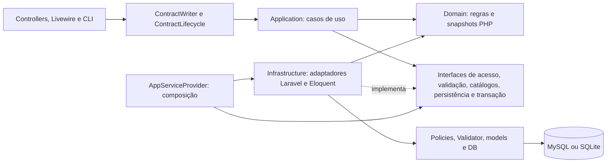

# Arquitetura do Contracts

O botão **Aditivo** emite **Prorrogação - Saldo Positivo** em Word ou PDF a partir de `resources/documents/atas/Aditivo_Prorrogacao_Saldo.docx`. A cláusula 2.1 distingue o início original, o vencimento anterior e o período prorrogado. A tabela Contínua ou Paralela contém saldos positivos registrados e omite os itens excluídos. Os valores por linha são calculados pelo preço unitário do snapshot. Quando a ATA tem quantidade especial configurada, a tabela inclui a coluna com o nome cadastrado e os valores do snapshot. A emissão reutiliza o controle de versão, autorização, revalidação e auditoria do termo de igual período e valor. A cópia de emissão usa o rodapé institucional atualizado.

Validação da redação da cláusula 2.1, da linha em branco entre 6.1 e 6.2 e da coluna opcional de quantidade especial por `php vendor/bin/phpunit --filter='AtaAmendmentWordTest|AtaWithAdmissionTest' --do-not-cache-result --colors=never` no Docker como `www-data`, com SQLite em memória (21 testes, 325 asserções). Pint dos dois arquivos PHP e `git diff --check` passaram.

Validação no Docker com SQLite em memória, como `www-data`: `php vendor/bin/phpunit --filter='AtaAmendmentWordTest|AtaWithAdmissionTest|AtaEditingTest' --do-not-cache-result --colors=never` passou (50 testes, 696 asserções), incluindo conversão real em PDF. Passaram também `composer check:architecture`, `composer check:static`, Pint nos três arquivos PHP, `npm.cmd test` (331 testes), `npm.cmd run build` e `git diff --check`. Conferência visual autenticada e gravação no banco operacional ficaram fora desta validação.

O campo **FINAL** dos aditivos aceita até o segundo aniversário da data original de início da vigência da ATA. O cálculo usa meses de calendário e ajusta a data ao último dia do mês quando necessário. O painel avisa ao sair do campo e impede o envio acima do limite. O servidor repete a verificação na gravação e exige a data inicial da ATA para calcular o limite. Validação: `php vendor/bin/phpunit --filter='AtaEditingTest|AtaLookupTest|AtaRegistrationTest|AtaTermTest' --do-not-cache-result --colors=never` no Docker com SQLite em memória (65 testes, 728 asserções), `composer check:architecture`, Pint dos quatro PHP, `npm.cmd test` (330 testes), `npm.cmd run build` e `git diff --check`.

O salvamento de **Prorrogação - Saldo Positivo** registra valor do aditivo igual a zero e mantém o total oficial da ATA nas criações e edições desse tipo. O painel mostra `0,0000` em **VL_Aditivo**; os totais por linha são informativos. **VL_Atualizado_ATA** reflete o total oficial. Validação por `php vendor/bin/phpunit --filter='AtaEditingTest|AtaRegistrationTest' --do-not-cache-result --colors=never` no Docker com SQLite em memória (51 testes, 606 asserções). Pint dos dois PHP, `npm.cmd test` (330 testes), `npm.cmd run build` e `git diff --check` passaram.

Ao refazer um aditivo de saldo positivo com um número reutilizado, o mesmo salvamento registra os saldos e as exclusões sob o ID do novo aditivo. A confirmação exibe as duas contagens devolvidas pelo servidor. A verificação de recriação passou com `php vendor/bin/phpunit --filter='test_recreating_a_positive_balance_amendment|test_positive_balance_' --do-not-cache-result --colors=never` no Docker com SQLite em memória (3 testes, 59 asserções). Também passaram `node --test tests/JavaScript/ata-save.test.mjs` (22 testes), `npm.cmd run build` e `git diff --check`.

Ao consultar uma prorrogação com saldo positivo, a lista oculta os itens cuja exclusão está gravada. Quando há saldos registrados, mostra os itens correspondentes por padrão. Em registros anteriores sem saldos, os itens elegíveis ficam com QTD em branco e o painel informa a ausência de quantidades. **Mostrar todos os produtos** reabre a lista para revisar a seleção. Na ATA 107/25, o aditivo 2 tem os itens 5 e 6 excluídos. A consulta em leitura confirmou a ausência de saldos, lançamentos de produtos, PDF assinado ou valores de saldo na auditoria desse aditivo.

Validação: `npm.cmd test` (328 testes), `npm.cmd run build`, `git diff --check` e, no Docker com SQLite em memória, `php vendor/bin/phpunit --filter='AtaRegistrationTest|AtaLookupTest' --do-not-cache-result --colors=never` (33 testes, 339 asserções).

Em **Prorrogação - Saldo Positivo**, `balance_quantities` recebe pares de ID de produto e quantidade decimal. A transação valida novos saldos contra os produtos originais ativos da ATA e rejeita quantidades acima do original, itens excluídos e IDs alheios. `tb_ADT_ATA.balance_products` guarda os saldos com a identificação, a descrição, a quantidade original e o preço de referência de cada produto. Omitir a lista em uma edição preserva os saldos dos itens incluídos. Enviar lista vazia limpa os saldos com histórico na auditoria. A consulta recarrega os snapshots por aditivo, incluindo produtos históricos, e a interface recalcula a prévia com os dados gravados. Os totais oficiais seguem as regras de lançamento anteriores.

Validação: a migration `2026_11_21_000004_add_ata_amendment_balance_products.php` foi aplicada no MySQL por `php artisan migrate --path=database/migrations/2026_11_21_000004_add_ata_amendment_balance_products.php --force` e confirmada no lote 63. `php vendor/bin/phpunit --filter='AtaEditingTest|AtaLookupTest|AtaRegistrationTest|AtaAmendmentWordTest' --do-not-cache-result --colors=never` passou em SQLite em memória (65 testes, 803 asserções). Passaram também `composer check:architecture`, `composer check:static`, Pint dos quatro arquivos PHP, `npm.cmd test` (327 testes), `npm.cmd run build` e `git diff --check`. A conferência visual autenticada ficou fora desta verificação.

Em **Prorrogação - Saldo Positivo**, `excluded_product_ids` recebe a lista de IDs selecionados na última coluna. O servidor valida os novos IDs contra os produtos originais ativos da ATA bloqueada. `ata_amendment_excluded_products` guarda ID da ATA, ID e número do aditivo, ID do produto, data da exclusão da prorrogação e um snapshot JSON de Item, Código, Ficha, Descrição, Marca, Unidade, quantidades e valores decimais. A gravação, a versão e a auditoria pertencem à mesma transação. Omitir a lista em uma edição preserva a seleção. Enviar lista vazia arquiva as marcações por exclusão lógica. O histórico dos produtos do cadastro e seus totais oficiais permanecem disponíveis. A consulta projeta os IDs ativos no aditivo correspondente, e os itens selecionados saem da prévia de valores da prorrogação.

Validação: `php artisan migrate --path=database/migrations/2026_11_21_000003_create_ata_amendment_excluded_products.php --force` aplicado no MySQL e confirmado no lote 62. Em SQLite em memória, `php vendor/bin/phpunit --filter='AtaEditingTest|AtaRegistrationTest|AtaLookupTest|AtaAmendmentWordTest' --do-not-cache-result --colors=never` passou (64 testes, 784 asserções). Passaram também `composer check:architecture`, `composer check:static`, Pint nos quatro arquivos PHP, `npm.cmd test` (326 testes), `npm.cmd run build` e `git diff --check`. Nenhum teste de escrita usou o banco operacional.

A emissão de documentos em Word ou PDF usa uma barra compartilhada no layout da suíte. Ela abre depois das validações e escolhas de formato, acompanha a requisição até receber o arquivo e fecha antes de exibir um erro. Como a emissão síncrona não publica etapas intermediárias, a barra usa animação indeterminada. Exportações em fila exibem o mesmo estilo no próprio card durante os estados pendente e em processamento. A gravação do PDF tarjado preserva seu progresso estimado.

Validação: `npm.cmd test` (320 testes), `npm.cmd run build` e `git diff --check` passaram. Verificação sintética em Chrome confirmou abertura, animação e encerramento da barra. No Docker com SQLite em memória, passaram os filtros `AtaRegistrationTest|ContractServiceOrderTest|DfdPanelTest|ReportExportTest` (35 testes, 418 asserções) e `AtaReportsTest|ReportGenerationFlowTest|ReportExportSecurityTest|DfdPdfTest|InspectorDecreeTest` (65 testes, 488 asserções) de `php vendor/bin/phpunit --do-not-cache-result --colors=never`. Conferência visual autenticada de cada tela ficou fora desta validação.

O rodapé institucional usado na ATA, no Extrato de ATA, no termo de aditivo e nos modelos de contrato exibe a arte sem a inscrição de gestão. Os dois PNGs de ATA e as imagens embutidas nos seis DOCX mantêm as dimensões originais. O Extrato de ATA e os PDFs de contrato também deixaram de sobrepor a inscrição. A administração configurada continua disponível nos campos próprios do documento.

Validação do rodapé: a comparação de pixels confirmou as duas imagens originais fora da área editada e a verificação dos arquivos DOCX confirmou que apenas a imagem do rodapé mudou em cada pacote. No Docker com SQLite em memória, `php vendor/bin/phpunit --filter='AtaAmendmentWordTest|AtaWithAdmissionTest|AtaExtractTest|SupplyContractTemplateTest|SupplyContractPdfTest' --do-not-cache-result --colors=never` passou (135 testes, 2067 asserções). Pint dos três arquivos PHP e `git diff --check` passaram.

## PDF assinado do aditivo de ATA

As rotas `/atas/{ata}/amendments/{amendment}/signed-document` usam o ID do registro ativo em `tb_ADT_ATA`. A consulta da ATA fornece a administradores o ID e as versões disponíveis por número de aditivo. O controle compartilha a prévia, marcação e progresso do PDF da ATA. O servidor exige administrador, confirma o vínculo por ATA e processo, aplica o escopo do Fundo e verifica a versão da ATA antes das mutações. A rasterização roda fora da transação e as operações de gravação revalidam identidade e integridade antes de atualizar a versão e auditar.

A migration `2026_11_21_000001_create_ata_amendment_signed_documents.php` cria o armazenamento privado do PDF original, da cópia tarjada e dos hashes. A exclusão lógica mantém as versões anteriores e os PDFs de origem continuam nos campos históricos. Downloads validam o hash e usam `private, no-store`. A interface permite salvar somente o original, retomar a revisão ou remover cada cópia separadamente.

Correção da consulta no painel de ATA. O MySQL recusou o nome automático do índice por exceder o limite de identificadores e preservou a tabela criada na primeira tentativa. A migration passou a usar um nome explícito e a retomar a criação do índice quando a tabela já existe. `php artisan migrate --path=database/migrations/2026_11_21_000001_create_ata_amendment_signed_documents.php --force` concluiu no MySQL e `migrate:status` confirmou o lote 60. A consulta de uma ATA com aditivos foi verificada em leitura pelo serviço do painel. Em SQLite em memória, `php vendor/bin/phpunit --filter='AtaSignedDocumentsTest|AtaLookupTest' --do-not-cache-result --colors=never` passou (18 testes, 257 asserções). Pint da migration e `git diff --check` passaram.

Validação no Docker com SQLite em memória. `php vendor/bin/phpunit --filter='AtaSignedDocumentsTest|AtaLookupTest|AtaEditingTest|AtaRegistrationTest' --do-not-cache-result --colors=never` passou (66 testes, 783 asserções). Passaram também `composer check:architecture`, `composer test:unit`, `composer check:static`, Pint nos sete arquivos PHP e `php artisan route:list --name=atas.amendments.signed-document`. `npm.cmd test` (317 testes), `npm.cmd run build` e `git diff --check` passaram. A suíte geral `composer check`, a conferência em navegador autenticado e a aplicação da migration no banco operacional ficaram fora desta validação.

## Emissão do termo de aditivo de ATA

A rota do termo aceita `format=pdf|docx` e mantém Word como padrão quando o parâmetro é omitido. A interface escolhe o formato antes do layout da tabela. O PDF é convertido do DOCX preenchido por LibreOffice Writer sem interface gráfica, em diretório temporário privado com perfil isolado e tempo limite. A conversão ocorre fora das transações, seguida pela mesma revalidação de fontes e permissões. A emissão do PDF registra `ata_amendment_pdf_generated` e o hash do PDF entregue. A imagem base do aplicativo inclui LibreOffice Writer e fontes Liberation. Uma implantação precisa reconstruir essa imagem antes de disponibilizar a opção PDF.

Validação: `docker compose build app` reconstruiu a imagem local e `docker compose up -d --no-deps app` atualizou o serviço. O login local respondeu HTTP 200. Na imagem nova, `php vendor/bin/phpunit --filter='AtaAmendmentWordTest|AtaWithAdmissionTest|AtaExtractTest|AtaPublicationTest' --do-not-cache-result --colors=never` passou (41 testes, 440 asserções). A suíte do aditivo foi repetida como `www-data` (5 testes, 114 asserções), com PDF real e texto verificado por `pdftotext`. Passaram também `composer check:architecture`, `composer test:unit`, `composer check:static`, Pint nos quatro arquivos PHP, `npm.cmd test` (318 testes), `npm.cmd run build` e `git diff --check`. Os testes PHP executaram em SQLite em memória. A conferência visual no navegador e a implantação externa ficaram fora desta revisão.

Os endpoints de criação e edição exigem `advantage` para **Prorrogação - Saldo Positivo** e **Prorrogação/Quantitativo - Igual Período e Valor** e aceitam **Pesquisa de Preços** ou **Declaração do Gestor**. A escolha pertence ao registro do aditivo em `tb_ADT_ATA.VANTAJOSIDADE`, entra na auditoria e volta na consulta. No documento de igual período e valor, preenche a cláusula 2.2. Aditivos anteriores com valor nulo continuam consultáveis.

Validação da extensão para Saldo Positivo: no Docker com SQLite em memória, `php vendor/bin/phpunit --filter='AtaEditingTest|AtaRegistrationTest|AtaLookupTest|AtaAmendmentWordTest' --do-not-cache-result --colors=never` passou (63 testes, 757 asserções). Pint dos dois arquivos PHP, `npm.cmd test` (321 testes), `npm.cmd run build` e `git diff --check` passaram.

A migration `2026_11_21_000002_add_ata_amendment_advantage.php` foi aplicada ao MySQL com `php artisan migrate --path=database/migrations/2026_11_21_000002_add_ata_amendment_advantage.php --force`, confirmada no lote 61. A consulta de ATA com aditivo no MySQL foi verificada em leitura. No Docker com SQLite em memória, `php vendor/bin/phpunit --filter='AtaAmendmentWordTest|AtaEditingTest|AtaLookupTest|AtaRegistrationTest' --do-not-cache-result --colors=never` passou (62 testes, 733 asserções). Passaram também `composer check:architecture`, `composer test:unit`, `composer check:static`, Pint nos sete arquivos PHP, `npm.cmd test` (318 testes), `npm.cmd run build` e `git diff --check`.

O download informa `ADT_{aditivo}_{fornecedor}_ATA_{ata}.docx` em `Content-Disposition`. O número da ATA e o fornecedor vêm do mesmo snapshot que abastece o Word. A barra do número da ATA vira hífen e o navegador preserva os acentos do fornecedor. Validação com `php vendor/bin/phpunit --filter='AtaAmendmentWordTest|AtaWithAdmissionTest|AtaExtractTest|AtaPublicationTest' --do-not-cache-result --colors=never` no Docker e SQLite em memória (40 testes, 421 asserções), `node --test tests/JavaScript/ata-extract.test.mjs` (9 testes), Pint dos quatro arquivos PHP, `npm.cmd run build` e `git diff --check`.

O botão **Aditivo** reutiliza a janela de escolha de tabela da ATA. A rota do DOCX recebe `products_layout=continuous|parallel`, com padrão Contínua quando omitido, e registra a escolha na auditoria. A ATA e o aditivo usam a mesma view de produtos e a mesma conversão de tabelas para Word. O aditivo insere as tabelas no lugar do marcador do seu modelo, com os itens ativos do aditivo e a quantidade especial quando configurada. A view compartilhada compõe o hash dos modelos para revalidação antes da entrega.

Validação no Docker com SQLite em memória e armazenamento isolado. `php vendor/bin/phpunit --filter='AtaAmendmentWordTest|AtaWithAdmissionTest|AtaExtractTest|AtaPublicationTest' --do-not-cache-result --colors=never` passou (40 testes, 404 asserções), assim como `composer check:architecture`, `composer test:unit`, `composer check:static` e Pint nos seis arquivos PHP. `npm.cmd test` (316 testes), `npm.cmd run build` e `git diff --check` passaram. A suíte geral `composer check` e a conferência visual no Word ficaram fora desta revisão.

O termo em Word usa a mesma ordem de identificação da ATA para o gestor na qualificação e na assinatura: CPF válido, Decreto Municipal com cargo informado, Matrícula Funcional ou RG. Na qualificação da pessoa jurídica, usa o CNPJ da detentora e o nome, RG e CPF do representante. Na assinatura, usa o CNPJ e o nome e CPF do representante. Para pessoa física, usa o CPF e o RG da própria detentora na qualificação e o CPF na assinatura.

Validação desta revisão no Docker com SQLite em memória: `php vendor/bin/phpunit --filter='AtaAmendmentWordTest|AtaWithAdmissionTest|AtaExtractTest|AtaPublicationTest' --do-not-cache-result --colors=never` passou (39 testes, 391 asserções), assim como `composer check:architecture`, Pint nos três arquivos PHP alterados e `git diff --check`. Conferência visual no Word ficou fora desta revisão.

`GET /atas/{ata}/amendments/{amendment}/document?version={version}` emite o DOCX privado do aditivo ativo **Prorrogação/Quantitativo - Igual Período e Valor**. `AtaAmendmentWord` usa o fluxo de emissão de ATA, que bloqueia ator e ATA, aplica a permissão de emissão e o escopo integral do Fundo, verifica a versão e consulta o aditivo por ATA normalizada, processo e número. A tabela usa os produtos ativos lançados para esse aditivo e o valor global soma os totais em decimal exato, arredondando para centavos uma vez tanto para o número quanto para o extenso.

`AtaAmendmentTemplate` preenche a cópia do modelo em `resources/documents/atas`, preserva campos de paginação e rodapé do Word e substitui `#VANTAJOSIDADE` pela escolha gravada no aditivo. CPF e RG seguem o mascaramento da emissão de ATA. A renderização ocorre fora da transação. Antes da entrega, o servidor reautoriza e confere novamente a ATA, o aditivo, seus itens, as configurações e o hash do modelo. A resposta usa `private, no-store` e depende do registro de `ata_amendment_word_generated` com a versão, o número do aditivo e os hashes do documento e do modelo.

Validação no serviço Docker `app` com SQLite em memória e storage temporário. `php vendor/bin/phpunit --filter='AtaAmendmentWordTest|AtaAmendmentDocumentTest|AtaWithAdmissionTest|AtaExtractTest|AtaPublicationTest|AtaRegistrationTest' --do-not-cache-result --colors=never` passou (63 testes, 603 asserções). Também passaram `composer check:architecture` (3 testes), `composer test:unit` (89 testes), `composer check:static` e `vendor/bin/pint --test` nos seis arquivos PHP envolvidos. Localmente, `npm.cmd test` passou (316 testes), assim como `npm.cmd run build` e `git diff --check`. A suíte geral `composer check` e o ensaio visual no Word ou em navegador autenticado ficaram fora desta verificação. Nenhum teste usou o banco operacional.

`POST /atas/{ata}/amendments` recebe a versão da ATA e os campos obrigatórios do aditivo. A prorrogação com saldo positivo registra apenas o efeito de vigência. A prorrogação com quantitativo igual copia os produtos originais ativos e calcula cada total decimal no servidor. A numeração considera os aditivos ativos. A unicidade de produtos permite que itens de aditivos excluídos compartilhem número e item com um lançamento posterior, preservando os dois históricos. O registro em `tb_ADT_ATA`, os produtos em `tb_PRODUTOS_ATA`, o novo vencimento, a versão e o evento de auditoria pertencem à mesma transação. A resposta de salvamento inclui o valor atualizado da ATA calculado na transação. O painel aplica a resposta sem reiniciar os campos, a lista de produtos ou o valor do aditivo. `PATCH /atas/{ata}/amendments/{amendment}` edita o último aditivo lançado no painel, com a mesma versão e regras de autorização. Uma edição do mesmo tipo conserva os produtos lançados e atualiza seus dados de referência; a troca de tipo aplica os efeitos do novo tipo. A base de vigência conserva o vencimento original para consulta e eventual exclusão. O relatório reflete a vigência do aditivo lançado no painel mesmo quando sua data de cadastro é anterior à de outro registro histórico.

`DELETE /atas/{ata}/amendments/{amendment}` recebe o número do aditivo e a versão da ATA. Em uma transação, o servidor bloqueia o ator e a ATA, aplica a política de edição, confirma que o aditivo é o último ativo e exclui logicamente suas representações e produtos. Os totais de consulta e relatório passam a somar os itens ativos restantes. Quando a data final gravada depende do aditivo excluído, o servidor recompõe o vencimento com o último aditivo remanescente com data ou com o período original. A exclusão, a atualização da versão e a auditoria são atômicas.

`amendment_base_products` contém os produtos de referência do painel de aditivos. A consulta autorizada sempre projeta os itens originais ativos da ATA, inclusive quando já existem aditivos. A projeção contém identificação, descrição, unidade, marca, preço unitário, quantidade e quantidade especial. A coluna de QTD Especial só aparece quando pelo menos um produto original ativo tem um valor salvo, inclusive zero. A coluna QTD mostra as quantidades originais somente com o tipo Prorrogação/Quantitativo - Igual Período e Valor e é atualizada a cada mudança de tipo, inclusive ao consultar um aditivo salvo. O VL. Total de cada item é calculado multiplicando a quantidade original pelo preço unitário com quatro casas decimais e aparece sob a mesma condição. `VL_Aditivo` mostra `amendment_base_total`, a soma desses totais, somente para esse tipo. O campo `VL_Atualizado_ATA` exibe `amendment_updated_total`, a soma decimal de quatro casas dos valores dos produtos ativos vinculados à ATA, incluindo originais e itens de aditivos, com o mesmo critério do relatório. A consulta não grava alterações.

Em Nova ATA, `end_date` exibe o término original. Para registros em que `UpdateAtaValidity` gravou o término aditivado e esse valor ainda corresponde à evidência, a consulta reconstrói o término original com `AtaTerm`, a data inicial e o período registrados na derivação. Sem período reconhecível, a projeção deixa o campo vazio. `end_date_derived` permite ao Salvar omitir essa data quando o campo não foi alterado. O relatório mantém sua regra de término aditivado.

A migration `2026_11_20_000008_add_ata_budget_date.php` acrescenta `tb_ATA.DATA_ORCAMENTO` como coluna de data anulável para preservar os registros anteriores. O cadastro exige `Data_Orçamento` em ISO e a consulta devolve `budget_date`. O Salvar do painel exige a data também ao editar. Uma requisição PATCH parcial que omite o campo preserva o valor anterior. Gravação e auditoria seguem a transação da ATA, e a exclusão lógica preserva a data.

A consulta de Nova ATA inclui `amendment_numbers`, uma lista decrescente de números distintos de aditivos ativos, e `amendments`, uma projeção dos campos do painel por número. A projeção usa o vínculo por `ID_ATA` e dá prioridade a `tb_ADT_ATA` quando número normalizado e processo identificam uma única ATA no cadastro. O campo editável **Nº Aditivo** oferece os números como sugestões e preenche os dados ao perder o foco ou ao clicar na lupa. A projeção omite PDFs e metadados privados.

## Numeração de pedidos de Autorização de Entrega

`DELETE /atas/{ata}/delivery-orders` recebe número e versão da ATA. A exclusão lógica e a auditoria são gravadas na mesma transação, sob autorização do Fundo e locks do ator e da ATA. A consulta omite pedidos removidos e o contador anual preserva os números já emitidos. A migration `2026_11_20_000007_add_ata_delivery_order_soft_deletes.php` adiciona o marcador de exclusão.

A migration `2026_11_20_000006_create_ata_delivery_orders.php` adiciona pedidos vinculados à ATA e um contador global por ano da aplicação. `POST /atas/{ata}/delivery-orders` bloqueia ator, ATA e contador nessa ordem, verifica Fundo e versão, atribui `NNN/AA` e grava contador, pedido e auditoria em uma transação. A chave de requisição permite repetir a gravação sem consumir outro número. `GET /atas/{ata}/delivery-orders/lookup` procura o número dentro da ATA aberta e reaplica a autorização. Os endpoints devolvem apenas o número e usam cache privado desabilitado.

## Bloqueio da ATA após registrar a publicação

O Salvar principal aceita `publication_date` e persiste a data em `tb_ATA.DATA_PUBLIC_INPC` junto com os demais dados, a versão e a auditoria. A consulta devolve a data, e o painel exibe o motivo do bloqueio. A política de escrita confere a data do registro sob lock depois da autorização. Com a publicação registrada, alterações de dados, participantes e produtos e a exclusão da ATA recebem HTTP 409. Os comandos de manutenção de vigência pulam essas atas. Consulta, emissão e gestão dos PDFs assinados continuam disponíveis de acordo com suas permissões. A data é informada pelo usuário e gravada pela migration aditiva `2026_11_20_000005_add_ata_publication_date.php`, sem consulta ao TCM.

## Correção do fornecedor de uma ATA salva

`PATCH /atas/{ata}` aceita `fornecedor_documento_snapshot` para substituir o fornecedor pelo cadastro autorizado correspondente ao novo CPF/CNPJ. A criação e a edição usam `AtaSupplierSnapshot` para validar e capturar os dados do catálogo no servidor. A edição confere o ator, a ATA, o escopo e a versão sob lock e grava os dados anteriores e novos na auditoria transacional. O painel só envia o documento quando ele muda, inclusive quando o registro consultado exibe um CPF mascarado.

## Tabelas Contínua e Paralela na ATA — 19/11/2026

Alinhamento das colunas: Item, Código, UND, QTD Especial (quando configurada), QTD e Marca ficam centralizados nas duas tabelas, em PDF e Word. As células usam a classe center compartilhada entre o CSS do PDF e o conversor Word. Validação desta alteração de apresentação: php vendor/bin/phpunit --filter=AtaWithAdmissionTest --do-not-cache-result --colors=never no Docker passou (12 testes, 137 asserções); php artisan view:cache e git diff --check passaram. Sem alteração de contratos internos, dados, JavaScript ou execução da suíte geral nesta correção de Blade.

Depois da escolha PDF/Word, uma segunda janela padrão oferece Contínua, Paralela e Cancelar. O bloqueio compartilhado dos dois botões ATA cobre as duas janelas. Cancelar/Esc não enviam requisição; ID/versão, ocupação e vigência pendente são conferidos após as escolhas. GET /atas/{ata}/document aceita products_layout=continuous|parallel, com continuous por padrão para preservar consumidores existentes; valor inválido retorna 422. Formato e layout são escolhas da emissão e não são persistidos na ATA.

AtaWithAdmissionPdf::generateWithLayout valida a escolha e chama o fluxo protegido generateDocument de AtaExtractPdf, com presentation.products_layout. generate conserva sua assinatura pública anterior. As opções seguem como valores locais, sem estado mutável nos serviços, e entram na auditoria da emissão em metadata.presentation. Word herda esse mesmo fluxo. Autorização, locks, fingerprints, renderização fora da transação, reautorização e auditoria inseparável da entrega permanecem compartilhados.

O mesmo Blade atende aos dois formatos. Contínua conserva a tabela anterior. Paralela reproduz a estrutura de Reference/Tabela_ATA.jpg: tabela por produto, cabeçalho cinza repetido, linha de dados sem a coluna Produto e linha inferior com DISCRIMINACAO daquele produto em colspan integral, sem substituir a descrição pelo objeto geral da ATA. Preserva Código, UND, QTD, Marca, valores e QTD Especial quando configurada. Os blocos têm espaço de 3 pt entre si. Dompdf evita dividir o bloco quando cabe na página; Word usa células mescladas, cabeçalhos cinza, parágrafos vinculados e espaçamento equivalente. Sem produtos, ambos informam Nenhum produto registrado. A escolha não altera valores, quantidades ou cadastro.

Validação Docker: php vendor/bin/phpunit --filter='AtaWithAdmissionTest|AtaExtractTest|AtaPublicationTest' --do-not-cache-result --colors=never passou (33 testes, 292 asserções, SQLite em memória e storage isolado). Inclui emissão real PDF/DOCX, ambas as tabelas, descrição escapada, separação por item, cabeçalhos, colspan, quantidade especial, ausência de produtos, opção inválida, auditoria da escolha e ausência de alterações no cadastro. composer check:architecture (3 testes, 4 asserções), composer test:unit (89 testes, 223 asserções), composer check:static e Pint dos cinco PHP alterados passaram. npm.cmd test passou (299 testes), npm.cmd run build, php artisan view:cache e git diff --check passaram.

O ensaio sintético no Chrome (node build/verify-ata-format.cjs) conferiu as duas janelas, cancelamento na segunda e requisição/download Word com products_layout=parallel. A prévia com dois objetos fictícios foi gerada por php build/preview-ata-word.php no Docker, aberta no Microsoft Word e exportada por build/check-ata-word.ps1; ambas as primeiras páginas foram inspecionadas com pdftoppm e comparadas com o exemplo fornecido. Artefatos em build/ permanecem fora do Git. Sem ensaio autenticado, migrations, alterações operacionais ou commits. composer check geral não foi repetido: a execução anterior neste atendimento já registrou falhas e timeout de 300 segundos, sem aprovação geral.

## Escolha de PDF ou Word na emissão da ATA — 19/11/2026

Os dois botões ATA abrem um dialog com as classes e o cabeçalho da janela padrão da suíte: ATA em PDF, ATA em Word e Cancelar. Esc ou Cancelar não consultam o endpoint. O diálogo compartilha o bloqueio entre os dois botões, descarta uma escolha se o ID/versão carregados mudarem e revalida ocupação e vigência pendente antes da requisição. O PDF continua abrindo em outra aba, com o download alternativo existente; Word baixa ata.docx e revoga seu URL de objeto após 60 segundos. O navegador aceita somente o MIME do formato escolhido.

GET /atas/{ata}/document mantém sua assinatura e o PDF como formato padrão. O parâmetro opcional format aceita somente pdf ou docx; outros valores retornam 422. DOCX usa Content-Type application/vnd.openxmlformats-officedocument.wordprocessingml.document e Content-Disposition attachment, mantendo private, no-store e nosniff. AtaWithAdmissionWord especializa somente a renderização e a ação de auditoria (ata_with_admission_word_generated) de AtaWithAdmissionPdf. Projeção, mascaramento, elegibilidade por adesão, autorização, locks, versão e fingerprints continuam compartilhados; a renderização fica fora da transação, com reautorização final e auditoria obrigatória antes da entrega. Não cria documentos públicos nem altera PDFs assinados salvos.

AtaWordDocument converte o HTML do mesmo AtaWithAdmissionTemplate em WordprocessingML editável, empacotado em DOCX com ZipArchive, sem biblioteca adicional ou conversão de PDF em imagem. O conversor é específico deste modelo local; não é um importador de HTML arbitrário. Reproduz A4, margens, fontes/tamanhos, negritos e sublinhados por trecho, alinhamentos, recuos, espaçamento, tabelas com cabeçalho repetido, duas colunas de assinatura e imagens institucionais. Word usa Arial e Times New Roman do modelo original; o renderizador PDF usa suas equivalentes Helvetica e Times-Roman conforme a implementação anterior. Cabeçalho e rodapé são partes próprias repetidas, com campos PAGE/NUMPAGES. Arquivo temporário privado é removido em finally; apenas os bytes são entregues. As quebras de página dependem do editor e das fontes disponíveis, sem garantia de identidade pixel a pixel com Dompdf.

Validação: npm.cmd test passou (297 testes) e npm.cmd run build passou. No Docker, php vendor/bin/phpunit --filter='AtaWithAdmissionTest|AtaExtractTest|AtaPublicationTest' --do-not-cache-result --colors=never passou (30 testes, 258 asserções, SQLite em memória/storage isolado); composer check:architecture (3 testes, 4 asserções), composer test:unit (89 testes, 223 asserções), composer check:static e Pint dos quatro PHP alterados passaram. Os testes adicionais cobrem pacote DOCX/XML, conteúdo escapado, produtos excluídos, formatação, cabeçalho/rodapé, elegibilidade, escopo/permissão, versão, alteração durante renderização e falha de auditoria. php artisan view:cache e git diff --check passaram.

Ensaio sintético no Chrome com CSS e módulos reais (node build/verify-ata-format.cjs) aprovou opções da janela, Esc, Cancelar e download Word. A prévia com dados fictícios (php build/preview-ata-word.php no Docker) foi aberta no Microsoft Word via build/check-ata-word.ps1 e exportada para PDF sem erro; primeira página, assinaturas e rodapé foram inspecionados com pdftoppm, comparando com PDF do mesmo HTML. Scripts e prévias ficam em build/, fora do Git. Sem ensaio autenticado, migrations, alterações no banco operacional ou commits.

composer check aprovou Pint (494 arquivos), mas a suíte PHP geral exibiu falhas e foi interrompida pelo timeout de 300 segundos do Composer, sem resumo final; não se declara aprovação geral. Após o ajuste final da cor do cabeçalho, Pint e php vendor/bin/phpunit --filter='AtaWithAdmissionTest' --do-not-cache-result --colors=never passaram novamente (9 testes, 103 asserções). As falhas gerais não foram investigadas ou alteradas nesta entrega.

## Arquivamento do PDF assinado da ATA

`AtaSignedDocuments` revalida administrador, acesso ao órgão, versão e existência de anexo antes e depois de preparar a cópia. A revisão manual funciona com PDFs digitais ou digitalizados. A prévia usa imagens renderizadas com Poppler. Na cópia final, Poppler renderiza cada página com 3508 pixels no lado maior, cerca de 300 dpi em A4. GD substitui os pixels marcados e FPDF gera o PDF somente com as imagens resultantes. As imagens usam compactação sem perdas por padrão e JPEG de alta qualidade quando uma página excede sua parcela do limite de tamanho. A cópia não carrega a camada de texto, anexos, formulários ou assinaturas digitais do original. É preciso marcar e conferir todas as ocorrências de CPF e RG na prévia.

O original fica byte a byte em `tb_ATA.Doc_ATA`. A cópia tarjada e os hashes SHA-256 ficam em `ata_signed_document_copies`, vinculados por `ata_id`. A gravação dos dois PDFs, a versão e a auditoria usam a mesma transação. A renderização acontece fora dela e usa arquivos temporários removidos ao fim do processamento. O download exige autenticação e acesso atual, verifica o hash e responde como anexo privado sem cache. Anexos existentes não são sobrescritos. A exclusão lógica da ata preserva os arquivos e bloqueia o download.

A migration aditiva `2026_11_20_000001_create_ata_signed_document_copies.php` cria a tabela e usa `LONGBLOB` no MySQL. O processamento usa Poppler e GD já fornecidos pela imagem Docker.

Se apenas o original estiver ativo, a consulta e a resposta de remoção indicam `can_create_redacted_copy`. Ao refazer uma cópia removida com `mode=stored`, a gravação arquiva o par anterior antes de atualizar a cópia tarjada e limpar o marcador de remoção, na mesma transação auditada. O histórico usa a data da substituição para esse arquivamento. A data da remoção individual consta na auditoria.

O envio aceita `mode=original` para guardar apenas o PDF original. A consulta indica quando a cópia pode ser criada. Nesse caso, a prévia e a gravação com `mode=stored` usam o original privado existente e revalidam versão, autorização e SHA-256. A cópia é gravada com auditoria própria, preservando os bytes do original. O fluxo padrão sem `mode` continua a gravar o par. A migration `2026_11_20_000004_allow_ata_original_without_redacted_copy.php` torna opcionais os bytes e o hash da cópia, inclusive no histórico.

`DELETE /atas/{ata}/signed-document` aceita `copy=original` ou `copy=redacted` para registrar a remoção lógica de um PDF. O parâmetro omitido mantém a remoção do par para consumidores existentes. Cada remoção incrementa a versão da ATA e grava a auditoria na mesma transação. A consulta informa os PDFs ativos, e o download revalida a disponibilidade da cópia solicitada. Um novo envio exige que o par anterior esteja removido. A transação arquiva os binários anteriores e os hashes em `ata_signed_document_history` antes de gravar o novo par. As migrations aditivas `2026_11_20_000002_add_ata_signed_document_removal_history.php` e `2026_11_20_000003_add_individual_ata_pdf_removal.php` acrescentam a tabela de histórico e os marcadores de remoção.

## Identificação do gestor na emissão de documentos da ATA

O emissor compartilhado aplica a prioridade CPF válido, Decreto Municipal com cargo informado, Matrícula Funcional e RG aos snapshots da ATA. A abertura e a assinatura usam a mesma identificação. CPF e RG seguem o mascaramento para usuários não administradores. Os campos de identificação integram a conferência de integridade antes e depois da renderização. Sem identificação elegível, os endpoints respondem HTTP 422 com o erro de validação `manager_document`, exibido na janela padrão de emissão.

## PDF da ATA com adesão — 18/11/2026

A linha de identificação do cabeçalho exibe o número da ATA, o número do processo e a paginação separada por uma barra vertical. A paginação usa a mesma linha de base do texto, logo acima do filete. O CNPJ do Fundo é apresentado em fonte regular no parágrafo de abertura.

Antes do push, os testes dirigidos de ATA com adesão, extrato e publicação passaram no Docker (27 testes, 214 asserções). Também passaram `composer check:architecture`, Pint dos sete arquivos PHP, `npm.cmd test` (291 testes), `npm.cmd run build` e `git diff --check`. A suíte PHP geral ficou fora dessa execução.

A revisão visual transpõe do DOCX os tamanhos de fonte, os negritos por trecho, os sublinhados, os recuos e as assinaturas em duas colunas. O Dompdf usa Helvetica como substituta da Arial. Os dados da ata e a paginação ficam acima do filete do cabeçalho. A posição da numeração é obtida da linha de dados renderizada em cada página, e os números são escritos em negrito após a contagem final.

Validação da revisão visual: `php vendor/bin/phpunit --filter='AtaWithAdmissionTest|AtaExtractTest|AtaPublicationTest' --do-not-cache-result --colors=never` passou no Docker (27 testes, 213 asserções), assim como `composer check:architecture`, Pint nos três arquivos PHP revisados e `git diff --check`. A prévia A4 com dados fictícios foi conferida com `pdfinfo`, `pdftotext` e `pdftoppm`, incluindo a sequência de páginas e a posição do cabeçalho. A exportação de referência pelo Microsoft Word não concluiu neste ambiente. Sem comparação pixel a pixel ou uso do banco operacional.

Os botões **ATA** do painel Nova Ata e da lista de produtos chamam `GET /atas/{ata}/document?version=...`. O modelo Blade e as imagens de cabeçalho e rodapé foram derivados de `Reference/Modelos_Doc/ATA/Modelo de ATA_Com_Adesao.docx`. A emissão exige `ADMITIR_ADESAO = SIM` no registro salvo. A cláusula 2.1 usa os produtos originais ativos com os valores na precisão exibida no painel. O nome configurado da quantidade especial aparece como coluna adicional à QTD fixa. A cláusula 3.2 usa os fundos participantes ativos e exclui o gerenciador. A cláusula 5.1 usa o texto do PNCP no modo 1 Ano INPC ou o período e as datas gravadas.

O adaptador reaproveita a autorização por ator e fundo, o controle de versão, o cache privado e a auditoria dos PDFs de ata. CPF e RG seguem o mascaramento do painel, e o contato do fornecedor exige a permissão do catálogo. A renderização ocorre fora da transação, seguida de nova conferência da autorização, dados de origem, administração e modelo antes da entrega.

Validação no Docker com SQLite em memória: `php vendor/bin/phpunit --filter='AtaWithAdmissionTest|AtaExtractTest|AtaPublicationTest' --do-not-cache-result --colors=never` passou (26 testes, 205 asserções); `composer check:architecture` (3 testes, 4 asserções), `composer test:unit` (89 testes, 223 asserções), `composer check:static` e Pint nos sete arquivos PHP passaram. `npm.cmd test` (291 testes) e `npm.cmd run build` passaram. A rota foi confirmada por `php artisan route:list --name=atas.document`, e uma prévia A4 fictícia foi conferida com `pdfinfo`, `pdftotext` e imagem da primeira página gerada por `pdftoppm`. Sem execução da suíte PHP geral, teste autenticado em navegador, migrations ou gravação no banco operacional.

## Commits e sincronização dos modelos — 18/11/2026

Os modelos `Reference/ATAS/Modelo_ATA.docx`, `Public_ATA.docx`, `Publicacao_ATA.dotx`, `Reference/Modelos_Doc/ATA/Modelo de ATA.docx` e os extratos de credenciamento PF/PJ foram incluídos no Git. Após o push, `git pull` na outra máquina transfere esses arquivos e o código versionado. Atas assinadas, fontes de importação, planilhas operacionais, capturas locais, arquivos de `build/`, banco, ambientes e documentos privados permanecem fora destes commits; a transferência dos dados operacionais continua pelo backup próprio do projeto.

Validação para o envio: `docker compose exec -T app composer check:architecture` passou (3 testes, 4 asserções); `docker compose exec -T app composer test:unit` passou (89 testes, 223 asserções); `docker compose exec -T app composer check:static` passou. `npm.cmd test` passou (291 testes), `npm.cmd run build` e `git diff --check` passaram. `docker compose exec -T app php artisan test --filter='AtaEditingTest|AtaPublicationTest|AtaExtractTest|AtaRegistrationTest|AtasOverviewTest|UpdateAtaAdmissionTest' --compact` passou (70 testes, 628 asserções). PHP usa SQLite em memória e storage/cache temporários conforme `phpunit.xml` e `tests/bootstrap.php`.

`docker compose exec -T app composer check` aprovou Pint (489 arquivos), mas apresentou falhas na suíte PHP geral; não se declara aprovação dessa suíte. A execução dirigida por `docker compose exec -T app php vendor/bin/phpunit --filter='test_contract_summary_embeds_paginated_amendments_with_actions_and_contract_scope|test_contract_information_panel_shows_saved_updated_values' --do-not-cache-result --colors=never` reproduziu as duas falhas já documentadas por ausência de “Excluir contrato” nas asserções de ordem do HTML em `ContractAmendmentsTest:96` e `ContractBrowsingTest:76` (2 testes, 6 asserções). Logs locais em `build/push-composer-check.log`, `build/push-contract-failures.log`, `build/push-ata-tests.log` e `build/push-js-tests.log`. Sem alterações ou enfraquecimento dos testes, migrations, restaurações, testes no banco operacional ou ensaio visual autenticado nesta preparação.

O `composer check` encerrou pelo timeout de 300 segundos antes do resumo final do PHPUnit, após apresentar falhas. A causa das demais falhas não foi isolada nesta preparação; os resultados aprovados acima se referem somente às verificações concluídas.

## Revisão do modelo de publicação da ATA — 18/11/2026

O arquivo atualizado em `Reference/ATAS/Public_ATA.docx` foi relido para ajustar somente a composição de `resources/views/atas/publication.blade.php`: título EXTRATO DA ATA em negrito e sublinhado, ADM e rótulos Processo/Licitação, Fornecedor, VALOR TOTAL e DATA em negrito, OBJETO em maiúsculas/negrito/sublinhado, e documento do fornecedor antes do nome, juntos no mesmo parágrafo. O nome e seu hífen permanecem em negrito, com linha vazia antes de OBJETO. Foi normalizado somente o espaço entre DA e ATA, unido no Word como DAATA. Margens, tamanho de fonte, dados salvos, total original, autorização e auditoria seguem as regras da entrega anterior.

Validação desta revisão: `docker compose exec -T app php artisan test --filter='AtaPublicationTest|AtaExtractTest' --compact` passou (21 testes, 155 asserções), incluindo o novo teste de destaques e ordem/documento único do fornecedor. As asserções anteriores de título, administração, data e valor foram ajustadas ao texto/formatação efetivamente alterados no modelo, preservando valores e verificações de segurança. `docker compose exec -T app vendor/bin/pint --test tests/Feature/AtaPublicationTest.php`, `docker compose run --rm --no-deps node npm run build` e `docker compose exec -T app php artisan view:cache` passaram. Prévia com dados fictícios por `php build/render-ata-publication-model-preview.php`, rasterização com `pdftoppm` e extração com `pdftotext`, via app, conferida visualmente em uma página A4. Testes usam SQLite em memória/storage isolado. A suíte geral `composer check` não foi repetida nesta revisão de Blade; permanecem as limitações da execução anterior documentadas abaixo. Sem ensaio autenticado, migrations ou alterações no banco operacional.

Verificações complementares desta revisão: `docker compose exec -T app composer check:architecture` passou (3 testes, 4 asserções), `docker compose exec -T app composer test:unit` passou (89 testes, 223 asserções) e `git diff --check` passou.

## Extrato de publicação da ATA — 18/11/2026

Os dois botões PUBLICAÇÃO, em Nova ATA e Produtos da ATA, usam agora `GET /atas/{ata}/publication?version=...` para emitir o modelo `Reference/ATAS/Public_ATA.docx`. A rota deixa de ser alias do EXTRATO; as rotas e a composição de EXTRATO continuam disponíveis. `AtaPublicationTemplate` renderiza `resources/views/atas/publication.blade.php`, transcrição do modelo: Fundo, administração, EXTRATO DE ATA, processo/licitação, fornecedor/documento, objeto, valor total e extenso, DATA e gestor/CPF/cargo. Preserva A4, margens do Word, texto preto, fonte de 10pt e disposição dos parágrafos; DejaVu Sans substitui Tahoma no servidor. Não acrescenta imagens, cláusula de vigência ou decreto. Administração vem das configurações e os demais dados vêm dos snapshots da ATA salva; DATA usa DATA_ATA em dd/mm/aaaa, sem usar a data de publicação ainda local da interface. Campos ausentes exibem Não informado.

O total considera somente produtos originais ativos da própria ATA (`ID_ATA`, `ADITIVO=0`, `ID_ADITIVO IS NULL`, `deleted_at IS NULL`), seguindo a consulta do editor. Não inclui aditivos nem produtos de outras atas. Soma `VL_TOTAL` em decimal exato e arredonda uma única vez para centavos (HalfUp), usando o mesmo valor para moeda e extenso. Ausência de produtos não presume valor zero; valores negativos/inválidos impedem emissão. `Domain/Shared/MoneyWords` compõe reais e centavos em PHP puro, sem floats, framework ou relógio.

`AtaPublicationPdf` especializa o fluxo de `AtaExtractPdf` por três extensões protegidas: projeção de campos, fingerprint de origem e ação de auditoria. `AtaPublicationTemplate` especializa renderização/fingerprint do template, sem duplicar autorização e entrega. Ator é bloqueado antes da ATA e produtos; exige permissão de emissão, escopo integral de Fundo e versão atual. CPF é mascarado para usuário comum. Renderiza fora da transação e reautoriza antes da entrega, verificando ATA, produtos originais ativos (IDs/valores), perfil, administração e hash do template. Inclusão, exclusão ou alteração de produto durante a renderização invalida o PDF mesmo sem mudança de versão. `ata_publication_generated` é gravado na transação final; falha da auditoria impede entrega. A resposta é PDF privado em memória, no-store/nosniff, com nome publicacao-ata-{id}.pdf; Dompdf não acessa recursos remotos nem executa PHP.

`ata-publication.js` reutiliza `initializeAtaExtract` com o argumento opcional `urlKey`, preservando consumidores existentes. Consulta somente ID/versão carregados, impede emissão durante operações e vigência pendente, descarta respostas de contexto antigo e traduz avisos para publicação. Abre o PDF em outra aba, com download publicacao-ata.pdf se bloqueada; revoga o URL de objeto após 60 segundos. Os dois botões usam os eventos de ocupação existentes do editor.

Validação: `docker compose exec -T app php artisan test --filter='AtaPublicationTest|AtaExtractTest|MoneyWordsTest' --compact` passou (21 testes, 155 asserções; SQLite em memória/storage isolado), incluindo PDF real, total exato, isolamento dos produtos originais, rejeição de negativos, mascaramento, escopos, versão, exclusão lógica, mudanças durante renderização e falha de auditoria. As primeiras execuções identificaram fixtures novas sem colunas obrigatórias; foram completadas sem alterar regras ou asserções. `node --test tests/JavaScript/ata-publication.test.mjs tests/JavaScript/ata-extract.test.mjs tests/JavaScript/ata-validity.test.mjs tests/JavaScript/ata-save.test.mjs tests/JavaScript/ata-lookup.test.mjs` passou (57 testes). Via serviço app, `composer check:architecture` (3 testes, 4 asserções), `composer test:unit` (89 testes, 223 asserções), `composer check:static` e Pint dos nove PHP envolvidos passaram. `docker compose run --rm --no-deps node npm run build` passou. Prévia sintética por `php build/render-ata-publication-model-preview.php`, `pdftoppm`, `pdftotext` e `pdfinfo` conferida visualmente: uma página A4, sem acesso a dados operacionais. Sem ensaio autenticado, migrations, alterações de dados operacionais ou commits.

Verificações complementares desta entrega: `docker compose exec -T app php artisan view:cache` e `git diff --check` passaram. A execução geral `docker compose exec -T app composer check` aprovou Pint (489 arquivos), mas apresentou falhas em componentes de contratos. A execução dirigida por `php vendor/bin/phpunit --filter='test_contract_summary_embeds_paginated_amendments_with_actions_and_contract_scope|test_contract_information_panel_shows_saved_updated_values' --do-not-cache-result --colors=never`, via app, reproduziu duas falhas (6 asserções) por ausência de “Excluir contrato” nas asserções de ordem de HTML, em ContractAmendmentsTest:96 e ContractBrowsingTest:76; esses componentes não foram alterados nesta entrega. Log local: `build/ata-publication-existing-contract-failures.log`. A execução geral começou antes da última correção da fixture nova (CNPJ_FUNDO obrigatório) e também registrou esse erro intermediário, já resolvido nos 21 testes dirigidos finais. Não se declara aprovação da suíte geral. A conferência adicional de `test_list_shows_amendment_validity_end_and_handles_missing_date|test_contract_summary_number_is_readonly_below_header` passou (2 testes, 15 asserções).

A execução geral terminou pelo timeout de 300 segundos do Composer, sem concluir PHPUnit (`build/ata-publication-composer-check.log`). As verificações dirigidas finais acima passaram após a correção das fixtures; a suíte geral permanece sem aprovação.

## Alteração de Processo com produtos originais e confirmação — 18/11/2026

O Processo só pode mudar se não houver aditivos vinculados. Produtos originais, inclusive excluídos logicamente, não impedem a troca. UpdateAta verifica vínculo por ID_ATA em tb_ADITIVOS_ATA, por número normalizado/Processo em tb_ADT_ATA e nos documentos importados sem ID_ATA, além das marcas ADITIVO/ID_ADITIVO dos produtos. Aditivos históricos excluídos continuam vinculados e impedem mudar essa identidade. Recusa responde 422 com motivo em errors.ata_process; os demais campos continuam editáveis sem trocar Processo. Outra ATA com mesmo número normalizado e Processo de destino também causa recusa explicativa para evitar identidade ambígua.

Após autorização e versão, a troca atualiza PROCESSO dos produtos da ATA, process dos rascunhos com ata_id e Processo_ATA dos seus participantes, inclusive registros já excluídos, preservando deleted_at, IDs, numeração, source_row, quantidades e valores. As linhas são bloqueadas antes da escrita. Tudo ocorre na transação da ATA e do evento ata_updated; related_process_changes registra os IDs e referências anteriores dos vínculos e o Processo novo. Falha da auditoria reverte ATA e vínculos. A alteração não migra itens de catálogo nem recalcula valores; consultas de saldo passam a usar a referência de Processo corrigida.

Na edição, Salvar exige confirmação padrão OK/Cancelar antes do PATCH. Cancelar preserva campos e não envia gravação. O handler impede cliques duplicados durante a confirmação e descarta contexto/versão alterados, informando o motivo. Criação mantém seu fluxo sem essa confirmação. Sucesso informa “Ata … alterada com sucesso.” e recarrega a projeção autorizada; validação de aditivos, duplicidade, permissão, sessão, conflito de versão, falha de comunicação e falha interna têm mensagens de retorno. Respostas de falha não causam recarga nem descartam os campos digitados. O quarto argumento opcional confirm de initializeAtaSave preserva os consumidores existentes.

Validação: `docker compose exec -T app php artisan test --filter="AtaEditingTest|AtaRegistrationTest|SaveAtaProductTest|RemoveAtaProductTest|AtaLookupTest" --compact` passou (79 testes, 699 asserções, SQLite em memória/storage temporário), cobrindo edição com produtos ativos/excluídos, preservação exata dos demais campos, exclusão de produto após a troca, participantes/rascunhos, rollback integral, vínculos normalizados de aditivos e duplicidade de destino. `node --test tests/JavaScript/ata-save.test.mjs tests/JavaScript/ata-lookup.test.mjs` passou (28 testes), incluindo confirmação, cancelamento, contexto antigo e motivos de recusa. `composer check:architecture` (3 testes, 4 asserções), `composer test:unit` (88 testes, 212 asserções), `composer check:static`, Pint dos dois PHP alterados, build via serviço node e `git diff --check` passaram; comandos PHP/Composer via serviço app. A suíte geral composer check não foi repetida devido às falhas/timeout previamente registrados. Sem ensaio autenticado, testes de concorrência MySQL, migrations, alterações de dados operacionais ou commits nesta etapa. Esta regra substitui a restrição anterior por existência de produtos.

Ficha nova após excluir ATA (18/11/2026): depois de DELETE confirmado pelo servidor, ata-deleted aborta consultas antigas e navega para o href do próprio botão Novo (data-ata-new), sem parâmetro draft. O GET cria outro token e reinicia todo o painel; não restaura o snapshot do rascunho anterior. A limpeza local antiga foi substituída pela navegação. Cancelamento, contexto alterado, conflito ou falha não emitem esse evento nem navegam. O aviso transitório de sucesso foi retirado para abrir diretamente a ficha nova.

Validação: `node --test tests/JavaScript/ata-save.test.mjs tests/JavaScript/ata-lookup.test.mjs tests/JavaScript/ata-process-fields.test.mjs` passou (43 testes). `docker compose exec -T app php artisan test --filter=new_ata_link_opens_panel_without_creating_records --compact` passou (1 teste, 29 asserções, SQLite em memória/storage temporário). Build por `docker compose run --rm --no-deps node npm run build`, `docker compose exec -T app php artisan view:cache` e `git diff --check` passaram. Sem suíte geral, ensaio autenticado, migrations ou alterações de dados operacionais nesta etapa.

Aviso ao tentar editar datas bloqueadas (18/11/2026): Data_Inicial e Data_Final têm um controle transparente sobre o campo/calendário somente enquanto o input estiver disabled. O controle impede que o clique transfira foco ao main com tabindex=-1 (borda preta nativa no card) e abre a janela padrão com “Campo bloqueado para edição”. Desbloquear a data oculta o controle e restaura edição normal. O aviso também pode ser acionado por teclado, com foco visível no próprio controle. Sem remoção global de outlines, alteração dos valores ou liberação das datas/calendários bloqueados. O estilo text-link mantém esse controle fora da coloração amarela global dos botões.

O teste HTTP de abertura também passou: `docker compose exec -T app php artisan test --filter=new_ata_link_opens_panel_without_creating_records --compact` (1 teste, 29 asserções, SQLite em memória/storage temporário). Suítes PHP gerais não repetidas nesta alteração de interface.

Validação: `node --test tests/JavaScript/ata-validity.test.mjs tests/JavaScript/ata-publication-dates.test.mjs` passou (16 testes); build por `docker compose run --rm --no-deps node npm run build`, `docker compose exec -T app php artisan view:cache` e `git diff --check` passaram. `node build/verify-ata-locked-dates.cjs` passou no Chrome headless com Blade, CSS compilado e o código real de conversão de datas de app.js em página sintética: conferiu aviso nos dois campos, calendário bloqueado, controle transparente no hover, card sem outline e edição normal ao desmarcar INPC. Sem ensaio autenticado ou alterações no banco operacional.

Negrito na confirmação de INPC (18/11/2026): `1 Ano INPC`, `Data_Inicial`, `Data_Final` e `Data de Publicação no INPC` aparecem em strong, mantendo as aspas e corrigindo Data_Incial para Data_Inicial. confirmSystemMessage aceita a opção adicional emphasize, cria elementos por DOM/textContent e continua tratando as demais mensagens como texto, sem interpretar HTML. `node --test tests/JavaScript/ata-validity.test.mjs tests/JavaScript/ata-save.test.mjs` passou (29 testes); build Docker e `git diff --check` passaram. Ensaio sintético no Chrome headless verificou os quatro strong com peso 700 e reutilização do diálogo sem negrito residual ou interpretação de HTML. Sem ensaio autenticado, suíte PHP ou alterações no banco.

Mensagem de confirmação de INPC (18/11/2026): texto atualizado conforme solicitado para `Ao marcar a opção "1 Ano INPC" a "Data_Incial" e a "Data_Final" serão preenchidas automaticamente após a inclusão da "Data de Publicação no INPC"`, preservando aspas e grafia. `node --test tests/JavaScript/ata-validity.test.mjs` passou (14 testes); `docker compose run --rm --no-deps node npm run build` e `git diff --check` passaram. Alteração somente de texto, sem suíte PHP ou alterações no banco.

## Exclusão lógica dos vínculos da ATA — 18/11/2026

RemoveAta agora marca deleted_at na ATA e nos vínculos ativos de tb_PRODUTOS_ATA (originais e aditivos), tb_FUNDOS_ATA, tb_Participantes (somente rascunhos com ata_id da ATA), tb_ADITIVOS_ATA e tb_ADT_ATA. Os produtos sem ID_ATA mas com ID_ADITIVO de aditivo vinculado também são abrangidos. A migration aditiva 2026_11_18_000001_add_soft_deletes_to_ata_amendments acrescenta deleted_at às duas tabelas de aditivos; down preserva campos e histórico. Não há remoção física, alteração de valores ou exclusão dos PDFs, rascunhos ou contador anual. Exclusões anteriores mantêm sua data original.

Ator e ATA continuam bloqueados e reautorizados antes das mutações. Os vínculos são bloqueados e atualizados na mesma transação da ATA e de ata_deleted, que registra related_deleted_ids por tabela, sem devolver esses dados na resposta HTTP. Qualquer falha da auditoria reverte todo o conjunto. tb_ADT_ATA não tem FK de ATA: o vínculo usa número normalizado e Processo, e duplicidade dessa identidade em outras ATAs impede a exclusão com 409 para não atingir registros alheios. A confirmação passa a mencionar os vínculos incluídos. Relatórios e resumo ignoram aditivos excluídos; importação de produtos, manutenção de vigência e cadastro documental preservam a marca de exclusão e não reutilizam aditivos excluídos como ativos. Esta regra substitui a exclusão somente da ATA descrita na etapa anterior.

Validação: `docker compose exec -T app php artisan test --filter="AtaEditingTest|AtaReportsTest|AtaAmendmentProductsTest|AtaAmendmentDocumentTest|RegisterAtaAmendmentsTest|ReconcileAtaProcessValidityTest|UpdateAtaValidityTest" --compact` passou (77 testes, 481 asserções, SQLite em memória e storage temporário), incluindo vínculos diretos, produtos originais/aditivos, participantes do rascunho, número normalizado, isolamento por processo, conflito de versão/identidade, PDFs preservados, exclusões anteriores e rollback integral por falha da auditoria. `composer check:architecture` (3 testes, 4 asserções), `composer test:unit` (88 testes, 212 asserções), `composer check:static`, Pint dos nove PHP desta etapa e `git diff --check` passaram. Os comandos Composer foram executados via serviço app. `node --test tests/JavaScript/ata-save.test.mjs` passou (15 testes); build por `docker compose run --rm --no-deps node npm run build` passou. A suíte geral `composer check` não foi repetida, mantendo a limitação de falhas/timeout registrada na etapa anterior; sem ensaio visual autenticado.

Aplicação local: `docker compose exec -T app php artisan migrate --path=database/migrations/2026_11_18_000001_add_soft_deletes_to_ata_amendments.php --force` concluiu somente a migration aditiva desta etapa. Não foram excluídos registros operacionais nem executados testes no banco real. A alteração atende as próximas exclusões; não faz atualização retroativa de vínculos de ATAs anteriormente excluídas. Sem commits.

## Criação, edição e exclusão no painel Nova ATA — 18/11/2026

Novo e Salvar permanecem habilitados inclusive durante operações; os handlers impedem requisições simultâneas. Excluir é habilitado somente com ATA salva/carregada. Novo continua abrindo uma ficha com outro token de rascunho. Sem ATA carregada, Salvar mantém POST /atas, validação completa, geração anual e idempotência do rascunho. Número digitado sem consulta concluída não autoriza criação nem edição: a tela orienta consultar ou usar Novo. Com ATA carregada, Salvar usa PATCH /atas/{ata}, ID persistido e versão atual, sem token de rascunho, numeração nova ou snapshots do navegador.

UpdateAta revalida/bloqueia ator antes da ATA, verifica Fundo da sessão e AtaWritePolicy do gerenciador atual antes de validar versão. Aceita somente Data_ATA, ata_process, bidding, bidding_number, admitir_adesao e os campos de AtaValidityInput. Campos omitidos são preservados; null explícito limpa somente campos anuláveis. Gerenciador permanece no fluxo próprio de substituição; fornecedor e snapshots completos, arquivos e histórico permanecem preservados. Data_Publicação continua sem persistência. Processo diferente é recusado quando há produtos (inclusive excluídos), documentos importados de aditivos ou cadastro de aditivos vinculados, pois seus saldos e identidades usam esse processo. Edições efetivas incrementam a versão e gravam ata_updated na mesma transação; sem diferenças, não há nova versão ou evento.

DELETE /atas/{ata} usa RemoveAta, com as mesmas verificações de identidade, contexto, policy e versão. A interface exige confirmação OK/Cancelar, descarta confirmações de contexto antigo e impede clique duplicado. A operação marca deleted_at e incrementa versão, com ata_deleted na mesma transação; não remove filhos, PDFs, contador ou histórico. Consulta, emissão e novas mutações recusam a ATA excluída pelas verificações existentes. Ambos os endpoints têm throttle e Cache-Control private, no-store e retornam somente id, number e version. Falhas e conflitos não retornam snapshots. Sucesso na edição recarrega a projeção autorizada; na exclusão limpa o painel. As descrições anteriores de edição indisponível são históricas.

Admitir Adesão passa a ser gravado pelo Salvar principal também na edição. O painel deixa de vincular o listener de gravação automática da seleção, evitando que sua consulta posterior descartasse outras edições pendentes. O módulo e o endpoint de atualização isolada permanecem disponíveis por compatibilidade, com os testes transacionais existentes preservados.

Validação executada: `docker compose exec -T app php artisan test --filter="AtaEditingTest|AtaRegistrationTest|AtasOverviewTest|AtaLookupTest|AtaExtractTest|UpdateAtaAdmissionTest" --compact` passou (56 testes, 510 asserções, SQLite em memória e storage temporário). O teste adicional de criação → edição → reenvio do rascunho passou por `php artisan test --filter=created_ata_is_edited_without_reissuing_number --compact` no Docker (1 teste, 10 asserções), confirmando contador inalterado, mesma ATA e um evento por mutação. `node --test` com todos os arquivos `tests/JavaScript/ata-*.test.mjs`, expandidos via Get-ChildItem, passou (129 testes). `composer check:architecture` passou (3 testes, 4 asserções), `composer test:unit` passou (88 testes, 212 asserções) e `composer check:static` passou, todos via serviço app. Build por `docker compose run --rm --no-deps node npm run build`, `php artisan view:cache` via app, Pint dos PHP alterados e `git diff --check` passaram.

`docker compose exec -T app composer check` passou no Pint (483 arquivos), mas o PHPUnit exibiu falhas e excedeu o limite de 300 segundos sem resumo final; a suíte completa não foi aprovada. As verificações dirigidas acima refletem as correções finais dos testes desta entrega. Sem ensaio visual autenticado, migrations, alterações de dados operacionais ou commits. As alterações locais anteriores foram preservadas.

## Cor das datas calculadas — 18/11/2026

Data_Inicial e Data_Final recebem texto vermelho (`#ff0000`) quando calculadas pela publicação, inclusive desabilitadas, mantendo o fundo cinza do bloqueio. O marcador local `data-auto-calculated` é removido ao limpar as datas ou carregar outra ATA; edição manual remove o destaque somente do campo editado. Sem alteração de cálculo ou persistência.

Validação: `node --test tests/JavaScript/ata-validity.test.mjs tests/JavaScript/ata-publication-dates.test.mjs` passou (16 testes); build Docker e `git diff --check` passaram. `node build/verify-ata-inpc-confirmation.cjs` passou no Chrome headless, conferindo texto vermelho e fundo cinza das duas datas calculadas/desabilitadas com os estilos compilados. Sem suíte PHP ou alterações de banco.

## Datas automáticas pela publicação — 18/11/2026

Preencher Data_Publicação calcula Data_Inicial como o próximo dia de segunda a sexta-feira, estritamente após a publicação, e Data_Final como o aniversário de um ano da data inicial. Segue o critério semanal já usado em `ata-date.js`, sem calendário de feriados. Início em 29/02 termina em 28/02 do ano seguinte, sem deslocar o aniversário por fim de semana. `ata-publication-dates.js` usa datas UTC e validação estrita, evitando dependência de horário local, datas impossíveis e anos fora de 0001–9999.

O cálculo ocorre na tela nos eventos input/change da publicação somente com 1 Ano INPC marcado; o modo INPC continua bloqueando a edição das datas geradas. Com a opção desmarcada, preencher, alterar, limpar ou invalidar a publicação preserva as datas atuais. Ativar INPC com publicação já preenchida recalcula após a confirmação existente. No modo INPC, remover ou invalidar a publicação limpa apenas datas geradas automaticamente; valores históricos ou depois editados manualmente são preservados. Trocar/limpar a ATA descarta a publicação e o estado de cálculo. A consulta de atas não recalcula nem sobrescreve snapshots. A criação continua enviando as datas pelo Salvar principal, sem persistência nova de Data_Publicação ou gravação de alterações em atas já salvas.

Validação da restrição ao modo INPC: `node --test tests/JavaScript/ata-validity.test.mjs tests/JavaScript/ata-publication-dates.test.mjs` passou (16 testes); build Docker, `node build/verify-ata-inpc-confirmation.cjs` e `git diff --check` passaram. Sem suíte PHP ou alterações de banco.

Validação: `node --test tests/JavaScript/ata-publication-dates.test.mjs tests/JavaScript/ata-validity.test.mjs tests/JavaScript/ata-date.test.mjs tests/JavaScript/ata-save.test.mjs tests/JavaScript/ata-lookup.test.mjs tests/JavaScript/ata-extract.test.mjs` passou (44 testes), cobrindo dias da semana, virada de ano, bissexto, formatos ISO/brasileiro, entradas inválidas, recálculo, limpeza e bloqueio. Build Docker, `php artisan view:cache`, `git diff --check` e `node build/verify-ata-inpc-confirmation.cjs` passaram. O ensaio em Chrome headless usou Blade/JS/CSS reais numa página sintética, incluindo publicação na sexta e início na segunda, sem banco. Sem suíte PHP ou ensaio autenticado; nenhuma alteração de dados operacionais.

## Remoção do botão de gravação isolada de vigência — 18/11/2026

O botão de gravação isolada foi removido de Nova ATA, junto com seu seletor, estilos, listener de clique, envio PATCH, mensagens de retorno e dependências de rede no módulo `ata-validity.js`. Os testes JavaScript exclusivos do fluxo removido foram retirados; os testes dos campos, confirmação, aviso e restauração permanecem. A função de inicialização agora recebe somente raiz e confirmação. A criação continua gravando a vigência pelo Salvar principal. A tela não persiste edições de vigência em atas já carregadas; o bloqueio de extrato com alterações locais pendentes continua vigente. Data_Publicação continua visível e sem persistência. O endpoint HTTP existente e seus testes transacionais foram preservados por compatibilidade, conforme as fronteiras do projeto. As descrições do botão nas seções anteriores abaixo são histórico de implementação.

Validação: os quatro arquivos dirigidos de JavaScript (`ata-validity`, `ata-save`, `ata-lookup`, `ata-extract`) passaram com 37 testes. `docker compose exec -T app php artisan test --filter=AtaRegistrationTest --compact` passou (18 testes, 148 asserções, SQLite em memória/storage temporário), incluindo a ausência do botão no HTML. Build Docker, `php artisan view:cache`, ensaio sintético no Chrome por `node build/verify-ata-inpc-confirmation.cjs` e `git diff --check` passaram. Busca em `resources` não encontrou seletor, classe, rótulo ou referência à rota do botão. Sem suíte PHP completa ou alterações de dados operacionais.

## Aviso e confirmação ao ativar INPC — 18/11/2026

Ativar 1 Ano INPC exibe, abaixo do período, “A validade da Ata de Registro de Preços será de 1 (um) ano, contado a partir do primeiro dia útil subsequente à data de divulgação no PNCP”. Havendo Data_Inicial ou Data_Final, usa `confirmSystemMessage` com OK e Cancelar e o texto solicitado: “Ao marcar a opção 1 Ano INPC a data inicial e data final serão preenchidas automaticamente após a inclusão da Data de Publicação no INPC”. Cancelar mantém datas e período e deixa a opção desmarcada. OK limpa as datas locais e bloqueia campos/calendários, inclusive em atas já salvas; a gravação continua explícita. Sem datas, aplica o modo imediatamente. Carregar uma ATA já marcada apenas mostra o estado salvo, sem apagar valores ou abrir confirmação. Respostas de confirmação antigas são descartadas após trocar/limpar a ATA. A publicação e o botão seguem sempre visíveis. O cálculo automático a partir da publicação não foi implementado nesta etapa; seu texto de confirmação foi reproduzido conforme solicitado.

Validação: `node --test tests/JavaScript/ata-validity.test.mjs tests/JavaScript/ata-save.test.mjs tests/JavaScript/ata-lookup.test.mjs tests/JavaScript/ata-extract.test.mjs` passou (40 testes); build via `docker compose run --rm --no-deps node npm run build`, `docker compose exec -T app php artisan view:cache` e `git diff --check` passaram. `node build/verify-ata-inpc-confirmation.cjs` passou no Chrome headless com Blade/JS/CSS reais em página sintética, verificando a janela padrão, ambos os botões, Cancelar, limpeza/bloqueio após OK e aviso abaixo do período. Sem suíte PHP, ensaio autenticado, migrations ou alterações de dados operacionais.

## Espaçamento da lista de participantes — 18/11/2026

O deslocamento adicional da lista usa `padding-top: 12px` no contêiner de rolagem. A tentativa por margem substituía a margem geral de 20px e interagia com o colapso da margem de 16px do parágrafo de mensagens, sem produzir o deslocamento solicitado. A solução mantém a margem existente e acrescenta 12px internos.

Validação: build via `docker compose run --rm --no-deps node npm run build` e `git diff --check` passaram. `node build/verify-ata-participant-spacing.cjs` passou no Chrome headless, usando o CSS compilado e uma estrutura sintética da lista: topo original 94px, tentativa anterior 90px e correção 106px (12px abaixo do original). Sem ensaio autenticado ou alterações de banco.

## Publicação e botão sempre visíveis — 18/11/2026

Data_Publicação e Salvar Vigência/Publicação agora permanecem visíveis desde a abertura da ficha, independentemente do modo INPC e da gravação da ATA. O botão fica desabilitado até carregar uma ATA salva e durante operações em andamento. Esta regra substitui as condições de visibilidade descritas nas etapas anteriores. A limpeza/bloqueio de Data_Inicial e Data_Final no modo INPC para atas novas permanece; a data de publicação continua sem persistência nesta etapa.

Validação: `node --test tests/JavaScript/ata-validity.test.mjs tests/JavaScript/ata-save.test.mjs tests/JavaScript/ata-lookup.test.mjs tests/JavaScript/ata-extract.test.mjs` passou (37 testes); `docker compose run --rm --no-deps node npm run build`, `docker compose exec -T app php artisan view:cache` e `git diff --check` passaram. Sem suíte PHP, ensaio visual autenticado ou alterações de banco.

## Ordem dos controles de vigência — 18/11/2026

A linha começa por Período da Vigência, com 1 Ano INPC ao lado do rótulo, seguida de Data_Inicial, Data_Final, Data_Publicação e Salvar Vigência/Publicação. O espaçamento é 24px; a linha quebra conforme a largura disponível e fica empilhada em telas de até 650px. A publicação e o botão mantêm as condições de exibição existentes. Esta ordem substitui os posicionamentos descritos nas etapas anteriores abaixo.

Validação: `node --test tests/JavaScript/ata-validity.test.mjs tests/JavaScript/ata-save.test.mjs tests/JavaScript/ata-lookup.test.mjs tests/JavaScript/ata-extract.test.mjs` (36 testes), `docker compose run --rm --no-deps node npm run build`, `docker compose exec -T app php artisan view:cache` e `git diff --check` passaram. Sem suíte PHP ou ensaio visual autenticado; sem alterações de banco.

## Modo INPC antes de salvar a ATA — 18/11/2026

Em uma ATA ainda não salva, marcar 1 Ano INPC limpa Data_Inicial e Data_Final e bloqueia as entradas e os respectivos calendários. Desmarcar libera a edição, mantendo as datas vazias. Atas já salvas preservam os valores das datas ao marcar a opção. Data_Publicação e o espaço reservado a ela aparecem somente com INPC marcado e uma ATA salva carregada. Salvar Vigência/Publicação mantém `x-show="loaded"` e passa a usar `x-cloak` para evitar exibição antes da inicialização do Alpine. A gravação inicial usa o botão Salvar da ATA; após a consulta do registro salvo, os controles de vigência ficam disponíveis. Sem alteração do payload ou persistência da data de publicação nesta etapa.

Validação: `node --test tests/JavaScript/ata-validity.test.mjs tests/JavaScript/ata-save.test.mjs tests/JavaScript/ata-lookup.test.mjs tests/JavaScript/ata-extract.test.mjs` passou (36 testes). `docker compose run --rm --no-deps node npm run build`, `docker compose exec -T app php artisan view:cache` e `git diff --check` passaram. Sem suíte PHP, ensaio visual autenticado, migrations ou alterações de dados operacionais.

## Campo visual de publicação no modo INPC — 18/11/2026

Marcar 1 Ano INPC mostra Data_Publicação entre Período da Vigência e Salvar Vigência/Publicação, deslocando o botão para a direita. Desmarcar ou editar o período para sair desse modo oculta o campo e aproxima novamente o botão. A consulta respeita o modo carregado; trocar ou limpar a ATA limpa a data de publicação local. Nesta etapa o campo é apenas visual: não integra o payload de gravação e não há persistência ou cálculo de vigência a partir da publicação. Data_Publicação e Data da ATA compartilham as regras de fonte (rótulos 12px/600, entradas 13px/400, mesma família herdada); o espaçamento entre Período da Vigência e Data_Publicação é 24px, igual ao intervalo entre as datas.

Validação: `node --test tests/JavaScript/ata-validity.test.mjs tests/JavaScript/ata-save.test.mjs tests/JavaScript/ata-lookup.test.mjs` passou (27 testes); `docker compose run --rm --no-deps node npm run build`, `docker compose exec -T app php artisan view:cache` e `git diff --check` passaram. Sem suíte PHP, ensaio visual autenticado, migrations ou alterações de dados operacionais.

Após o ajuste exclusivo de fonte e espaçamento, build pelo mesmo comando Docker e `git diff --check` passaram; sem repetição dos testes ou compilação de views, pois somente CSS foi alterado.

## Largura da vigência em Nova ATA — 18/11/2026

Data da ATA permanece no painel superior, entre Fundo Gerenciador e Admitir Adesão a ATA, após reverter o deslocamento para a linha de vigência a pedido do usuário. O mesmo input `Data_ATA` preserva consulta, obrigatoriedade, bloqueio após carregamento e gravação. O seletor 1 Ano INPC fica ao lado do rótulo Período da Vigência, separado por uma barra vertical decorativa.

O campo de texto do período compartilha a largura da linha “Período da Vigência | 1 Ano INPC”, terminando no final do texto da opção. Salvar vigência fica imediatamente ao lado do campo quando o modo INPC está desmarcado. Entre 651px e 1100px, Data_Inicial e Data_Final ocupam uma linha e o período ocupa a próxima; em telas de até 650px, os campos ficam empilhados.

A reposição de Data da ATA no painel superior foi validada por `docker compose run --rm --no-deps node npm run build`, `docker compose exec -T app php artisan view:cache` e `git diff --check`, todos aprovados. Sem novos testes ou ensaio visual autenticado nesta mudança de posição.

Validação: `docker compose run --rm --no-deps node npm run build`, `docker compose exec -T app php artisan view:cache`, `node --test tests/JavaScript/ata-validity.test.mjs tests/JavaScript/ata-save.test.mjs tests/JavaScript/ata-lookup.test.mjs` (26 testes) e `git diff --check` passaram. Sem testes novos, suíte PHP ou ensaio visual autenticado para este ajuste de CSS/Blade; sem alterações de banco.

## Restauração do período ao desmarcar INPC — 18/11/2026

Em Nova ATA, desmarcar “1 Ano INPC” restaura `validity_period` recebido na última consulta da ATA (`tb_ATA.PERIODO_ATA`), sem aproveitar edições ainda não salvas. Valor ausente e ficha nova deixam o campo vazio. Carregar outra ATA ou limpar a consulta substitui essa referência; editar diretamente o período continua desmarcando a opção e preservando o texto digitado. A gravação de vigência mantém seu fluxo existente.

Validação: `node --test tests/JavaScript/ata-validity.test.mjs tests/JavaScript/ata-extract.test.mjs tests/JavaScript/ata-save.test.mjs tests/JavaScript/ata-lookup.test.mjs` passou (33 testes); `docker compose run --rm --no-deps node npm run build` e `git diff --check` passaram. Sem suíte PHP ou ensaio visual autenticado nesta alteração de JavaScript; nenhuma migration ou alteração de dados operacionais.

## Validação e commits das melhorias de ATA — 17/11/2026

As alterações de aplicação, migrations aditivas, recursos institucionais e testes de ATA foram reunidas para envio ao Git, incluindo produtos (soma, saldo sem aditivos, modo manual, exclusão individual/em conjunto, seleção e TAB), QTD Especial, adesão, vigência e emissão de extrato. README e esta documentação acompanham a implementação. Referências locais, capturas de tela, documentos fornecidos e `build/` permanecem fora do envio; não foram incluídos bancos, credenciais, PDFs emitidos ou dados operacionais.

`node --test tests/JavaScript/*.test.mjs` passou com **261 testes**. A revisão geral identificou fixtures de navegador incompletos: o teste do modal de produtos passou a simular `$nextTick`/`$dispatch` e verificar o evento após o tick; o filtro DFD passou a simular `window.alert` e conferir o aviso e a restauração da lista quando a busca não encontra produto (comportamento já presente em HEAD); o cabeçalho passou a simular `MutationObserver` e verificar o reajuste após mudar o nome. Nenhuma alteração de produção foi necessária nesses dois componentes externos à ATA.

`docker compose exec -T app composer check` aprovou Pint geral (**480 arquivos**), mas a execução PHP foi interrompida pelo timeout padrão de **300 segundos** do Composer. Não se afirma aprovação da suíte PHP completa. A conferência dirigida dos 12 métodos de falha previamente registrados em `docs/ata-amendment-register.md` terminou com **12 testes, 119 asserções e as mesmas 12 falhas nas mesmas linhas de HTML de contratos**; não houve enfraquecimento desses testes nem mudança nesses componentes. Evidência local em `build/php-baseline-failures-before-push.log`. Testes específicos de ATA, Architecture, Unit, análise estática e build aprovados nas etapas documentadas abaixo permanecem válidos. As verificações PHP usam SQLite em memória e armazenamento temporário. `git diff --check` e `git diff --cached --check` aprovados; nenhuma operação de teste foi executada no banco real.

## Vigência editável de Nova ATA e correção do botão EXTRATO — 17/11/2026

Data_Inicial, Data_Final e Período da Vigência ocupam uma linha abaixo da grade de Processo ATA, Licitação, Nº Licit e participantes. O período é texto editável; ao lado está o checkbox 1 Ano INPC, com o title “1 (um) ano, contado a partir do primeiro dia útil subsequente à data de divulgação no PNCP”. Marcar preenche “1 Ano INPC” e desabilita os dois campos de data, preservando seus valores. Desmarcar libera as datas. Editar o período para outro texto desmarca a opção, para manter o campo editável sem conflito com o modo selecionado. Não calcula datas nem aplica índice financeiro.

Usa as colunas existentes `INICIO_ATA`, `FINAL_ATA`, `PERIODO_ATA` e a nova `VIGENCIA_ANO_INPC` boolean nullable. A migration aditiva `2026_11_17_000003_add_ata_validity_mode.php` deixa os registros anteriores null, sem inferir escolha a partir de textos legados ou alterar datas; rollback preserva a coluna. A consulta projeta start_date, end_date, validity_period e one_year_inpc. O POST de nova ATA aceita as quatro chaves opcionais e usa `AtaValidityInput`, que distingue omissão de null, valida datas ISO e sua ordem no modo manual e normaliza o texto do modo marcado. O salvamento e os snapshots de auditoria da criação incluem os valores. Atas antigas sem escolha aparecem com a opção desmarcada; no extrato, usam a composição manual com os valores disponíveis, indicando Não informado quando necessário.

Em ATA já carregada, Salvar vigência usa `PATCH /atas/{ata}/validity`. `SaveAtaValidity` bloqueia/revalida ator antes da ATA, exige Fundo corrente, `AtaWritePolicy`, versão, validação e auditoria na mesma transação. Grava somente os quatro campos de vigência, versão e timestamp. Campos omitidos preservam os anteriores e null explícito limpa o campo. Operação idêntica não cria outra versão/auditoria. Conflitos e falhas preservam os valores digitados, com aviso padrão; erro de auditoria reverte todos os campos. `ata-validity.js` controla estado, datas desabilitadas, restauração e envio; dados de vigência ainda não salvos impedem emissão de extrato. Não altera produtos, aditivos, valores financeiros, quality_issues ou a evidência documental validity_basis.

O modelo anteriormente conectado a PUBLICAÇÃO era de EXTRATO. Agora os dois botões EXTRATO usam `data-ata-extract-url` e `ata-extract.js`, com `GET /atas/{ata}/extract`, `AtaExtractPdf`, `AtaExtractTemplate` e `resources/views/atas/extract.blade.php`; os testes existentes foram renomeados e preservados. PUBLICAÇÃO perdeu a ligação com esse modelo. O endpoint anterior `/atas/{ata}/publication` continua como alias de compatibilidade do extrato, sem vínculo com o botão PUBLICAÇÃO. A auditoria passa a `ata_extract_generated`, e o arquivo é extrato-ata-{id}.pdf. As rotas de publicação de contratos permanecem inalteradas.

`Domain/Atas/AtaExtractPeriod` contém somente PHP nativo e compõe os textos solicitados: marcado usa a cláusula completa de um ano, primeiro dia útil após divulgação no PNCP e possibilidade de prorrogação; desmarcado usa o período cadastrado, “iniciando-se em” Data_Inicial e “término em” Data_Final (dd/mm/aaaa), com o mesmo encerramento sobre prorrogação e art. 84. São as regras e o texto fornecidos pelo usuário, sem derivar efeitos sobre outros cadastros. O snapshot/hash para emissão passou a incluir o modo e as datas, impedindo entrega se mudarem durante a renderização.

Validação: `php artisan test --filter='AtaExtractTest|AtaRegistrationTest|AtaExtractPeriodTest' --compact` via Docker passou (30 testes, 221 asserções); o conjunto ampliado com AtaLookupTest, renderização dos dois modos do componente e a navegação legada de PublicationTest passou (37 testes, 305 asserções). Após explicitar a composição manual para modo legado null, AtaExtractTest foi repetido e passou (10 testes, 75 asserções). `node --test tests/JavaScript/ata-validity.test.mjs tests/JavaScript/ata-extract.test.mjs tests/JavaScript/ata-save.test.mjs tests/JavaScript/ata-lookup.test.mjs` passou (30 testes). Via Docker, Pint dos 13 PHP envolvidos, `composer check:architecture` (3 testes), `composer test:unit` (88 testes), `composer check:static`, build e `php artisan view:cache` passaram. `git diff --check` aprovado. Testes usam SQLite em memória e storage/cache temporários. Sem suíte completa `composer check` ou ensaio visual autenticado no navegador.

Aplicação local: `php build/verify-ata-validity-schema.php`, `php artisan migrate --path=database/migrations/2026_11_17_000003_add_ata_validity_mode.php --force` e repetição da conferência, via Docker, preservaram por SHA-256 todos os campos anteriores das 88 atas, com o modo novo inicialmente null. Evidências em `build/ata-validity-schema-before-20261117.json` e `build/ata-validity-schema-after-20261117.json`. Não foram gravados cadastros de ensaio nem inferidas datas ou escolhas nas atas reais.

## Publicação da ATA a partir do modelo informado — 17/11/2026

Registro da implementação inicial: o usuário posteriormente corrigiu a identificação desse modelo para EXTRATO, conforme a seção acima. Os nomes de classes/arquivos/rotas de uso atual e o texto de período são os documentados na seção mais recente.

O documento `Reference/ATAS/WELLIESE DA SILVA DOS SANTOS LTDA_ATA_002-25.docx` foi analisado como modelo de PUBLICAÇÃO. A composição foi implementada em `resources/views/atas/publication.blade.php`, mantendo título de extrato da ATA, pregão, processo, objeto, contratante, contratada/documento, período, data por extenso e assinatura (gestor, CPF, decreto e cargo). Os dois PNG institucionais foram extraídos do modelo e incluídos em `resources/documents/atas/`; nenhuma informação do fornecedor ou gestor de exemplo foi copiada. Cabeçalho e contratante usam `tb_ATA.FUNDO`, snapshot do órgão gerenciador, e nunca o órgão selecionado na sessão ou parâmetros do navegador. Administração vem de `document_settings.administration_start_year/end_year`, incluindo a legenda do rodapé, cuja imagem original tem os anos antigos cobertos por área branca e texto dinâmico. A posição foi conferida em PDF rasterizado, com dados fictícios e administração 2031/2034. A data é DATA_ATA e objeto/período são os textos efetivamente cadastrados na ATA; campos ausentes exibem Não informado, sem presumir cláusulas, vigência ou dados do exemplo.

`GET /atas/{ata}/publication` exige autenticação, usuário ativo, limite de frequência e versão. `AtaPublicationPdf` bloqueia/revalida ator antes da ATA, exige `canIssueContracts()` e escopo de Fundo inteiro pela `AtaWritePolicy` (ATA sem fund_id somente para administrador). O CPF pessoal é mascarado para perfis não administradores; CNPJ continua formatado. Captura uma projeção explícita da ATA, administração, perfil e hashes de origem/modelo, renderiza com Dompdf fora da transação e reautoriza sob os mesmos locks antes da entrega. Mudanças nos campos/versão da ATA, configurações, perfil, autorização ou modelo impedem a entrega. `ata_publication_generated` registra ator, ATA/versão, administração e hashes do modelo/PDF em transação; falha de auditoria impede resposta com o PDF. Não modifica a ATA ou seus produtos. PDF é entregue em memória com private/no-store, nosniff e disposição inline, sem arquivo ou URL pública persistente. Dompdf não executa PHP nem acessa recursos remotos.

Os dois botões PUBLICAÇÃO (cabeçalho de Nova ATA e painel Produtos) usam `ata-publication.js`. É obrigatório salvar/consultar uma ATA; ID e versão vêm do contexto carregado, e cabeçalho fora do componente Alpine usa esse mesmo contexto. A emissão bloqueia operações simultâneas dos dois botões, consulta o endpoint e abre somente resposta PDF. Se a aba for bloqueada, disponibiliza o download do PDF; o URL de objeto é revogado após 60 segundos. Respostas de contexto anterior são ignoradas. Falhas de sessão, permissão, versão, rede e servidor usam a janela padrão e textos simples sem detalhes internos. ATA e EXTRATO continuam aguardando seus modelos/ações específicos.

Validação: `docker compose exec -T app php artisan test --filter='AtaPublicationTest|ata_products_panel|product_list_header' --compact` passou (9 testes, 59 asserções, SQLite em memória/storage temporário), cobrindo PDF real, dados corretos de órgão/administração, parâmetros forjados, HTML escapado, ausência de dados do exemplo, CPF mascarado, privilégios e escopos de Fundo/secretaria, convidados, versão, exclusão lógica, alterações durante renderização e falha de auditoria. `node --test tests/JavaScript/ata-publication.test.mjs` passou (6 testes), cobrindo ambos os botões, ausência de ATA, bloqueio compartilhado, erros e respostas antigas. Via Docker, Pint dos cinco PHP envolvidos, `composer check:architecture` (3 testes), `composer test:unit` (86 testes), `composer check:static`, build e `php artisan view:cache` passaram. `git diff --check` aprovado. `php build/render-ata-publication-preview.php` e `pdftoppm -f 1 -singlefile -scale-to 1400 -png build/ata-publication-preview.pdf build/ata-publication-preview` geraram prévia sintética privada, conferida visualmente, sem leitura/escrita de cadastros reais. Sem suíte completa `composer check` ou ensaio visual autenticado no navegador; nenhuma migration ou emissão sobre registros reais foi executada.

## Botões de documentos no painel de produtos da ATA — 17/11/2026

Ajuste de posição: no cabeçalho de Nova ATA, a ordem final é ATA → EXTRATO → PUBLICAÇÃO → barra cinza → Nº ATA. Campo e rótulo ficam à direita, com o mesmo espaçamento e alinhamento à direita quando a linha quebra. Verificados os mesmos dois testes de renderização, build, cache Blade e `git diff --check`, com sucesso; sem alterações de comportamento ou banco.

Na tela Nova ATA, o mesmo grupo ATA/EXTRATO/PUBLICAÇÃO também aparece ao lado de Nº ATA. Reutiliza ícones, cores, gap interno de 8px e barra `product-actions-separator`; o espaço externo de 10px é igual ao toolbar de produtos. O rótulo continua associado ao número e a linha pode quebrar em telas estreitas. O estilo azul agora cobre tanto o diálogo quanto o grupo `ata-summary-document-actions` do cabeçalho. A emissão de PUBLICAÇÃO foi implementada conforme descrito acima; ATA e EXTRATO aguardam seus modelos específicos. Para esta inclusão, repetidos com sucesso os dois testes de renderização (11 asserções), build e `view:cache` pelos mesmos comandos abaixo, além de `git diff --check`. Sem ensaio visual autenticado ou alteração de banco.

O cabeçalho de Produtos da ATA apresenta ATA, EXTRATO e PUBLICAÇÃO à esquerda de Salvar produto, em um grupo com ícones existentes (`contracts`, `document-extract` e `document-publication`). A barra cinza `product-actions-separator` e o espaçamento do toolbar separam os novos botões das operações de produtos. Usam azul Del Rey `#002395`, texto branco e hover/foco azul escuro, com escopo restrito ao diálogo da ATA. A classe `document-action` preserva a exceção à regra global de botões amarelos. O grupo acompanha os bloqueios de ATA não carregada/operação em andamento e o ciclo de TAB do painel. A etapa inicial acrescentou a apresentação dos botões; posteriormente, PUBLICAÇÃO foi vinculada ao endpoint documentado acima.

Validação: `docker compose exec -T app php artisan test --filter='ata_products_panel|product_list_header' --compact` passou (2 testes existentes, 11 asserções, SQLite em memória/storage temporário), renderizando Nova ATA e o componente de contratos. Build por `docker compose run --rm --no-deps node npm run build`, `php artisan view:cache` via Docker e `git diff --check` passaram. Sem testes novos para a alteração visual, suíte completa, ensaio visual autenticado ou alterações de banco.

## Correção da renderização de Nova ATA — 17/11/2026

O cabeçalho condicional da última coluna introduzido no ajuste dos seletores causava `ParseError` ao renderizar `components/contract-products.blade.php`, impedindo a abertura de Nova ATA. A compilação por `view:cache` da etapa anterior não havia detectado essa falha de sintaxe. O cabeçalho agora usa blocos Blade separados para o th acessível vazio da ATA e o th Ação dos contratos. O teste HTTP existente de abertura reproduziu o erro 500 antes da correção e passou após ela; passou também a conferir no DOM o texto vazio do cabeçalho correto, sem confundi-lo com o cabeçalho Ação da lista interna de consulta do catálogo. Um teste adicional renderiza o componente de contratos e verifica que seu cabeçalho continua nomeado.

Validação: `docker compose exec -T app php artisan test --filter=SaveAtaProductTest --compact` passou (25 testes, 243 asserções, SQLite em memória/storage temporário). Pint do teste, `php artisan view:clear`, `php artisan view:cache` via Docker e `git diff --check` passaram. Sem novo build, pois não houve mudança em JavaScript/CSS; sem suíte completa ou ensaio visual autenticado. Nenhuma alteração de banco.

## Seleção e exclusão de vários produtos da ATA — 17/11/2026

A última coluna do painel da ATA não exibe mais Ação; mantém um nome acessível e apresenta um checkbox por produto, com rótulo acessível contendo o Item e `tabindex=-1`, preservando o ciclo de TAB solicitado. Contratos mantêm o cabeçalho anterior. `AtaEditorQuery` acrescenta somente o ID do produto à projeção já autorizada. `ata-lookup.js` mantém a ordem dos cliques: o primeiro marcado preenche os campos, marcar outros não substitui esse item e desmarcar o primeiro promove o próximo. Cliques em outras linhas respeitam o primeiro marcado. Mudança de contexto/estado ocupado impede seleção antiga; nova consulta reconstrói os seletores desmarcados.

`Excluir` sempre usa confirmação padrão OK/Cancelar antes de enviar uma exclusão válida: uma seleção, várias seleções ou nenhuma seleção com Item/QTD nos campos. Seleções têm prioridade sobre os campos e a confirmação informa exclusão completa dos itens marcados. Sem seleção, mantém retirada parcial por Item/QTD e confirmação. Sem seleção nem Item, informa na janela padrão que não há item selecionado ou informado para exclusão. Cancelar/Escape, contexto alterado e cliques duplicados não enviam exclusões.

O DELETE existente `/atas/{ata}/products` preserva o contrato anterior e aceita alternativamente `product_ids` (1–1000 IDs inteiros distintos) com `version`. Presença de lista vazia/inválida não recai no fluxo dos campos. `RemoveAtaProduct` revalida/bloqueia ator e ATA antes de validar a seleção. Busca apenas originais ativos da ATA e seu Processo, ordena/bloqueia por ID e exige que todos os IDs estejam disponíveis. Qualquer inválido aborta o conjunto. Faz soft delete de todos os selecionados e incrementa uma vez a versão, na mesma transação da auditoria `ata_products_removed` com snapshots completos antes/depois. Falha de auditoria reverte todos os itens e versão. Quantidades e valores históricos são preservados; a consulta recarrega a lista e calcula o total dos originais ainda ativos. Não aplica efeitos a aditivos nem opera em outra ATA.

Validação: `docker compose exec -T app php artisan test --filter='RemoveAtaProductTest|AtaLookupTest' --compact` passou (19 testes, 161 asserções, SQLite em memória/storage temporário), cobrindo lote, seleção única, preservação de aditivos/histórico, lista inválida, conflito e rollback. `node --test tests/JavaScript/ata-product-delete.test.mjs tests/JavaScript/ata-lookup.test.mjs tests/JavaScript/ata-products.test.mjs` passou (46 testes), incluindo ordem de seleção, confirmação para um/vários/nenhum marcado, Cancelar e contexto antigo. Via Docker, Pint dos três PHP envolvidos, `composer check:architecture` (3 testes), `composer test:unit` (86 testes), `composer check:static`, build via serviço node e `php artisan view:cache` passaram. `git diff --check` aprovado. Sem suíte completa `composer check`, ensaio visual autenticado, migrations ou alterações diretas no banco operacional.

## Exclusão de QTD Especial — 17/11/2026

O rótulo da quantidade especial apresenta o link azul Excluir QTD, fora do ciclo de TAB. O clique usa `confirmSystemMessage`, com o nome do campo e aviso de que todos os valores especiais dos produtos dessa ATA serão apagados. OK envia `DELETE /atas/{ata}/special-quantity` (`atas.special-quantity.destroy`) com `version`; Cancelar ou Escape não enviam requisição. Trocar ATA/versão durante a confirmação impede o envio e cliques duplicados são bloqueados. Erros explicam sessão, permissão, versão e indisponibilidade em linguagem simples, sem expor detalhes internos. Após sucesso, oculta campo e coluna, limpa as células especiais, restaura a grade de dois campos e o link QTD Especial; recarrega a consulta para descartar também os valores antigos das linhas selecionáveis.

`RemoveAtaSpecialQuantity` bloqueia/revalida ator antes da ATA, exige Fundo corrente, `AtaWritePolicy`, validação e versão. Bloqueia produtos por ID crescente. Na mesma transação, limpa `tb_ATA.QTD_ESPECIAL_NOME` e `tb_PRODUTOS_ATA.QTD_ESPECIAL` dos registros vinculados por ID_ATA, incluindo aditivos e registros com soft delete, conforme a exclusão dos valores da configuração inteira. Nenhum produto, quantidade padrão, valor financeiro ou coluna é removido. A auditoria `ata_special_quantity_removed` guarda nome anterior, IDs/valores especiais anteriores e posteriores, autoria e versões; falha de auditoria reverte tanto o nome quanto todos os valores. Outras ATAs permanecem intactas. Ausência de nome e valores já limpos é idempotente, sem nova versão ou auditoria. Não há migração ou exclusão executada diretamente no banco operacional.

Validação: `docker compose exec -T app php artisan test --filter=AtaSpecialQuantityTest --compact` passou (8 testes, 103 asserções, SQLite em memória/storage temporário), cobrindo remoção de valores originais/aditivos/soft delete, preservação dos demais campos e de outra ATA, auditoria, reconfiguração sem valores antigos, idempotência, validação, conflito, permissões e rollback. `node --test tests/JavaScript/ata-special-quantity.test.mjs tests/JavaScript/ata-products.test.mjs tests/JavaScript/ata-lookup.test.mjs tests/JavaScript/ata-product-delete.test.mjs` passou (52 testes), incluindo OK/Cancelar, contexto alterado, duplicidade e mensagens de falha. Via Docker, Pint dos quatro PHP envolvidos, `composer check:architecture` (3 testes), `composer test:unit` (86 testes), `composer check:static`, build via serviço node e `php artisan view:cache` passaram. `git diff --check` aprovado. Sem suíte completa `composer check`, ensaio visual autenticado ou alterações de dados operacionais.

## Configuração e valores de QTD Especial — 17/11/2026

Após criar a QTD Especial, o link fica oculto. Consultar uma ATA que já possui o campo mantém o link oculto; limpar a consulta ou carregar uma ATA sem configuração volta a exibi-lo. A visibilidade acompanha o mesmo estado que exibe o campo e a coluna, sem alterar o banco. Verificação deste ajuste: `node --test tests/JavaScript/ata-special-quantity.test.mjs` (5 testes), build via `docker compose run --rm --no-deps node npm run build` e `git diff --check` aprovados. Sem repetição da suíte PHP ou ensaio visual autenticado, por ser alteração de visibilidade no JavaScript.

O link QTD Especial agora abre o diálogo padrão com o campo de nome QTD de ... e somente OK. O nome não é obrigatório: OK vazio, espaços ou Escape fecham sem requisição, alterações de campos, versão ou auditoria. O nome preenchido (sufixo de até 60 caracteres, aparado) configura a ATA salva por `PATCH /atas/{ata}/special-quantity`. `UpdateAtaSpecialQuantity` bloqueia/revalida ator antes da ATA, exige Fundo corrente, `AtaWritePolicy`, validação e versão; grava somente nome, versão e timestamp junto de `ata_special_quantity_updated` na mesma transação. Falha de auditoria reverte tudo. Repetir o nome ou enviar nome vazio não apaga configuração anterior nem gera auditoria. Respostas são projeções explícitas privadas; conflitos não expõem estado atual.

A migration aditiva `2026_11_17_000002_add_ata_special_quantity.php` acrescenta `tb_ATA.QTD_ESPECIAL_NOME` varchar(60) nullable e `tb_PRODUTOS_ATA.QTD_ESPECIAL` decimal(18,4) nullable, sem preencher dados históricos; down preserva dados. A consulta autorizada projeta `special_quantity_name` e `products[].special_quantity`. O painel restaura o nome como QTD de {nome}, renderizado por textContent, e os valores decimais. Sem configuração, campo e coluna ficam ocultos. A grade interna ocupa exatamente as duas colunas anteriores de QTD/VL. Unitário e distribui essa área entre três campos quando configurada. O TAB acrescenta a quantidade especial após QTD, nos dois modos, e seleção de linha restaura seu valor.

O POST de produto aceita `special_quantity` opcional/nullable e não negativa, apenas quando há nome configurado na ATA bloqueada. Valores repetidos somam no mesmo registro original por ATA/Processo/Item, com controle de precisão e overflow; omissão/null preserva valores existentes durante a soma e novos registros ficam null. Snapshots de auditoria incluem o valor. O campo adicional é **informativo nesta etapa**, pois não foi definida outra fórmula: preserva QTD × VL. Unitário, saldo e regras financeiras anteriores. Exclusão parcial continua alterando somente QTD e valor financeiro; não infere uma retirada da quantidade especial. Exclusão integral preserva seu valor histórico no registro com soft delete. Renomear o campo não altera valores existentes.

Validação: 44 testes PHP (428 asserções) de `AtaSpecialQuantityTest`, `SaveAtaProductTest`, `AtaLookupTest` e `RemoveAtaProductTest` passaram em SQLite em memória; 58 testes JavaScript dos arquivos ata-special-quantity, ata-products, ata-product-save, ata-lookup e ata-product-delete passaram. No Docker, Pint dos sete PHP envolvidos, `composer check:architecture` (3 testes), `composer test:unit` (86 testes), `composer check:static`, build via serviço node e `php artisan view:cache` passaram. Sem suíte completa `composer check` ou ensaio visual autenticado. `git diff --check` aprovado.

Aplicação local: `php build/verify-ata-special-quantity-schema.php`, `php artisan migrate --path=database/migrations/2026_11_17_000002_add_ata_special_quantity.php --force` e repetição da conferência, via Docker, confirmaram preservação por SHA-256 de todos os campos anteriores das 88 atas e 1786 produtos, incluindo históricos/aditivos. Evidências sem dados pessoais em `build/ata-special-quantity-schema-before-20261117.json` e `build/ata-special-quantity-schema-after-20261117.json`. Nenhum cadastro de ensaio foi gravado no banco operacional.

## Link QTD Especial no painel de produtos da ATA — 17/11/2026

O cabeçalho de QTD apresenta o controle visual QTD Especial ao lado do rótulo obrigatório, alinhado à borda direita do campo, sublinhado e azul `#002395`, acompanhando o azul já usado no painel. A largura mínima da coluna da ATA em desktop acomoda o rótulo e o link; o layout móvel mantém a grade existente. O controle fica fora do ciclo de TAB, conforme o padrão solicitado para os demais controles. A etapa inicial acrescentou somente a apresentação; a ação foi implementada na seção Configuração e valores de QTD Especial acima. Contratos permanecem preservados.

Ajuste visual: o controle também usa `text-link`, que já é a exceção da regra global de botões amarelos, para manter o fundo transparente no estado normal e ao passar o mouse. Build e compilação Blade repetidos com sucesso; `git diff --check` aprovado. Sem novos testes ou alterações no banco.

O atributo `title` de QTD Especial exibe ao passar o mouse: “Para adicionar uma QTD de item diferente da QTD padrão”. `php artisan view:cache` via Docker e `git diff --check` passaram; alteração somente de texto no Blade, sem novo build ou testes.

Verificação: build via `docker compose run --rm --no-deps node npm run build`, compilação Blade por `docker compose exec -T app php artisan view:cache` e `git diff --check` passaram. Sem novos testes para esta alteração visual, suíte completa ou ensaio visual autenticado; sem alterações no banco.

## Edição de adesão em atas carregadas — 17/11/2026

O seletor Admitir Adesão a ATA deixa de ser desabilitado por `loaded`; bloqueia somente durante operações em andamento. Em novos rascunhos, a escolha continua sendo gravada pelo botão Salvar. Em atas carregadas, `ata-admission.js` salva automaticamente pelo novo `PATCH /atas/{ata}/admission` (`atas.admission.update`), enviando `version` e a chave presente `admitir_adesao` (SIM, NAO ou null). Na confirmação, recarrega a projeção da ATA e mostra sucesso pela janela padrão. Falhas restauram a seleção anterior e explicam o motivo; falhas de rede pedem nova consulta, porque o resultado pode ser incerto. Respostas de uma ATA anterior não sobrescrevem outra seleção.

`Infrastructure/Atas/UpdateAtaAdmission` bloqueia e revalida ator antes da ATA, exige Fundo corrente, `AtaWritePolicy`, validação e versão atual. Atualiza somente ADMITIR_ADESAO, version e updated_at, junto com `ata_admission_updated` e snapshots antes/depois na mesma transação. Repetir a escolha atual não incrementa versão nem duplica auditoria. Falha de auditoria reverte a mudança; conflitos não expõem os dados atuais da ATA. A resposta explícita contém somente id, number, version e admitir_adesao, com `private, no-store`. A rota exige autenticação, usuário ativo e limite de frequência.

Validação: `docker compose exec -T app php artisan test --filter='UpdateAtaAdmissionTest|AtaRegistrationTest|AtaLookupTest' --compact` passou (27 testes, 235 asserções, SQLite em memória/storage temporário), cobrindo edição de ATA existente, valores SIM/NAO/null, preservação dos demais campos, validação, versão, escopos, convidados, sessão obsoleta, soft delete e rollback de auditoria. `node --test tests/JavaScript/ata-admission.test.mjs tests/JavaScript/ata-save.test.mjs tests/JavaScript/ata-lookup.test.mjs` passou (21 testes), incluindo gravação automática, rascunho sem requisição, erros e respostas antigas. No container, Pint dos quatro PHP envolvidos, `composer check:architecture` (3 testes), `composer test:unit` (86 testes), `composer check:static` e `php artisan route:list --path=admission` passaram. Build via serviço node, `php artisan view:cache` e `git diff --check` passaram. Sem suíte completa `composer check`, ensaio visual autenticado, migrations ou alterações no banco operacional.

## Admitir Adesão a ATA — 17/11/2026

Nova ATA apresenta o seletor Admitir Adesão a ATA imediatamente após Data_ATA, na mesma linha em telas largas e empilhado em telas estreitas. Exibe SIM e NÃO, com seleção inicialmente vazia. A migration aditiva `2026_11_17_000001_add_ata_admission.php` cria `tb_ATA.ADMITIR_ADESAO` como `varchar(3)` nullable, sem preencher decisões históricas. É repetível e seu rollback preserva a coluna e os valores.

O POST existente recebe a chave opcional `admitir_adesao` com `SIM`, `NAO` ou null; omissão mantém compatibilidade com consumidores anteriores e é gravada como null. `AtaRegistration` valida a escolha e grava junto à ATA e ao snapshot de auditoria `ata_created` na mesma transação, sem alterar autorização, numeração ou idempotência. A consulta por número projeta explicitamente `admitir_adesao`; a interface restaura a seleção e a limpa ao descartar a consulta. A restrição inicial de edição somente no rascunho foi substituída pela atualização específica para atas carregadas documentada acima. Nenhuma regra de adesão ou autorização é derivada deste seletor nesta etapa.

Validação: `docker compose exec -T app php artisan test --filter='AtaRegistrationTest|AtaLookupTest|AtasOverviewTest' --compact` passou (31 testes, 313 asserções, SQLite em memória/storage temporário), incluindo escolhas SIM/NAO/null, omissão, rejeição de valores inválidos, persistência/auditoria/consulta e preservação da coluna após repetição/rollback. `node --test tests/JavaScript/ata-save.test.mjs tests/JavaScript/ata-lookup.test.mjs tests/JavaScript/ata-date.test.mjs` passou (19 testes), incluindo envio e restauração da escolha. No container, `composer check:architecture` (3 testes), `composer test:unit` (86 testes), `composer check:static`, Pint dos cinco PHP envolvidos, build via serviço node e `php artisan view:cache` passaram; `git diff --check` passou. Sem suíte geral `composer check` ou ensaio visual autenticado.

Aplicação local: `php build/verify-ata-admission-schema.php` capturou a quantidade e o SHA-256 dos campos anteriores das 88 atas; `php artisan migrate --path=database/migrations/2026_11_17_000001_add_ata_admission.php --force` aplicou somente a migration nova; a repetição da conferência confirmou o mesmo hash e 88 atas preservadas, todas com o novo campo null. Comandos executados via `docker compose exec -T app`. Evidências sem dados pessoais em `build/ata-admission-schema-before-20261117.json` e `build/ata-admission-schema-after-20261117.json`. Nenhum cadastro de ensaio foi gravado no banco operacional.

## Foco inicial ao abrir Produtos da ATA — 17/11/2026

Item possui `autofocus` somente no painel da ATA. Após abrir o diálogo, o botão Produtos aguarda `$nextTick` do Alpine e emite `ata-products-opened`; o painel reaplica a tabulação do modo corrente, foca Item e seleciona seu conteúdo para digitação. Repete o comportamento a cada abertura, sem consultar o catálogo. Painel fechado, ATA ausente ou operação em andamento não recebem foco. Contratos e diálogos internos mantêm seu comportamento.

Validação: `node --test tests/JavaScript/ata-products.test.mjs tests/JavaScript/ata-lookup.test.mjs tests/JavaScript/ata-product-save.test.mjs tests/JavaScript/ata-product-delete.test.mjs` passou (50 testes), incluindo foco/seleção, reabertura, tabulação por modo e bloqueios. `docker compose run --rm --no-deps node npm run build`, `docker compose exec -T app php artisan view:cache` e `git diff --check` passaram. Sem alterações no banco, repetição da suíte PHP ou ensaio visual autenticado.

## TAB de Item para QTD no painel da ATA — 17/11/2026

Com Lançamento Manual desmarcado, TAB no Item preenchido vai diretamente para QTD, aguardando a consulta do produto; de QTD retorna a Item. Com a opção marcada, segue o ciclo Item → Código → Marca → UND → QTD → VL. Unitário → Descrição → Item, sem consultar o catálogo e pulando Disponível. Shift+TAB percorre o ciclo manual em sentido inverso. Os demais controles do painel e suas linhas salvas têm `tabindex=-1`, mantendo o uso por clique; diálogos internos de consulta e confirmação preservam sua navegação própria. Controles externos ao painel permanecem intactos. A consulta pendente não muda o foco se o usuário já saiu do Item ou trocou o contexto da ATA. Se a consulta falhar e QTD estiver indisponível, mantém o foco no Item.

Validação do ciclo fechado: os quatro arquivos JavaScript citados abaixo passaram com 49 testes, cobrindo Descrição → Item, Shift+TAB Item → Descrição, exclusão dos demais controles da sequência e preservação dos controles de diálogos internos. Build via serviço node e `git diff --check` passaram. Sem alterações de PHP ou banco e sem ensaio visual autenticado.

Validação adicional da sequência manual: os mesmos quatro arquivos de testes JavaScript abaixo passaram com 49 testes, cobrindo TAB e Shift+TAB em todos os campos e saída nativa dos extremos. Build via serviço node e `git diff --check` passaram. Sem alterações de PHP ou banco; sem ensaio visual autenticado.

Validação: `node --test tests/JavaScript/ata-products.test.mjs tests/JavaScript/ata-lookup.test.mjs tests/JavaScript/ata-product-save.test.mjs tests/JavaScript/ata-product-delete.test.mjs` passou (48 testes), incluindo consulta assíncrona, modo manual, Shift+TAB e preservação do foco. `docker compose run --rm --no-deps node npm run build` e `git diff --check` passaram. Sem alteração de PHP/banco, repetição da suíte PHP ou ensaio visual autenticado.

## Seleção de produto salvo na lista da ATA — 17/11/2026

Linhas de produtos originais renderizadas por `ata-lookup.js` podem ser selecionadas por clique, Enter ou Espaço. O evento interno `ata-product-selected` transporta a projeção já autorizada do produto e o contexto da ATA/Processo. `ata-products.js` preenche Item, Código, Marca, UND, QTD, valor unitário, total salvo e descrição sem escrever no banco. Mantém o estado de Lançamento Manual e libera QTD para informar a quantidade a retirar. O total exibido é o valor registrado, com quatro casas, preservando arredondamentos acumulados.

Fora do modo manual, consulta somente o saldo pelo endpoint existente, sem substituir os campos históricos pelo catálogo. Em modo manual não consulta o catálogo; Disponível fica vazio, pois não pode ser inferido da quantidade registrada. Se a consulta de saldo falhar, mantém os dados salvos, deixa Disponível vazio e informa a situação pela janela padrão. Seleção cancela buscas anteriores; respostas atrasadas, mudança de Item/ATA e operações em andamento não sobrescrevem o contexto atual. A seleção não transforma Salvar Produto em edição: o salvamento continua somando a quantidade informada conforme a regra vigente.

Validação: `node --test tests/JavaScript/ata-lookup.test.mjs tests/JavaScript/ata-products.test.mjs tests/JavaScript/ata-product-save.test.mjs tests/JavaScript/ata-product-delete.test.mjs` passou (46 testes), incluindo clique/teclado, valores salvos exatos, consulta separada de saldo, modo manual, falha de catálogo, concorrência de respostas e bloqueio de contexto antigo/ocupado. `docker compose run --rm --no-deps node npm run build` e `git diff --check` passaram. Sem alterações de PHP, contratos HTTP ou banco; sem repetição da suíte PHP ou ensaio visual autenticado.

## Consulta de Item sem aviso de limite atingido — 17/11/2026

Consultar um Item com saldo zerado carrega os campos normalmente, sem abrir aviso de limite atingido. Disponível continua zerado e QTD permanece editável para exclusão ou lançamento manual. O texto antigo também foi retirado do servidor: uma tentativa de salvar pelo catálogo acima do saldo usa a validação já existente de quantidade máxima, inclusive quando o limite é zero. O modo manual continua dispensando o limite do catálogo.

Validação: `node --test tests/JavaScript/ata-products.test.mjs tests/JavaScript/ata-product-save.test.mjs tests/JavaScript/ata-product-delete.test.mjs` passou (34 testes); `docker compose exec -T app php artisan test --filter=SaveAtaProductTest --compact` passou (24 testes, 239 asserções, SQLite em memória/storage temporário). No Docker, `composer check:architecture` (3 testes), `composer test:unit` (86 testes), Pint dos dois PHP envolvidos e `npm run build` via serviço node passaram. `git diff --check` passou. Sem suíte completa `composer check`, ensaio visual autenticado ou alterações no banco operacional.

## Retirada e exclusão de produtos originais da ATA — 17/11/2026

O botão Excluir do painel da ATA envia `DELETE /atas/{ata}/products` (`atas.products.destroy`) com `item`, `quantity` e `version`, somente depois da confirmação na janela padrão “Gestão Sistem informa:” com OK e Cancelar. Cancelar ou fechar com Escape não envia a requisição. O componente compartilhado mantém o comportamento anterior dos contratos.

`Infrastructure/Atas/RemoveAtaProduct` bloqueia e revalida ator antes da ATA, aplica o Fundo corrente e `AtaWritePolicy`, valida versão e quantidade decimal positiva e localiza o original ativo pelo ID da ATA, Processo persistido e Item exato, sem permitir selecionar aditivos. Item ausente ou com vários originais ativos recebe orientação de erro. A quantidade maior que a registrada é recusada, com o máximo apresentado no formato brasileiro; menor é subtraída de QTD; igual marca `deleted_at`, preservando quantidade, valor e histórico originais. Na retirada parcial, `VL_TOTAL` passa a `VL_TOTAL anterior × QTD restante ÷ QTD anterior`, truncado em quatro casas, sem alterar preço unitário ou outros snapshots. O cálculo usa strings e BCMath, preservando a proporção dos totais já acumulados e seus arredondamentos históricos. O catálogo não é alterado e seu saldo não limita retiradas.

Versão da ATA, atualização/exclusão lógica e evento `ata_product_removed` com quantidade retirada e snapshots antes/depois são persistidos na mesma transação. Falha de auditoria reverte tudo; versão antiga impede repetir a retirada. A resposta 200 usa projeção explícita (`id`, `number`, `version`, `deleted`, `quantity`, `total`) e `private, no-store`. Falhas não revelam dados atuais da ATA. A rota exige autenticação, ator ativo e limite de frequência.

QTD permanece editável após consultar um Item, inclusive quando o saldo para novos lançamentos está zerado, para permitir informar a quantidade a excluir. Como o campo é compartilhado pelas duas ações, o limite do catálogo agora é verificado ao clicar em Salvar Produto e novamente no servidor, em vez de apagar QTD ao perder foco; o modo manual continua dispensando esse limite. A confirmação captura Item, QTD, ATA e versão; uma troca de ATA/versão durante a confirmação cancela o envio. O evento `ata-saved` recarrega a lista e o total após retirada parcial ou exclusão completa. Mensagens de sucesso, validação, falta de permissão e falhas usam a janela padrão; resultado incerto pede nova consulta antes de tentar outra vez.

Validação executada: `docker compose exec -T app php artisan test --filter='RemoveAtaProductTest|SaveAtaProductTest|AtaLookupTest|AtaProductLookupTest' --compact` passou (47 testes, 417 asserções, SQLite em memória/storage temporário). A primeira execução identificou uma expectativa incorreta no novo teste de escopo: o middleware encerra a sessão sem Fundo autorizado com 401; o teste passou a verificar esse contrato HTTP e também a recusa 403 do adaptador, preservando a comprovação de ausência de mutação. Cobertura inclui quantidade menor/igual/maior, valor proporcional, saldo liberado, origem/processo, aditivos, Fundos, sessão inativa, versão antiga e rollback de auditoria.

`node --test tests/JavaScript/ata-product-delete.test.mjs tests/JavaScript/ata-product-save.test.mjs tests/JavaScript/ata-products.test.mjs tests/JavaScript/ata-lookup.test.mjs tests/JavaScript/supplier-registration.test.mjs` passou (52 testes), cobrindo confirmação real com OK/Cancelar/Escape, envio somente após OK, bloqueio de repetição, mudança de contexto, mensagens, atualização e QTD utilizável na retirada com saldo zerado. No Docker, `composer check:architecture` (3 testes), `composer test:unit` (86 testes), `composer check:static`, Pint dos quatro PHP envolvidos, `npm run build` via serviço node, `php artisan view:cache` e `php artisan route:list --path=atas --method=DELETE` passaram. `git diff --check` passou. Sem suíte completa `composer check`, ensaio visual autenticado, MySQL concorrente, migrations ou exclusões no banco operacional.

## Lançamento manual sem limite de quantidade do catálogo — 17/11/2026

Regra vigente, substituindo a revalidação de saldo manual descrita nas etapas anteriores: quando `manual = true`, `SaveAtaProduct` não consulta o catálogo e não aplica seu limite de quantidade, inclusive quando o produto existe, o saldo está zerado ou a quantidade do catálogo é inválida. O produto usa os campos informados pelo usuário. Itens repetidos na mesma ATA e Processo continuam acumulando quantidade e valor em um único original ativo. Mantêm-se a compatibilidade de unidade/preço ao acumular, quantidade positiva, limites de precisão decimal, autorização, versão e auditoria transacional. O evento `ata_product_saved` registra também o indicador `manual`, inclusive ao acumular em registro cuja origem tenha sido o catálogo.

Quando `manual = false`, a correspondência única no catálogo, os campos canônicos e o limite de saldo continuam obrigatórios. Lançamentos manuais ativos continuam compondo a soma de originais usada em futuras consultas de saldo; o resultado não fica negativo. A interface já ignorava o limite no modo manual, liberava QTD mesmo após saldo zerado e cancelava consultas pendentes ao trocar de modo; não foi necessário alterar JavaScript.

Validação: `docker compose exec -T app php artisan test --filter='SaveAtaProductTest|AtaProductLookupTest|AtaLookupTest' --compact` passou (38 testes, 340 asserções, SQLite em memória e storage temporário), incluindo lançamento manual acima do limite, acúmulo com saldo esgotado, independência de quantidade inválida/duplicidade no catálogo e preservação dos registros de outras atas. `node --test tests/JavaScript/ata-products.test.mjs tests/JavaScript/ata-product-save.test.mjs tests/JavaScript/ata-lookup.test.mjs` passou (35 testes), incluindo liberação de QTD e ausência de bloqueio no modo manual. No container, `composer check:architecture` passou (3 testes), `composer test:unit` passou (86 testes) e Pint dos dois PHP alterados passou. `git diff --check` passou. Sem build ou `composer check` completo nesta alteração exclusiva de PHP, sem ensaio visual autenticado, migrations ou gravações no banco operacional.

## Salvamento com acúmulo por Item, ATA e Processo — 17/11/2026

`SaveAtaProduct` cria um original quando não existe produto ativo do mesmo Item, ATA e Processo; caso exista, mantém o identificador e soma a quantidade solicitada e o total do novo lançamento aos valores já registrados. O novo total continua calculado no servidor, truncado nas duas a quatro casas solicitadas, e os totais dos lançamentos são somados sem recalcular ou arredondar o histórico. Unidade e preço unitário precisam coincidir com os registros ativos; divergências são recusadas com orientação específica. Código, descrição, marca, Ficha histórica e origem do registro existente são preservados durante o acúmulo. Entradas de Ficha no HTTP continuam ignoradas.

Quando há vários originais ativos históricos do mesmo Item, seus valores são consolidados no primeiro registro; os excedentes recebem exclusão lógica, mantendo seus dados. Produtos de aditivos e de outras atas não são alterados. Produtos excluídos não entram na soma; a restauração de um original excluído sem Ficha mantém o comportamento anterior, usando somente os valores do novo lançamento. O limite do catálogo continua revalidado para a quantidade adicional, considerando somente originais ativos do mesmo Item/Processo. Quantidade e total acumulados devem caber em `decimal(18,4)`.

Ator, ATA, policy, versão, catálogo, saldo, gravação e auditoria continuam protegidos pela mesma transação e ordem de locks. Uma tentativa com versão antiga não soma novamente. O evento `ata_product_saved` mantém `before`/`after` e acrescenta snapshots `consolidated_before`/`consolidated_after` dos registros históricos consolidados. Falha de auditoria reverte também o acúmulo e as exclusões lógicas. A rota e o status HTTP 201 permanecem; `total` na resposta passa a representar o total acumulado do registro salvo.

O evento `ata-saved` recarrega a ATA, a lista de produtos e o total do painel. Sucesso e falhas usam a janela padrão “Gestão Sistem informa:”. Falhas de validação explicam os campos a corrigir; sessão, permissão, conflito e indisponibilidade recebem orientação simples. Falhas de rede ou resposta inválida pedem nova consulta antes de tentar salvar, pois o resultado da gravação pode ser incerto. Detalhes de erros internos do servidor não são exibidos nesse fluxo.

Validação: `docker compose exec -T app php artisan test --filter='SaveAtaProductTest|AtaProductLookupTest|AtaLookupTest' --compact` passou (36 testes, 327 asserções, SQLite em memória e storage temporário). Cobertura inclui acúmulo exato, versão antiga, excesso de saldo, preço/unidade incompatíveis, limite decimal, consolidação histórica, projeção atualizada, preservação de aditivos/outras atas e rollback por falha de auditoria. `node --test tests/JavaScript/ata-product-save.test.mjs tests/JavaScript/ata-products.test.mjs tests/JavaScript/ata-lookup.test.mjs` passou (35 testes). No container, `composer check:architecture` passou (3 testes), `composer test:unit` passou (86 testes), `composer check:static` passou; Pint dos dois PHP alterados passou após corrigir somente o estilo do teste. `docker compose run --rm --no-deps node npm run build` e `git diff --check` passaram. Sem `composer check` completo, ensaio visual autenticado, concorrência MySQL, migrations ou gravações no banco operacional.

## Saldo de produtos originais sem quantidades de aditivos — 17/11/2026

`AtaProductAvailability` desconta do limite `tb_Produtos.QTD` apenas produtos originais ativos do mesmo Item e Processo: `ADITIVO = 0`, `ID_ADITIVO IS NULL` e `deleted_at IS NULL`. Quantidades de aditivos não consomem nem aumentam esse limite. O saldo continua compartilhado entre atas do mesmo processo, com comparação exata dos itens e cálculo decimal de quatro casas, limitado a zero. A regra vale para consulta individual, lista do catálogo e revalidação transacional ao salvar, inclusive em modo manual quando existe correspondência no catálogo. Locks, autorização, auditoria e dados históricos permanecem preservados.

Validação: `docker compose exec -T app php artisan test --filter='AtaProductLookupTest|SaveAtaProductTest' --compact` passou (26 testes, 220 asserções, SQLite em memória e storage temporário), incluindo consulta/lista sem descontar aditivos, restauração do original, gravação manual e por catálogo, recusa de excesso e preservação do aditivo. `composer check:architecture` passou (3 testes, 4 asserções), `composer test:unit` passou (86 testes, 210 asserções), executados no container; `vendor/bin/pint --test` dos três PHP alterados e `git diff --check` passaram. Consulta local somente de leitura por `php build/explain-ata107-item2.php` confirmou saldo `40000.0000` para o Item 2 da ATA 107/2025, Processo 2025007440, preservando o aditivo ativo de mesma quantidade. Sem mutações no banco operacional, migrations ou ensaio visual autenticado; sem repetição de `composer check` ou build nesta mudança exclusiva de PHP.

## Mensagens da consulta de atas — 17/11/2026

A consulta por Nº ATA não apresenta mais “Ata carregada para consulta.” após carregar os dados. Falhas aparecem na janela padrão “Gestão Sistem informa:”, com orientação simples conforme o resultado: número inválido, ata indisponível para consulta, cadastro duplicado, sessão encerrada, falta de permissão, excesso de consultas, indisponibilidade ou falha de conexão. Respostas inválidas também recebem orientação para atualizar a página. Mensagens técnicas recebidas do servidor, incluindo SQL e nomes de tabelas, não são exibidas por esse fluxo. Consultas canceladas ou substituídas não abrem avisos nem sobrescrevem a consulta atual.

Validação: `node --test tests/JavaScript/ata-lookup.test.mjs tests/JavaScript/ata-products.test.mjs tests/JavaScript/ata-product-save.test.mjs` passou (33 testes), incluindo uso da janela padrão, ausência de mensagem de sucesso, tratamento de falhas HTTP/rede/resposta inválida e descarte de erros atrasados. `docker compose run --rm --no-deps node npm run build` e `git diff --check` passaram. Sem alteração de PHP, contratos HTTP, autorização ou banco; sem ensaio visual autenticado ou repetição da suíte PHP.

## Diagnóstico completo da suíte — 14/11/2026

A suíte PHP foi executada diretamente, sem o timeout do Composer: `docker compose exec -T app php vendor/bin/phpunit --do-not-cache-result --colors=never --log-junit=build/suite-diagnosis-20261113/phpunit.xml`. O nome do diretório preserva a data usada no início da investigação. Todos os testes de banco usaram a configuração forçada de `phpunit.xml`: SQLite em memória e storage/cache temporários de `tests/bootstrap.php`. Não houve teste ou restauração no banco operacional.

| Verificação | Resultado |
| --- | --- |
| PHPUnit completo | 1.096 testes: 1.080 aprovados, 15 falhas, 1 ignorado; 10.649 asserções; 7min29,583s; 215,50 MB |
| Architecture, incluída no PHPUnit completo | 3 testes aprovados |
| Unit, incluída no PHPUnit completo | 86 testes aprovados |
| Feature, incluída no PHPUnit completo | 1.006 testes: 991 aprovados e 15 falhas |
| Concurrency | 1 ignorado: exige MySQL explicitamente descartável e isolado; não executado no banco local |
| `docker compose run --rm --no-deps node npm test` | 205 testes: 203 aprovados e 2 falhas |
| `docker compose exec -T app composer check:static` | Sem erros; análise de Domain/Application configurada no PHPStan |
| `docker compose exec -T app vendor/bin/pint --test` | 460 arquivos aprovados |
| `docker compose run --rm --no-deps node npm run build` | Aprovado |
| `powershell -NoProfile -ExecutionPolicy Bypass -File tests/Operations/test-portable-backup.ps1` | Aprovado; quatro cenários sintéticos, sem Docker/banco |
| `docker compose exec -T app python3 tests/Operations/test_backup_verification.py` | 3 testes: 1 aprovado e 2 falhas; Docker simulado |

O limite de 300 segundos pertence ao processo iniciado pelo Composer, não à utilização do sistema. A execução completa consumiu cerca de 449 segundos, portanto esse limite é insuficiente neste ambiente. O teste mais lento foi `ReportScaleTest::test_export_totals_and_rows_for_zero_one_one_hundred_and_legacy_scale` (32,166s), que valida CSV, Excel e PDF com até 2.145 contratos sintéticos. A análise de tempos não indica um único teste travado; o tempo é acumulado por toda a suíte. Para validação completa, executar PHPUnit diretamente ou configurar timeout apenas para o comando de validação, sem enfraquecer as asserções.

Foi extraído um snapshot de `HEAD` (`fa325f1`) com `git archive`, sem trocar a árvore de trabalho. Seus 86 testes unitários passaram. Os mesmos 15 testes PHP problemáticos foram reexecutados em um container separado com código do snapshot, vendor montado somente para leitura e SQLite em memória: 14 falharam também no GitHub; somente o teste de apresentação da Nova ATA passou no snapshot e falhou localmente. Não foram alterados arquivos de código ou testes para fazer a comparação.

As 15 falhas PHP, com a primeira asserção que interrompe cada teste:

| Teste e asserção | Diagnóstico | Origem confirmada |
| --- | --- | --- |
| `AtasOverviewTest::test_new_ata_products_is_disabled_until_an_ata_is_saved_or_loaded`, linha 82 | Espera “Cadastro de produtos”; o cabeçalho foi alterado por solicitação para “PRODUTOS”. As demais expectativas de posição dos controles e modo manual desse teste também precisam acompanhar o layout solicitado, preservando a validação de bloqueio antes de carregar a ata. | Alterações locais |
| `ContractAmendmentsTest::test_contract_summary_embeds_paginated_amendments_with_actions_and_contract_scope`, linha 96 | Espera “Excluir contrato” na ordem antiga da tela de detalhes; o bloco não é renderizado por `contracts/show.blade.php`. | Reproduzida em HEAD |
| `ContractAttachmentsTest::test_private_upload_download_audit_and_current_scope`, linha 59 | O upload inicial passa, mas a tela não apresenta “Instrumento assinado”. A falha ocorre antes das asserções posteriores de download e escopo desse teste. | Reproduzida em HEAD |
| `ContractBrowsingTest::test_contract_information_panel_shows_saved_updated_values`, linha 76 | Espera a sequência de detalhes/aditivos/“Excluir contrato” da apresentação anterior. | Reproduzida em HEAD |
| `ContractBrowsingTest::test_detail_renders_all_fields_masks_personal_documents_and_escapes_source_text`, linha 686 | Espera “Data inválida na origem.” no detalhamento completo que a view resumida não apresenta. | Reproduzida em HEAD |
| `ContractIssuancePermissionTest::test_user_needs_explicit_issuance_permission_for_creation_and_documents_but_can_consult`, linha 82 | As proibições iniciais sem permissão passam; após conceder permissão, espera “Exportar resumo PDF”, ausente na view atual. | Reproduzida em HEAD |
| `ContractWritingTest::test_save_confirmation_renders_with_maintenance_audit_metadata`, linha 112 | Espera “Histórico de alterações”, não renderizado na view resumida. | Reproduzida em HEAD |
| `ContractWritingTest::test_accumulated_footer_requires_a_saved_contract_and_registered_nonzero_amendment`, linha 135 | Espera HTML e `value="R$ 12.345,67"`; o input atual tem `data-money` e decimal bruto com quatro casas para formatação no navegador. | Reproduzida em HEAD |
| `ContractWritingTest::test_editor_action_toolbar_respects_persistence_and_delete_permission`, linha 426 | Espera `id="delete-contract"` na tela de detalhes; há link para esse destino no formulário, mas o destino não é renderizado na view de detalhes. | Reproduzida em HEAD |
| `ContractWritingTest::test_financial_panel_displays_readonly_totals_and_allows_creation_before_item_totals`, linha 501 | Espera texto HTML “R$ 125,00”, mas recebe `125.0000` em elemento `data-money`; o teste PHP não executa o formatador JavaScript. | Reproduzida em HEAD |
| `ContractWritingTest::test_heading_shows_generated_number_after_save_and_supplier_and_instructions_are_positioned`, linha 958 | Espera “Rua do fornecedor” no detalhamento completo que não é renderizado na view resumida. | Reproduzida em HEAD |
| `ContractWritingTest::test_create_renders_sections_and_persists_native_contract_and_audit`, linha 1025 | Espera “Histórico de alterações” após cadastrar o contrato; a view atual não renderiza esse bloco. | Reproduzida em HEAD |
| `HistoricalAmendmentImportTest::test_imported_amendment_is_visible_and_masked_but_cannot_be_edited_by_regular_users`, linha 146 | O fixture cria `VL_ADT=1234.5678`, e a lista mostra corretamente “R$ 1.234,57”; a asserção espera “R$ 999,00”, que é o acumulado do contrato do fixture, não o valor do aditivo. | Reproduzida em HEAD |
| `HistoryAndOperationsTest::test_ambiguous_history_requires_admin_review_and_never_changes_money_or_end_dates`, linha 99 | Conciliação, bloqueio de usuário comum e preservação de valor/vigência passam antes de falhar ao procurar “Texto preservado”; a view resumida não apresenta o histórico. | Reproduzida em HEAD |
| `SelectedFundTest::test_editing_a_contract_preserves_its_existing_manager`, linha 147 | O gestor histórico é encontrado; falha porque proíbe o rótulo “Gestor do Fundo”, hoje mostrado em campo somente para leitura do catálogo. A falha não demonstra substituição do gestor histórico. | Reproduzida em HEAD |

Dez falhas se concentram na divergência entre a view resumida `resources/views/contracts/show.blade.php` e as expectativas de detalhamento, documentos, histórico ou ações. O controller ainda consulta anexos, histórico e auditorias que essa view não utiliza. A correção exige confirmar o caminho funcional para essas informações: restaurar os blocos/ações necessários ou atualizar as expectativas para a navegação vigente, mantendo testes próprios de autorização, mascaramento e persistência. Não basta remover as asserções que falham. Nos testes com várias etapas, a primeira falha impede a execução das verificações posteriores.

JavaScript: a execução do snapshot completo de recursos de HEAD teve 193 testes, com 192 aprovados e uma falha. A comparação usou código e testes do mesmo commit, incluindo os arquivos de Blade e CSS lidos por alguns testes. Os resultados locais são:

| Teste | Causa e evidência | Origem |
| --- | --- | --- |
| `dfd-product-filter.test.mjs:34` | `window is not defined` ao chamar `window.alert` em `dfd-product-filter.js:180`. Em prova controlada, com `window.alert` simulado sem editar arquivos, aparece uma segunda divergência na linha 92: o código limpa `appliedQuery` quando a pesquisa não encontra produto, enquanto o teste espera manter o filtro após desmarcar a seleção. É necessário simular a API e alinhar a regra de pesquisa inexistente com o requisito. | Também falha em HEAD |
| `fund-heading.test.mjs:5` | `MutationObserver is not defined` em `fund-heading.js:16`. O teste já simula DOM, fontes e ResizeObserver, mas não o novo observador de texto. Com MutationObserver simulado por preload, as asserções existentes passam. É uma lacuna introduzida no teste pela alteração local de ajuste de fonte; isso não demonstra falha dessa API no navegador. A correção deve também testar o ajuste quando o texto muda. | Alterações locais |

Operação de backup Linux: `scripts/verify-backup.sh:20` e `:58` chamam `TarFile.extractall(..., filter='data')`. O Python 3.11.2 instalado neste container expõe a assinatura `(self, path='.', members=None, *, numeric_owner=False)`, sem `filter`. Assim, o pacote válido é recusado antes do Docker simulado, e o teste de limpeza não encontra a chamada `docker rm` porque nenhum container chegou a ser criado. As duas falhas têm essa mesma causa de compatibilidade. O terceiro teste, de rejeição de traversal, passa por retorno não zero, mas neste runtime esse resultado também pode decorrer da incompatibilidade; não prova que o arquivo malicioso foi especificamente identificado. É necessário usar um runtime com extração segura compatível e repetir os testes, preservando a proteção contra caminhos externos. O script e seus testes não têm alterações locais em relação a HEAD.

Prioridades recomendadas: primeiro reconciliar os caminhos de documentos/histórico/exclusão da tela de detalhes sem perder cobertura de segurança; depois alinhar os testes ao layout solicitado da ATA, à formatação monetária e ao fixture do aditivo; corrigir as simulações JavaScript e confirmar a regra da pesquisa DFD; ajustar o ambiente Python e a execução longa do PHPUnit. Os 10 testes de `SaveAtaProductTest` passaram na suíte completa. Nenhuma correção de código ou teste foi aplicada durante este diagnóstico.

Evidências completas em `build/suite-diagnosis-20261113/`: `phpunit.log`, `phpunit.xml`, `phpunit-baseline.log`, `phpunit-baseline.xml`, `php-failures-compared.json` e `javascript-baseline-complete.log`. A execução JavaScript local está em `build/suite-diagnosis-javascript-20261113.log`. As primeiras tentativas de baseline JS com recursos incompletos foram desconsideradas e substituídas pela comparação completa. Não houve ensaio visual autenticado, execução dos scripts de navegador dependentes de credenciais, MySQL de concorrência ou commit.

## Gravação de produtos da ATA sem ficha

Regra vigente em 15/11/2026, substituindo o fluxo por ficha descrito no histórico abaixo: o painel de produtos da ATA não possui campo Ficha, Nova Ficha, lista de fichas, coluna Ficha ou Total da Ficha. O espaço de edição ocupa a largura disponível. O componente compartilhado mantém esses recursos para contratos.

`SaveAtaProduct` não exige Ficha nem grava ou acumula valores de ficha. Novos produtos originais recebem `FICHA = null`. Entradas antigas de Ficha no HTTP são ignoradas. Desde 17/11/2026, repetir Item original na mesma ATA e Processo acumula quantidade e valor no mesmo registro; originais ativos históricos são consolidados com auditoria e exclusão lógica dos excedentes, preservando seus campos históricos. Originais excluídos sem Ficha podem ser reativados com snapshot anterior auditado. A tabela de atas mantém versão e a auditoria permanece inseparável da gravação do produto.

Continuam obrigatórios Item, UND, QTD, VL. Unitário, VL. Total calculado na tela e Descrição, com avisos na janela padrão. Código e Marca permanecem opcionais. O servidor calcula o total exato e revalida o saldo por Item/Processo em `tb_Produtos`, descontando lançamentos ativos de `tb_PRODUTOS_ATA` conforme `AtaProductAvailability`. O modo manual mantém o comportamento anterior: quando existe produto correspondente no catálogo, o limite também é revalidado no salvamento; sem correspondência, permanecem as regras de lançamento manual existentes. Após o sucesso, a lista de produtos e o total da ATA são recarregados. Consulta de Item continua somente ao perder foco com Lançamento Manual desmarcado; X e Novo Produto limpam o lançamento.

A migration `2026_11_15_000002_retire_ata_ficha_values.php` retira `tb_ValorFicha_ATA` do uso, renomeando-a para `tb_ValorFicha_ATA_historico`, sem apagar registros. A aplicação não consulta nem altera a tabela histórica. A migration é repetível e recusa sobrescrever um arquivo histórico existente caso as duas tabelas coexistam. As chaves HTTP `ficha` e `ficha_total` na resposta de gravação permanecem com `null`; `ficha_totals` na consulta permanece como lista vazia para compatibilidade. A consulta de produtos ainda preserva a projeção histórica de Ficha, sem apresentá-la na interface.

Aplicação local por `php artisan migrate --path=database/migrations/2026_11_15_000002_retire_ata_ficha_values.php --force` via Docker: tabela original ausente, tabela histórica criada com os mesmos zero registros encontrados antes, produtos preservados por conferência SHA-256. Evidência em `build/ata-ficha-retirement-verification-20261115.json`. Não foram inseridos produtos de teste no banco operacional.

Validação: `php artisan test --filter='SaveAtaProductTest|AtaFichaValuesSchemaTest|AtaLookupTest|AtaProductLookupTest|AtaReferenceImportTest|AtaAmendmentProductsTest' --compact` passou no Docker (63 testes, 374 asserções; SQLite em memória e storage temporário). O teste dirigido `AtasOverviewTest::test_new_ata_products_is_disabled_until_an_ata_is_saved_or_loaded` passou (1 teste, 27 asserções), alinhando as expectativas de título/ordem do painel e ausência de Ficha à interface solicitada, mantendo os controles de autenticação/contexto/ausência de escritas. `node --test tests/JavaScript/ata-products.test.mjs tests/JavaScript/ata-product-save.test.mjs tests/JavaScript/ata-lookup.test.mjs` passou (30 testes); `node --test tests/JavaScript/contract-product-fichas.test.mjs` passou (22 testes, regressão do componente compartilhado para contratos). `composer check:architecture` (3 testes), `composer test:unit` (86 testes), Pint dos PHP envolvidos, `php artisan view:cache`, `npm.cmd run build` e `git diff --check` passaram. Sem suíte geral `composer check`, ensaio visual autenticado ou teste concorrente MySQL. Testes do acúmulo por Ficha foram substituídos por verificações de gravação sem Ficha, isolamento por ata, total exato, preservação histórica, duplicidade e limite por Item/Processo; os testes de rollback e autorização foram mantidos.

## Gravação de produtos e totais por ficha da ATA

Histórico anterior à retirada de Ficha: as regras desta seção foram substituídas pelo fluxo sem ficha descrito acima.

### Salvar produto: campos, listas e duplicidade por ficha (15/11/2026)

Antes de enviar, a interface exige Item, UND, QTD, VL. Unitário, VL. Total e Descrição preenchidos, além da Ficha necessária ao lançamento. Qualquer campo vazio (inclusive espaços) cancela o envio e apresenta a janela padrão da suíte. Código e Marca permanecem opcionais. O servidor valida os campos de entrada e calcula o total canônico com BCMath; não aceita o total do navegador como autoridade financeira nem altera o contrato HTTP para exigir esse total calculado.

Sucesso e falha usam a janela padrão. No sucesso, o evento `ata-saved` recarrega a ata, a lista de produtos originais e a lista de fichas e valores do painel. A primeira gravação cria a linha de `tb_ValorFicha_ATA` com ATA, Processo, Ficha e VALOR; gravações seguintes somam o novo total ao valor da mesma combinação, dentro da transação da persistência e auditoria do produto. A projeção de valores por ficha usa strings decimais com quatro casas.

É proibido repetir Item ativo na mesma Ficha, ATA e Processo; o mesmo Item pode ser distribuído em fichas diferentes, respeitando o saldo compartilhado por Item e Processo. Item/Processo/Ficha são comparados sem espaços externos; zeros à esquerda permanecem significativos. Originais excluídos da mesma ficha podem ser reativados com snapshot anterior auditado, e um original legado excluído sem Ficha pode ser reaproveitado, preservando o histórico na auditoria. Aditivos não são reativados nem alterados nessa operação.

A migration `2026_11_15_000001_scope_ata_product_uniqueness_to_ficha.php` substitui a unicidade anterior por ata/aditivo/item pela unicidade por ata/aditivo/item/ficha. Acrescenta a coluna gerada `ficha_identity = COALESCE(FICHA, '')`, mantendo a proteção dos registros legados sem Ficha. Instala o índice novo antes de retirar o anterior, preservando o índice necessário à FK e a unicidade específica de produtos de aditivos. Pode ser retomada após interrupção de DDL e não possui rollback destrutivo. Aplicada no MySQL local apenas por esse arquivo: os 1.786 registros e todos os campos originais mantiveram o mesmo SHA-256 antes/depois, conforme `build/ata-product-ficha-migration-verification-20261115.json`.

Validação executada: `php artisan test --filter='SaveAtaProductTest|AtaLookupTest|AtaProductLookupTest|AtaReferenceImportTest|AtaAmendmentProductsTest' --compact` no Docker passou (60 testes, 368 asserções, SQLite em memória/storage temporário); `node --test tests/JavaScript/ata-products.test.mjs tests/JavaScript/ata-product-save.test.mjs tests/JavaScript/ata-lookup.test.mjs` passou (31 testes); `composer check:architecture` passou (3 testes); `composer test:unit` passou (86 testes); Pint dos cinco PHP envolvidos, `php artisan view:cache`, `npm.cmd run build` e `git diff --check` passaram. O teste de clonagem de produto do importador passou a omitir a coluna gerada no INSERT, preservando suas asserções. A primeira verificação de valores de ficha identificou a perda das casas finais no SQLite; corrigida a normalização decimal na projeção. Sem suíte geral `composer check`, ensaio visual autenticado ou teste concorrente MySQL; os testes não usaram o banco operacional. Não foram inseridos produtos de ensaio no ambiente local.

### Limite de quantidade por Item e Processo (15/11/2026)

`AtaProductAvailability` calcula Disponível como `tb_Produtos.QTD` menos a soma exata de `tb_PRODUTOS_ATA.QTD` dos registros ativos com o mesmo Item e Processo (TRIM, preservando zeros à esquerda). Desde 17/11/2026, a soma considera apenas produtos originais (`ADITIVO = 0` e `ID_ADITIVO IS NULL`) de todas as atas desse processo; aditivos e registros com `deleted_at` preenchido não consomem saldo. O resultado mínimo é zero, inclusive quando o histórico já excede o limite. Não altera o limite do catálogo nem valores financeiros ou vigências de aditivos. A consulta individual e o seletor do catálogo retornam esse saldo sem expor os registros usados na soma.

Ao consultar um item sem saldo, o painel mostra Disponível e QTD zerados, bloqueia QTD e alerta que o produto já atingiu o limite para a ATA. A consulta continua ocorrendo somente ao perder foco, com Lançamento Manual desmarcado. No salvamento, inclusive manual quando houver correspondência no catálogo, o servidor recalcula o saldo e recusa excedentes. Sem correspondência no catálogo, o cadastro manual mantém as regras existentes. O lock do ator precede o da ata; o registro do catálogo é bloqueado antes da leitura bloqueante dos lançamentos, serializando os salvamentos desse produto por esta rotina entre atas distintas. Persistência, versão, ficha e auditoria continuam na mesma transação. A duplicidade é recusada por Item e Ficha dentro da mesma ATA e Processo, conforme a regra de 15/11/2026 abaixo.

Validação: `php artisan test --filter='AtaProductLookupTest|SaveAtaProductTest' --compact` no Docker passou (21 testes, 171 asserções; SQLite em memória); `node --test tests/JavaScript/ata-products.test.mjs tests/JavaScript/ata-product-save.test.mjs` passou (25 testes); `composer check:architecture` passou (3 testes); `composer test:unit` passou (86 testes); Pint dos cinco PHP envolvidos, `npm.cmd run build` e `git diff --check` passaram. A primeira execução dos novos testes revelou um fixture sem CNPJ_FUNDO obrigatório e uma comparação de texto cru contra JSON com Unicode escapado; corrigidos o fixture e a asserção para o campo JSON, mantendo a verificação da mensagem. Sem suíte geral `composer check`, ensaio visual autenticado ou teste concorrente em MySQL; sem migrations ou escrita no banco operacional.

`POST /atas/{ata}/products` (`atas.products.store`) usa `Infrastructure/Atas/SaveAtaProduct`. Dentro de uma transação, bloqueia/revalida primeiro o ator e depois a ata ativa, verifica acesso ao Fundo atual da sessão e policy de escrita da ata, valida campos e versão, grava o produto original, cria ou acumula a ficha e registra auditoria inseparável. A versão da ata aumenta uma vez. Não retorna snapshots ou modelos internos. Versão antiga retorna 409 sem dados atuais, e repetição de Item ativo na mesma Ficha é recusada sem duplicar valores. Item original excluído logicamente pode ser reativado com seu estado anterior integralmente auditado; aditivos permanecem intactos.

Ficha, Item, UND, QTD, VL. Unitário e Descrição são obrigatórios. Código e Marca são opcionais tanto no lançamento manual quanto na consulta do catálogo; Código admite omissão, nulo ou vazio. QTD deve ser positiva; preços não podem ser negativos. Decimais usam strings e BCMath, com limite de decimal(18,4). O servidor calcula QTD × preço e trunca para as duas a quatro casas solicitadas; ignora totais e identificações da ata/processo enviados pelo cliente. Fora do modo manual, consulta novamente o catálogo pelo processo persistido e Item, exige correspondência única e usa os campos canônicos. Quando existe correspondência no catálogo, recusa QTD superior ao saldo restante por Item e Processo. O catálogo não é debitado nesta operação.

A migration aditiva `2026_11_13_000004_add_native_ata_product_fields.php` acrescenta `COD_PROD` e `FICHA` opcionais a `tb_PRODUTOS_ATA`, preservando registros históricos. A ficha é identificada por `ATA`, `Processo` e `Ficha` em `tb_ValorFicha_ATA`: primeira gravação cria a linha; produtos posteriores somam `VL_TOTAL` ao `VALOR` existente. O lock da ata serializa essa operação, inclusive a criação da primeira ficha; duplicidades históricas de ficha ou identificação de ata/processo são recusadas para evitar atualização ambígua entre Fundos. Na leitura, fichas com identificação ambígua não são expostas.

A interface mantém a Ficha digitada, bloqueia cliques concorrentes, apresenta erros na janela padrão e recarrega a ata após o sucesso, atualizando produtos, códigos, fichas, totais, versão e quadro por ficha. As consultas de produtos originais continuam excluindo os aditivos. O botão de Salvar produto fica disponível somente para ata carregada e fora de operações pendentes; o servidor reautoriza toda gravação.

Validação específica executada: `SaveAtaProductTest` passou (10 testes, 88 asserções, SQLite em memória e storage temporário); `AtaLookupTest` e `AtaProductLookupTest` também passaram (12 testes, 90 asserções). JavaScript de consulta, produtos e gravação passou (22 testes). `composer check:architecture` passou (3 testes, 4 asserções), `composer test:unit` passou (86 testes, 210 asserções), Pint dos PHP alterados, `php artisan view:cache`, `npm run build` e `git diff --check` passaram. Migration aditiva aplicada no MySQL local; rotas confirmadas por `route:list --name=atas.products`. Sem teste de escrita no banco operacional, sem ensaio visual autenticado e sem commit.

`composer check` também foi executado: Pint geral passou (460 arquivos), mas PHPUnit sinalizou falhas e atingiu o timeout de 300 segundos antes de produzir o resumo dos 1.096 testes. Não se declara aprovação da suíte geral nem se atribuem essas falhas à nova gravação sem diagnóstico individual. Log local preservado em `build/ata-product-save-composer-check-20261113.log`.

## Lista de produtos do processo no editor de ATA

Ao fechar o painel de produtos (inclusive pelo X), os campos de lançamento e Ficha são limpos, o modo manual é desmarcado e a precisão do total volta a duas casas. Campos numéricos retornam ao zero padrão. Consultas de item pendentes são canceladas e respostas atrasadas não repopulam os campos. A ata carregada e seus produtos persistidos permanecem disponíveis; fechar o seletor interno de produtos não limpa o lançamento.

Validação desta alteração (15/11/2026): `node --test tests/JavaScript/ata-products.test.mjs tests/JavaScript/ata-product-save.test.mjs` passou (19 testes); `npm.cmd run build` passou; `git diff --check` passou. `npm run build` foi bloqueado pela política de execução do PowerShell e repetido com `npm.cmd`. Sem ensaio visual autenticado ou execução da suíte PHP nesta mudança exclusiva de JavaScript.

A lupa de Item consulta o item preenchido; vazia, abre o catálogo do processo da ata salva. `GET /atas/{ata}/products/catalog` autoriza a ata, deriva o processo no servidor e retorna projeção explícita sem fornecedor ou fontes privadas, paginada em 50 registros e com `private, no-store`. Revalida ator, acesso, versão e processo após a leitura. Selecionar um registro consulta novamente o item; ambiguidades continuam recusadas. A janela descarta respostas antigas e fecha ao trocar de ata. Validação: `AtaProductLookupTest` (7 testes, 47 asserções, SQLite em memória), Architecture, Pint, compilação Blade e build aprovados; sem escrita no banco operacional.

## Produtos originais no editor de ATA

A consulta `GET /atas/lookup` carrega apenas produtos ativos com `ADITIVO = 0` e `ID_ADITIVO` nulo. O total retornado soma somente os produtos originais. Os produtos dos aditivos permanecem no banco; os relatórios mantêm seus critérios próprios. Esta regra substitui a inclusão de aditivos no editor descrita no histórico abaixo. Validação: `AtaLookupTest` passou (5 testes, 43 asserções, SQLite em memória), assim como Architecture (3 testes, 4 asserções) e Pint dos dois arquivos PHP alterados. Sem testes no banco operacional.

## Verificação antes dos commits e push — 13/11/2026

Por solicitação do usuário, as alterações foram organizadas em correção do envio de fornecedor, funcionalidades de atas/participantes/produtos e documentação. Referências locais não rastreadas, `build/`, dependências, configurações privadas, backups e assets compilados ficaram fora dos commits. O fetch anterior confirmou `main` e `origin/main` em `3d30f46` antes dos commits; não foi necessário reaplicar alterações locais por pull.

Verificação final no Docker: Pint geral passou (457 arquivos); `composer check:architecture` passou (3 testes, 4 asserções); `composer test:unit` passou (86 testes, 210 asserções). O filtro `AtaProductLookupTest|AtaRegistrationTest|RemoveSavedAtaParticipantTest|SavedAtaParticipantsTest|AtaFichaValuesSchemaTest|AtaFundNumberMigrationTest|AtaReferenceImportTest|ReconcileAtaProcessValidityTest|AtaLookupTest|AtaParticipantsTest|AtasOverviewTest|ContractProductsTest|SupplierRegistrationTest` passou (150 testes, 1.467 asserções, SQLite em memória e storage temporário). Os cinco arquivos JavaScript de consulta/preenchimento/validação de atas e cadastro de fornecedor passaram (46 testes). `npm run build`, `git diff --check` e a verificação de stage passaram. Ensaios Chrome de envio de fornecedor, consulta de Item da ata e exclusão/substituição de participantes passaram com APIs simuladas, sem escrita no banco operacional. A suíte PHP geral não foi repetida nesta conferência; continuam registradas abaixo suas falhas e o timeout anterior de `composer check`.

## Consulta de Item para produtos da ATA — 13/11/2026

Após carregar uma ata salva, Item e sua lupa ficam disponíveis em Cadastro de produtos da ATA. A digitação não consulta nem limpa os campos do produto. A consulta ocorre ao perder o foco; se Item estiver vazio, os campos dependentes são limpos nessa saída. A lupa e a seleção explícita no catálogo continuam disponíveis. `GET /atas/{ata}/products/item-lookup` (`atas.products.item-lookup`) recebe somente Item. `AtaProductLookup` revalida ator/sessão e acesso ao Fundo da ata no backend, obtém o Processo da ata persistida e consulta `tb_Produtos` por igualdade de Item e Processo com TRIM, preservando zeros à esquerda. Não aplica filtro adicional por fornecedor. O parâmetro HTTP Processo não controla a consulta. Atas excluídas ou fora do escopo não retornam dados; ator, acesso, processo e versão são verificados novamente antes do retorno.

A projeção explícita retorna Código (`Cod_Prod`), Marca, UND (`Unidade`), Disponível (`QTD` do catálogo, o saldo atual), VL. Unitário (`VL_Unitario`) e Descrição (`Discriminacao`). Os decimais são normalizados por strings e apresentados com quatro casas, inclusive saldo zero; valores inválidos são recusados. Não são retornados fornecedor, fontes privadas ou models completos. Item inexistente retorna 404, duplicidade entre fornecedores para o mesmo Item/Processo retorna 409, sem escolher uma linha arbitrária; inconsistência cadastral retorna 422. Respostas de sucesso usam `private, no-store` e a rota limita frequência.

`ata-products.js` limpa os dados anteriores ao mudar o Item ou a ata, cancela requisições antigas e descarta respostas atrasadas ou de Processo diferente do exibido. A descrição é preenchida como valor de textarea, sem interpretar HTML. Erros são informados na janela padrão da suíte ao concluir a entrada ou usar a lupa; pausas durante a digitação mostram apenas o status para não interromper o preenchimento. Ficha, QTD e ações de gravação de produtos permanecem indisponíveis nesta etapa; campos de dados consultados são somente leitura. Não há consumo de saldo, escrita em produtos ou em valores de ficha.

Verificações executadas no Docker: `AtaProductLookupTest|AtasOverviewTest|ContractProductsTest` passou inicialmente (58 testes, 686 asserções); após acrescentar o cenário de mudança de Processo durante a consulta, `AtaProductLookupTest` passou novamente (6 testes, 32 asserções). Testes de banco somente em SQLite em memória/storage temporário. `node --test tests/JavaScript/ata-products.test.mjs tests/JavaScript/ata-process-fields.test.mjs tests/JavaScript/ata-save.test.mjs tests/JavaScript/ata-lookup.test.mjs` passou (35 testes). `composer check:architecture` (3/4), `composer test:unit` (86/210), Pint dos quatro PHP, `npm run build`, `php artisan view:cache`, `git diff --check`, rota e `contracts:check-operations` passaram. Chrome com Blade/Alpine/assets reais e APIs simuladas (`node build/check-ata-item-lookup.cjs`) confirmou Item habilitado após consulta da ata, preenchimento dos seis campos com decimais exatos, limpeza e aviso para inexistente. Sem migration ou escrita de teste no banco operacional; suíte geral não repetida, mantendo as limitações anteriores de `composer check`.

## Tabela de valores de fichas das atas — 13/11/2026

Criada `tb_ValorFicha_ATA` com exatamente os quatro campos solicitados, todos obrigatórios: `ATA` varchar(32), `Processo` varchar(64), `Ficha` varchar(64) e `VALOR` decimal(18,4). ATA guarda o número documental; Processo/Ficha permanecem texto para preservar zeros à esquerda. O índice composto `ata_ficha_values_lookup` abrange ATA/Processo/Ficha, sem introduzir regra de unicidade ou chave estrangeira por número de ata. Não há preenchimento automático, importação ou integração de escrita na interface nesta etapa. `tb_ValorFicha` dos contratos permanece preservada.

A migration aditiva `2026_11_13_000003_create_ata_ficha_values.php` foi aplicada no MySQL local por `docker compose exec -T app php artisan migrate --path=database/migrations/2026_11_13_000003_create_ata_ficha_values.php --force`; `php artisan db:table tb_ValorFicha_ATA` confirmou as quatro colunas e decimal(18,4). Repetir `up()` preserva a tabela; `down()` não elimina os valores financeiros.

Validação: `php artisan test --filter=AtaFichaValuesSchemaTest --compact` passou (2 testes, 8 asserções, SQLite em memória e storage temporário), incluindo preservação dos identificadores textuais, quatro casas decimais em valores sintéticos, repetição/rollback sem perda e preservação do catálogo dos contratos. `composer check:architecture` passou (3 testes, 4 asserções), `composer test:unit` passou (86 testes, 210 asserções), Pint dos dois PHP e `git diff --check` passaram. Sem inserções de teste no banco operacional; build não necessário para esta alteração de schema. A suíte geral não foi repetida, mantendo o registro anterior de falhas e timeout.

## Alinhamento do cadastro de produtos da ATA — 13/11/2026

Total da Ficha foi alinhado à borda direita de VL. Total. Em larguras superiores a 900 px, o painel de consulta da ATA usa uma grade que mantém campos e ações na coluna esquerda e estende a lista de Ficha pelas duas linhas da coluna direita. A borda inferior da lista alinha com a borda inferior de Total da Ficha. As regras são limitadas ao preview das atas e preservam a disposição anterior em telas menores e nos contratos. `npm run build` e `git diff --check` passaram. Chrome com fixture Blade/Alpine real conferiu 1600×1000, 1280×900 e 800×900 sem erros JavaScript; nas duas larguras de desktop, a altura da lista aumentou de 151,578125 para 219,75 px e a borda inferior ficou em 305,75 px, igual à do total. Medidas e capturas desta etapa estão em `build/ata-ficha-total-*.json` e `build/ata-products-*.png`. Sem mudança de HTML, JavaScript, backend, dados ou migrations; não houve repetição das suítes PHP para esta alteração exclusivamente de CSS.

Na apresentação de produtos da ata, o cabeçalho Ficha/Processo integra a coluna dos campos de entrada. Processo e a linha horizontal terminam na mesma borda direita de VL. Total. A lista de valores por Ficha ocupa a coluna à direita desde o topo desse cabeçalho, estendendo sua altura para preservar a borda inferior. O componente mantém a estrutura anterior para contratos; as duas regras adicionais de CSS são limitadas a `.contract-products-preview`.

Verificações: `npm run build`, `php artisan view:cache` e `git diff --check` passaram. `AtasOverviewTest` passou (9 testes, 123 asserções) e `ContractProductsTest` passou (44 testes, 532 asserções), no Docker com SQLite em memória/storage temporário. Chrome com fixture Blade/Alpine real e APIs simuladas conferiu 1600×1000, 1280×900 e adaptação em 800×900, sem erros JavaScript. Medidas antes/depois confirmaram a mesma borda inferior da lista (237,578125 px) nas duas larguras de desktop; Processo, linha e VL. Total alinharam suas bordas direitas com diferença inferior a 1 px. As capturas e medidas ficam em `build/ata-products-*.png` e `build/ata-product-layout-*.json`. Sem mudanças de dados, backend ou migrations; suítes gerais não repetidas para este ajuste visual.

## Exclusão de participantes e substituição do gerenciador — 13/11/2026

Confirmação para Participante: o Excluir da linha abre um `alertdialog` no padrão visual da suíte, com o nome institucional renderizado por `x-text` e as ações Cancelar/Excluir participante. Abrir a janela não envia requisição; Cancelar, Esc e limpar a consulta descartam a seleção pendente. Confirmar dispara a exclusão da linha escolhida com a versão apropriada da ata ou rascunho. O fluxo de substituição do gerenciador permanece específico para essa função. Validação desta inclusão: `node --test tests/JavaScript/ata-process-fields.test.mjs` passou (16 testes); `AtasOverviewTest` passou (9 testes, 123 asserções, SQLite em memória/storage temporário); `npm run build`, `php artisan view:cache` e `git diff --check` passaram. Chrome com HTML Blade/Alpine real e APIs simuladas confirmou abertura sem DELETE, nome do Fundo, cancelamento sem mutação, confirmação da linha correta e manutenção do fluxo de troca do gerenciador. Sem alteração de backend, migration ou testes no banco operacional; suítes gerais não repetidas nesta inclusão de interface.

O Excluir da linha de uma ata carregada usa `DELETE /atas/{ata}/participants/{participant}` (`atas.saved-participants.destroy`). `RemoveSavedAtaParticipant` bloqueia primeiro o ator, revalida sessão e política do órgão atual, bloqueia os Fundos em ordem de ID, a ata e seus vínculos. Exige versão atual e que o vínculo ativo pertença à ata indicada. Participantes comuns são excluídos logicamente, preservando o ID, os snapshots e o histórico.

Para um gerenciador, a tela abre a janela padrão “Substituir Fundo Gerenciador”, explica que a ata não pode ficar sem gerenciador e exige outro Fundo antes de “Substituir e excluir”. Cancelar não envia nenhuma mutação. O servidor também impõe a regra, usando o papel persistido e a identidade do órgão/CNPJ da ata; rótulos do navegador não autorizam a exclusão. Atas históricas sem vínculo ativo de gerenciador exigem a mesma correção antes de excluir outra linha.

O novo Fundo precisa ser ativo, diferente do Fundo excluído inclusive por CNPJ, autorizado para escrita pelo ator e ter cadastro completo dos dados obrigatórios do gerenciador. `AtaManagingFundSnapshot` centraliza a captura/validação dos snapshots, compartilhada com a criação de atas. Um participante existente é promovido; um vínculo excluído pode ser restaurado; um Fundo novo é vinculado. Os demais papéis ativos de gerenciador são convertidos em participante. A alteração atualiza órgão, CNPJ, endereço e snapshots do gestor em `tb_ATA`, remove logicamente a linha selecionada, incrementa a versão e grava `ata_saved_participant_removed` com os estados anteriores/posteriores na mesma transação. Conflito com outra ata de mesmo número/processo/órgão impede a operação. Falha de auditoria reverte inclusive a troca e a exclusão. Produtos, vigência e numeração permanecem preservados.

A resposta é uma projeção institucional da lista e versão, sem os snapshots pessoais de gestor; após uma troca, o painel recarrega a ata pela consulta autorizada existente para atualizar cabeçalho e Dados Gerenciador. Reenvios de criação de um rascunho já consumido também reautorizam o órgão atual da ata, pois o órgão guardado no rascunho pode ser anterior à troca. Atas sem `fund_id` continuam restritas a administrador para esta manutenção. Não houve migration ou exclusão de teste no banco operacional.

Validação no Docker: `php artisan test --filter='RemoveSavedAtaParticipantTest|AtaRegistrationTest|SavedAtaParticipantsTest|AtaParticipantsTest|AtaLookupTest|AtasOverviewTest' --compact` passou (57 testes, 525 asserções), com SQLite em memória e storage temporário. `node --test tests/JavaScript/ata-process-fields.test.mjs tests/JavaScript/ata-save.test.mjs tests/JavaScript/ata-lookup.test.mjs` passou (28 testes). `composer check:architecture` (3/4), `composer test:unit` (86/210), Pint dos sete PHP envolvidos, `npm run build`, `php artisan view:cache`, `git diff --check`, confirmação da rota e `contracts:check-operations` passaram. Chrome com Blade/Alpine/assets reais e APIs simuladas (`node build/check-ata-remove.cjs`) confirmou exclusão da linha correta, cancelamento sem envio, bloqueio sem substituto, confirmação e atualização do cabeçalho. A suíte geral não foi repetida, mantendo o registro anterior de falhas e timeout de `composer check`.

## Número da ata em tb_FUNDOS_ATA — 13/11/2026

`tb_FUNDOS_ATA.ATA` armazena o número documental como texto de até 32 caracteres, por exemplo `107/25`, copiado de `tb_ATA.ATA` sem reformatar. `ID_ATA` permanece como chave estrangeira técnica para preservar vínculos existentes e distinguir atas históricas com o mesmo número. A unicidade continua sendo por `ID_ATA` e CNPJ; não se substitui o vínculo por uma comparação textual de número.

A migration aditiva `2026_11_13_000002_add_ata_number_to_ata_funds.php` cria o campo e preenche valores nulos pelo vínculo existente, incluindo registros excluídos logicamente, sem modificar os demais campos ou timestamps. O preenchimento e o evento de sistema `ata_fund_numbers_backfilled` ficam na mesma transação. A criação da coluna pode ser retomada após falha de auditoria no MySQL; reaplicar o preenchimento não sobrescreve números existentes. Novas atas, inclusão/restauração de participantes e importações documentais passam a preencher `ATA` junto com `ID_ATA`. O importador também verifica o número armazenado ao conferir uma carga repetida.

Aplicado no MySQL local por `docker compose exec -T app php artisan migrate --path=database/migrations/2026_11_13_000002_add_ata_number_to_ata_funds.php --force`: 213 vínculos preenchidos, nenhum número ausente ou divergente do registro pai. Conferência somente de leitura antes/depois confirmou a mesma quantidade e o mesmo SHA-256 dos campos anteriores, incluindo datas e exclusões lógicas. Não houve exclusão ou renumeração de registros.

Testes no Docker, SQLite em memória/storage temporário: `php artisan test --filter='AtaFundNumberMigrationTest|AtaRegistrationTest|SavedAtaParticipantsTest|AtaReferenceImportTest|ReconcileAtaProcessValidityTest' --compact` passou (49 testes, 268 asserções). `composer check:architecture` passou (3 testes, 4 asserções), `composer test:unit` passou (86 testes, 210 asserções), Pint dos dez PHP envolvidos e `git diff --check` passaram. O teste da migration cobre formatos históricos, números repetidos em atas diferentes, preservação dos campos, soft delete, repetição e rollback por falha na auditoria. Sem mudanças em assets; build e suíte geral não repetidos nesta etapa (a limitação anterior de `composer check` permanece registrada abaixo).

## Fundos participantes após salvar ou consultar uma ata — 13/11/2026

Em Nova ATA, a seleção de Fundos Participantes e Adicionar ficam desativados até carregar uma ata persistida, tanto após Salvar quanto pela consulta de Nº ATA. O estado carregado guarda separadamente ID e versão da ata, sem reutilizar a versão/token do rascunho. Limpar a consulta volta a desativar a seleção. Fundos já vinculados deixam de aparecer nas opções quando têm ID correspondente.

`POST /atas/{ata}/participants` (`atas.saved-participants.store`) recebe somente versão e ID do Fundo. `SavedAtaParticipants` bloqueia primeiro o ator, valida sessão e política de escrita do órgão da ata, bloqueia os Fundos por ID e depois a ata. A autorização é repetida com a ata bloqueada antes de verificar conflitos. Atas históricas sem `fund_id` exigem administrador. O servidor valida Fundo ativo/CNPJ e duplicidade por ID ou documento normalizado; obtém nome e CNPJ do cadastro, número/processo da ata persistida e grava o vínculo em `tb_FUNDOS_ATA`. Restaura vínculos excluídos logicamente mantendo o ID e o antes na auditoria. O papel Gerenciador é reconhecido pelo órgão ou CNPJ da ata, sem mudar seu gerenciador histórico.

A versão da ata e o evento `ata_saved_participant_added` são gravados na mesma transação; falhas de auditoria desfazem tudo. Conflitos retornam mensagem sem snapshots atuais; o usuário deve consultar novamente pelo Nº ATA. A resposta projeta explicitamente somente versão e lista institucional, com `private, no-store`. O fluxo não modifica rascunhos consumidos, produtos, vigência ou sequência anual; exclusão de participantes de atas salvas permanece desabilitada. Não houve migration.

Validação executada no Docker: `php artisan test --filter='SavedAtaParticipantsTest|AtaRegistrationTest|AtaParticipantsTest|AtaLookupTest|AtasOverviewTest' --compact` passou (45 testes, 441 asserções); após acrescentar o reconhecimento do gerenciador histórico, `SavedAtaParticipantsTest` passou novamente (7 testes, 48 asserções). `node --test tests/JavaScript/ata-process-fields.test.mjs tests/JavaScript/ata-save.test.mjs tests/JavaScript/ata-lookup.test.mjs` passou (24 testes). `composer check:architecture` (3/4), `composer test:unit` (86/210), Pint dos PHP envolvidos, `npm run build`, `php artisan view:cache` e `git diff --check` passaram. Chrome com fixture Blade/Alpine real e APIs simuladas confirmou bloqueio inicial, liberação após salvar e após consultar, e inclusão com versão da ata. Testes de banco somente em SQLite em memória/storage temporário; nenhuma gravação de teste no banco operacional. `composer check` completo não foi repetido: permanecem as limitações de falhas e timeout registradas na seção de gravação abaixo.

## Gravação de Nova ATA — 13/11/2026

`POST /atas` (`atas.store`) recebe token do rascunho, versão, Fundo Gerenciador, data, processo, licitação, número da licitação e documento do fornecedor. `AtaRegistration` executa toda a operação na mesma transação: bloqueia primeiro o ator autenticado, revalida atividade/versão de sessão e Fundo da sessão; valida identidade/propriedade e versão do rascunho; aplica `AtaWritePolicy` ao órgão de destino. Administradores ou usuários com escopo integral do Fundo podem criar atas; escopos somente de Secretaria não autorizam uma escrita sem campo de Secretaria.

Os Fundos envolvidos são bloqueados por ID crescente, antes dos gestores, fornecedor e contador anual. Os dados completos do gerenciador e fornecedor são obtidos dos cadastros atuais autorizados, sem confiar nos snapshots enviados pelo navegador. Campos obrigatórios e regras PF/PJ são repetidos no servidor, incluindo e-mail e pelo menos Celular ou WhatsApp. O ano/número vêm exclusivamente de `AtaNumbering::next()`. A gravação cria `tb_ATA` e o gerenciador/participantes em `tb_FUNDOS_ATA`, vincula os participantes ativos do rascunho e registra `ata_created` com os snapshots e Fundos na auditoria síncrona. Não gera produtos, efeitos financeiros ou vigência automaticamente.

A migration aditiva `2026_11_13_000001_enable_native_ata_registration.php` preserva histórico e acrescenta snapshots de cargo do gestor, RG/documento profissional/PIS do fornecedor e `ata_participant_drafts.ata_id`. Esse vínculo permite repetir um envio sem emitir outra numeração ou auditoria e impede alteração posterior dos participantes do rascunho consumido. A resposta HTTP contém somente ID, número e versão, com `private, no-store`; a tela recarrega a ata pela consulta autorizada existente, com os novos campos pessoais mascarados conforme o perfil. A edição de atas já salvas continua fora deste fluxo.

Instalação local: `docker compose exec -T app php artisan migrate --path=database/migrations/2026_11_13_000001_enable_native_ata_registration.php --force` executado com sucesso. Build e cache de views atualizados. Testes de banco executados exclusivamente com SQLite em memória e storage temporário; o ensaio de navegador usou HTML Blade/Alpine/assets reais com todas as APIs simuladas, sem criar atas operacionais.

Comandos executados no Docker: `php artisan test --filter='AtaRegistrationTest|AtaParticipantsTest|AtaLookupTest|AtaNumberingTest|AtasOverviewTest' --compact` passou (48 testes, 435 asserções). Após a atualização do texto da janela de produtos, o teste específico correspondente passou novamente (1 teste, 23 asserções). `node --test tests/JavaScript/ata-save.test.mjs tests/JavaScript/ata-lookup.test.mjs` passou (13 testes). `composer check:architecture` passou (3 testes, 4 asserções); `composer test:unit` passou (86 testes, 210 asserções); Pint dos nove PHP envolvidos passou; `npm run build`, `php artisan view:cache`, `git diff --check`, confirmação da rota e `contracts:check-operations` passaram. Ensaio Chrome `node build/check-ata-save.cjs` passou: campos ausentes impedem POST; ficha completa envia uma vez, confirma, carrega o número emitido e entra em consulta. O script e os arquivos de fixture são artefatos locais de validação.

`composer check` passou no Pint geral (446 arquivos), mas a suíte PHP apresentou falhas e excedeu o timeout de 300 segundos do Composer, após progresso de 854/1053 testes e antes do resumo. O log local está em `build/native-ata-composer-check.log`; a suíte geral não foi considerada aprovada e as falhas não foram atribuídas a uma causa sem resumo/diagnóstico. Não houve ensaio de concorrência MySQL nem gravação de teste no banco operacional. Sem commit ou publicação.

## Envio de Novo fornecedor após consulta do documento (13/11/2026)

O envio aguardava a consulta de CPF/CNPJ e chamava `requestSubmit()` em uma microtask. Quando a consulta já estava resolvida, essa chamada podia ocorrer antes do encerramento do evento nativo de envio, sendo ignorada pelo navegador sem mensagem. `supplier-registration.js` agora retoma o envio em uma nova tarefa, preservando a validação nativa, o botão acionado e a conferência do documento antes da retomada.

Problema reproduzido no Chrome com HTML renderizado por teste isolado e assets reais: clique sem POST nem erro; após a correção, um POST recebido. `scripts/browser-supplier-save.cjs` passou com consulta concluída e com consulta pendente, verificando exatamente um envio em cada cenário. Todas as respostas são simuladas e não há gravação no banco operacional. `node --test tests/JavaScript/supplier-registration.test.mjs` passou (11 testes); `SupplierRegistrationTest` passou antes da correção JavaScript (12 testes, 246 asserções, SQLite em memória). `npm run build` e `git diff --check` passaram. Sem alteração de regras de persistência ou migrations.

## Validação do botão Salvar de Nova ATA (13/11/2026)

O botão inicia habilitado em novos rascunhos; fica indisponível durante operações em andamento e na consulta de atas salvas. `resources/js/ata-save.js` verifica Fundo Gerenciador, Data_ATA, Processo ATA, Licitação e Nº Licit, todos os campos apresentados em Dados Gerenciador e os dados obrigatórios do fornecedor. CNPJ exige representante, CPF/RG do representante; CPF exige RG do fornecedor. Ambos exigem documento, nome, endereço, e-mail e pelo menos Celular ou WhatsApp. Ausências abrem a janela padrão da suíte com os campos e suas abas, selecionando a primeira aba com pendência. Na primeira etapa, esta validação era somente de interface; a gravação transacional e a repetição das regras no servidor foram implementadas em seguida, conforme a seção Gravação de Nova ATA acima.

Verificação: testes JavaScript de validação/consulta passaram (9 testes); `AtasOverviewTest` passou (9 testes, 123 asserções, SQLite em memória e storage temporário). Após ajuste da propagação do evento de seleção de aba, os 6 testes de validação passaram novamente. `npm run build`, `php artisan view:cache` e `git diff --check` passaram. Sem teste visual autenticado, migrations ou gravação no banco operacional.

## Transferência local entre máquinas Windows

`scripts/backup.ps1` cria snapshots em `backup/AAAAMMDD-HHMMSS-mmm`, com `database.sql` (incluindo BLOBs em hexadecimal), `storage.tar.gz`, `environment.env`, `source.zip` e `manifest.json` com SHA-256. O ZIP usa a lista de arquivos versionados e não ignorados do Git, incluindo alterações locais e referências, excluindo `backup`, `backups` e `build`; dependências, dumps legados e demais arquivos ignorados não são copiados. O banco exportado é o MySQL Docker local (`APP_ENV=local`, `DB_HOST=db`). O script pausa web/worker/scheduler que estavam ativos e os reinicia no bloco de finalização. Falhas não atualizam `LATEST`, preservando snapshots anteriores. Arquivos binários passam por `docker compose cp`, sem redirecionamento binário do PowerShell.

Copie a pasta `backup` inteira para a raiz do checkout de destino, com Docker Desktop aberto, e execute `powershell -ExecutionPolicy Bypass -File .\backup\restaurar.ps1`. O restaurador verifica hashes, preserva a `APP_KEY`, recupera o código local e os arquivos privados, instala dependências, aplica migrations pendentes e compila os assets. Exige código versionado sem alterações no destino e ausência de `compose.override.yaml`. Preserva o `.env` anterior dentro de `backup` e cria um override local ignorado pelo Git, com projeto e imagens exclusivos: os novos volumes não sobrescrevem bancos existentes. A porta 8000 deve estar disponível para abrir a nova instalação. O fluxo é para desenvolvimento; os backups contêm dados pessoais/segredos e precisam de transporte protegido. O script Bash anterior permanece disponível.

`powershell -ExecutionPolicy Bypass -File .\backup\restaurar.ps1 -VerifyOnly` confere a integridade sem restaurar. `tests/Operations/test-portable-backup.ps1` usa arquivos sintéticos temporários para verificar aceitação e recusa de pacotes incompletos/corrompidos e caminhos externos, sem acessar Docker ou bancos. Código de retorno não zero de comandos Docker interrompe o fluxo. Se uma restauração falhar após criar o override, a instalação parcial fica preservada para diagnóstico; não há exclusão automática de volumes nem reaplicação sobre dados existentes.

Validação em 12/11/2026: `powershell -ExecutionPolicy Bypass -File scripts/backup.ps1` gerou o pacote real e retomou os serviços originais; hashes conferidos por `backup/restaurar.ps1 -VerifyOnly`. `powershell -NoProfile -ExecutionPolicy Bypass -File tests/Operations/test-portable-backup.ps1` aprovado (pacote válido, corrupção, arquivo ausente e caminho externo). Importação do SQL em container MySQL 8.4 descartável, sem rede e com dados em tmpfs, aprovada: 52 tabelas, 2.145 contratos, 17 usuários e 88 atas. Container descartável removido; nenhum restore no banco instalado. `tar -tzf` confirmou a leitura do pacote de storage; parser do PowerShell e `git diff --check` passaram. A comparação adicional de INSERTs não foi concluída: a primeira chamada auxiliar falhou por quoting de `python -c` no Windows e a segunda por limpeza prematura do arquivo temporário. Não se afirma comparação integral dos registros. O restaurador completo (build, migrations e abertura da interface no destino) não foi executado; sem `composer check` ou build nesta alteração operacional.

Nova ATA (11/11/2026): `AtaParticipants` permite incluir o gerenciador como participante e excluir logicamente registros próprios com versão e auditoria transacional. `Infrastructure/Atas/AtaContractor` compõe leituras autorizadas de Fundo/gestor, com projeção explícita e CPF/RG por perfil. A busca de fornecedor admite contatos institucionais opcionais somente para quem possui acesso ao catálogo; a opção HTTP não amplia permissões. Data_ATA, dados do gerenciador e fornecedor ainda não gravam uma ata. [Contratos, apresentação e validação](atas-overview.md#nova-ata-apresentação-e-preenchimento--11112026).

Participantes de uma nova ata (11/11/2026): `AtaController` consome `Infrastructure/Atas/AtaParticipants` para gravar rascunhos próprios em `ata_participant_drafts` e a lista em `tb_Participantes`. A operação bloqueia/revalida ator antes do rascunho, verifica contexto da sessão e versão, valida Fundos atuais e persiste snapshots explícitos com auditoria na mesma transação. A leitura global das opções de Fundo não concede acesso a rascunhos de outros usuários. O token criptografado vincula a navegação ao autor/versão de sessão, sem substituir identidade ou autorização. `ATA` fica nula até a futura gravação; não há criação nem numeração de ata nesta etapa. [Estrutura, contratos HTTP e validação](atas-overview.md#cadastro-de-participantes-antes-de-salvar-a-ata--11112026).

Origem das opções de Fundo em atas (10/11/2026): `AtaReportQuery` lista todos os fundos ativos de `contract_funds`, inclusive sem atas, conforme solicitação do usuário, em lugar dos nomes presentes nas atas. A projeção das opções inclui apenas o nome institucional. O filtro segue comparando esse nome a `tb_ATA.FUNDO`; consulta global de atas e autorização dos contratos permanecem como antes. Banco local: 8 fundos ativos. Testes específicos: 18 aprovados/169 asserções. [Regras e validação](ata-reports.md).

Filtros do cabeçalho de atas (10/11/2026): por nova orientação do usuário, o relatório apresenta Ano, Fundo, Licitação e Nº Licit na mesma linha, separados por barras. `AtaReportQuery` acrescenta `report_fund`, filtrando o nome gerenciador de `tb_ATA.FUNDO` (TRIM/igualdade) e consultando opções institucionais/licitatórias das atas ativas. A base continua global por padrão, sem depender do Fundo da sessão ou multiplicar participantes. Os parâmetros combinados alimentam lista, totais, paginação, título e PDF; os controles de licitação foram retirados do popover para evitar duplicação. Testes: 17 aprovados/156 asserções; arquitetura, unitários, build e conferência visual passaram. [Regras e validação](ata-reports.md).

Final no relatório de atas (10/11/2026): por determinação do usuário, `AtaReportQuery` deriva a data exibida de `tb_ADT_ATA.FINAL` do último aditivo por data/ID, vinculado por número/ano e processo original, com fallback a `tb_ATA.FINAL_ATA`. Filtros de término e vigência são aplicados sobre a data efetiva antes da paginação/somas; a mesma projeção alimenta o PDF e seu hash de integridade. É uma leitura, sem atualizar datas persistidas ou os indicadores do acompanhamento. Testes dirigidos: 22 aprovados/186 asserções. [Regra e validação](ata-reports.md).

Valor registrado no relatório de atas (10/11/2026): por determinação do usuário, `AtaReportQuery` soma os produtos originais e todos os produtos de aditivos ativos vinculados por `ID_ATA`, usando `VL_TOTAL` e BCMath. Tela, PDF e total filtrado compartilham a regra. Os registros, vigências e indicadores do acompanhamento permanecem preservados. Testes dirigidos: 19 aprovados/165 asserções. [Regra e validação](ata-reports.md).

Fornecedor no relatório de atas (10/11/2026): `AtaReportQuery` acrescenta à projeção o último aditivo de `tb_ADT_ATA` por data/ID, vinculado por número/ano normalizado e processo original. Painel e PDF mostram número e processo na coluna Fornecedor, sem selecionar o PDF binário; a projeção adicional participa da revalidação de integridade do relatório. Testes específicos: 12 aprovados/95 asserções. [Regras e validação](ata-reports.md).

Relatórios de atas (10/11/2026): o menu Relatórios tem submenus para o painel existente de contratos (`reports.index`, URL preservada) e o novo painel global `/reports/atas`. `Infrastructure/Atas/AtaReportQuery` revalida o ator e entrega projeção explícita de `tb_ATA`, com exercício pelo número documental, filtros combinados, paginação e somas decimais dos itens originais ativos. Não há campos ou recorte por Fundo/Secretaria, por orientação do usuário. `AtaReportPdf` captura a projeção, renderiza fora da transação e revalida ator e hash dos dados antes da entrega privada e auditoria transacional. Dados pessoais de snapshots e PDFs anexados não entram na projeção. Sem mudanças de schema ou dados operacionais. [Fluxo e validação](ata-reports.md).

Cadastro de aditivos de atas (09/11/2026): `tb_ADT_ATA` possui `ATA`, `Proc_ATA`, `ADT`, `Data_ADT`, `Proc_ADT`, `Tipo_ADT`, `Doc_ADT`, `INICIO`, `FINAL` e `Período`, além da chave técnica `ID`. `Doc_ADT` é `LONGBLOB` nullable no MySQL e armazena o próprio PDF. `Infrastructure/Atas/RegisterAtaAmendments` recebe revisão documental privada vinculada ao SHA-256, valida arquivos/campos antes da transação e grava cadastro, binário e auditoria de sistema inseparáveis. O comando `atas:register-amendments` simula por padrão e compartilha a trava das manutenções de atas. Impede arquivos externos/alterados, identidades duplicadas, sobrescrita de dados/PDFs e qualquer cadastro/anexo de pasta excluída pela política, inclusive `Nova pasta`. Foram cadastrados 48 aditivos e anexados 47 PDFs; 104/2025 sem assinatura fica sem anexo. Sem efeitos em vigências, produtos, numeração ou consumidores de `tb_ADITIVOS_ATA`. [Conferência, execução e validação](ata-amendment-register.md).

Validação desta carga: 85 testes específicos/402 asserções, Architecture (3/4), Unit (86/210), Pint geral (430 arquivos), build e conferência dos binários passaram. `composer check`, com timeout de 1.200 segundos, concluiu 999 testes/9.833 asserções com 12 falhas de HTML de contratos e um teste MySQL ignorado. As mesmas 12 falhas, nas mesmas linhas de asserção, foram reproduzidas em cópia isolada de `e5dba3f`, anterior às alterações de atas; a suíte geral permanece não aprovada. [Locais e evidência](ata-amendment-register.md#validação-do-cadastro-e-dos-anexos).

PDF da ata (09/11/2026): `tb_ATA.Doc_ATA` passou a `LONGBLOB` nullable no MySQL, armazenando o próprio PDF em binário dentro do banco, como `tb_ADT_ATA.Doc_ADT`. A conversão preserva os cadastros, recusa caminhos textuais existentes e não reconverte/trunca binários no rollback. Não foram criados endpoints, upload/download ou anexação automática de arquivos. A reimportação preserva o PDF preenchido. [Estrutura e validação](atas-reference-import.md).

Processos de aditivos não assinados (09/11/2026): `config/atas.php` e `Infrastructure/Atas/AtaAmendmentSourcePolicy` excluem a árvore Nova pasta das leituras de aditivos/produtos e dos efeitos de vigência, por orientação explícita do usuário. `AtaProcessEvidenceReader` lê as cópias originais dos PDFs de processos fora da transação; `ReconcileAtaProcessValidity` confere fontes/identidade e persiste cadastros/datas, contador e auditoria de sistema na mesma transação, preservando eventual extensão assinada de outra origem. Foram confirmadas 21 vigências originais e cadastradas seis atas ausentes, sem importar seus produtos. Base consolidada: 88 atas, 30 vigentes e 58 vencidas. [Datas, regras, pendências cadastrais e validação](ata-process-validity-review.md).

Apresentação do painel de atas (09/11/2026): a lista do relatório, sua pesquisa/paginação visível e o botão Consultar atas foram retirados de `/atas` por solicitação do usuário. Indicadores, gráficos, alertas e exercício foram preservados. A assinatura e as projeções de `AtasOverviewQuery` continuam compatíveis; não há mutação de dados ou mudança de autorização. Testes do painel: 11 aprovados, 114 asserções. [Comportamento e validação](atas-overview.md).

Produtos dos aditivos de atas (09/11/2026): `tb_PRODUTOS_ATA` distingue itens originais (`ADITIVO=0`) e itens de aditivos (`ADITIVO`, `DATA_ADT`, `PROC_ADT`, `ID_ADITIVO`). `ID_ATA` pode ficar nulo para histórico cuja ata original está ausente, preservando FK para o aditivo. `Infrastructure/Atas/ImportAtaAmendmentProducts` prepara extração privada de PDF/OCR fora da transação e grava produtos, manifesto e auditoria sob locks; repetições e vínculos posteriores não duplicam itens. A importação original e o painel selecionam somente itens originais, preservando os valores atuais. Foram importados 675 produtos de 47 dos 48 aditivos; a 080/2025 não discrimina itens. [Contrato, dados e validação](ata-amendment-products.md).

Complementação de atas (09/11/2026): a pasta `Reference/ATAS/2025` acrescentou 57 atas/889 itens, incluindo a documental 058/2026. Os modelos anteriores e múltiplas versões PDF são conferidos antes da transação. Após completar quatro datas com auditoria, a manutenção vinculou 26 dos 48 aditivos e definiu a vigência de todas as 82 atas; 22 originais continuam ausentes. Contadores globais: 2025=109, 2026=58. [Resultado consolidado e validação](atas-2025-import.md). Os parágrafos abaixo registram as etapas anteriores da mesma entrega.

Vigência de atas (09/11/2026): por regra explícita do usuário, `atas:update-validity --apply` define início pela `DATA_ATA` e término pelo aditivo confirmado ou duração original (`Domain/Atas/AtaTerm`, sem subtrair um dia). `Infrastructure/Atas/UpdateAtaValidity` registra `tb_ADITIVOS_ATA`, derivação privada em `tb_ATA.validity_basis`, versão e auditoria na mesma transação. A leitura recursiva usa PDF/OCR fora da transação; vínculos exigem ano/número, processo base e pregão, com CNPJ quando identificado. As 25 atas foram atualizadas pelo período original; 48 aditivos de 2025 ficaram pendentes por ausência das atas correspondentes. A importação original reconhece a derivação auditada sem sobrescrever datas. [Regras, execução e validação](ata-validity-update.md).

Painel global de atas (09/11/2026): por orientação explícita do usuário, `/atas` passa a consultar todas as atas ativas, independentemente do Fundo selecionado e dos participantes. `Infrastructure/Atas/AtasOverviewQuery` revalida ator/sessão e projeta somente dados de acompanhamento, com somas decimais de itens ativos, pesquisa e paginação. `Domain/Atas/AtaValidity` classifica intervalos com referência explícita; datas ausentes permanecem indeterminadas. O cabeçalho de ATAS identifica a base global; contratos preservam seus escopos. [Comportamento e validação](atas-overview.md).

Numeração de atas (09/11/2026): `tb_N_ATA` guarda `ANO` único e o último `NUMERO`, sem Fundo. `Infrastructure/Atas/AtaNumbering` reserva números sob lock em transação, consulta o histórico de todos os órgãos incluindo excluídos e usa o ano atual para novas alocações. A importação reserva mínimos por ano do número documental, com auditoria inseparável. `atas:sync-numbering --apply` inicializou 2026 em 57, sem consumir o próximo `058/26`. [Regras e validação](ata-numbering.md).

Atas de Registro de Preços (09/11/2026): `Infrastructure/Atas` interpreta o XLSX e os documentos locais antes da transação; `atas:import-reference` simula por padrão e `--apply` grava `tb_ATA`, `tb_FUNDOS_ATA`, `tb_PRODUTOS_ATA` e auditoria de sistema na mesma transação. Preserva nomes da planilha, decimais exatos, proveniência, exclusão lógica e conflitos sem sobrescrita. Órgãos são associados somente por CNPJ único ativo. Datas de vigência dependentes de publicação ausente permanecem nulas. Não há novo endpoint nem mudança em Domain/Application. [Estrutura, execução e conferência documental](atas-reference-import.md).

Carregar histórico no Diário do Fiscal (03/11/2026): o link Carregar na lista abre a página do fiscal fora do iframe com `edit` e `diary_contract`, já na aba do diário. O ID seleciona o contrato, sem conceder acesso: `InspectorContracts` compartilha entre listagem e histórico a revalidação do ator, permissão de catálogo, policy de leitura, visibilidade, Fundo/Secretaria e vínculo do fiscal. A leitura de `tb_Historico` usa número e Fundo salvos; chaves ambíguas entre contratos, inclusive excluídos, recebem 409 para evitar mistura entre órgãos. A projeção explícita separa Contrato e Data nas colunas próprias; Histórico organiza Fundo, Fiscal, Decreto, Tipo, Licitação, Processo e Objeto, com escape HTML. Remove somente o prefixo da data no formato gerado pelo cadastro, preservando o texto restante; entradas livres permanecem intactas. Respostas privadas sem cache; não altera dados históricos.

Validação do carregamento: `docker compose exec -T app php artisan test --filter='InspectorContractsTest|InspectorRegistrationTest' --compact` passou (22 testes, 245 asserções, SQLite em memória), cobrindo destino do link, aba selecionada, separação da data, múltiplas entradas, escape HTML, estado vazio, vínculos, exclusão, ambiguidades e revogação de escopos. Pint dos três PHP alterados, `composer check:architecture` (3 testes), `composer test:unit` (81 testes), build Docker (`npm run build`) e `git diff --check` passaram. Sem ensaio visual autenticado ou execução da suíte completa nesta etapa.

Preenchimento retroativo do histórico (03/11/2026): `contracts:backfill-history 2026` simula a seleção pelo ano de `data_contrato`, incluindo contratos excluídos logicamente; `--apply` inclui os registros ausentes em `tb_Historico`. A composição é compartilhada com novos cadastros por `ContractHistoryEntry`, usando os snapshots salvos. A rotina CLI de sistema bloqueia contratos em ordem de ID, evita repetir número/Fundo já presentes e grava os IDs de origem/destino em `ActivityEvent` na mesma transação. Não altera contratos nem substitui históricos existentes. Registros sem número ou Fundo são contabilizados como inválidos. Execução autorizada no ambiente local: 122 contratos conferidos, 122 históricos inseridos, zero inválidos; nova conferência encontrou 122 existentes e zero ausentes. Testes `BackfillContractHistoryTest|ContractNumberingTest` passaram (13 testes, 91 asserções, SQLite em memória), assim como Architecture (3 testes), Pint dos cinco PHP envolvidos e `git diff --check`. Suíte completa e build não executados nesta etapa.

Histórico de contratos (03/11/2026): `tb_Historico` possui `ID` autoincremental, `Contrato` e `Fundo` como textos de até 255 caracteres, `Historico` como texto longo e `Fiscal` ampliado para texto pela migration `2026_11_03_000002_expand_history_inspector_text.php`. Os cinco campos são obrigatórios, sem timestamps adicionais ou chaves estrangeiras. Os rollbacks preservam os dados. Na criação pelo fluxo `SaveContract`, `EloquentContractStore` insere o número definitivo, o Fundo salvo e o nome do fiscal seguido de quebra de linha e decreto, derivados dos snapshots autorizados. `Historico` recebe `dd/mm/aaaa - Tipo - Modalidade Nº da Licitação - Processo - OBJETO: Objeto`, usando `data_contrato`. A inserção participa da mesma transação do contrato, contador e auditoria: qualquer falha reverte o conjunto. Edições preservam a entrada inicial; não há preenchimento retroativo nem novo endpoint.

Validação do histórico: `docker compose exec -T app php artisan test --filter='ContractNumberingTest|ContractHistoryTableTest' --compact` passou (12 testes, 85 asserções, SQLite em memória), incluindo snapshots autorizados, preservação em edição e rollback por falhas no histórico ou na auditoria. `composer check:architecture` passou (3 testes); `composer test:unit` passou (81 testes); Pint dos PHP alterados passou após ajuste de estilo. A suíte completa e build não foram executados nesta alteração de backend.

Filtro de vigência dos contratos do fiscal (03/11/2026): a mesma rota aceita somente `status=vigente|vencido`, com padrão `vigente`. `InspectorContracts` aplica `withReportValidity` antes da paginação e mantém o status nos links. Reutiliza a regra dos relatórios: término atualizado posterior a hoje é vigente; término até hoje é vencido; ausência de término não integra essas duas seleções. Não recebe habilidades, ator ou órgão do navegador como autorização.

Contratos do Fiscal (03/11/2026): `GET /inspectors/{inspector}/contracts` usa `Infrastructure/Inspectors/InspectorContracts` para revalidar o ator, a permissão de catálogo e o acesso ao fiscal, aplicar a policy de leitura e `Contract::visibleTo`, e retornar uma projeção paginada privada em HTML. O vínculo considera Fundo/Secretaria salvos e CPF do fiscal; contratos sem CPF usam o nome salvo apenas quando não há homônimos no mesmo órgão. Nenhum snapshot recebido do cliente concede acesso. O dialog do diário carrega essa rota em iframe a cada abertura, com as seis colunas solicitadas, término atualizado e último aditivo (ou resumo legado). Não há gravação nem alteração nas fronteiras de Domain/Application.

Administração no PDF de DFD (30/10/2026): `DfdPdf` registra os anos vigentes no evento transacional da primeira emissão bem-sucedida e reutiliza essa captura nas reimpressões da mesma DFD. Emissões legadas sem anos registrados usam a administração inicial 2025/2028. O cabeçalho é um bloco único, com apenas a logomarca da esquerda. Não há nova tabela ou entrada HTTP; autorização, captura, revalidação e auditoria permanecem no adaptador. [Semântica e validação](dfd-pdf-2026-10-29.md).

Seletor de classe DFD (29/10/2026): o menu abre um dialog nativo; `DfdController::classes` revalida ator/Fundo e projeta somente classes distintas de produtos ativos de `tb_Produtos_Prodata`, com cache privado desativado. O módulo JavaScript pesquisa/seleciona sem persistir documentos. A importação ganhou `--catalog-only` para preparar exclusivamente o catálogo, com origem/auditoria transacionais. [Interface, instalação local e validação](dfd-compra-menu-2026-10-29.md).

Numeração de DFD (29/10/2026): `Infrastructure/Dfd/DfdNumbering` bloqueia o contador anual global de `tb_N_DFD` dentro da transação de cadastro/auditoria de `DfdRegistration`. A sequência é compartilhada entre Fundos, usa o ano atual do servidor e considera números históricos/excluídos. `tb_DFD` recebe os dados e `tb_Produtos_DFD` recebe os produtos com o número do documento pai. Não altera a numeração de contratos. [Contrato, migration e validação](dfd-numbering-2026-10-29.md).

Importação de DFD (29/10/2026): `DfdLegacyImport` preserva também a origem de `tb_N_DFD`, mantendo contadores sem ano separados dos controles anuais. Após importar documentos/produtos, sincroniza os máximos históricos por ano sem consumir números nem reduzir reservas existentes, com auditoria na mesma transação e locks dos Fundos antes dos contadores/documentos. Secretarias são associadas somente por correspondência normalizada única da área requisitante do Município. A importação local autorizada incluiu 5 DFDs, 22 produtos e 1 contador legado, sem conflitos; detalhes no guia de numeração acima.

PDF de DFD (29/10/2026): `Infrastructure/Dfd/DfdPdf` atende a rota autenticada `dfd-compra.pdf`, captura projeções autorizadas do documento/produtos/dotação/administração com `DfdAccess`, renderiza fora da transação e reautoriza/confere o conteúdo antes da entrega privada e auditoria. O template segue o PDF de referência, inclui paginação de produtos extensos e usa imagens locais. [Modelo, fluxo e validação](dfd-pdf-2026-10-29.md).

Consulta de contratos (29/10/2026): a listagem duplicada do Acervo/Contratos vigentes foi retirada; consultas ficam em Relatórios. Links para o painel antigo foram removidos e `/contracts` redireciona para `/reports`. `ContractListingQuery` atende apenas a consulta administrativa de excluídos em `/contracts/deleted`, preservando restauração e histórico. [Escopo e compatibilidade](contract-listing-retirement-2026-10-29.md).

Índice de reajuste (28/10/2026): `contracts.indice_reajuste` é um campo nativo separado do mapa legado de 80 campos. O formulário apresenta seleção obrigatória ao lado de Escopo, sem valor inicial. `LaravelContractInputValidator` valida as opções; `SaveContract` mantém persistência e auditoria transacionais existentes. Atualizações parciais preservam campos omitidos; nenhum cálculo ou alteração documental é aplicado. [Contrato e validação](contract-adjustment-index.md).

Conciliação explícita do acumulado (28/10/2026): `contracts:reconcile-accumulated-values [--apply] [--json]` usa `Infrastructure/Contracts/ReconcileContractAccumulatedValues` para conferir valor original + soma decimal exata dos VL_ADT normalizados. Só corrige divergências calculáveis, por manutenção CLI de sistema, com locks de contrato/aditivos, ContractMapper, versão e auditoria na mesma transação. Ausências, rascunhos, aditivos históricos pendentes e estouro de limite são reportados sem gravação. Não altera os aditivos ou aplica efeitos de prazo; a regra é restrita a esta rotina autorizada. [Contrato e validação](accumulated-value-reconciliation.md).

Pessoa do fornecedor nos relatórios (28/10/2026): `report_person` aceita vazio, PF ou PJ em `ReportController::index`, compartilhado pelo painel e PDF. A consulta usa `supplier_document_key` normalizado do contrato (11 caracteres para CPF/PF; 14 para CNPJ/PJ), junto aos escopos e demais filtros. Sem seleção, não restringe a pessoa; documentos ausentes ou de comprimento desconhecido não são classificados automaticamente. Controles radio compartilham nome/formulário; Limpar remove a seleção preservando os valores dos controles. Nenhuma alteração de persistência ou fronteiras. [Contrato e validação](report-combined-filters.md#pessoa-do-fornecedor-pf-e-pj).

Filtros combinados dos relatórios (28/10/2026): o filtro Final preserva Tipo do contrato (Objeto), Processo, Licitação, Nº da licitação, Fornecedor e a opção Somente Vigentes. Todos os critérios informados são aplicados em conjunto, inclusive na paginação e no PDF do painel; os indicadores continuam ativos e a limpeza de um filtro preserva os demais. Final continua consultando todos os exercícios, com Ano desabilitado, preservando Fundo/Secretaria e autorização. Esta regra substitui as descrições históricas abaixo que indicam limpeza dos demais filtros ao aplicar Final. [Comportamento e validação](report-combined-filters.md).

Ano nos relatórios (27/10/2026): o seletor usa os mesmos itens do Início: exercícios dos contratos visíveis do Fundo da sessão, em ordem decrescente, incluindo o ano atual identificado e “Todos os anos”. O ano atual permanece o padrão; `report_year=all` representa ausência de recorte anual, e links antigos com valor vazio continuam compatíveis. Paginação, filtros bloqueados e PDF preservam essa escolha. O filtro Final continua desconsiderando o exercício e apresenta “Todos os anos” no seletor desabilitado. O título compartilhado pelo painel e PDF usa “todos os anos”.

Validação desse ajuste: `docker compose exec -T app composer check:architecture` (3 testes), `docker compose exec -T app composer test:unit` (81 testes), `docker compose run --rm --no-deps node npm run build` e `git diff --check` passaram. Os filtros PHPUnit `ContractBrowsingTest::test_.*report|ContractBrowsingTest::test_list_filters|ContractBrowsingTest::test_final_filter` (15 testes) e `ContractBrowsingTest::test_panel_pdf` (3 testes) passaram. Após acrescentar asserções de seleção e paginação, os testes específicos também passaram. A execução completa de `ContractBrowsingTest` teve 28 testes aprovados e 2 falhas na tela de detalhes, fora dos arquivos de apresentação alterados neste ajuste. `docker compose exec -T app composer check` passou no Pint (357 arquivos), mas a suíte completa terminou com 835 testes: 822 aprovados, 12 falhas e 1 ignorado, incluindo asserções de apresentação dos detalhes/aditivos e do formulário de contratos (SelectedFundTest). Essas asserções não foram alteradas. Testes usam SQLite em memória; sem validação visual autenticada.

Atas: `/atas` (`atas.dashboard`) abre `AtasOverview`, agora integrado à base global de atas e itens, com indicadores, gráficos, lista, pesquisa e exercício na URL. A implementação preparatória de outubro, que mostrava gráficos vazios, foi substituída pela consulta documentada no [painel global](atas-overview.md). Os botões CONTRATOS e ATAS mantêm seus destinos; o cadastro de novas atas continua reservado para evolução própria.

Alertas do Início: o link de antecedência abre um diálogo de 1 a 365 dias. `Overview::saveAlertDays` chama `Infrastructure/Accounts/UpdateExpirationAlertDays`, que bloqueia e revalida o ator autenticado, autoriza a leitura de contratos, valida o intervalo e salva a preferência pessoal com auditoria na mesma transação. Mantém a ativação atual dos avisos e recalcula os alertas no Fundo/exercício selecionados, sem sair do painel. A lista em duas colunas com rolagem inclui todos os contratos contados no período, sem o antigo limite de cinco, selecionando somente ID, número, término atualizado e fornecedor. O endpoint existente do calendário permanece compatível.

Relatórios (26/10/2026): leituras do painel, Acervo, calendário, Início e exportações usam início de vigência, término atualizado e valor acumulado, sem fallback aos originais ou exclusão por revisão. Escopos específicos do model mantêm a regra de leitura separada da classificação histórica e da escrita. [Critérios e compatibilidade](report-criteria-2026-10-26.md).

Importação dos aditivos: `Infrastructure/Contracts/ImportHistoricalAmendments` copia históricos vinculados para `tb_Aditivos`, com origem única, autoria de sistema, status `importado`, auditoria e versão transacionais. O histórico original é preservado; nenhuma alteração financeira ou de vigência é aplicada. [Comando, fronteira de manutenção e pendências](historical-amendment-import.md).

O botão **Contrato** também emite **Credenciamento Saúde**, usando o Word fornecido, os dados profissionais salvos e a conferência de produtos e dotações. [Campos, referências do modelo e validação](health-accreditation-contract.md).

Contrato de Obras: `SupplyContractPdf::modelFor` seleciona `works` pelo tipo persistido. O interpretador usa o Word fornecido, a tabela de seis colunas e as dotações conferidas por ficha; `#Texto_Dotacao` concorda com a quantidade de linhas emitidas. Reutiliza captura, autorização, revalidação e auditoria existentes. [Fluxo e validação](works-contract.md).

Data de criação de contratos (22/10/2026): `ContractCreationDate` é a porta de Application para preencher `data_cont_verd` apenas na criação. O adapter HTTPS obtém a data no fuso de Brasília antes da transação; falhas usam a data do sistema do servidor, sem aviso. Edições preservam o valor e ignoram manipulação do cliente. Nenhuma dependência de Laravel/HTTP entrou em Domain/Application. [Fluxo e testes](contract-creation-date.md).

Número do contrato (22/10/2026): a coluna física agora é `contracts.Contrato`. O atributo público/lógico `numero` é preservado no model e traduzido explicitamente por `ContractMapper`, sem contaminar Domain/Application com nomes de persistência. Consultas SQL e projeções usam `Contrato`; filtros e auditorias continuam com os contratos anteriores. [Migração, compatibilidade e validação](contract-number-column.md).

Painel de fichas após separação dos aditivos (22/10/2026): `FichaValuesCatalog::panel` fornece a projeção adicional `ficha_panel` com linhas e resumo coerentes, preservando os campos anteriores da API. A lista usa valores originais filtrados e totais exatos dos produtos originais, sem duplicar as duas fontes; exclui fichas exclusivas da tabela de aditivos. A consulta permanece autorizada pelo contrato e não grava valores. [Contrato e validação](original-contract-ficha-panel.md).

Produtos de aditivos (22/10/2026): `tb_Prtodutos_Aditivos` separa os itens classificados por `Domain/Contracts/ProductOrigin`, preservando os campos de produto e acrescentando `ADT`/`Proc_ADT`. `Infrastructure/Contracts/SeparateAmendmentProducts` executa manutenção transacional auditada com identidade de sistema e arquivamento lógico da origem, sem efeitos financeiros. A importação roteia os novos registros por origem e mantém idempotência nas duas tabelas. Leitores/documentos do contrato continuam apenas com produtos originais; fichas exclusivas de aditivos consideram também a nova tabela. [Estrutura, manutenção e validação](amendment-product-separation.md).

Estado atual de Dotação e Ficha (21/10/2026): Cadastros → Dotação abre diretamente o formulário com lista integrada; a antiga listagem redireciona. O cadastro de dotação acionado pelos produtos abre em painel modal com iframe autenticado, sem nova guia. Ficha é entrada de texto sem seleção; consulta ao perder o foco, seleção explícita pelo painel de fichas e atualização após salvar usam o endpoint autorizado. Essas regras substituem os passos intermediários de navegação registrados abaixo.

Contrato de Serviços Diversos: `SupplyContractPdf::modelFor` seleciona a chave interna `services` pelo tipo persistido; `SupplyContractTemplate` usa o modelo Word fornecido e a tabela de seis colunas. Reutiliza `OriginalContractProducts`, conferência decimal, autorização, captura/revalidação transacionais e auditoria privada existentes. Sem novas camadas, rotas ou migrations. [Contrato e validação](services-contract.md).

Cadastro de Dotação implementado: o painel anteriormente em branco passou a usar `BudgetController`, `Infrastructure/Budgets/BudgetRegistration` e o compositor PHP puro `Domain/Contracts/BudgetCode`. Salvar/Novo/Excluir preservam escopos, revisão HMAC, auditoria transacional e exclusão lógica. O código é recomposto pelo servidor quando seus componentes mudam, iniciando em Gestão; Órgão fica separado. Textos históricos são preservados quando os componentes não mudam. A migration aditiva acrescenta `tb_Dotacao.deleted_at` e os leitores operacionais/documentais ignoram excluídos. Após salvar, o Cadastro de produtos refaz a consulta autorizada na aba original. Esta implementação substitui a descrição do painel vazio no histórico abaixo. [Contrato completo, composição e instalação](budget-registration.md).

Navegação para cadastro de dotação: o botão da mensagem de ficha não encontrada abre o painel `/catalogs/budgets/create` em nova aba, preservando o cadastro de produtos aberto. O formulário contextual anterior foi retirado da interface; o painel de destino permanece em branco para evolução posterior. A permissão `budget` é exigida na apresentação e no destino. Os 13 testes JavaScript de produtos/fichas e o build Docker passaram após esse ajuste.

Cadastro de dotação (21/10/2026): a listagem de Dotação oferece “Cadastro de Dotação”, abrindo `/catalogs/budgets/create`, um painel em branco reservado para evolução posterior, protegido pela permissão de catálogo `budget` e sem persistência nessa tela. Na mensagem de ficha não encontrada do Cadastro de produtos, usuários com a mesma permissão podem cadastrar Ficha/Descrição/Dotação em uma caixa própria. `POST /contracts/{contract}/products/budgets` usa `BudgetRegistration`: lock de ator/contrato via `ContractAccess`, policy, versão, destino de catálogo e Fundo/Secretaria atuais derivados no servidor, validação, rejeição de ficha duplicada e `ActivityEvent` na mesma transação. Um lock compartilhado de cache serializa esse novo fluxo de cadastro. Não altera contratos, produtos, valores ou versões do contrato. Após salvar, a interface consulta novamente a ficha. A nova tela em branco é independente desse formulário contextual.

Validação: suíte `ContractProductsTest` anterior com 37 testes passou (430 asserções); o teste adicional da tela em branco passou isoladamente (8 asserções), após corrigir uma asserção que incluía indevidamente o formulário de logout do layout. Os 13 testes JavaScript existentes, Architecture (3 testes), Pint dos quatro PHP alterados, build Docker e `git diff --check` passaram. Testes usam SQLite isolado; nenhum cadastro foi criado no banco instalado. Sem validação visual autenticada no navegador.

Consulta de ficha (21/10/2026): ao atualizar Ficha, a interface preenche automaticamente Descrição (`tb_Dotacao.Descricao`) e Dotação (`tb_Dotacao.Dotacao`) pelo endpoint autorizado existente. Diferença de Fundo/Secretaria passa a ser aviso informativo, sem confirmação bloqueante; essa regra substitui o OK/Cancelar descrito no histórico abaixo. Campo vazio, ficha ausente e troca de ficha limpam os dados anteriores; respostas antigas continuam descartadas. Não há gravação automática. Validação: os 13 testes JavaScript de produtos/fichas, build Docker e `git diff --check` passaram; sem conferência visual autenticada no navegador.

Edição de produtos (21/10/2026): preço unitário e descrição são editáveis apenas no Lançamento Manual. Produtos do catálogo mantêm esses campos somente para leitura; `ProcurementProducts` recusa mudanças de preço e descrição enviadas pelo cliente nesse modo. O botão de liberação de preço foi removido. A descrição continua ajustando a altura até cinco linhas, com rolagem para conteúdo maior. Locks, versão, saldo e auditoria transacional permanecem no fluxo existente.

Validação dessa edição: `docker compose exec -T app php artisan test --filter=ContractProductsTest --compact` (35 testes, 409 asserções, SQLite isolado); `node --test tests/JavaScript/contract-products.test.mjs tests/JavaScript/contract-product-fichas.test.mjs` (10 testes); `docker compose exec -T app composer check:architecture` (3 testes); Pint dos dois PHP alterados, build via `docker compose run --rm --no-deps node npm run build` e `git diff --check` passaram. Sem conferência visual autenticada no navegador.

Painel Ficha/Valor: `FichaValuesCatalog` exige `Proc_ADT` vazio e `N_ADT` nulo ou zero e confere a soma decimal das fichas originais com `valor_total`, sem efeitos financeiros. O painel mostra Ficha/Valor e alerta quando a soma ultrapassa o valor do contrato. O endpoint de produtos acrescenta `ficha_summary` para o rodapé e a mensagem de conferência. A migration 000005 permite ausência de `N_ADT`; o importador preserva essa ausência e a proveniência. [Filtros, migração e validação](original-contract-ficha-panel.md).

Cadastro de produtos: `Infrastructure/Contracts/OriginalContractProducts` delimita a lista e as fichas ao contrato original pelo vínculo autorizado, Fundo/número/Processo e proveniência legada (`ADT`/`Proc_ADT`). `ProcurementProducts` recusa edição/estorno de itens classificados como aditivos nesse cadastro, sob a transação e os locks existentes. Histórico e contratos HTTP são preservados. [Regras e validação](product-ficha-selection-2026-10-19.md).

Contrato de Locação de Imóvel: `SupplyContractPdf` preserva a interface de compatibilidade e seleciona `property-lease` pelo tipo persistido. O interpretador Word aceita somente as chaves internas fixas; preserva Fornecimento como padrão. Projeções de locador, valores mensal/global e Decreto/Matrícula do gestor são capturadas e revalidadas pelo adaptador antes da entrega privada e auditoria transacional. [Modelo, vínculos e validação](property-lease-contract.md).

Documentos assinados: seis referências anuláveis ao final de `contracts` apontam para `contract_attachments`, protegidas contra atribuição em massa e ocultas na serialização. O painel Publicação foi retirado da interface em 29/10/2026; sua rota de consulta redireciona para Relatórios. As rotas compatíveis usam `Infrastructure/Documents/SignedDocuments` para upload privado com `ContractAccess::lockForSave`, versão, auditoria transacional, histórico de substituições e download reautorizado com SHA-256. `signed_category` identifica o histórico de cada categoria; Fundo da sessão e escopos atuais continuam obrigatórios. [Campos](signed-document-fields-2026-10-20.md) e [retirada do painel](publication-panel-retirement-2026-10-29.md).

Tipos históricos: o formulário oferece ajuda e correções de grafia confirmadas com aceite opcional, persistidas pelo fluxo de gravação existente. A manutenção CLI explícita usa adaptador de Infrastructure, identidade de sistema, locks, versão e auditoria transacional. [Comportamento e execução](historical-contract-types.md).

PDF de OS: `ServiceOrderTemplate` seleciona chaves fixas Obras/Serviços/Genérico pelo tipo persistido e identifica layout/modelo por SHA-256. `ServiceOrderPdf` captura projeções, configuração de administração e responsável do contratante sob locks, renderiza fora da transação e reautoriza/revalida antes da entrega privada e auditoria. O CPF/CNPJ do fornecedor respeita o perfil. [Modelos e validação](service-order-models-2026-10-20.md).

Ordens de Serviço: `ContractServiceOrder` usa `tb_OS`, renomeada preservando o schema Laravel e os registros. `Services/Legacy/ServiceOrderImporter` lê literais da origem `tb_OS`, exige vínculo único por número/Fundo/processo e preserva proveniência integral em `legacy_records`, com transação, versão e auditoria de sistema inseparáveis. Não aplica efeitos históricos de prazo, vigência ou valores; conflitos permanecem como pendências. [Renomeação e importação](service-order-import-2026-10-20.md).

Abertura pela lupa: o formulário de edição usa snapshots do contrato e restauração de valores anteriores delimitada por `_contract_form_id`, apenas como indicação de apresentação. O Fundo no cabeçalho é o nome salvo, sem alterar o contexto da sessão. A consulta inicial de fiscal é preservada somente na criação ou após mudança explícita de Secretaria; fiscal histórico ausente não é substituído na abertura. Endpoints, policies e regras de gravação permanecem iguais. [Comportamento e validação](contract-search-saved-form.md).

Extrato de Locação de Imóvel: `SupplyContractExtract` mantém sua interface de compatibilidade e seleciona `property-lease` pelo tipo persistido após lock/autorização. `SupplyExtractTemplate` aceita chaves internas fixas, preservando `supply` como padrão. O DOCX específico projeta imóvel, destinação, término original e valores mensal/inicial salvos. Por definição do usuário, o gestor vem do snapshot do contrato, com revalidação de nome/CPF/cargo sob lock antes da entrega; o Extrato de Fornecimento segue a mesma regra de término original e gestor salvo. A entrega revalida também o tipo/modelo e o hash do modelo selecionado, com auditoria transacional. [Campos e validação](property-lease-extract.md).

Importação operacional do banco de modelo: `Services/Legacy/ContractProductImporter` lê somente literais de `tb_Produtos_Contratos`, confirma número/Fundo/fornecedor/processo e registra produtos com proveniência única em `legacy_record_id`. É uma operação CLI de sistema, com ator nulo explícito, lock de importação, transação, versão e auditoria; não expõe autorização por parâmetros HTTP. A fonte já contém saldos consumidos: os produtos importados usam `product_id=null`, sem nova baixa ou devolução no catálogo. Totais e efeitos financeiros/vigência não são recalculados. [Procedimento](model-data-import-2026-10-19.md).

Seleção editável de ficha em produtos: `Contract::productFichas()` preenche a lista no HTML inicial a partir dos produtos ativos do contrato autorizado. `ContractProductController::index` aceita `ficha` e retorna `items` filtrados, mais todas as `fichas` desse contrato. O campo único usa input/datalist e admite valores novos, que só entram nas opções depois de salvar um produto. O painel mantém o texto digitado e descarta consultas antigas ao trocar ficha/versão/modo. Gravação, escopos e auditoria continuam nos adaptadores existentes. [Contrato HTTP e validação](product-ficha-selection-2026-10-19.md).

Contrato de Fornecimento: `Infrastructure/Documents/SupplyContractPdf` captura projeções autorizadas do contrato, produtos e códigos de `tb_Dotacao` pelas fichas desses produtos. `SupplyContractFigures` consolida itens, valida multiplicações/somas com decimais exatos e soma os totais dos produtos por ficha, exigindo soma das dotações igual ao total do contrato. Não depende de registros financeiros nem persiste efeitos financeiros. Renderiza o Word confiável por `SupplyContractTemplate` fora da transação e revalida fontes, permissões e modelo antes da entrega/auditoria transacional. `ContractDocumentController` expõe o PDF privado e apresenta divergências como 422; a escolha do modelo usa somente o tipo persistido. [Campos, fontes e validação](supply-contract-pdf-2026-10-19.md).

Decretos de fiscais: `Infrastructure/Documents/InspectorDecree` captura fontes autorizadas e revisão HMAC, agrupa automaticamente fiscais ativos do mesmo número/data, escolhe o modelo individual/coletivo, renderiza PDF fora da transação e revalida antes da entrega/auditoria. Usa sempre Município e Prefeito, independente da assinatura delegada nos contratos. `InspectorDecreeController` mantém o transporte HTTP privado. [Operação e validação](inspector-decrees-2026-10-18.md).

Gestor de Contratos: `Infrastructure/ContractStewards/ContractStewardRegistration` implementa o cadastro administrativo derivado do Fiscal em `contract_stewards`, com validação contextual, revisão HMAC, exclusão lógica e auditoria transacional. `StewardLegacyTable` mantém os campos equivalentes em `tb_Gestor_Cont` na mesma transação. `ContractStewardController` mantém a projeção HTTP e busca por CPF privadas. `CopyFundManager` permite cópia explícita e idempotente de uma origem importada de `tb_Gestor`, com identidade de sistema, execução rastreável e auditoria transacional. O novo papel não altera `tb_Gestor`, a assinatura do Executivo ou os snapshots dos contratos. [Contrato e instalação](contract-steward-registration-2026-10-18.md).

`StewardAssignments` garante exclusividade do Gestor de Contratos: no Município, um para Todas as Secretarias ou um por Secretaria; nos demais Fundos, um por Fundo e nenhuma Secretaria. Escritas bloqueiam ator, Fundos em ordem de ID e registro, verificando ocupação sob lock na mesma transação de persistência/auditoria. Cópias por CLI respeitam a mesma regra e exclusões/transferências liberam o vínculo anterior.

Cadastro de Gestor do Fundo: `Infrastructure/Managers/ManagerRegistration` mantém os campos de `tb_Gestor` em `tb_Gestor`, com locks ator/Fundos em ordem de ID/registro, revisão HMAC e auditoria transacional. A ficha administrativa projeta explicitamente os campos; exclusão lógica preserva importações e snapshots. `ManagerSignatory` centraliza o responsável do Município: um único gestor com Assinatura ativa ou, na ausência dele, o Prefeito. Contratos completos de Fornecimento e publicações resolvem o responsável sob lock e o revalidam após renderizar; novos contratos e novos aditivos usam a mesma regra. [Contrato e instalação](manager-fund-registration-2026-10-18.md).

Consulta pública de CNPJ: `Infrastructure/Companies/CnpjLookup` encapsula o HTTP à BrasilAPI com URL fixa, timeouts e projeção explícita. O controller autenticado revalida administrador antes e depois da consulta; a interface preenche campos vazios ou apresenta comparação, sem persistência automática. Nenhum HTTP externo ocorre em transações de escrita. [Fonte e validação](cnpj-consultation-2026-10-18.md).

Cadastro de Fundos: `Infrastructure/Funds/FundRegistration` mantém os detalhes legados em `contract_funds`, com locks ator/Fundo, revisão HMAC, validação contextual e auditoria inseparável. Exclusão lógica é recusada para Fundos vinculados e revalidada nas seleções, sessões, escopos, contratos e importadores. Identidades textuais já vinculadas são preservadas, assim como snapshots dos contratos e rotas de compatibilidade. [Campos, instalação e validação](fund-registration-2026-10-18.md).

Busca de fiscal por CPF: `POST /inspectors/lookup` revalida o administrador atual e retorna apenas a URL da ficha existente, com cache privado e sem payload pessoal. Comparação normaliza CPF importado/nativo; exclusões lógicas são ignoradas e ambiguidades recebem 409. A interface descarta respostas antigas e aguarda a consulta antes de criar. [Comportamento e validação](inspector-registration-2026-10-18.md).

Cadastro de fiscais: `Infrastructure/Inspectors/InspectorRegistration` implementa criação/edição e exclusão lógica administrativas com locks ator/fiscal, validação contextual, revisão HMAC e auditoria na transação. Exclusão exige confirmação e grava `deleted_at`; listagem, edição e resolução automática excluem esses registros, preservando importações e snapshots dos contratos. `InspectorController` mantém a projeção explícita da ficha, sem payload pessoal na lista; `/catalogs/list/inspector` permanece compatível. `legacy_id` opcional distingue cadastros nativos sem alterar importações ou snapshots dos contratos. [Instalação e validação](inspector-registration-2026-10-18.md).

Extratos de Fornecimento: `Infrastructure/Documents/SupplyContractExtract` projeta somente os marcadores do modelo autorizado, renderiza fora da transação e reautoriza antes de entregar o PDF privado, com auditoria inseparável da autorização final. `SupplyExtractTemplate` interpreta a cópia confiável do DOCX; o controller mantém o transporte HTTP. [Contrato e validação](supply-contract-extract-2026-10-17.md).

O painel de produtos consulta `Infrastructure/Contracts/FichaValuesCatalog` após autorizar o contrato. A origem é `tb_ValorFicha`, com correspondência simultânea de Contrato, Fundo e Proc_Cont persistidos no contrato autorizado; CPF/CNPJ não restringe essa consulta. A projeção retorna somente ficha e valor e é recarregada a cada abertura do cadastro e após alterações dos produtos. A consulta de dotação pelo campo Ficha permanece independente. A importação isolada `contracts:import-ficha-values` mantém rastreabilidade e preserva divergências existentes. A sincronização dos valores com os produtos ainda depende da definição funcional para produtos sem ficha.

Produtos de processos licitatórios: `Infrastructure/Contracts/ProcurementProducts` distribui o catálogo preexistente de `tb_Produtos` aos contratos do mesmo processo, com ficha textual opcional, baixa/estorno, versão, total e auditoria na mesma transação. No modo padrão filtra o fornecedor; com **Exibir produtos do processo** ativo, o saldo da origem pode ser consumido por fornecedores diferentes (credenciamento), mantendo autorização e locks. O modo é gravado em `process_catalog` e auditado, preservando a regra nos estornos. A busca por Item revalida o mesmo contexto no servidor. Os dados do item são snapshots; digitar uma ficha não cria vínculo financeiro. Por solicitação explícita do usuário, `BudgetCatalog` consulta `tb_Dotacao` apenas pela Ficha após autorizar o contrato; Fundo e Secretaria servem somente à comparação informativa. Correspondência ou equivalência preenche sem alerta; divergência exige OK/Cancelar. O parâmetro compatível `budget_id` restringe-se às dotações financeiras ativas do contrato, e os escopos de contratos/produtos permanecem aplicados no backend. A integração de IA foi retirada, sem apagar dados ou tabelas da migration anterior. [Contratos internos, persistência e operação](contract-products-2026-10-16.md).

Ordens de Serviço: o adaptador `Infrastructure/Contracts/RegisterServiceOrder.php` usa `ContractAccess::lockForSave` e `TransactionManager` para cadastrar registros documentais independentes por contrato/aditivo, com versão e auditoria transacionais. Atualiza o campo textual prazo_obra a partir do Período na mesma transação/auditoria, preservando snapshots históricos e sem efeitos financeiros ou de vigência. Datas opcionais starts_on/ends_on preservam clientes antigos; a janela exige ambas. ServiceOrderPdf captura projeções autorizadas sob locks, renderiza fora da transação e revalida antes da entrega privada/auditoria. Consulta, projeções HTTP, instalação e validação estão em [Ordens de Serviço](service-orders-2026-10-15.md).

## Objetivo e estado atual

Relatórios: a opção Todos os Fundos no seletor administrativo envia `report_fund` vazio e consulta somente os IDs de fundos autorizados e ativos. O parâmetro omitido mantém o Fundo da sessão. A seleção global desabilita Secretaria e permanece nos links de paginação e nos filtros. Contas sem seleção administrativa mantêm seu escopo de sessão e permissões.

Final considera o término atualizado, com retorno ao original quando ausente. Somente Até seleciona términos anteriores ou iguais ao limite; De e Até selecionam o intervalo inclusivo. Durante esse filtro, a coluna Final mostra a mesma data usada na consulta.

Quando o filtro Final está ativo, a lista e as opções de tipo de contrato ignoram o exercício do campo Ano, que mostra Todos os anos e fica desabilitado, sem campo oculto para reenviar o ano anterior. Desde 28/10/2026, Processo, fornecedor, licitação, número da licitação, tipo e Somente Vigentes são preservados e combinados, inclusive nos parâmetros de paginação. Fundo, Secretaria selecionada e escopos autorizados permanecem aplicados. O cabeçalho informa todos os exercícios; limpar Final libera o Ano, usando o exercício atual como padrão quando omitido.

Filtro Final nos relatórios: informar somente Até aplica um limite superior inclusivo à data final atualizada, inclusive para datas passadas, sem acrescentar a data atual como limite inferior. Aplicar o filtro com ambas as datas vazias mantém o início padrão em hoje. Intervalos invertidos são impedidos com alerta na interface e rejeitados também pela validação HTTP.

Exceção de catálogo autorizada: lançamentos manuais de objetos como locação usam `tb_Produtos_Contratos.product_id=null`. O mesmo adaptador `ProcurementProducts` valida os campos informados, protege contrato/ator/versão e audita snapshots e total na transação; não cria nem movimenta `tb_Produtos`. A origem persistida determina edição/estorno, sem aceitar conversão pelo cliente. A migration 000005 apenas torna o vínculo opcional, mantendo dados e chave estrangeira para origens existentes.

O Contracts permanece um monólito Laravel 13, Livewire 4/Alpine, Blade, Tailwind 4, MySQL/SQLite e Docker. A arquitetura evolui por módulo, preservando os contratos HTTP, os 80 campos, o histórico, os escopos e as transações existentes.

O núcleo de cadastro, edição, exclusão e restauração de contratos agora possui **Domain e Application independentes de Laravel, Eloquent, Carbon, facades e HTTP**. As dependências são verificadas pela suíte Architecture. Os demais módulos continuam nos adaptadores/serviços existentes até uma migração justificada: não se afirma que todos os serviços do sistema já tenham essa independência.

As [evidências da primeira auditoria](architecture-audit.md) e da [auditoria incremental](technical-audit-2026-10-12.md) descrevem seus respectivos snapshots. A [evolução para desenvolvimento](clean-architecture-development.md) registra esta etapa, sua validação e os limites remanescentes.

## Direção das dependências



O caso de uso define suas necessidades por interfaces próprias. O container fornece os adaptadores externos; a aplicação não escolhe classes Eloquent nem acessa o container. A apresentação pode usar os serviços de compatibilidade e consultas de infraestrutura já existentes. Views, formatação, PDF/XLSX, discos e queues permanecem externos ao núcleo.

## Responsabilidades e arquivos

| Camada | Implementação | Responsabilidade |
| --- | --- | --- |
| Domain | `Contracts/ContractValidity.php` | Classificação temporal com referência explícita e cronologia por datas civis. |
| Domain | `Contracts/ContractState.php` | Snapshot imutável, aplicação de patch parcial, exercício, revisão legada e verificação de datas alteradas. Não acessa relógio, banco ou usuário global. |
| Domain | `Shared/BrazilianDocument.php`, `Shared/DecimalAmount.php` | Dígitos/verificadores/mascaramento e conversão decimal exata; regras compartilhadas com a normalização legada. |
| Application | `Contracts/SaveContract.php` | Orquestra autorização atual, validação, versão, escopo de destino, snapshots, invariantes, duplicidade, persistência e auditoria. |
| Application | `Contracts/ChangeContractLifecycle.php` | Casos explícitos de exclusão/restauração, autorização, confirmação e versão. |
| Application | `Security/ActorIdentity.php` | ID e versão de sessão recebidos de um consumidor autenticado. Não contém permissões autodeclaradas. |
| Application | `Contracts/AuthorizedContract.php`, `ValidatedContractInput.php` | Contexto autorizado e separação de controles validados do patch de campos graváveis. |
| Application | `Contracts/Ports/*`, `Ports/TransactionManager.php` | Seis interfaces específicas, incluindo numeração por Fundo/ano, sem builders/Models/Response na assinatura. |
| Application | `Exceptions/*` | Falhas de acesso, validação, concorrência e ausência de registro sem status HTTP ou dependência do framework. |
| Infrastructure | `Contracts/EloquentContractAccess.php` | Locks de ator/contrato e policies; verificação de atribuição de fundo/secretaria. Métodos públicos específicos de salvar/ciclo de vida evitam combinações arbitrárias de abilities. |
| Infrastructure | `Contracts/LaravelContractInputValidator.php` | Validação contextual Laravel, requisitos por tipo, proteção de campos, existência de catálogos e normalização do patch permitido. |
| Infrastructure | `Contracts/EloquentContractCatalog.php` | Snapshots de órgãos e resolução de fornecedor sem match ambíguo. |
| Infrastructure | `Contracts/EloquentContractStore.php`, `ContractMapper.php` | Tradução de snapshots, duplicidade sob lock, Eloquent, soft delete e auditoria inseparável da persistência. |
| Infrastructure | `Persistence/LaravelTransactionManager.php`, `TransactionGuard.php` | Transação com três tentativas; recusa explícita de mutação sem transação ativa. |
| Infrastructure | `Security/LockActor.php` | Atividade, exclusão lógica e versão de sessão atual. Também reutilizado por aditivos, financeiro, revisão e controllers administrativos. |
| Infrastructure | `Http/ApplicationErrors.php`, `bootstrap/app.php` | Tradução das falhas da aplicação em 403/404/409/422 ou erros de formulário, na fronteira HTTP. |
| Compatibilidade | `Services/ContractWriter.php`, `ContractLifecycle.php`, `Legacy/Normalizer.php` | Preservam as chamadas existentes; convertem models/identidade e delegam regras compartilhadas. |
| Composição | `Providers/AppServiceProvider.php` | Bindings das seis interfaces. Sem singleton com estado mutável de contratos/usuários. |

`ContractInputValidator` deixou de ser uma classe Laravel em Application: sua interface está em `Application/Contracts/Ports`, e sua implementação em Infrastructure. `LockActor` também foi movido de Application para Infrastructure, com todos os consumidores locais atualizados. As assinaturas dos serviços públicos de compatibilidade permanecem iguais.

## Fluxo seguro de escrita

1. HTTP/CLI fornece uma identidade derivada do usuário autenticado. ID, perfil e versão de sessão enviados no formulário não viram autoridade.
2. O caso de uso inicia `TransactionManager::run`; a implementação Laravel mantém até três tentativas em caso de deadlock.
3. `ContractAccess::lockForSave` ou `lockForLifecycle` bloqueia primeiro o ator, verifica atividade/versão de sessão, bloqueia o contrato atual e executa a policy. Os casos não podem escolher uma ability arbitrária recebida do cliente.
4. O validador recebe o contexto atual autorizado, dentro da transação. Ausência continua distinta de `null`. Dados pessoais protegidos e campos derivados não entram no patch gravável, mesmo quando valores vazios são aceitos pela semântica do Validator.
5. A aplicação verifica a versão persistida e o escopo de destino, resolve snapshots em catálogos e aplica as regras temporais. Datas históricas inconsistentes não alteradas continuam preservadas.
6. Cadastro novo recebe `ContractNumber` por `ContractNumbering`, após autorizar/validar o destino e a cronologia. O adaptador bloqueia o Fundo, depois seu contador no ano atual, faz leituras correntes dos números usados (incluindo soft delete) e incrementa `tb_N_Contrato.NUMERO`. `numero` recebe pelo menos três dígitos e sufixo anual; `cont_inteiro` recebe a sequência decimal sem máscara. A geração não confia em número, exercício ou contador enviados pelo cliente. A checagem preventiva existente recebe o número efetivamente atribuído.
7. `ContractStore::save` calcula diferenças com a semântica de casts do Eloquent, salva e registra a auditoria na mesma transação. Uma falha reverte ambos.
8. O resultado é o snapshot efetivamente salvo. O adaptador retorna o model compatível a partir desse snapshot, sem consulta global do contrato depois do commit. Conflitos de edição continuam reautorizando o ator/contrato atual antes de mostrar formulários.

O mapper preserva atributos originais e aplica somente diferenças: JSON já serializado não é serializado novamente; datas/decimais omitidos mantêm seus casts e campos legados continuam preservados. `ContractState` mantém arrays para representar os campos extensos, evitando um DTO artificial com 80 propriedades.

`ContractNumber` é PHP puro; recebe sequência/exercício explícitos e formata `001/26`, `999/26`, `1000/26`. O relógio pertence ao adaptador `EloquentContractNumbering`, com o fuso da aplicação. `tb_N_Contrato` usa `fund_id` e `ANO` únicos, preservando `FUNDO`/`NUMERO` como campos do controle. Um exercício novo tem contador independente, sem apagar o anterior. Contador, contrato e auditoria compartilham a transação: falha reverte os três. `number_year`/`number_sequence` identificam contratos gerados e possuem unicidade no banco por Fundo/ano/sequência; são nulos em registros anteriores, preservando duplicidades históricas sem whitelist de arquitetura. A identidade gerada e seu Fundo ficam imutáveis na edição; corrigir outros campos e a secretaria permanece permitido. Registros anteriores continuam com seus contratos de edição existentes. `ContractState::exercise` usa o exercício completo da numeração quando presente, evitando inferência de século pelo sufixo curto.

O importador legado bloqueia o Fundo antes de inserir contratos e recusa colisão com número nativo já reservado, preservando a origem para conciliação. A implantação importa contadores com exercício explícito via `contracts:import-contract-counters 2026 [arquivo.sql] [--dry-run]`. A origem `tb_N_Contrato` não contém ano; 2026 foi confirmado pelo usuário. O comando mantém o maior valor entre origem, contador existente e números utilizados, não altera contratos, registra `ImportRun`/`LegacyRecord` e evento com identidade de sistema (`actor_id=null`). A fonte SQL não é executada nem modificada.

Os campos monetários chegam aos atributos de domínio como strings com quatro casas, usando os casts existentes também no SQLite, cujo PDO pode devolver números como `float`. `original()` conserva a representação original para mapeamento/auditoria; regras financeiras devem usar os atributos normalizados, não os valores brutos de persistência. Essa tradução preserva a semântica dos casts e não altera valores do banco.

`TransactionGuard` protege locks de ator, verificação de escopo de destino, duplicidade, escrita e ciclo de vida. Não é substituto da policy ou da ordem de locks. O adapter não expõe `save` sem auditoria; não há evento assíncrono para a trilha de alterações.

## Regras de desenvolvimento

- **Domain** depende apenas de Domain e PHP nativo. Não usar Eloquent, Laravel, Carbon, facades, HTTP, containers, helpers globais ou inclusões de arquivos.
- **Application** depende de Application, Domain e PHP nativo. Novas operações recebem dependências pelo construtor e não usam `app()`, `auth()`, `request()`, `now()`, `collect()` ou `abort()`.
- **Ports** descrevem necessidades do caso de uso. Retornam dados/snapshots, não builders, models ou respostas. Não criar repository genérico para espelhar o ORM.
- **Infrastructure** implementa as interfaces e traduz recursos/falhas do framework. Não importar controllers, Livewire ou providers.
- **Apresentação** decide transporte, navegação e renderização. Os fluxos existentes continuam usando os serviços compatíveis; novos consumidores podem usar os casos puros e suas falhas tipadas.
- **Composição** acontece no provider. Não vincular repositories/contextos mutáveis como singleton.
- **Autorização** permanece no backend e é repetida sob lock nas mutações. Nunca confiar em dados de papel, autoria, fundo derivado ou propriedade conciliada vindos do cliente.
- **Validação contextual** permanece depois dos locks. Um FormRequest pode validar estrutura, mas não substituir a validação que depende do estado atual.
- **Tempo** é parâmetro explícito no domínio. Valores monetários são strings decimais, sem `float`; mudanças de sinais/saldos/aditivos exigem regra funcional e testes.

A suíte Architecture inspeciona tokens PHP, imports, referências qualificadas e helpers comuns. Ela detecta dependências estáticas proibidas; não é uma análise de segurança completa nem tenta resolver código dinâmico/reflection. Não criar exceções à regra para acomodar nova dependência externa: colocar a implementação no adaptador adequado.

## Comandos de desenvolvimento e CI

```bash
# Verificar as fronteiras sem inicializar Laravel ou banco
composer check:architecture

# Regras/casos de uso com doubles de interfaces, sem Laravel ou banco
composer test:unit

# Pint + todas as suites, com SQLite/storage/cache isolados
composer check

# Assets continuam no fluxo Node existente
npm run build
```

No ambiente Docker:

```bash
docker compose run --rm --no-deps app composer check:architecture
docker compose run --rm --no-deps app composer test:unit
docker compose run --rm --no-deps app composer check
docker compose run --rm --no-deps node npm run build
```

A CI verifica arquitetura explicitamente, PHPStan nível 5 em Domain/Application, Pint, build, suíte completa SQLite com cobertura PCOV e MySQL 8.4 em schema dedicado. `composer check:static` não inicia Laravel nem usa Larastan, baseline ou supressões; os adaptadores Laravel permanecem cobertos por arquitetura e integração. `composer audit --locked` verifica todas as dependências PHP; npm inclui ferramentas de build e falha a partir de severidade alta, publicando todos os alertas. `composer test:coverage` gera Clover em `build/coverage`, sem limiar artificial. A reprodução Docker e os limites estão em [security-hardening-2026-10-12.md](security-hardening-2026-10-12.md). A configuração SQLite padrão dos testes não acessa o banco instalado; `tests/bootstrap.php` prepara storage/caches temporários por processo. Configurações MySQL de teste devem apontar somente para um banco descartável: nunca trocar o DSN por uma instalação real em comandos com `RefreshDatabase`.

## Leituras, relatórios e limites atuais

Resumo de atas (10/11/2026): `GET /reports/atas/{ata}` usa `Infrastructure/Atas/AtaSummaryQuery` para revalidar o ator e projetar explicitamente dados comerciais da ata ativa, fundos participantes e produtos vinculados por `ID_ATA`. Segue a leitura global já autorizada do relatório de atas, com resposta privada sem cache, sem PDFs ou snapshots pessoais. O gerenciador é destacado; produtos originais e de aditivos ativos compõem o total decimal exato. Registros excluídos não são apresentados. Por correção do usuário, a coleção `products` é exibida em lista única, sem agrupamento por ficha. [Comportamento e validação](ata-reports.md#resumo-da-ata).

O painel Dados Contratante é somente leitura. As rotas de gravação de contratos descartam alterações de snapshots do Fundo/gestor vindas do cliente; novos contratos usam o cadastro autorizado. `Infrastructure/Contracts/InspectorCatalog` resolve fiscais importados de `tb_Fiscal` por Fundo ou por Fundo/Secretaria para o Município, sem escolher vínculos ambíguos. A consulta HTTP aplica sessão, policy e escopos, com projeção privada e CPF/RG apenas para administradores. A resolução na gravação ocorre sob transação e lock, preserva históricos quando o contexto não muda e compartilha a auditoria do contrato. [Comportamento, importação e validação](inspector-autofill-2026-10-15.md).

Leituras continuam usando Eloquent nos adaptadores existentes, com `visibleTo` e policies. Após a retirada da listagem duplicada, `ContractListingQuery` pesquisa apenas contratos excluídos para administradores; consultas ativas permanecem nos relatórios. `ContractSearch` mantém filtros compartilhados pelos relatórios; `review=1` usa `pendingReview`. `withValidity` traduz a classificação temporal para SQL; `endingBetween` compartilha os limites inclusivos de calendário/alertas/relatórios a vencer.

O cadastro de novos contratos usa `SupplierCatalog::defaults` nos dois caminhos de assistência: seleção explícita por ID e busca por documento em `POST /suppliers/lookup`. Nome/documento vêm das colunas normalizadas de `suppliers`; os demais campos vêm de uma projeção explícita de `raw_payload`, importado da `tb_Fornecedor` (`RG`, `Doc_Prof`, `PIS_PASEP`, `Endereco`, `Nome_Socio`, `CPF_Socio`, `RG_Socio`). Payloads completos, contatos, dados de nascimento e outros atributos não são retornados. RG, PIS/PASEP e CPF/RG do sócio só são sugeridos a administradores; fornecedores pessoas físicas continuam restritos pelo catálogo existente. Ambos os caminhos revalidam o ator atual, exigem policy de criação e aplicam `SupplierCatalog::visibleTo`. Busca automática exige documento válido e correspondência única acessível; duplicidade recebe 409 sem selecionar um cadastro arbitrário, enquanto a seleção explícita por ID permanece disponível. CPF legado inválido do sócio não é sugerido; sua origem é preservada.

O documento é enviado no corpo POST, com autenticação, CSRF, limitação de frequência e `private, no-store`. O formulário novo aplica máscaras de CPF/CNPJ ao perder o foco e já na abertura de dados selecionados. Aborta consultas antigas, descarta respostas fora de ordem, preenche os oito campos de fornecedor somente para leitura e limpa sugestões anteriores ao trocar o documento. Gravação espera uma consulta pendente terminar; dados ainda passam pelo caso de uso, validação e auditoria habituais. Os oito campos de fornecedor são somente leitura e usam exclusivamente dados do cadastro autorizado. O validador contextual remove valores recebidos do cliente e resolve os dados e o ID do fornecedor sob lock na transação para novos contratos ou troca de documento. A seleção explícita deve corresponder ao documento e à visibilidade atual; o ID resolvido integra o patch validado. Edições com documento inalterado preservam os snapshots e o vínculo existentes. Detalhes e validação: [formulário de contratos](contract-form-2026-10-14.md). `npm test` executa testes JavaScript nativos de máscara/interação e também integra a CI.

O Início seleciona o exercício do ano atual por padrão, com referência ao relógio configurado da aplicação. `Overview` mantém `year` na URL, aceita anos anteriores e `all` (todos os anos), reinicia a paginação ao trocar o exercício e consulta opções somente entre contratos visíveis do Fundo selecionado na sessão. Fundo e exercício aplicam-se a contagens, vigência, revisão, totais exatos, órgãos, gráficos mensais, alertas e lista recente, inclusive para administradores. Os cards exibem os indicadores sem links para a antiga listagem; a consulta fica no painel de Relatórios. `OverviewMetrics::for(User $actor, ?int $year = null, ?int $fundId = null)` aceita esses recortes; chamadas existentes sem filtros preservam seu comportamento. O Fundo é reautorizado no servidor em cada renderização Livewire, sem propriedade ou parâmetro URL capaz de substituir a sessão. Sem Fundo válido, o painel não apresenta carteira ou indicadores; queries internas usam um ID impossível (-1) para produzir resultados vazios, inclusive nos totais. Registros sem exercício aparecem somente em todos os anos. A vigência continua calculada em relação à data atual; selecionar um exercício antigo não transforma o painel em uma consulta histórica de vigência.

`ReportRows` captura linhas formatadas em arquivo temporário privado. Linhas e totais derivam da mesma leitura; PDF/XLSX são renderizados após o commit. O hash de acesso usa lotes, ator/escopos atuais, visibilidade, versões e timestamps. Jobs têm claim condicional. Esses componentes continuam adaptadores Laravel, não foram movidos para Domain/Application.

O patch gravável exclui explicitamente campos pessoais protegidos; aditivos/financeiro também excluem snapshots derivados/somente leitura após validação. A aceitação de valores vazios por `prohibited` não define autorização de escrita. Edição cadastral de usuários aplica apenas nome, username, e-mail e perfil; senha usa a operação dedicada.

Importação de aditivos históricos bloqueia candidatos em ordem de ID, incrementa a versão de cada contrato afetado e persiste `ContractAudit` na mesma transação. A identidade de sistema é explícita: `actor_id=null`, `import_run_id` com FK e motivo identificando a execução; não se atribui a ação ao último usuário humano. `updated_by` é limpo nessa mutação. Reimportar a mesma origem não muda novamente versão/auditoria. Dinheiro e períodos permanecem documentais.

Mutações administrativas de usuários recebem `version`, que corresponde à `session_version` do alvo visto no formulário, e comparam a revisão depois de bloquear e autorizar ator/alvo. Não é identidade ou autoridade do cliente. Formulários antigos são recusados com 409; ausência de versão recebe validação 422. A ordem especial de locks do último administrador permanece preservada.

Exportações prontas persistem SHA-256/tamanho e exigem ambos no download. Arquivos anteriores sem metadados de integridade recebem 410 e precisam ser solicitados novamente. Cada geração tem token e início de processamento; o token é serializado na fila para identificar também o callback `failed()`. Publicação/auditoria ocorrem na transação final, com ator bloqueado antes da exportação, e somente a tentativa proprietária pode publicar ou falhar. Payloads antigos sem token continuam gerando; callbacks sem identidade deixam a detecção de abandono para a limpeza.

A limpeza executa a cada cinco minutos, expira registros mesmo sem arquivo e encerra como `failed` processamentos que excederam 960 segundos (900s de timeout mais 60s de margem). Não há reexecução automática; o usuário solicita nova exportação. Tentativas atrasadas removem seus próprios arquivos e não alteram uma tentativa posterior. Arquivos órfãos de processos mortos são removidos depois de 24 horas.

Aditivos, registros financeiros, revisão, administração de usuários, conciliação e exportações ainda têm orquestração nos serviços/controllers existentes. A segurança não depende de esses módulos já estarem migrados: seus mecanismos de autorização/auditoria permanecem e a revalidação compartilhada do ator foi ampliada. Migrações futuras devem seguir os contratos e testes deste núcleo, uma operação por vez.

## Evolução funcional e operacional

A interface de relatórios/auditoria solicita `background=1` nas rotas de exportação existentes e recebe JSON 202 com ID e URL de acompanhamento. `ReportRequests` bloqueia/revalida o ator, verifica autorização e grava solicitação/evento na transação; a fila recebe o job após a gravação. A geração da interface não faz contagem prévia nem renderiza PDF/XLSX na requisição. Chamadas diretas sem esse controle preservam os contratos anteriores de download/redirect.

`GET /reports/status/{export}` retorna somente ID, estado, formato e URL autorizada de download. Exige sessão atual/proprietário e perfil administrativo para auditoria. Pendências não calculam o hash de todos os contratos a cada consulta; resultados prontos revalidam esse hash, e o download mantém as verificações completas de acesso, expiração e integridade. Não há caminhos de disco, filtros pessoais ou models serializados na resposta.

Cards consultam estados em sequência a cada cinco segundos, pausam em abas ocultas e param em estados finais. Voltar pelo cache de navegação retoma uma geração pendente. Falhas transitórias retomam consultas com espera maior; falhas de acesso removem a ação de download. Cliques repetidos no mesmo relatório em geração reutilizam o card. Capturas/totalizações selecionam somente os 21 atributos usados no relatório e reutilizam referência/datas na montagem das linhas. Medições e validação estão em [geração acompanhada de relatórios](report-generation-flow.md).

Uma geração acompanhada dispara automaticamente um único download quando fica pronta, pela mesma URL privada que reautoriza e verifica integridade no servidor. O botão manual permanece disponível. Cards que já estavam prontos na abertura da página não disparam esse efeito; o acompanhamento em aba oculta retoma ao voltar.

O worker/scheduler registram atividade recente via cache compartilhado. `contracts:check-operations` verifica banco, tabela da fila, heartbeats e espera de jobs; os healthchecks do Compose consultam cada processo. A imagem PHP inclui `pcntl` para aplicar timeouts no worker daemon. O Nginx resolve `app:9000` pelo DNS do Docker para acompanhar recriações do PHP. As [correções da verificação](audit-corrections-2026-10-12.md) registram migrations e recuperação local; não houve deploy externo. Retenção institucional, imutabilidade de auditoria e homologação continuam exigindo decisões próprias.

Atas de Registro de Preços, saldos e quantitativos precisam de modelagem e regras institucionais verificáveis. Valores iniciais, acumulados, fichas e empenhos continuam indicadores separados. Não foi aplicada prorrogação, reajuste, acréscimo ou supressão automaticamente. Homologação jurídica/administrativa e restauração de backups continuam pendentes.

## Autenticação e controles HTTP

O login exige `fund_id` existente e autorizado ao usuário atual, revalidado depois do lock do ator. A sessão armazena somente o ID do Fundo; o middleware consulta o cadastro/permissões atuais, encerra sessões cujo Fundo deixou de ser acessível e fornece projeções de ID/nome do Fundo e das opções autorizadas ao cabeçalho. A escolha filtra o Início e sugere dados no cadastro, sem ampliar permissões ou substituir policies/escopos. O seletor de Fundo fica somente no login; as telas autenticadas não exibem o campo Fundo selecionado nem o botão Alterar Fundo. Para trocar o Fundo, é necessário sair e entrar novamente.

`POST /session/fund` troca o contexto com autenticação e CSRF. Bloqueia/revalida primeiro o ator e depois o Fundo, verifica permissões atuais e registra `fund_selected` na mesma transação. O ID da sessão só muda após o commit, portanto falhas de autorização, validação ou auditoria preservam o contexto anterior. O retorno abre o Início e preserva o exercício escolhido, com valor validado. A seleção não altera contratos, escopos ou versões de usuário. Outras consultas continuam com seus contratos HTTP e filtros existentes.

Novos contratos sugerem Fundo, CNPJ e endereço de `contract_funds` e gestor da tabela local `tb_Gestor`, alimentada pelo dump legado. A associação usa o nome normalizado do Fundo e exige um único Fundo e um único gestor candidatos; ambiguidades ficam vazias. `Nome_Gestor`, `Cargo`, `CPF_Gestor` e `RG_Gestor` são projetados explicitamente, com CPF/RG disponíveis apenas para administradores. A API autenticada `GET /funds/{fund}/contract-defaults` valida acesso e retorna somente essa projeção com `private, no-store`; não expõe payloads, endereço pessoal, contatos ou outros atributos legados. O formulário usa o Fundo autorizado da sessão e não apresenta seletores de Fundo ou Situação administrativa. Secretaria e Tipo de contrato compõem o painel superior compacto; Secretaria é habilitada somente para o Município e, em edições, quando o Fundo do contrato corresponde à sessão. Em POST /contracts, o validador de infraestrutura reautoriza e bloqueia o Fundo da sessão dentro da transação, deriva fund_id no servidor e recusa um ID HTTP divergente ou Secretaria para outros Fundos. Alterações de Secretaria na edição também consultam o contexto atual. Edições com esses controles omitidos preservam Fundo, situação e snapshots históricos. [Comportamento e validação](contract-form-2026-10-14.md). Escritas continuam no caso de uso e são autorizadas novamente na transação.

Instalação: `php artisan migrate --force` e `php artisan contracts:import-managers [arquivo.sql]`. A sequência cria originalmente `contract_managers` e a renomeia para `tb_Gestor` pela migration 000013, preservando os dados e a estrutura Laravel. O comando importa somente a origem `tb_Gestor` do dump, registra origem/execução, preserva o payload completo e não altera contratos. Reimportações iguais são idempotentes; versões divergentes são registradas como conflito e não sobrescrevem o cadastro. A importação completa de contratos também passa a incluir esse catálogo. Ensaios de navegador aceitam `fund_id` no arquivo de acesso ou `CONTRACTS_FUND_ID`.

Login grava `last_login_at` e o evento na mesma transação, revalidando atividade, versão e senha sob lock do usuário. Falha encerra sessão e cookies, pois rollback de banco não reverte o guard. Tentativas inválidas consomem o limitador antes de gravar eventos. Logout encerra a sessão em `finally`, mesmo quando a auditoria falha; erros continuam reportados.

`SecurityHeaders` aplica CSP parcial: `base-uri 'none'; object-src 'none'; frame-ancestors 'self'; form-action 'self'`. Não restringe scripts/estilos nem pretende substituir uma CSP completa contra XSS. A migração para o build CSP do Livewire, nonces e ajustes das expressões Alpine exige validação própria de navegador/Vite; proposta e decisões de MFA estão na revisão de segurança.

Edição de fornecedores: PUT /suppliers/{supplier} usa Infrastructure/Suppliers/UpdateSupplier para bloquear/revalidar administrador e fornecedor, verificar revisão HMAC e duplicidade, validar com SupplierRegistrationInput e gravar o cadastro com auditoria na transação. A validação dos detalhes é compartilhada com CatalogController. O modal reutilizado recebe projeção explícita dos campos ativos somente para administrador; dados legados omitidos e snapshots dos contratos permanecem preservados. Detalhes em supplier-registration-2026-10-15.md.

Fotos de perfil: Infrastructure/Accounts/ProfilePhoto valida/normaliza imagens e persiste somente a foto do ator autenticado, com LockActor e auditoria transacionais. A renderização da miniatura ocorre antes da transação; arquivos ficam no disco privado local e o novo AccountAvatarController reautoriza a leitura própria com verificação de integridade. O model User oculta caminho e hash e não permite atribuição desses campos em massa. Rotas, migration aditiva, implantação local e validação em profile-photo-2026-10-17.md.

Cabeçalhos documentais: Infrastructure/Documents/DocumentSettings centraliza a administração vigente (2025/2028 inicialmente) em configuração persistente global. headerData fornece somente a projeção do cabeçalho para os próximos emissores. PUT /document-settings revalida/bloqueia administrador e configuração, valida versão/anos/justificativa e audita na mesma transação. A edição aparece em Órgãos e permissões. Não altera exercício, dados ou snapshots dos contratos; futuros PDFs devem capturar a configuração na emissão. Migration e validação em document-administration-2026-10-17.md.

Minha conta: edição da identidade autenticada, permissões administrativas revalidadas, proteção do último administrador e auditoria transacional conforme [edição da própria conta](own-account-editing-2026-10-18.md).

Governança de contas: Administrador Master gerencia todos os perfis; Administrador gerencia somente Usuario. UserPolicy e UserGovernance revalidam hierarquia, perfil resultante e último Master sob locks ordenados. [Regras e promoção local](user-role-hierarchy-2026-10-18.md).

Delegação de cadastros: users.catalog_permissions guarda autorizações por tipo; CatalogAccess limita leituras/escritas aos órgãos atuais, com revalidação após lock do ator e auditoria transacional das concessões. [Contrato e instalação](catalog-delegation-2026-10-18.md).

Emissão de contratos: permissão explícita contract-issuance para usuários comuns; create/issue na policy mantêm escopos e revalidação transacional. [Contrato e validação](contract-issuance-permission-2026-10-18.md).

## Barra de ações de Nova ATA (12/11/2026)

O painel Nova ATA usa a mesma barra fixa, classes e ícones de Novo Contrato: Valor da ATA à esquerda e Excluir, Novo e Salvar à direita. O valor segue o padrão do contrato, somente leitura, inicialmente com “0,0000”. Novo abre uma ficha sem o token do rascunho anterior, preservando os participantes já persistidos naquele rascunho. Excluir e Salvar permanecem desabilitados com explicação no título porque a gravação e o carregamento de atas ainda não foram implementados. Esta etapa altera somente a interface; não cria endpoints nem modifica dados ou numeração.

Validação executada no Docker: `php artisan test --filter='AtasOverviewTest|AtaParticipantsTest' --compact` passou (21 testes, 251 asserções, SQLite em memória e storage temporário); `node --test tests/JavaScript/ata-process-fields.test.mjs` passou (7 testes); `composer check:architecture` passou (3 testes, 4 asserções); `composer test:unit` passou (86 testes, 210 asserções); `npm run build` passou. `composer check` passou no Pint (440 arquivos), mas a suíte geral mostrou falhas antes de atingir o timeout de 300 segundos do Composer, sem produzir resumo final; não foi considerada aprovada. `git diff --check` passou, com avisos de CRLF em arquivos previamente alterados. Sem ensaio visual autenticado; sem testes contra o banco operacional, migrations ou commit.

Ajuste do valor inicial do contrato (12/11/2026): a barra de Novo Contrato também exibe `0,0000` como valor inicial, sem placeholder. Contratos existentes continuam usando `Contract::moneyLabel($contract->valor_total)`. Executado `docker compose exec -T app php artisan test --filter='ContractWritingTest::test_editor_action_toolbar_respects_persistence_and_delete_permission' --compact`: as verificações do valor inicial passaram, mas o teste falhou posteriormente na asserção existente de `id="delete-contract"` na tela de detalhes (linha 426), fora desta alteração. `git diff --check` passou com avisos de CRLF em arquivos previamente alterados. Sem repetição da suíte completa ou build nesta correção exclusiva de Blade.

## Campos monetários e quantidades (12/11/2026)

Os campos de moeda e quantidade usam `0,0000`, vírgula decimal, ponto de milhar e quatro casas após o preenchimento/saída do campo. Moeda fica alinhada à direita. `resources/js/decimal-fields.js` centraliza a formatação por strings, sem conversão para ponto flutuante, e cobre abertura, saída, submit, FormData, reset e conteúdo inserido dinamicamente. `data-money` identifica moeda (inclusive projeções somente leitura); `data-quantity` identifica quantidade. Percentuais, identificadores e exercícios mantêm seus formatos próprios. Campos opcionais vazios exibem zero, mas continuam enviando vazio até receberem um valor, preservando a distinção entre ausência e zero.

Contratos, Nova ATA, produtos, aditivos, revisão financeira e registros financeiros usam o padrão. Totais somente leitura recebem o decimal original do model/API, sem passar por `moneyLabel`, que arredonda relatórios a centavos. Atualizações dos produtos usam `total` em vez de `total_label`. DFD agora aceita e mantém a quarta casa também na validação do navegador, incluindo `0,0001`, recusando zero no lançamento. Novo/Nova Ficha mantêm quantidades e preços em `0,0000`. Não houve mudança de cálculos, precisão do banco, autorização, auditoria, contratos HTTP ou relatórios/documentos.

Validação Docker executada: `composer check:architecture` passou (3 testes, 4 asserções); `composer test:unit` passou (86 testes, 210 asserções); `vendor/bin/pint --test` passou (440 arquivos); `npm run build` passou. `npm test`: 163 aprovados de 164; o teste de filtro da DFD falha com `window is not defined`, reproduzido também com os arquivos originais de HEAD em `build/decimal-dfd-baseline`, sem enfraquecer o teste. Os novos testes cobrem precisão, grandes valores, edição, campos opcionais, FormData, conteúdo dinâmico e lançamento da quarta casa. `php artisan test --filter='AtasOverviewTest|ContractProductsTest|DfdPanelTest' --compact` passou (64 testes, 823 asserções, SQLite em memória e storage temporário). Execução adicional de `DfdPanelTest|AtaParticipantsTest`: 25 testes, 316 asserções aprovados. O filtro `ContractFinanceTest|ContractAmendmentsTest|ContractWritingTest::test_create_renders_sections_and_persists_native_contract_and_audit` teve 18 aprovados e duas falhas nas asserções da tela de detalhes: ordem de Dados do contrato/amendments-table/Excluir contrato e presença de Histórico de alterações, fora dos templates alterados. `git diff --check` passou com avisos de CRLF em arquivos previamente alterados. A suíte PHP completa não foi repetida (timeout e falhas já registrados acima). Sem ensaio visual autenticado, migrations ou testes no banco operacional.

## Consulta pelo número no painel Nova ATA (12/11/2026)

Ao sair de Nº ATA preenchido, ou clicar na lupa, `ata-lookup.js` consulta `GET /atas/lookup?number=001/2026`. A busca exata normaliza sequência/ano (aceita `1/26`, `001/2026` e espaços); inexistente retorna 404, formato inválido 422 e duplicidade entre atas acessíveis 409, sem escolher um registro arbitrário. A rota exige autenticação/ator atual, limita frequência e responde `private, no-store`. `Infrastructure/Atas/AtaEditorQuery` aplica Fundos autorizados no backend para usuários comuns; administradores consultam todos. Revalida ator e acesso antes do retorno. Campos pessoais são mascarados para usuários comuns; contatos seguem a permissão de Fornecedor. A projeção explícita não inclui PDFs, fontes privadas, hashes ou payloads internos.

O painel recebe data, processo, licitação, número de licitação, Fundo Gerenciador, snapshots de gestor/fornecedor, participantes ativos e soma exata dos produtos ativos, incluindo aditivos conforme o relatório existente. Dados inexistentes na ata permanecem vazios, sem substituir histórico por catálogos atuais. Fundos históricos preservam seu nome; registros sem vínculo usam uma opção de apresentação `saved-ID`, que não concede acesso nem é enviada para gravação. Produtos carregados ficam disponíveis para consulta no modal. A ata carregada permanece somente para leitura; Salvar e Excluir continuam pendentes da implementação de escrita. Adicionar/excluir participantes do rascunho fica bloqueado durante a consulta da ata salva. Limpar/trocar o número descarta a projeção carregada e restaura o contexto corrente do rascunho, inclusive participantes adicionados após abrir a página, sem escrever no banco.

Requisições antigas são abortadas e respostas fora de ordem são descartadas. Buscas de catálogos de gestor e fornecedor não sobrescrevem os snapshots da ata carregada. Textos/produtos são inseridos por `textContent`, preservando escape de conteúdo.

Validação executada no Docker: `php artisan test --filter='AtaLookupTest|AtaParticipantsTest|AtasOverviewTest' --compact` passou (25 testes, 289 asserções, SQLite em memória e storage temporário). Cobertura: normalização, duplicidade, soft delete, projeções, precisão, escopos, mascaramento, sessão revogada e ausência de escrita. `composer check:architecture` passou (3 testes, 4 asserções); `composer test:unit` passou (86 testes, 210 asserções); Pint dos três PHP alterados passou; `npm run build` passou. `npm test`: 169 de 170 aprovados; permanece a falha anterior no filtro de DFD (`window is not defined`), já reproduzida em HEAD na etapa anterior. Testes JavaScript incluem carga, erros, respostas atrasadas, snapshots e preservação do rascunho. `git diff --check` passou com avisos de CRLF em arquivos previamente alterados. Rota confirmada por `route:list --path=atas/lookup`; banco/fila/worker/scheduler verificados por `contracts:check-operations`, sem jobs falhos. Sem ensaio visual autenticado, migrations ou testes contra o banco operacional. A suíte PHP completa não foi repetida devido às falhas e timeout previamente registrados.

## Preparação dos commits e push (12/11/2026)

O remoto continha os commits `4d35c7b` (produtos da ata) e `7e7700f` (backup portátil), já presentes nos arquivos restaurados. A branch main foi sincronizada por fast-forward; as alterações locais foram reaplicadas e os dois conflitos de Blade resolvidos preservando integralmente o conteúdo testado. `git diff` contra o snapshot Git anterior à sincronização confirmou ausência de diferenças no conteúdo final. A implementação de formatação decimal, controles visuais e consulta de atas foi registrada em `85ccd29`.

Comandos adicionais executados: `git fetch origin`, verificações de diff/stage e `powershell -NoProfile -ExecutionPolicy Bypass -File tests/Operations/test-portable-backup.ps1` (aprovado: integridade, corrupção, arquivo ausente e caminho externo; sem Docker ou banco). As verificações de implementação e limitações das suítes estão registradas nas seções anteriores; não se declara aprovação das suítes gerais. Backup, ambientes/chaves, dados operacionais, referências locais não rastreadas e artefatos de build ficaram fora dos commits. Sem migrations ou deploy.

Validação do ajuste de consulta somente na saída de Item (15/11/2026): os testes dirigidos de ata-products e ata-product-save passaram (20 testes), incluindo ausência de consulta durante digitação e limpeza ao sair com Item vazio. npm.cmd run build e git diff --check passaram. Sem ensaio visual autenticado ou suíte PHP nesta alteração de JavaScript.

Novo Produto no painel da ATA (15/11/2026): limpa os campos do lançamento, desmarca o modo manual, reinicia a precisão do total e posiciona o foco em Item, preservando Ficha e seu total. Cancela consultas pendentes; fica indisponível durante gravações ou sem ata carregada. Validação: node --test tests/JavaScript/ata-products.test.mjs tests/JavaScript/ata-product-save.test.mjs passou (21 testes); npm.cmd run build, php artisan view:cache no Docker e git diff --check passaram. Sem ensaio visual autenticado ou suíte PHP nesta alteração de interface.

Lançamento Manual e Item (15/11/2026): com o marcador ativo, sair de Item ou acionar a busca não consulta o catálogo nem limpa os dados digitados, inclusive quando Item está vazio. Desmarcado, permanece a consulta ao perder foco. Validação: node --test tests/JavaScript/ata-products.test.mjs tests/JavaScript/ata-product-save.test.mjs passou (22 testes); npm.cmd run build e git diff --check passaram. Sem ensaio visual autenticado ou suíte PHP nesta alteração de JavaScript.

Código e Marca opcionais em produtos da ATA (15/11/2026): removida a exigência de Código na interface, no JavaScript e nas validações do servidor, inclusive nos campos canônicos do catálogo. Marca já era opcional. Validação: php artisan test --filter=SaveAtaProductTest --compact no Docker passou (11 testes, 93 asserções, SQLite em memória); node --test tests/JavaScript/ata-products.test.mjs tests/JavaScript/ata-product-save.test.mjs passou (23 testes); composer check:architecture (3 testes), composer test:unit (86 testes), Pint dos dois PHP alterados, php artisan view:cache, npm.cmd run build e git diff --check passaram. Sem suíte geral composer check ou ensaio visual autenticado; sem migrations ou alteração de dados operacionais.

## Verificação para commits e push (17/11/2026)

`git fetch origin` confirmou `main` sincronizada com `origin/main` antes dos commits. Os testes dirigidos por `node --test tests/JavaScript/ata-products.test.mjs tests/JavaScript/ata-product-save.test.mjs tests/JavaScript/ata-lookup.test.mjs tests/JavaScript/contract-product-fichas.test.mjs` passaram (52 testes). `npm.cmd run build` e `git diff --check` passaram; Git avisou sobre normalização de CRLF em `docs/architecture.md`.

Não foi possível repetir as verificações PHP (`composer check:architecture`, `composer test:unit`, `composer check` e testes de integração): o daemon Docker está indisponível e PHP/Composer não estão no PATH local. Permanecem os resultados e limitações históricos acima, sem declarar nova aprovação da suíte PHP. Nenhuma migration ou operação no banco foi executada nesta preparação. Referências locais não rastreadas e artefatos de `build/` permanecem fora dos commits.
