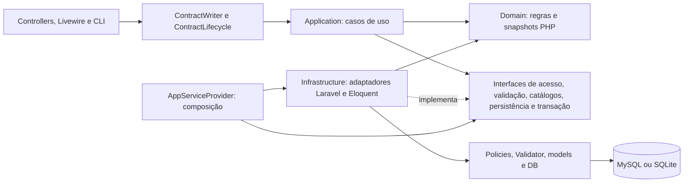

# Arquitetura do Contracts

## Objetivo e estado atual

O Contracts permanece um monólito Laravel 13, Livewire 4/Alpine, Blade, Tailwind 4, MySQL/SQLite e Docker. A arquitetura evolui por módulo, preservando os contratos HTTP, os 80 campos, o histórico, os escopos e as transações existentes.

O núcleo de cadastro, edição, exclusão e restauração de contratos agora possui **Domain e Application independentes de Laravel, Eloquent, Carbon, facades e HTTP**. As dependências são verificadas pela suíte Architecture. Os demais módulos continuam nos adaptadores/serviços existentes até uma migração justificada: não se afirma que todos os serviços do sistema já tenham essa independência.

As [evidências da primeira auditoria](architecture-audit.md) e da [auditoria incremental](technical-audit-2026-10-12.md) descrevem seus respectivos snapshots. A [evolução para desenvolvimento](clean-architecture-development.md) registra esta etapa, sua validação e os limites remanescentes.

## Direção das dependências



O caso de uso define suas necessidades por interfaces próprias. O container fornece os adaptadores externos; a aplicação não escolhe classes Eloquent nem acessa o container. A apresentação pode usar os serviços de compatibilidade e consultas de infraestrutura já existentes. Views, formatação, PDF/XLSX, discos e queues permanecem externos ao núcleo.

## Responsabilidades e arquivos

| Camada | Implementação | Responsabilidade |
| --- | --- | --- |
| Domain | `Contracts/ContractValidity.php` | Classificação temporal com referência explícita e cronologia por datas civis. |
| Domain | `Contracts/ContractState.php` | Snapshot imutável, aplicação de patch parcial, exercício, revisão legada e verificação de datas alteradas. Não acessa relógio, banco ou usuário global. |
| Domain | `Shared/BrazilianDocument.php`, `Shared/DecimalAmount.php` | Dígitos/verificadores/mascaramento e conversão decimal exata; regras compartilhadas com a normalização legada. |
| Application | `Contracts/SaveContract.php` | Orquestra autorização atual, validação, versão, escopo de destino, snapshots, invariantes, duplicidade, persistência e auditoria. |
| Application | `Contracts/ChangeContractLifecycle.php` | Casos explícitos de exclusão/restauração, autorização, confirmação e versão. |
| Application | `Security/ActorIdentity.php` | ID e versão de sessão recebidos de um consumidor autenticado. Não contém permissões autodeclaradas. |
| Application | `Contracts/AuthorizedContract.php`, `ValidatedContractInput.php` | Contexto autorizado e separação de controles validados do patch de campos graváveis. |
| Application | `Contracts/Ports/*`, `Ports/TransactionManager.php` | Cinco interfaces específicas, sem builders/Models/Response na assinatura. |
| Application | `Exceptions/*` | Falhas de acesso, validação, concorrência e ausência de registro sem status HTTP ou dependência do framework. |
| Infrastructure | `Contracts/EloquentContractAccess.php` | Locks de ator/contrato e policies; verificação de atribuição de fundo/secretaria. Métodos públicos específicos de salvar/ciclo de vida evitam combinações arbitrárias de abilities. |
| Infrastructure | `Contracts/LaravelContractInputValidator.php` | Validação contextual Laravel, requisitos por tipo, proteção de campos, existência de catálogos e normalização do patch permitido. |
| Infrastructure | `Contracts/EloquentContractCatalog.php` | Snapshots de órgãos e resolução de fornecedor sem match ambíguo. |
| Infrastructure | `Contracts/EloquentContractStore.php`, `ContractMapper.php` | Tradução de snapshots, duplicidade sob lock, Eloquent, soft delete e auditoria inseparável da persistência. |
| Infrastructure | `Persistence/LaravelTransactionManager.php`, `TransactionGuard.php` | Transação com três tentativas; recusa explícita de mutação sem transação ativa. |
| Infrastructure | `Security/LockActor.php` | Atividade, exclusão lógica e versão de sessão atual. Também reutilizado por aditivos, financeiro, revisão e controllers administrativos. |
| Infrastructure | `Http/ApplicationErrors.php`, `bootstrap/app.php` | Tradução das falhas da aplicação em 403/404/409/422 ou erros de formulário, na fronteira HTTP. |
| Compatibilidade | `Services/ContractWriter.php`, `ContractLifecycle.php`, `Legacy/Normalizer.php` | Preservam as chamadas existentes; convertem models/identidade e delegam regras compartilhadas. |
| Composição | `Providers/AppServiceProvider.php` | Bindings das cinco interfaces. Sem singleton com estado mutável de contratos/usuários. |

`ContractInputValidator` deixou de ser uma classe Laravel em Application: sua interface está em `Application/Contracts/Ports`, e sua implementação em Infrastructure. `LockActor` também foi movido de Application para Infrastructure, com todos os consumidores locais atualizados. As assinaturas dos serviços públicos de compatibilidade permanecem iguais.

## Fluxo seguro de escrita

1. HTTP/CLI fornece uma identidade derivada do usuário autenticado. ID, perfil e versão de sessão enviados no formulário não viram autoridade.
2. O caso de uso inicia `TransactionManager::run`; a implementação Laravel mantém até três tentativas em caso de deadlock.
3. `ContractAccess::lockForSave` ou `lockForLifecycle` bloqueia primeiro o ator, verifica atividade/versão de sessão, bloqueia o contrato atual e executa a policy. Os casos não podem escolher uma ability arbitrária recebida do cliente.
4. O validador recebe o contexto atual autorizado, dentro da transação. Ausência continua distinta de `null`. Dados pessoais protegidos e campos derivados não entram no patch gravável, mesmo quando valores vazios são aceitos pela semântica do Validator.
5. A aplicação verifica a versão persistida e o escopo de destino, resolve snapshots em catálogos e aplica as regras temporais. Datas históricas inconsistentes não alteradas continuam preservadas.
6. Cadastro novo bloqueia o fundo antes da consulta corrente de candidatos acessíveis. Duplicidade plausível exige confirmação explícita; não cria unicidade nem impede registros legítimos.
7. `ContractStore::save` calcula diferenças com a semântica de casts do Eloquent, salva e registra a auditoria na mesma transação. Uma falha reverte ambos.
8. O resultado é o snapshot efetivamente salvo. O adaptador retorna o model compatível a partir desse snapshot, sem consulta global do contrato depois do commit. Conflitos de edição continuam reautorizando o ator/contrato atual antes de mostrar formulários.

O mapper preserva atributos originais e aplica somente diferenças: JSON já serializado não é serializado novamente; datas/decimais omitidos mantêm seus casts e campos legados continuam preservados. `ContractState` mantém arrays para representar os campos extensos, evitando um DTO artificial com 80 propriedades.

Os campos monetários chegam aos atributos de domínio como strings com quatro casas, usando os casts existentes também no SQLite, cujo PDO pode devolver números como `float`. `original()` conserva a representação original para mapeamento/auditoria; regras financeiras devem usar os atributos normalizados, não os valores brutos de persistência. Essa tradução preserva a semântica dos casts e não altera valores do banco.

`TransactionGuard` protege locks de ator, verificação de escopo de destino, duplicidade, escrita e ciclo de vida. Não é substituto da policy ou da ordem de locks. O adapter não expõe `save` sem auditoria; não há evento assíncrono para a trilha de alterações.

## Regras de desenvolvimento

- **Domain** depende apenas de Domain e PHP nativo. Não usar Eloquent, Laravel, Carbon, facades, HTTP, containers, helpers globais ou inclusões de arquivos.
- **Application** depende de Application, Domain e PHP nativo. Novas operações recebem dependências pelo construtor e não usam `app()`, `auth()`, `request()`, `now()`, `collect()` ou `abort()`.
- **Ports** descrevem necessidades do caso de uso. Retornam dados/snapshots, não builders, models ou respostas. Não criar repository genérico para espelhar o ORM.
- **Infrastructure** implementa as interfaces e traduz recursos/falhas do framework. Não importar controllers, Livewire ou providers.
- **Apresentação** decide transporte, navegação e renderização. Os fluxos existentes continuam usando os serviços compatíveis; novos consumidores podem usar os casos puros e suas falhas tipadas.
- **Composição** acontece no provider. Não vincular repositories/contextos mutáveis como singleton.
- **Autorização** permanece no backend e é repetida sob lock nas mutações. Nunca confiar em dados de papel, autoria, fundo derivado ou propriedade conciliada vindos do cliente.
- **Validação contextual** permanece depois dos locks. Um FormRequest pode validar estrutura, mas não substituir a validação que depende do estado atual.
- **Tempo** é parâmetro explícito no domínio. Valores monetários são strings decimais, sem `float`; mudanças de sinais/saldos/aditivos exigem regra funcional e testes.

A suíte Architecture inspeciona tokens PHP, imports, referências qualificadas e helpers comuns. Ela detecta dependências estáticas proibidas; não é uma análise de segurança completa nem tenta resolver código dinâmico/reflection. Não criar exceções à regra para acomodar nova dependência externa: colocar a implementação no adaptador adequado.

## Comandos de desenvolvimento e CI

```bash
# Verificar as fronteiras sem inicializar Laravel ou banco
composer check:architecture

# Regras/casos de uso com doubles de interfaces, sem Laravel ou banco
composer test:unit

# Pint + todas as suites, com SQLite/storage/cache isolados
composer check

# Assets continuam no fluxo Node existente
npm run build
```

No ambiente Docker:

```bash
docker compose run --rm --no-deps app composer check:architecture
docker compose run --rm --no-deps app composer test:unit
docker compose run --rm --no-deps app composer check
docker compose run --rm --no-deps node npm run build
```

A CI verifica arquitetura explicitamente, Pint, build, suite completa SQLite e MySQL 8.4 em schema dedicado. A configuração SQLite padrão dos testes não acessa o banco instalado; `tests/bootstrap.php` prepara storage/caches temporários por processo. Configurações MySQL de teste devem apontar somente para um banco descartável: nunca trocar o DSN por uma instalação real em comandos com `RefreshDatabase`.

## Leituras, relatórios e limites atuais

Leituras continuam usando Eloquent nos adaptadores existentes, com `visibleTo` e policies. `ContractListingQuery` compartilha filtros por `ContractSearch`; `review=1` usa `pendingReview`. `withValidity` traduz a classificação temporal para SQL; `endingBetween` compartilha os limites inclusivos de calendário/alertas/relatórios a vencer.

`ReportRows` captura linhas formatadas em arquivo temporário privado. Linhas e totais derivam da mesma leitura; PDF/XLSX são renderizados após o commit. O hash de acesso usa lotes, ator/escopos atuais, visibilidade, versões e timestamps. Jobs têm claim condicional. Esses componentes continuam adaptadores Laravel, não foram movidos para Domain/Application.

O patch gravável exclui explicitamente campos pessoais protegidos; aditivos/financeiro também excluem snapshots derivados/somente leitura após validação. A aceitação de valores vazios por `prohibited` não define autorização de escrita. Edição cadastral de usuários aplica apenas nome, username, e-mail e perfil; senha usa a operação dedicada.

Importação de aditivos históricos bloqueia candidatos em ordem de ID, incrementa a versão de cada contrato afetado e persiste `ContractAudit` na mesma transação. A identidade de sistema é explícita: `actor_id=null`, `import_run_id` com FK e motivo identificando a execução; não se atribui a ação ao último usuário humano. `updated_by` é limpo nessa mutação. Reimportar a mesma origem não muda novamente versão/auditoria. Dinheiro e períodos permanecem documentais.

Mutações administrativas de usuários recebem `version`, que corresponde à `session_version` do alvo visto no formulário, e comparam a revisão depois de bloquear e autorizar ator/alvo. Não é identidade ou autoridade do cliente. Formulários antigos são recusados com 409; ausência de versão recebe validação 422. A ordem especial de locks do último administrador permanece preservada.

Exportações prontas persistem SHA-256/tamanho e exigem ambos no download. Arquivos anteriores sem metadados de integridade recebem 410 e precisam ser solicitados novamente. Cada geração tem token e início de processamento; o token é serializado na fila para identificar também o callback `failed()`. Publicação/auditoria ocorrem na transação final, com ator bloqueado antes da exportação, e somente a tentativa proprietária pode publicar ou falhar. Payloads antigos sem token continuam gerando; callbacks sem identidade deixam a detecção de abandono para a limpeza.

A limpeza executa a cada cinco minutos, expira registros mesmo sem arquivo e encerra como `failed` processamentos que excederam 960 segundos (900s de timeout mais 60s de margem). Não há reexecução automática; o usuário solicita nova exportação. Tentativas atrasadas removem seus próprios arquivos e não alteram uma tentativa posterior. Arquivos órfãos de processos mortos são removidos depois de 24 horas.

Aditivos, registros financeiros, revisão, administração de usuários, conciliação e exportações ainda têm orquestração nos serviços/controllers existentes. A segurança não depende de esses módulos já estarem migrados: seus mecanismos de autorização/auditoria permanecem e a revalidação compartilhada do ator foi ampliada. Migrações futuras devem seguir os contratos e testes deste núcleo, uma operação por vez.

## Evolução funcional e operacional

A interface de relatórios/auditoria solicita `background=1` nas rotas de exportação existentes e recebe JSON 202 com ID e URL de acompanhamento. `ReportRequests` bloqueia/revalida o ator, verifica autorização e grava solicitação/evento na transação; a fila recebe o job após a gravação. A geração da interface não faz contagem prévia nem renderiza PDF/XLSX na requisição. Chamadas diretas sem esse controle preservam os contratos anteriores de download/redirect.

`GET /reports/status/{export}` retorna somente ID, estado, formato e URL autorizada de download. Exige sessão atual/proprietário e perfil administrativo para auditoria. Pendências não calculam o hash de todos os contratos a cada consulta; resultados prontos revalidam esse hash, e o download mantém as verificações completas de acesso, expiração e integridade. Não há caminhos de disco, filtros pessoais ou models serializados na resposta.

Cards consultam estados em sequência a cada cinco segundos, pausam em abas ocultas e param em estados finais. Voltar pelo cache de navegação retoma uma geração pendente. Falhas transitórias retomam consultas com espera maior; falhas de acesso removem a ação de download. Cliques repetidos no mesmo relatório em geração reutilizam o card. Capturas/totalizações selecionam somente os 21 atributos usados no relatório e reutilizam referência/datas na montagem das linhas. Medições e validação estão em [geração acompanhada de relatórios](report-generation-flow.md).

Uma geração acompanhada dispara automaticamente um único download quando fica pronta, pela mesma URL privada que reautoriza e verifica integridade no servidor. O botão manual permanece disponível. Cards que já estavam prontos na abertura da página não disparam esse efeito; o acompanhamento em aba oculta retoma ao voltar.

O worker/scheduler registram atividade recente via cache compartilhado. `contracts:check-operations` verifica banco, tabela da fila, heartbeats e espera de jobs; os healthchecks do Compose consultam cada processo. A imagem PHP inclui `pcntl` para aplicar timeouts no worker daemon. O Nginx resolve `app:9000` pelo DNS do Docker para acompanhar recriações do PHP. As [correções da verificação](audit-corrections-2026-10-12.md) registram migrations e recuperação local; não houve deploy externo. Retenção institucional, imutabilidade de auditoria e homologação continuam exigindo decisões próprias.

Atas de Registro de Preços, saldos e quantitativos precisam de modelagem e regras institucionais verificáveis. Valores iniciais, acumulados, fichas e empenhos continuam indicadores separados. Não foi aplicada prorrogação, reajuste, acréscimo ou supressão automaticamente. Homologação jurídica/administrativa e restauração de backups continuam pendentes.
