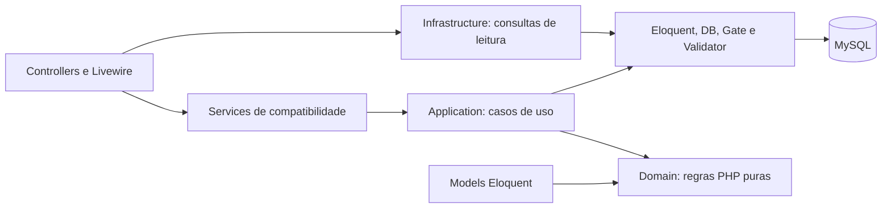

# Arquitetura do Contracts

## Objetivo e limites

Evoluir um monólito Laravel modular, com regras de domínio independentes onde isso traz testabilidade real. A aplicação permanece em Laravel 13/PHP 8.4, Livewire 4/Alpine, Blade, Tailwind 4, MySQL, Docker, Nginx e Vite. Esta etapa não modifica schema, rotas, contrato JSON da API, layout ou funcionalidades administrativas.

A [auditoria](architecture-audit.md) registra evidências, correções, verificações executadas e pendências. Não se trata de uma implementação completa de Clean Architecture: as dependências preservadas do Laravel estão explicitadas abaixo.

## Organização atual e evolução inicial

| Camada | Implementação | Responsabilidade |
| --- | --- | --- |
| Domain | `app/Domain/Contracts/ContractValidity.php` | Classificação temporal e comparação de datas civis; recebe a referência explicitamente, sem Laravel, Carbon, banco ou relógio global. |
| Application | `app/Application/Contracts/SaveContract.php` | Orquestra cadastro/edição: ator e contrato atuais, validação contextual, escopo, normalização, invariantes, versão, persistência e auditoria na mesma transação. |
| Application | `app/Application/Contracts/ContractInputValidator.php` | Validação de entrada com estado atual bloqueado: campos permitidos, proteção pessoal, campos derivados, requisitos por tipo e tolerâncias legadas. Utilizável por HTTP e CLI. |
| Application | `app/Application/Contracts/ChangeContractLifecycle.php` | Casos de uso explícitos `delete` e `restore`, compartilhando a transação e as invariantes do ciclo de vida. |
| Application | `app/Application/Security/LockActor.php` | Recarrega e bloqueia o usuário na transação; verifica atividade e versão de sessão contra o snapshot do chamador. |
| Infrastructure | `app/Infrastructure/Contracts/ContractListingQuery.php` | Consulta Eloquent da listagem, escolhas restritas ao escopo, ordenação e paginação. |
| Infrastructure existente | `app/Models`, `Services/Reports`, `Services/Legacy`, discos Laravel | Persistência, casts, queries, importação, renderização PDF/XLSX/CSV e documentos privados. Mantidos nos caminhos atuais para evitar mudanças cosméticas em massa. |
| Presentation | `app/Http`, `app/Livewire`, `resources/views` | Rotas, autenticação HTTP, validação estrutural dos filtros, respostas, paginação e apresentação. |
| Compatibilidade | `Services/ContractWriter`, `Services/ContractLifecycle` | Mantêm assinaturas existentes e delegam aos casos de uso. Evitam quebrar controllers, comando de demonstração, testes e consumidores existentes. |



**Concessão deliberada:** os casos de uso ainda recebem models Eloquent e usam transações, Gate, Validator e exceções HTTP do framework. A leitura pode ser chamada diretamente pelo controller. A dependência estritamente interna já existe na regra de domínio; a aplicação inteira ainda não possui inversão de persistência. O diagrama descreve o código implementado, não uma arquitetura idealizada.

## Fluxo de escrita

1. O middleware HTTP verifica autenticação e versão da sessão. Isso não substitui a verificação transacional.
2. `SaveContract` inicia uma transação com até três tentativas e bloqueia o ator atual usando `LockActor`.
3. Recarrega e bloqueia o contrato existente; executa a policy com o ator atual.
4. `ContractInputValidator` valida o payload usando o estado bloqueado. Campos omitidos permanecem omitidos; `null` continua distinto de ausência. Dados pessoais protegidos e campos derivados não podem ser sobrescritos pelo cliente.
5. Compara a versão enviada com a versão persistida e verifica o escopo de destino, incluindo mudança de fundo/secretaria.
6. Normaliza valores sem `float`, conserva snapshots e pendências legadas e aplica as verificações temporais já existentes. A tolerância de datas históricas inconsistentes, quando não alteradas, permanece preservada.
7. Persiste o contrato com versão incrementada e registra `ContractAudit`. Uma falha na auditoria reverte também o contrato.

No conflito de edição, o controller recarrega o contrato ativo e o ator, confere a sessão e repete a autorização antes de mostrar o formulário. Conflitos ordinários continuam retornando 409 e os dados digitados; perda de acesso retorna 403 e exclusão concorrente retorna 404.

`ChangeContractLifecycle` preserva confirmação pelo número/ID, motivo, versão, permissão administrativa, soft delete, autoria e auditoria. Exclusão e restauração compartilham a mesma fronteira transacional. Não há exclusão física no fluxo.

A verificação de ator também foi aplicada ao cadastro de usuários, alterações administrativas de usuários e cadastro de catálogos. A ordem de bloqueio de todos os administradores ativos em `UserController::mutate` foi mantida, para preservar a proteção do último administrador.

## Vigência e consultas

`ContractValidity::classify` mantém a precedência: revisão; datas insuficientes; vencido; a iniciar ou vigente. Início e término são inclusivos na data de referência. São datas civis, não instantes de execução. A classificação não certifica situação jurídica.

O término atualizado informado tem precedência sobre o original, como já ocorria. `Contract::validityOn` adapta os casts do Eloquent para a regra pura. O accessor `validity` continua usando a data atual da aplicação. Os relatórios passam sua própria referência, independente do dia de execução.

A tradução SQL permanece em `Contract::scopeWithValidity`, agora com referência opcional. Os relatórios a reutilizam. Testes de equivalência verificam regra/model, filtros SQL e linhas dos relatórios para todas as situações, limites e datas ausentes.

`ContractSearch::applyIdentityFilters` compartilha busca por número/processo/fornecedor/documento e filtro de fundo/secretaria entre listagem e relatório. O método `apply` anterior permanece com sua semântica de filtros avançados. As escolhas dos filtros continuam derivadas apenas dos contratos visíveis.

## Decisões técnicas

- **Eloquent mantido:** models continuam em `app/Models`; queries e casts são integração útil, não uma falha arquitetural por si só. Policies são adaptadores Laravel de autorização.
- **Sem repository genérico:** não existe troca concreta de persistência nesta etapa. Espelhar todos os métodos do Eloquent em interfaces aumentaria código sem reduzir o risco identificado.
- **Sem DTO para cada formulário:** o contrato tem 80 campos mapeados e edição parcial. O array validado conserva a distinção entre ausente e nulo. Um DTO deverá ser introduzido somente se proteger um contrato estável ou reduzir ambiguidade comprovada.
- **Auditoria junto à persistência:** não foi substituída por evento assíncrono. Isso preserva rollback e evita salvar uma alteração sem trilha de auditoria.
- **Validação contextual na aplicação:** os requisitos por tipo, estado legado e perfil exigem o contrato atual. Mover tudo para um FormRequest executado antes dos locks poderia reintroduzir uma janela de concorrência.
- **Normalização existente preservada:** `Legacy/Normalizer` ainda é usado pelo cadastro nativo, importação e relatórios. A extração futura de documentos/decimais compartilhados deve preservar quatro casas e comportamentos legados; não houve renomeação em massa nesta etapa.
- **Interfaces quando houver uma fronteira real:** armazenamento remoto de documentos, múltiplos geradores de relatório ou integração externa são candidatos. A extração da regra temporal não exigiu uma interface de relógio, porque a referência já é um parâmetro explícito.

## Testes e isolamento

`phpunit.xml` executa suites Unit e Feature. `tests/bootstrap.php` cria storage e caches temporários exclusivos por processo, antes de inicializar Laravel. Isso isola relatórios, anexos de teste, views compiladas, logs, configuração e manifestos de pacotes do ambiente instalado. Ao terminar, remove apenas o diretório criado para aquela execução.

O banco padrão dos testes permanece SQLite em memória. A verificação MySQL desta auditoria utilizou um container MySQL 8.4 separado, sem porta publicada e com dados em `tmpfs`, em rede própria; o código foi montado somente para leitura. O banco e os volumes da instalação não foram alvo de migrations.

```bash
docker compose exec -T app php artisan test
docker compose exec -T app vendor/bin/phpunit --testsuite=Unit
docker compose exec -T app vendor/bin/pint --test
```

Os testes Unit do domínio estendem diretamente `PHPUnit\Framework\TestCase`, sem inicializar a aplicação ou acessar banco. Os Feature verificam autorização, versão, rollback, consultas e integração.

## Evoluções seguintes

1. Uniformizar a revalidação de ator nos demais comandos HTTP de mutação e testar as janelas entre middleware e transação, sem alterar ordens de locks existentes.
2. Extrair a governança de usuários e a conciliação de histórico dos controllers, com caracterização do último administrador e da revisão obrigatória.
3. Tornar a geração de exportação idempotente, melhorar observabilidade sem dados pessoais e reduzir o custo de `accessHash`/indicadores após medição.
4. Consolidar a normalização de CPF/CNPJ e decimais em componentes compartilhados com testes puros, preservando diferenças entre dados nativos e importados.
5. Definir necessidade real de contratos de infraestrutura antes de introduzir ports/repositories. Separar exceções de aplicação do transporte HTTP quando os casos de uso tiverem novos consumidores.
6. Avaliar hard delete, retenção e imutabilidade da auditoria com requisitos operacionais. Qualquer mudança de FK ou migração de dados exige revisão própria.

### Módulos futuros, não implementados

Atas de Registro de Preços precisam de modelagem própria para ata, itens, unidades, fornecedores, participantes e utilização por órgão. O histórico importado de itens não equivale a esse domínio.

Saldos e quantitativos precisam de eventos e vínculos verificáveis de reserva, consumo, cancelamento e ajuste, com unidade, origem documental e concorrência. As somas atuais de valores iniciais, fichas e empenhos continuam indicadores separados; não foram transformadas em saldo disponível nem aplicação automática de aditivo.

Essas definições dependem de requisitos do município e validação administrativa/jurídica. Esta etapa não implementa regras novas de prorrogação ou interpreta a Lei nº 14.133/2021 como uma autorização automática.
