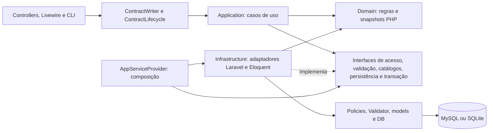

# Arquitetura do Contracts

Data de criação de contratos (22/10/2026): `ContractCreationDate` é a porta de Application para preencher `data_cont_verd` apenas na criação. O adapter HTTPS obtém a data no fuso de Brasília antes da transação; falhas usam a data do sistema do servidor, sem aviso. Edições preservam o valor e ignoram manipulação do cliente. Nenhuma dependência de Laravel/HTTP entrou em Domain/Application. [Fluxo e testes](contract-creation-date.md).

Número do contrato (22/10/2026): a coluna física agora é `contracts.Contrato`. O atributo público/lógico `numero` é preservado no model e traduzido explicitamente por `ContractMapper`, sem contaminar Domain/Application com nomes de persistência. Consultas SQL e projeções usam `Contrato`; filtros e auditorias continuam com os contratos anteriores. [Migração, compatibilidade e validação](contract-number-column.md).

Painel de fichas após separação dos aditivos (22/10/2026): `FichaValuesCatalog::panel` fornece a projeção adicional `ficha_panel` com linhas e resumo coerentes, preservando os campos anteriores da API. A lista usa valores originais filtrados e totais exatos dos produtos originais, sem duplicar as duas fontes; exclui fichas exclusivas da tabela de aditivos. A consulta permanece autorizada pelo contrato e não grava valores. [Contrato e validação](original-contract-ficha-panel.md).

Produtos de aditivos (22/10/2026): `tb_Prtodutos_Aditivos` separa os itens classificados por `Domain/Contracts/ProductOrigin`, preservando os campos de produto e acrescentando `ADT`/`Proc_ADT`. `Infrastructure/Contracts/SeparateAmendmentProducts` executa manutenção transacional auditada com identidade de sistema e arquivamento lógico da origem, sem efeitos financeiros. A importação roteia os novos registros por origem e mantém idempotência nas duas tabelas. Leitores/documentos do contrato continuam apenas com produtos originais; fichas exclusivas de aditivos consideram também a nova tabela. [Estrutura, manutenção e validação](amendment-product-separation.md).

Estado atual de Dotação e Ficha (21/10/2026): Cadastros → Dotação abre diretamente o formulário com lista integrada; a antiga listagem redireciona. O cadastro de dotação acionado pelos produtos abre em painel modal com iframe autenticado, sem nova guia. Ficha é entrada de texto sem seleção; consulta ao perder o foco, seleção explícita pelo painel de fichas e atualização após salvar usam o endpoint autorizado. Essas regras substituem os passos intermediários de navegação registrados abaixo.

Contrato de Serviços Diversos: `SupplyContractPdf::modelFor` seleciona a chave interna `services` pelo tipo persistido; `SupplyContractTemplate` usa o modelo Word fornecido e a tabela de seis colunas. Reutiliza `OriginalContractProducts`, conferência decimal, autorização, captura/revalidação transacionais e auditoria privada existentes. Sem novas camadas, rotas ou migrations. [Contrato e validação](services-contract.md).

Cadastro de Dotação implementado: o painel anteriormente em branco passou a usar `BudgetController`, `Infrastructure/Budgets/BudgetRegistration` e o compositor PHP puro `Domain/Contracts/BudgetCode`. Salvar/Novo/Excluir preservam escopos, revisão HMAC, auditoria transacional e exclusão lógica. O código é recomposto pelo servidor quando seus componentes mudam, iniciando em Gestão; Órgão fica separado. Textos históricos são preservados quando os componentes não mudam. A migration aditiva acrescenta `tb_Dotacao.deleted_at` e os leitores operacionais/documentais ignoram excluídos. Após salvar, o Cadastro de produtos refaz a consulta autorizada na aba original. Esta implementação substitui a descrição do painel vazio no histórico abaixo. [Contrato completo, composição e instalação](budget-registration.md).

Navegação para cadastro de dotação: o botão da mensagem de ficha não encontrada abre o painel `/catalogs/budgets/create` em nova aba, preservando o cadastro de produtos aberto. O formulário contextual anterior foi retirado da interface; o painel de destino permanece em branco para evolução posterior. A permissão `budget` é exigida na apresentação e no destino. Os 13 testes JavaScript de produtos/fichas e o build Docker passaram após esse ajuste.

Cadastro de dotação (21/10/2026): a listagem de Dotação oferece “Cadastro de Dotação”, abrindo `/catalogs/budgets/create`, um painel em branco reservado para evolução posterior, protegido pela permissão de catálogo `budget` e sem persistência nessa tela. Na mensagem de ficha não encontrada do Cadastro de produtos, usuários com a mesma permissão podem cadastrar Ficha/Descrição/Dotação em uma caixa própria. `POST /contracts/{contract}/products/budgets` usa `BudgetRegistration`: lock de ator/contrato via `ContractAccess`, policy, versão, destino de catálogo e Fundo/Secretaria atuais derivados no servidor, validação, rejeição de ficha duplicada e `ActivityEvent` na mesma transação. Um lock compartilhado de cache serializa esse novo fluxo de cadastro. Não altera contratos, produtos, valores ou versões do contrato. Após salvar, a interface consulta novamente a ficha. A nova tela em branco é independente desse formulário contextual.

Validação: suíte `ContractProductsTest` anterior com 37 testes passou (430 asserções); o teste adicional da tela em branco passou isoladamente (8 asserções), após corrigir uma asserção que incluía indevidamente o formulário de logout do layout. Os 13 testes JavaScript existentes, Architecture (3 testes), Pint dos quatro PHP alterados, build Docker e `git diff --check` passaram. Testes usam SQLite isolado; nenhum cadastro foi criado no banco instalado. Sem validação visual autenticada no navegador.

Consulta de ficha (21/10/2026): ao atualizar Ficha, a interface preenche automaticamente Descrição (`tb_Dotacao.Descricao`) e Dotação (`tb_Dotacao.Dotacao`) pelo endpoint autorizado existente. Diferença de Fundo/Secretaria passa a ser aviso informativo, sem confirmação bloqueante; essa regra substitui o OK/Cancelar descrito no histórico abaixo. Campo vazio, ficha ausente e troca de ficha limpam os dados anteriores; respostas antigas continuam descartadas. Não há gravação automática. Validação: os 13 testes JavaScript de produtos/fichas, build Docker e `git diff --check` passaram; sem conferência visual autenticada no navegador.

Edição de produtos (21/10/2026): preço unitário e descrição são editáveis apenas no Lançamento Manual. Produtos do catálogo mantêm esses campos somente para leitura; `ProcurementProducts` recusa mudanças de preço e descrição enviadas pelo cliente nesse modo. O botão de liberação de preço foi removido. A descrição continua ajustando a altura até cinco linhas, com rolagem para conteúdo maior. Locks, versão, saldo e auditoria transacional permanecem no fluxo existente.

Validação dessa edição: `docker compose exec -T app php artisan test --filter=ContractProductsTest --compact` (35 testes, 409 asserções, SQLite isolado); `node --test tests/JavaScript/contract-products.test.mjs tests/JavaScript/contract-product-fichas.test.mjs` (10 testes); `docker compose exec -T app composer check:architecture` (3 testes); Pint dos dois PHP alterados, build via `docker compose run --rm --no-deps node npm run build` e `git diff --check` passaram. Sem conferência visual autenticada no navegador.

Painel Ficha/Valor: `FichaValuesCatalog` exige `Proc_ADT` vazio e `N_ADT` nulo ou zero e confere a soma decimal das fichas originais com `valor_total`, sem efeitos financeiros. O painel mostra Ficha/Valor e alerta quando a soma ultrapassa o valor do contrato. O endpoint de produtos acrescenta `ficha_summary` para o rodapé e a mensagem de conferência. A migration 000005 permite ausência de `N_ADT`; o importador preserva essa ausência e a proveniência. [Filtros, migração e validação](original-contract-ficha-panel.md).

Cadastro de produtos: `Infrastructure/Contracts/OriginalContractProducts` delimita a lista e as fichas ao contrato original pelo vínculo autorizado, Fundo/número/Processo e proveniência legada (`ADT`/`Proc_ADT`). `ProcurementProducts` recusa edição/estorno de itens classificados como aditivos nesse cadastro, sob a transação e os locks existentes. Histórico e contratos HTTP são preservados. [Regras e validação](product-ficha-selection-2026-10-19.md).

Contrato de Locação de Imóvel: `SupplyContractPdf` preserva a interface de compatibilidade e seleciona `property-lease` pelo tipo persistido. O interpretador Word aceita somente as chaves internas fixas; preserva Fornecimento como padrão. Projeções de locador, valores mensal/global e Decreto/Matrícula do gestor são capturadas e revalidadas pelo adaptador antes da entrega privada e auditoria transacional. [Modelo, vínculos e validação](property-lease-contract.md).

Documentos assinados: seis referências anuláveis ao final de `contracts` apontam para `contract_attachments`, protegidas contra atribuição em massa e ocultas na serialização. O menu Publicação usa `Infrastructure/Documents/SignedDocuments` para upload privado com `ContractAccess::lockForSave`, versão, auditoria transacional, histórico de substituições e download reautorizado com SHA-256. `signed_category` identifica o histórico de cada categoria; listas aplicam Fundo da sessão e escopos atuais. [Campos](signed-document-fields-2026-10-20.md) e [módulo, fronteiras e validação](publication-module-2026-10-20.md).

Tipos históricos: o formulário oferece ajuda e correções de grafia confirmadas com aceite opcional, persistidas pelo fluxo de gravação existente. A manutenção CLI explícita usa adaptador de Infrastructure, identidade de sistema, locks, versão e auditoria transacional. [Comportamento e execução](historical-contract-types.md).

PDF de OS: `ServiceOrderTemplate` seleciona chaves fixas Obras/Serviços/Genérico pelo tipo persistido e identifica layout/modelo por SHA-256. `ServiceOrderPdf` captura projeções, configuração de administração e responsável do contratante sob locks, renderiza fora da transação e reautoriza/revalida antes da entrega privada e auditoria. O CPF/CNPJ do fornecedor respeita o perfil. [Modelos e validação](service-order-models-2026-10-20.md).

Ordens de Serviço: `ContractServiceOrder` usa `tb_OS`, renomeada preservando o schema Laravel e os registros. `Services/Legacy/ServiceOrderImporter` lê literais da origem `tb_OS`, exige vínculo único por número/Fundo/processo e preserva proveniência integral em `legacy_records`, com transação, versão e auditoria de sistema inseparáveis. Não aplica efeitos históricos de prazo, vigência ou valores; conflitos permanecem como pendências. [Renomeação e importação](service-order-import-2026-10-20.md).

Abertura pela lupa: o formulário de edição usa snapshots do contrato e restauração de valores anteriores delimitada por `_contract_form_id`, apenas como indicação de apresentação. O Fundo no cabeçalho é o nome salvo, sem alterar o contexto da sessão. A consulta inicial de fiscal é preservada somente na criação ou após mudança explícita de Secretaria; fiscal histórico ausente não é substituído na abertura. Endpoints, policies e regras de gravação permanecem iguais. [Comportamento e validação](contract-search-saved-form.md).

Extrato de Locação de Imóvel: `SupplyContractExtract` mantém sua interface de compatibilidade e seleciona `property-lease` pelo tipo persistido após lock/autorização. `SupplyExtractTemplate` aceita chaves internas fixas, preservando `supply` como padrão. O DOCX específico projeta imóvel, destinação, término original e valores mensal/inicial salvos. Por definição do usuário, o gestor vem do snapshot do contrato, com revalidação de nome/CPF/cargo sob lock antes da entrega; o Extrato de Fornecimento segue a mesma regra de término original e gestor salvo. A entrega revalida também o tipo/modelo e o hash do modelo selecionado, com auditoria transacional. [Campos e validação](property-lease-extract.md).

Importação operacional do banco de modelo: `Services/Legacy/ContractProductImporter` lê somente literais de `tb_Produtos_Contratos`, confirma número/Fundo/fornecedor/processo e registra produtos com proveniência única em `legacy_record_id`. É uma operação CLI de sistema, com ator nulo explícito, lock de importação, transação, versão e auditoria; não expõe autorização por parâmetros HTTP. A fonte já contém saldos consumidos: os produtos importados usam `product_id=null`, sem nova baixa ou devolução no catálogo. Totais e efeitos financeiros/vigência não são recalculados. [Procedimento](model-data-import-2026-10-19.md).

Seleção editável de ficha em produtos: `Contract::productFichas()` preenche a lista no HTML inicial a partir dos produtos ativos do contrato autorizado. `ContractProductController::index` aceita `ficha` e retorna `items` filtrados, mais todas as `fichas` desse contrato. O campo único usa input/datalist e admite valores novos, que só entram nas opções depois de salvar um produto. O painel mantém o texto digitado e descarta consultas antigas ao trocar ficha/versão/modo. Gravação, escopos e auditoria continuam nos adaptadores existentes. [Contrato HTTP e validação](product-ficha-selection-2026-10-19.md).

Contrato de Fornecimento: `Infrastructure/Documents/SupplyContractPdf` captura projeções autorizadas do contrato, produtos e códigos de `tb_Dotacao` pelas fichas desses produtos. `SupplyContractFigures` consolida itens, valida multiplicações/somas com decimais exatos e soma os totais dos produtos por ficha, exigindo soma das dotações igual ao total do contrato. Não depende de registros financeiros nem persiste efeitos financeiros. Renderiza o Word confiável por `SupplyContractTemplate` fora da transação e revalida fontes, permissões e modelo antes da entrega/auditoria transacional. `ContractDocumentController` expõe o PDF privado e apresenta divergências como 422; a escolha do modelo usa somente o tipo persistido. [Campos, fontes e validação](supply-contract-pdf-2026-10-19.md).

Decretos de fiscais: `Infrastructure/Documents/InspectorDecree` captura fontes autorizadas e revisão HMAC, agrupa automaticamente fiscais ativos do mesmo número/data, escolhe o modelo individual/coletivo, renderiza PDF fora da transação e revalida antes da entrega/auditoria. Usa sempre Município e Prefeito, independente da assinatura delegada nos contratos. `InspectorDecreeController` mantém o transporte HTTP privado. [Operação e validação](inspector-decrees-2026-10-18.md).

Gestor de Contratos: `Infrastructure/ContractStewards/ContractStewardRegistration` implementa o cadastro administrativo derivado do Fiscal em `contract_stewards`, com validação contextual, revisão HMAC, exclusão lógica e auditoria transacional. `StewardLegacyTable` mantém os campos equivalentes em `tb_Gestor_Cont` na mesma transação. `ContractStewardController` mantém a projeção HTTP e busca por CPF privadas. `CopyFundManager` permite cópia explícita e idempotente de uma origem importada de `tb_Gestor`, com identidade de sistema, execução rastreável e auditoria transacional. O novo papel não altera `tb_Gestor`, a assinatura do Executivo ou os snapshots dos contratos. [Contrato e instalação](contract-steward-registration-2026-10-18.md).

`StewardAssignments` garante exclusividade do Gestor de Contratos: no Município, um para Todas as Secretarias ou um por Secretaria; nos demais Fundos, um por Fundo e nenhuma Secretaria. Escritas bloqueiam ator, Fundos em ordem de ID e registro, verificando ocupação sob lock na mesma transação de persistência/auditoria. Cópias por CLI respeitam a mesma regra e exclusões/transferências liberam o vínculo anterior.

Cadastro de Gestor do Fundo: `Infrastructure/Managers/ManagerRegistration` mantém os campos de `tb_Gestor` em `tb_Gestor`, com locks ator/Fundos em ordem de ID/registro, revisão HMAC e auditoria transacional. A ficha administrativa projeta explicitamente os campos; exclusão lógica preserva importações e snapshots. `ManagerSignatory` centraliza o responsável do Município: um único gestor com Assinatura ativa ou, na ausência dele, o Prefeito. Contratos completos de Fornecimento e publicações resolvem o responsável sob lock e o revalidam após renderizar; novos contratos e novos aditivos usam a mesma regra. [Contrato e instalação](manager-fund-registration-2026-10-18.md).

Consulta pública de CNPJ: `Infrastructure/Companies/CnpjLookup` encapsula o HTTP à BrasilAPI com URL fixa, timeouts e projeção explícita. O controller autenticado revalida administrador antes e depois da consulta; a interface preenche campos vazios ou apresenta comparação, sem persistência automática. Nenhum HTTP externo ocorre em transações de escrita. [Fonte e validação](cnpj-consultation-2026-10-18.md).

Cadastro de Fundos: `Infrastructure/Funds/FundRegistration` mantém os detalhes legados em `contract_funds`, com locks ator/Fundo, revisão HMAC, validação contextual e auditoria inseparável. Exclusão lógica é recusada para Fundos vinculados e revalidada nas seleções, sessões, escopos, contratos e importadores. Identidades textuais já vinculadas são preservadas, assim como snapshots dos contratos e rotas de compatibilidade. [Campos, instalação e validação](fund-registration-2026-10-18.md).

Busca de fiscal por CPF: `POST /inspectors/lookup` revalida o administrador atual e retorna apenas a URL da ficha existente, com cache privado e sem payload pessoal. Comparação normaliza CPF importado/nativo; exclusões lógicas são ignoradas e ambiguidades recebem 409. A interface descarta respostas antigas e aguarda a consulta antes de criar. [Comportamento e validação](inspector-registration-2026-10-18.md).

Cadastro de fiscais: `Infrastructure/Inspectors/InspectorRegistration` implementa criação/edição e exclusão lógica administrativas com locks ator/fiscal, validação contextual, revisão HMAC e auditoria na transação. Exclusão exige confirmação e grava `deleted_at`; listagem, edição e resolução automática excluem esses registros, preservando importações e snapshots dos contratos. `InspectorController` mantém a projeção explícita da ficha, sem payload pessoal na lista; `/catalogs/list/inspector` permanece compatível. `legacy_id` opcional distingue cadastros nativos sem alterar importações ou snapshots dos contratos. [Instalação e validação](inspector-registration-2026-10-18.md).

Extratos de Fornecimento: `Infrastructure/Documents/SupplyContractExtract` projeta somente os marcadores do modelo autorizado, renderiza fora da transação e reautoriza antes de entregar o PDF privado, com auditoria inseparável da autorização final. `SupplyExtractTemplate` interpreta a cópia confiável do DOCX; o controller mantém o transporte HTTP. [Contrato e validação](supply-contract-extract-2026-10-17.md).

O painel de produtos consulta `Infrastructure/Contracts/FichaValuesCatalog` após autorizar o contrato. A origem é `tb_ValorFicha`, com correspondência simultânea de Contrato, Fundo e Proc_Cont persistidos no contrato autorizado; CPF/CNPJ não restringe essa consulta. A projeção retorna somente ficha e valor e é recarregada a cada abertura do cadastro e após alterações dos produtos. A consulta de dotação pelo campo Ficha permanece independente. A importação isolada `contracts:import-ficha-values` mantém rastreabilidade e preserva divergências existentes. A sincronização dos valores com os produtos ainda depende da definição funcional para produtos sem ficha.

Produtos de processos licitatórios: `Infrastructure/Contracts/ProcurementProducts` distribui o catálogo preexistente de `tb_Produtos` aos contratos do mesmo processo, com ficha textual opcional, baixa/estorno, versão, total e auditoria na mesma transação. No modo padrão filtra o fornecedor; com **Exibir produtos do processo** ativo, o saldo da origem pode ser consumido por fornecedores diferentes (credenciamento), mantendo autorização e locks. O modo é gravado em `process_catalog` e auditado, preservando a regra nos estornos. A busca por Item revalida o mesmo contexto no servidor. Os dados do item são snapshots; digitar uma ficha não cria vínculo financeiro. Por solicitação explícita do usuário, `BudgetCatalog` consulta `tb_Dotacao` apenas pela Ficha após autorizar o contrato; Fundo e Secretaria servem somente à comparação informativa. Correspondência ou equivalência preenche sem alerta; divergência exige OK/Cancelar. O parâmetro compatível `budget_id` restringe-se às dotações financeiras ativas do contrato, e os escopos de contratos/produtos permanecem aplicados no backend. A integração de IA foi retirada, sem apagar dados ou tabelas da migration anterior. [Contratos internos, persistência e operação](contract-products-2026-10-16.md).

Ordens de Serviço: o adaptador `Infrastructure/Contracts/RegisterServiceOrder.php` usa `ContractAccess::lockForSave` e `TransactionManager` para cadastrar registros documentais independentes por contrato/aditivo, com versão e auditoria transacionais. Atualiza o campo textual prazo_obra a partir do Período na mesma transação/auditoria, preservando snapshots históricos e sem efeitos financeiros ou de vigência. Datas opcionais starts_on/ends_on preservam clientes antigos; a janela exige ambas. ServiceOrderPdf captura projeções autorizadas sob locks, renderiza fora da transação e revalida antes da entrega privada/auditoria. Consulta, projeções HTTP, instalação e validação estão em [Ordens de Serviço](service-orders-2026-10-15.md).

## Objetivo e estado atual

Exceção de catálogo autorizada: lançamentos manuais de objetos como locação usam `tb_Produtos_Contratos.product_id=null`. O mesmo adaptador `ProcurementProducts` valida os campos informados, protege contrato/ator/versão e audita snapshots e total na transação; não cria nem movimenta `tb_Produtos`. A origem persistida determina edição/estorno, sem aceitar conversão pelo cliente. A migration 000005 apenas torna o vínculo opcional, mantendo dados e chave estrangeira para origens existentes.

O Contracts permanece um monólito Laravel 13, Livewire 4/Alpine, Blade, Tailwind 4, MySQL/SQLite e Docker. A arquitetura evolui por módulo, preservando os contratos HTTP, os 80 campos, o histórico, os escopos e as transações existentes.

O núcleo de cadastro, edição, exclusão e restauração de contratos agora possui **Domain e Application independentes de Laravel, Eloquent, Carbon, facades e HTTP**. As dependências são verificadas pela suíte Architecture. Os demais módulos continuam nos adaptadores/serviços existentes até uma migração justificada: não se afirma que todos os serviços do sistema já tenham essa independência.

As [evidências da primeira auditoria](architecture-audit.md) e da [auditoria incremental](technical-audit-2026-10-12.md) descrevem seus respectivos snapshots. A [evolução para desenvolvimento](clean-architecture-development.md) registra esta etapa, sua validação e os limites remanescentes.

## Direção das dependências



O caso de uso define suas necessidades por interfaces próprias. O container fornece os adaptadores externos; a aplicação não escolhe classes Eloquent nem acessa o container. A apresentação pode usar os serviços de compatibilidade e consultas de infraestrutura já existentes. Views, formatação, PDF/XLSX, discos e queues permanecem externos ao núcleo.

## Responsabilidades e arquivos

| Camada | Implementação | Responsabilidade |
| --- | --- | --- |
| Domain | `Contracts/ContractValidity.php` | Classificação temporal com referência explícita e cronologia por datas civis. |
| Domain | `Contracts/ContractState.php` | Snapshot imutável, aplicação de patch parcial, exercício, revisão legada e verificação de datas alteradas. Não acessa relógio, banco ou usuário global. |
| Domain | `Shared/BrazilianDocument.php`, `Shared/DecimalAmount.php` | Dígitos/verificadores/mascaramento e conversão decimal exata; regras compartilhadas com a normalização legada. |
| Application | `Contracts/SaveContract.php` | Orquestra autorização atual, validação, versão, escopo de destino, snapshots, invariantes, duplicidade, persistência e auditoria. |
| Application | `Contracts/ChangeContractLifecycle.php` | Casos explícitos de exclusão/restauração, autorização, confirmação e versão. |
| Application | `Security/ActorIdentity.php` | ID e versão de sessão recebidos de um consumidor autenticado. Não contém permissões autodeclaradas. |
| Application | `Contracts/AuthorizedContract.php`, `ValidatedContractInput.php` | Contexto autorizado e separação de controles validados do patch de campos graváveis. |
| Application | `Contracts/Ports/*`, `Ports/TransactionManager.php` | Seis interfaces específicas, incluindo numeração por Fundo/ano, sem builders/Models/Response na assinatura. |
| Application | `Exceptions/*` | Falhas de acesso, validação, concorrência e ausência de registro sem status HTTP ou dependência do framework. |
| Infrastructure | `Contracts/EloquentContractAccess.php` | Locks de ator/contrato e policies; verificação de atribuição de fundo/secretaria. Métodos públicos específicos de salvar/ciclo de vida evitam combinações arbitrárias de abilities. |
| Infrastructure | `Contracts/LaravelContractInputValidator.php` | Validação contextual Laravel, requisitos por tipo, proteção de campos, existência de catálogos e normalização do patch permitido. |
| Infrastructure | `Contracts/EloquentContractCatalog.php` | Snapshots de órgãos e resolução de fornecedor sem match ambíguo. |
| Infrastructure | `Contracts/EloquentContractStore.php`, `ContractMapper.php` | Tradução de snapshots, duplicidade sob lock, Eloquent, soft delete e auditoria inseparável da persistência. |
| Infrastructure | `Persistence/LaravelTransactionManager.php`, `TransactionGuard.php` | Transação com três tentativas; recusa explícita de mutação sem transação ativa. |
| Infrastructure | `Security/LockActor.php` | Atividade, exclusão lógica e versão de sessão atual. Também reutilizado por aditivos, financeiro, revisão e controllers administrativos. |
| Infrastructure | `Http/ApplicationErrors.php`, `bootstrap/app.php` | Tradução das falhas da aplicação em 403/404/409/422 ou erros de formulário, na fronteira HTTP. |
| Compatibilidade | `Services/ContractWriter.php`, `ContractLifecycle.php`, `Legacy/Normalizer.php` | Preservam as chamadas existentes; convertem models/identidade e delegam regras compartilhadas. |
| Composição | `Providers/AppServiceProvider.php` | Bindings das seis interfaces. Sem singleton com estado mutável de contratos/usuários. |

`ContractInputValidator` deixou de ser uma classe Laravel em Application: sua interface está em `Application/Contracts/Ports`, e sua implementação em Infrastructure. `LockActor` também foi movido de Application para Infrastructure, com todos os consumidores locais atualizados. As assinaturas dos serviços públicos de compatibilidade permanecem iguais.

## Fluxo seguro de escrita

1. HTTP/CLI fornece uma identidade derivada do usuário autenticado. ID, perfil e versão de sessão enviados no formulário não viram autoridade.
2. O caso de uso inicia `TransactionManager::run`; a implementação Laravel mantém até três tentativas em caso de deadlock.
3. `ContractAccess::lockForSave` ou `lockForLifecycle` bloqueia primeiro o ator, verifica atividade/versão de sessão, bloqueia o contrato atual e executa a policy. Os casos não podem escolher uma ability arbitrária recebida do cliente.
4. O validador recebe o contexto atual autorizado, dentro da transação. Ausência continua distinta de `null`. Dados pessoais protegidos e campos derivados não entram no patch gravável, mesmo quando valores vazios são aceitos pela semântica do Validator.
5. A aplicação verifica a versão persistida e o escopo de destino, resolve snapshots em catálogos e aplica as regras temporais. Datas históricas inconsistentes não alteradas continuam preservadas.
6. Cadastro novo recebe `ContractNumber` por `ContractNumbering`, após autorizar/validar o destino e a cronologia. O adaptador bloqueia o Fundo, depois seu contador no ano atual, faz leituras correntes dos números usados (incluindo soft delete) e incrementa `tb_N_Contrato.NUMERO`. `numero` recebe pelo menos três dígitos e sufixo anual; `cont_inteiro` recebe a sequência decimal sem máscara. A geração não confia em número, exercício ou contador enviados pelo cliente. A checagem preventiva existente recebe o número efetivamente atribuído.
7. `ContractStore::save` calcula diferenças com a semântica de casts do Eloquent, salva e registra a auditoria na mesma transação. Uma falha reverte ambos.
8. O resultado é o snapshot efetivamente salvo. O adaptador retorna o model compatível a partir desse snapshot, sem consulta global do contrato depois do commit. Conflitos de edição continuam reautorizando o ator/contrato atual antes de mostrar formulários.

O mapper preserva atributos originais e aplica somente diferenças: JSON já serializado não é serializado novamente; datas/decimais omitidos mantêm seus casts e campos legados continuam preservados. `ContractState` mantém arrays para representar os campos extensos, evitando um DTO artificial com 80 propriedades.

`ContractNumber` é PHP puro; recebe sequência/exercício explícitos e formata `001/26`, `999/26`, `1000/26`. O relógio pertence ao adaptador `EloquentContractNumbering`, com o fuso da aplicação. `tb_N_Contrato` usa `fund_id` e `ANO` únicos, preservando `FUNDO`/`NUMERO` como campos do controle. Um exercício novo tem contador independente, sem apagar o anterior. Contador, contrato e auditoria compartilham a transação: falha reverte os três. `number_year`/`number_sequence` identificam contratos gerados e possuem unicidade no banco por Fundo/ano/sequência; são nulos em registros anteriores, preservando duplicidades históricas sem whitelist de arquitetura. A identidade gerada e seu Fundo ficam imutáveis na edição; corrigir outros campos e a secretaria permanece permitido. Registros anteriores continuam com seus contratos de edição existentes. `ContractState::exercise` usa o exercício completo da numeração quando presente, evitando inferência de século pelo sufixo curto.

O importador legado bloqueia o Fundo antes de inserir contratos e recusa colisão com número nativo já reservado, preservando a origem para conciliação. A implantação importa contadores com exercício explícito via `contracts:import-contract-counters 2026 [arquivo.sql] [--dry-run]`. A origem `tb_N_Contrato` não contém ano; 2026 foi confirmado pelo usuário. O comando mantém o maior valor entre origem, contador existente e números utilizados, não altera contratos, registra `ImportRun`/`LegacyRecord` e evento com identidade de sistema (`actor_id=null`). A fonte SQL não é executada nem modificada.

Os campos monetários chegam aos atributos de domínio como strings com quatro casas, usando os casts existentes também no SQLite, cujo PDO pode devolver números como `float`. `original()` conserva a representação original para mapeamento/auditoria; regras financeiras devem usar os atributos normalizados, não os valores brutos de persistência. Essa tradução preserva a semântica dos casts e não altera valores do banco.

`TransactionGuard` protege locks de ator, verificação de escopo de destino, duplicidade, escrita e ciclo de vida. Não é substituto da policy ou da ordem de locks. O adapter não expõe `save` sem auditoria; não há evento assíncrono para a trilha de alterações.

## Regras de desenvolvimento

- **Domain** depende apenas de Domain e PHP nativo. Não usar Eloquent, Laravel, Carbon, facades, HTTP, containers, helpers globais ou inclusões de arquivos.
- **Application** depende de Application, Domain e PHP nativo. Novas operações recebem dependências pelo construtor e não usam `app()`, `auth()`, `request()`, `now()`, `collect()` ou `abort()`.
- **Ports** descrevem necessidades do caso de uso. Retornam dados/snapshots, não builders, models ou respostas. Não criar repository genérico para espelhar o ORM.
- **Infrastructure** implementa as interfaces e traduz recursos/falhas do framework. Não importar controllers, Livewire ou providers.
- **Apresentação** decide transporte, navegação e renderização. Os fluxos existentes continuam usando os serviços compatíveis; novos consumidores podem usar os casos puros e suas falhas tipadas.
- **Composição** acontece no provider. Não vincular repositories/contextos mutáveis como singleton.
- **Autorização** permanece no backend e é repetida sob lock nas mutações. Nunca confiar em dados de papel, autoria, fundo derivado ou propriedade conciliada vindos do cliente.
- **Validação contextual** permanece depois dos locks. Um FormRequest pode validar estrutura, mas não substituir a validação que depende do estado atual.
- **Tempo** é parâmetro explícito no domínio. Valores monetários são strings decimais, sem `float`; mudanças de sinais/saldos/aditivos exigem regra funcional e testes.

A suíte Architecture inspeciona tokens PHP, imports, referências qualificadas e helpers comuns. Ela detecta dependências estáticas proibidas; não é uma análise de segurança completa nem tenta resolver código dinâmico/reflection. Não criar exceções à regra para acomodar nova dependência externa: colocar a implementação no adaptador adequado.

## Comandos de desenvolvimento e CI

```bash
# Verificar as fronteiras sem inicializar Laravel ou banco
composer check:architecture

# Regras/casos de uso com doubles de interfaces, sem Laravel ou banco
composer test:unit

# Pint + todas as suites, com SQLite/storage/cache isolados
composer check

# Assets continuam no fluxo Node existente
npm run build
```

No ambiente Docker:

```bash
docker compose run --rm --no-deps app composer check:architecture
docker compose run --rm --no-deps app composer test:unit
docker compose run --rm --no-deps app composer check
docker compose run --rm --no-deps node npm run build
```

A CI verifica arquitetura explicitamente, PHPStan nível 5 em Domain/Application, Pint, build, suíte completa SQLite com cobertura PCOV e MySQL 8.4 em schema dedicado. `composer check:static` não inicia Laravel nem usa Larastan, baseline ou supressões; os adaptadores Laravel permanecem cobertos por arquitetura e integração. `composer audit --locked` verifica todas as dependências PHP; npm inclui ferramentas de build e falha a partir de severidade alta, publicando todos os alertas. `composer test:coverage` gera Clover em `build/coverage`, sem limiar artificial. A reprodução Docker e os limites estão em [security-hardening-2026-10-12.md](security-hardening-2026-10-12.md). A configuração SQLite padrão dos testes não acessa o banco instalado; `tests/bootstrap.php` prepara storage/caches temporários por processo. Configurações MySQL de teste devem apontar somente para um banco descartável: nunca trocar o DSN por uma instalação real em comandos com `RefreshDatabase`.

## Leituras, relatórios e limites atuais

O painel Dados Contratante é somente leitura. As rotas de gravação de contratos descartam alterações de snapshots do Fundo/gestor vindas do cliente; novos contratos usam o cadastro autorizado. `Infrastructure/Contracts/InspectorCatalog` resolve fiscais importados de `tb_Fiscal` por Fundo ou por Fundo/Secretaria para o Município, sem escolher vínculos ambíguos. A consulta HTTP aplica sessão, policy e escopos, com projeção privada e CPF/RG apenas para administradores. A resolução na gravação ocorre sob transação e lock, preserva históricos quando o contexto não muda e compartilha a auditoria do contrato. [Comportamento, importação e validação](inspector-autofill-2026-10-15.md).

Leituras continuam usando Eloquent nos adaptadores existentes, com `visibleTo` e policies. `ContractListingQuery` compartilha filtros por `ContractSearch`; `review=1` usa `pendingReview`. `withValidity` traduz a classificação temporal para SQL; `endingBetween` compartilha os limites inclusivos de calendário/alertas/relatórios a vencer.

O cadastro de novos contratos usa `SupplierCatalog::defaults` nos dois caminhos de assistência: seleção explícita por ID e busca por documento em `POST /suppliers/lookup`. Nome/documento vêm das colunas normalizadas de `suppliers`; os demais campos vêm de uma projeção explícita de `raw_payload`, importado da `tb_Fornecedor` (`RG`, `Doc_Prof`, `PIS_PASEP`, `Endereco`, `Nome_Socio`, `CPF_Socio`, `RG_Socio`). Payloads completos, contatos, dados de nascimento e outros atributos não são retornados. RG, PIS/PASEP e CPF/RG do sócio só são sugeridos a administradores; fornecedores pessoas físicas continuam restritos pelo catálogo existente. Ambos os caminhos revalidam o ator atual, exigem policy de criação e aplicam `SupplierCatalog::visibleTo`. Busca automática exige documento válido e correspondência única acessível; duplicidade recebe 409 sem selecionar um cadastro arbitrário, enquanto a seleção explícita por ID permanece disponível. CPF legado inválido do sócio não é sugerido; sua origem é preservada.

O documento é enviado no corpo POST, com autenticação, CSRF, limitação de frequência e `private, no-store`. O formulário novo aplica máscaras de CPF/CNPJ ao perder o foco e já na abertura de dados selecionados. Aborta consultas antigas, descarta respostas fora de ordem, preenche os oito campos de fornecedor somente para leitura e limpa sugestões anteriores ao trocar o documento. Gravação espera uma consulta pendente terminar; dados ainda passam pelo caso de uso, validação e auditoria habituais. Os oito campos de fornecedor são somente leitura e usam exclusivamente dados do cadastro autorizado. O validador contextual remove valores recebidos do cliente e resolve os dados e o ID do fornecedor sob lock na transação para novos contratos ou troca de documento. A seleção explícita deve corresponder ao documento e à visibilidade atual; o ID resolvido integra o patch validado. Edições com documento inalterado preservam os snapshots e o vínculo existentes. Detalhes e validação: [formulário de contratos](contract-form-2026-10-14.md). `npm test` executa testes JavaScript nativos de máscara/interação e também integra a CI.

O Início seleciona o exercício do ano atual por padrão, com referência ao relógio configurado da aplicação. `Overview` mantém `year` na URL, aceita anos anteriores e `all` (todos os anos), reinicia a paginação ao trocar o exercício e consulta opções somente entre contratos visíveis do Fundo selecionado na sessão. Fundo e exercício aplicam-se a contagens, vigência, revisão, totais exatos, órgãos, gráficos mensais, alertas e lista recente, inclusive para administradores. Links dos cards e da lista preservam ambos. `OverviewMetrics::for(User $actor, ?int $year = null, ?int $fundId = null)` aceita esses recortes; chamadas existentes sem filtros preservam seu comportamento. O Fundo é reautorizado no servidor em cada renderização Livewire, sem propriedade ou parâmetro URL capaz de substituir a sessão. Sem Fundo válido, o painel não apresenta carteira ou indicadores; queries internas usam um ID impossível (-1) para produzir resultados vazios, inclusive nos totais. Registros sem exercício aparecem somente em todos os anos. A vigência continua calculada em relação à data atual; selecionar um exercício antigo não transforma o painel em uma consulta histórica de vigência.

`ReportRows` captura linhas formatadas em arquivo temporário privado. Linhas e totais derivam da mesma leitura; PDF/XLSX são renderizados após o commit. O hash de acesso usa lotes, ator/escopos atuais, visibilidade, versões e timestamps. Jobs têm claim condicional. Esses componentes continuam adaptadores Laravel, não foram movidos para Domain/Application.

O patch gravável exclui explicitamente campos pessoais protegidos; aditivos/financeiro também excluem snapshots derivados/somente leitura após validação. A aceitação de valores vazios por `prohibited` não define autorização de escrita. Edição cadastral de usuários aplica apenas nome, username, e-mail e perfil; senha usa a operação dedicada.

Importação de aditivos históricos bloqueia candidatos em ordem de ID, incrementa a versão de cada contrato afetado e persiste `ContractAudit` na mesma transação. A identidade de sistema é explícita: `actor_id=null`, `import_run_id` com FK e motivo identificando a execução; não se atribui a ação ao último usuário humano. `updated_by` é limpo nessa mutação. Reimportar a mesma origem não muda novamente versão/auditoria. Dinheiro e períodos permanecem documentais.

Mutações administrativas de usuários recebem `version`, que corresponde à `session_version` do alvo visto no formulário, e comparam a revisão depois de bloquear e autorizar ator/alvo. Não é identidade ou autoridade do cliente. Formulários antigos são recusados com 409; ausência de versão recebe validação 422. A ordem especial de locks do último administrador permanece preservada.

Exportações prontas persistem SHA-256/tamanho e exigem ambos no download. Arquivos anteriores sem metadados de integridade recebem 410 e precisam ser solicitados novamente. Cada geração tem token e início de processamento; o token é serializado na fila para identificar também o callback `failed()`. Publicação/auditoria ocorrem na transação final, com ator bloqueado antes da exportação, e somente a tentativa proprietária pode publicar ou falhar. Payloads antigos sem token continuam gerando; callbacks sem identidade deixam a detecção de abandono para a limpeza.

A limpeza executa a cada cinco minutos, expira registros mesmo sem arquivo e encerra como `failed` processamentos que excederam 960 segundos (900s de timeout mais 60s de margem). Não há reexecução automática; o usuário solicita nova exportação. Tentativas atrasadas removem seus próprios arquivos e não alteram uma tentativa posterior. Arquivos órfãos de processos mortos são removidos depois de 24 horas.

Aditivos, registros financeiros, revisão, administração de usuários, conciliação e exportações ainda têm orquestração nos serviços/controllers existentes. A segurança não depende de esses módulos já estarem migrados: seus mecanismos de autorização/auditoria permanecem e a revalidação compartilhada do ator foi ampliada. Migrações futuras devem seguir os contratos e testes deste núcleo, uma operação por vez.

## Evolução funcional e operacional

A interface de relatórios/auditoria solicita `background=1` nas rotas de exportação existentes e recebe JSON 202 com ID e URL de acompanhamento. `ReportRequests` bloqueia/revalida o ator, verifica autorização e grava solicitação/evento na transação; a fila recebe o job após a gravação. A geração da interface não faz contagem prévia nem renderiza PDF/XLSX na requisição. Chamadas diretas sem esse controle preservam os contratos anteriores de download/redirect.

`GET /reports/status/{export}` retorna somente ID, estado, formato e URL autorizada de download. Exige sessão atual/proprietário e perfil administrativo para auditoria. Pendências não calculam o hash de todos os contratos a cada consulta; resultados prontos revalidam esse hash, e o download mantém as verificações completas de acesso, expiração e integridade. Não há caminhos de disco, filtros pessoais ou models serializados na resposta.

Cards consultam estados em sequência a cada cinco segundos, pausam em abas ocultas e param em estados finais. Voltar pelo cache de navegação retoma uma geração pendente. Falhas transitórias retomam consultas com espera maior; falhas de acesso removem a ação de download. Cliques repetidos no mesmo relatório em geração reutilizam o card. Capturas/totalizações selecionam somente os 21 atributos usados no relatório e reutilizam referência/datas na montagem das linhas. Medições e validação estão em [geração acompanhada de relatórios](report-generation-flow.md).

Uma geração acompanhada dispara automaticamente um único download quando fica pronta, pela mesma URL privada que reautoriza e verifica integridade no servidor. O botão manual permanece disponível. Cards que já estavam prontos na abertura da página não disparam esse efeito; o acompanhamento em aba oculta retoma ao voltar.

O worker/scheduler registram atividade recente via cache compartilhado. `contracts:check-operations` verifica banco, tabela da fila, heartbeats e espera de jobs; os healthchecks do Compose consultam cada processo. A imagem PHP inclui `pcntl` para aplicar timeouts no worker daemon. O Nginx resolve `app:9000` pelo DNS do Docker para acompanhar recriações do PHP. As [correções da verificação](audit-corrections-2026-10-12.md) registram migrations e recuperação local; não houve deploy externo. Retenção institucional, imutabilidade de auditoria e homologação continuam exigindo decisões próprias.

Atas de Registro de Preços, saldos e quantitativos precisam de modelagem e regras institucionais verificáveis. Valores iniciais, acumulados, fichas e empenhos continuam indicadores separados. Não foi aplicada prorrogação, reajuste, acréscimo ou supressão automaticamente. Homologação jurídica/administrativa e restauração de backups continuam pendentes.

## Autenticação e controles HTTP

O login exige `fund_id` existente e autorizado ao usuário atual, revalidado depois do lock do ator. A sessão armazena somente o ID do Fundo; o middleware consulta o cadastro/permissões atuais, encerra sessões cujo Fundo deixou de ser acessível e fornece projeções de ID/nome do Fundo e das opções autorizadas ao cabeçalho. A escolha filtra o Início e sugere dados no cadastro, sem ampliar permissões ou substituir policies/escopos. O seletor de Fundo fica somente no login; as telas autenticadas não exibem o campo Fundo selecionado nem o botão Alterar Fundo. Para trocar o Fundo, é necessário sair e entrar novamente.

`POST /session/fund` troca o contexto com autenticação e CSRF. Bloqueia/revalida primeiro o ator e depois o Fundo, verifica permissões atuais e registra `fund_selected` na mesma transação. O ID da sessão só muda após o commit, portanto falhas de autorização, validação ou auditoria preservam o contexto anterior. O retorno abre o Início e preserva o exercício escolhido, com valor validado. A seleção não altera contratos, escopos ou versões de usuário. Outras consultas continuam com seus contratos HTTP e filtros existentes.

Novos contratos sugerem Fundo, CNPJ e endereço de `contract_funds` e gestor da tabela local `tb_Gestor`, alimentada pelo dump legado. A associação usa o nome normalizado do Fundo e exige um único Fundo e um único gestor candidatos; ambiguidades ficam vazias. `Nome_Gestor`, `Cargo`, `CPF_Gestor` e `RG_Gestor` são projetados explicitamente, com CPF/RG disponíveis apenas para administradores. A API autenticada `GET /funds/{fund}/contract-defaults` valida acesso e retorna somente essa projeção com `private, no-store`; não expõe payloads, endereço pessoal, contatos ou outros atributos legados. O formulário usa o Fundo autorizado da sessão e não apresenta seletores de Fundo ou Situação administrativa. Secretaria e Tipo de contrato compõem o painel superior compacto; Secretaria é habilitada somente para o Município e, em edições, quando o Fundo do contrato corresponde à sessão. Em POST /contracts, o validador de infraestrutura reautoriza e bloqueia o Fundo da sessão dentro da transação, deriva fund_id no servidor e recusa um ID HTTP divergente ou Secretaria para outros Fundos. Alterações de Secretaria na edição também consultam o contexto atual. Edições com esses controles omitidos preservam Fundo, situação e snapshots históricos. [Comportamento e validação](contract-form-2026-10-14.md). Escritas continuam no caso de uso e são autorizadas novamente na transação.

Instalação: `php artisan migrate --force` e `php artisan contracts:import-managers [arquivo.sql]`. A sequência cria originalmente `contract_managers` e a renomeia para `tb_Gestor` pela migration 000013, preservando os dados e a estrutura Laravel. O comando importa somente a origem `tb_Gestor` do dump, registra origem/execução, preserva o payload completo e não altera contratos. Reimportações iguais são idempotentes; versões divergentes são registradas como conflito e não sobrescrevem o cadastro. A importação completa de contratos também passa a incluir esse catálogo. Ensaios de navegador aceitam `fund_id` no arquivo de acesso ou `CONTRACTS_FUND_ID`.

Login grava `last_login_at` e o evento na mesma transação, revalidando atividade, versão e senha sob lock do usuário. Falha encerra sessão e cookies, pois rollback de banco não reverte o guard. Tentativas inválidas consomem o limitador antes de gravar eventos. Logout encerra a sessão em `finally`, mesmo quando a auditoria falha; erros continuam reportados.

`SecurityHeaders` aplica CSP parcial: `base-uri 'none'; object-src 'none'; frame-ancestors 'self'; form-action 'self'`. Não restringe scripts/estilos nem pretende substituir uma CSP completa contra XSS. A migração para o build CSP do Livewire, nonces e ajustes das expressões Alpine exige validação própria de navegador/Vite; proposta e decisões de MFA estão na revisão de segurança.

Edição de fornecedores: PUT /suppliers/{supplier} usa Infrastructure/Suppliers/UpdateSupplier para bloquear/revalidar administrador e fornecedor, verificar revisão HMAC e duplicidade, validar com SupplierRegistrationInput e gravar o cadastro com auditoria na transação. A validação dos detalhes é compartilhada com CatalogController. O modal reutilizado recebe projeção explícita dos campos ativos somente para administrador; dados legados omitidos e snapshots dos contratos permanecem preservados. Detalhes em supplier-registration-2026-10-15.md.

Fotos de perfil: Infrastructure/Accounts/ProfilePhoto valida/normaliza imagens e persiste somente a foto do ator autenticado, com LockActor e auditoria transacionais. A renderização da miniatura ocorre antes da transação; arquivos ficam no disco privado local e o novo AccountAvatarController reautoriza a leitura própria com verificação de integridade. O model User oculta caminho e hash e não permite atribuição desses campos em massa. Rotas, migration aditiva, implantação local e validação em profile-photo-2026-10-17.md.

Cabeçalhos documentais: Infrastructure/Documents/DocumentSettings centraliza a administração vigente (2025/2028 inicialmente) em configuração persistente global. headerData fornece somente a projeção do cabeçalho para os próximos emissores. PUT /document-settings revalida/bloqueia administrador e configuração, valida versão/anos/justificativa e audita na mesma transação. A edição aparece em Órgãos e permissões. Não altera exercício, dados ou snapshots dos contratos; futuros PDFs devem capturar a configuração na emissão. Migration e validação em document-administration-2026-10-17.md.

Minha conta: edição da identidade autenticada, permissões administrativas revalidadas, proteção do último administrador e auditoria transacional conforme [edição da própria conta](own-account-editing-2026-10-18.md).

Governança de contas: Administrador Master gerencia todos os perfis; Administrador gerencia somente Usuario. UserPolicy e UserGovernance revalidam hierarquia, perfil resultante e último Master sob locks ordenados. [Regras e promoção local](user-role-hierarchy-2026-10-18.md).

Delegação de cadastros: users.catalog_permissions guarda autorizações por tipo; CatalogAccess limita leituras/escritas aos órgãos atuais, com revalidação após lock do ator e auditoria transacional das concessões. [Contrato e instalação](catalog-delegation-2026-10-18.md).

Emissão de contratos: permissão explícita contract-issuance para usuários comuns; create/issue na policy mantêm escopos e revalidação transacional. [Contrato e validação](contract-issuance-permission-2026-10-18.md).
