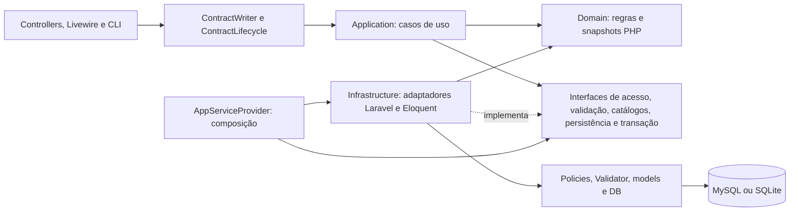

# Arquitetura do Contracts

## Objetivo e estado atual

O Contracts permanece um monólito Laravel 13, Livewire 4/Alpine, Blade, Tailwind 4, MySQL/SQLite e Docker. A arquitetura evolui por módulo, preservando os contratos HTTP, os 80 campos, o histórico, os escopos e as transações existentes.

O núcleo de cadastro, edição, exclusão e restauração de contratos agora possui **Domain e Application independentes de Laravel, Eloquent, Carbon, facades e HTTP**. As dependências são verificadas pela suíte Architecture. Os demais módulos continuam nos adaptadores/serviços existentes até uma migração justificada: não se afirma que todos os serviços do sistema já tenham essa independência.

As [evidências da primeira auditoria](architecture-audit.md) e da [auditoria incremental](technical-audit-2026-10-12.md) descrevem seus respectivos snapshots. A [evolução para desenvolvimento](clean-architecture-development.md) registra esta etapa, sua validação e os limites remanescentes.

## Direção das dependências



O caso de uso define suas necessidades por interfaces próprias. O container fornece os adaptadores externos; a aplicação não escolhe classes Eloquent nem acessa o container. A apresentação pode usar os serviços de compatibilidade e consultas de infraestrutura já existentes. Views, formatação, PDF/XLSX, discos e queues permanecem externos ao núcleo.

## Responsabilidades e arquivos

| Camada | Implementação | Responsabilidade |
| --- | --- | --- |
| Domain | `Contracts/ContractValidity.php` | Classificação temporal com referência explícita e cronologia por datas civis. |
| Domain | `Contracts/ContractState.php` | Snapshot imutável, aplicação de patch parcial, exercício, revisão legada e verificação de datas alteradas. Não acessa relógio, banco ou usuário global. |
| Domain | `Shared/BrazilianDocument.php`, `Shared/DecimalAmount.php` | Dígitos/verificadores/mascaramento e conversão decimal exata; regras compartilhadas com a normalização legada. |
| Application | `Contracts/SaveContract.php` | Orquestra autorização atual, validação, versão, escopo de destino, snapshots, invariantes, duplicidade, persistência e auditoria. |
| Application | `Contracts/ChangeContractLifecycle.php` | Casos explícitos de exclusão/restauração, autorização, confirmação e versão. |
| Application | `Security/ActorIdentity.php` | ID e versão de sessão recebidos de um consumidor autenticado. Não contém permissões autodeclaradas. |
| Application | `Contracts/AuthorizedContract.php`, `ValidatedContractInput.php` | Contexto autorizado e separação de controles validados do patch de campos graváveis. |
| Application | `Contracts/Ports/*`, `Ports/TransactionManager.php` | Seis interfaces específicas, incluindo numeração por Fundo/ano, sem builders/Models/Response na assinatura. |
| Application | `Exceptions/*` | Falhas de acesso, validação, concorrência e ausência de registro sem status HTTP ou dependência do framework. |
| Infrastructure | `Contracts/EloquentContractAccess.php` | Locks de ator/contrato e policies; verificação de atribuição de fundo/secretaria. Métodos públicos específicos de salvar/ciclo de vida evitam combinações arbitrárias de abilities. |
| Infrastructure | `Contracts/LaravelContractInputValidator.php` | Validação contextual Laravel, requisitos por tipo, proteção de campos, existência de catálogos e normalização do patch permitido. |
| Infrastructure | `Contracts/EloquentContractCatalog.php` | Snapshots de órgãos e resolução de fornecedor sem match ambíguo. |
| Infrastructure | `Contracts/EloquentContractStore.php`, `ContractMapper.php` | Tradução de snapshots, duplicidade sob lock, Eloquent, soft delete e auditoria inseparável da persistência. |
| Infrastructure | `Persistence/LaravelTransactionManager.php`, `TransactionGuard.php` | Transação com três tentativas; recusa explícita de mutação sem transação ativa. |
| Infrastructure | `Security/LockActor.php` | Atividade, exclusão lógica e versão de sessão atual. Também reutilizado por aditivos, financeiro, revisão e controllers administrativos. |
| Infrastructure | `Http/ApplicationErrors.php`, `bootstrap/app.php` | Tradução das falhas da aplicação em 403/404/409/422 ou erros de formulário, na fronteira HTTP. |
| Compatibilidade | `Services/ContractWriter.php`, `ContractLifecycle.php`, `Legacy/Normalizer.php` | Preservam as chamadas existentes; convertem models/identidade e delegam regras compartilhadas. |
| Composição | `Providers/AppServiceProvider.php` | Bindings das seis interfaces. Sem singleton com estado mutável de contratos/usuários. |

`ContractInputValidator` deixou de ser uma classe Laravel em Application: sua interface está em `Application/Contracts/Ports`, e sua implementação em Infrastructure. `LockActor` também foi movido de Application para Infrastructure, com todos os consumidores locais atualizados. As assinaturas dos serviços públicos de compatibilidade permanecem iguais.

## Fluxo seguro de escrita

1. HTTP/CLI fornece uma identidade derivada do usuário autenticado. ID, perfil e versão de sessão enviados no formulário não viram autoridade.
2. O caso de uso inicia `TransactionManager::run`; a implementação Laravel mantém até três tentativas em caso de deadlock.
3. `ContractAccess::lockForSave` ou `lockForLifecycle` bloqueia primeiro o ator, verifica atividade/versão de sessão, bloqueia o contrato atual e executa a policy. Os casos não podem escolher uma ability arbitrária recebida do cliente.
4. O validador recebe o contexto atual autorizado, dentro da transação. Ausência continua distinta de `null`. Dados pessoais protegidos e campos derivados não entram no patch gravável, mesmo quando valores vazios são aceitos pela semântica do Validator.
5. A aplicação verifica a versão persistida e o escopo de destino, resolve snapshots em catálogos e aplica as regras temporais. Datas históricas inconsistentes não alteradas continuam preservadas.
6. Cadastro novo recebe `ContractNumber` por `ContractNumbering`, após autorizar/validar o destino e a cronologia. O adaptador bloqueia o Fundo, depois seu contador no ano atual, faz leituras correntes dos números usados (incluindo soft delete) e incrementa `tb_N_Contrato.NUMERO`. `numero` recebe pelo menos três dígitos e sufixo anual; `cont_inteiro` recebe a sequência decimal sem máscara. A geração não confia em número, exercício ou contador enviados pelo cliente. A checagem preventiva existente recebe o número efetivamente atribuído.
7. `ContractStore::save` calcula diferenças com a semântica de casts do Eloquent, salva e registra a auditoria na mesma transação. Uma falha reverte ambos.
8. O resultado é o snapshot efetivamente salvo. O adaptador retorna o model compatível a partir desse snapshot, sem consulta global do contrato depois do commit. Conflitos de edição continuam reautorizando o ator/contrato atual antes de mostrar formulários.

O mapper preserva atributos originais e aplica somente diferenças: JSON já serializado não é serializado novamente; datas/decimais omitidos mantêm seus casts e campos legados continuam preservados. `ContractState` mantém arrays para representar os campos extensos, evitando um DTO artificial com 80 propriedades.

`ContractNumber` é PHP puro; recebe sequência/exercício explícitos e formata `001/26`, `999/26`, `1000/26`. O relógio pertence ao adaptador `EloquentContractNumbering`, com o fuso da aplicação. `tb_N_Contrato` usa `fund_id` e `ANO` únicos, preservando `FUNDO`/`NUMERO` como campos do controle. Um exercício novo tem contador independente, sem apagar o anterior. Contador, contrato e auditoria compartilham a transação: falha reverte os três. `number_year`/`number_sequence` identificam contratos gerados e possuem unicidade no banco por Fundo/ano/sequência; são nulos em registros anteriores, preservando duplicidades históricas sem whitelist de arquitetura. A identidade gerada e seu Fundo ficam imutáveis na edição; corrigir outros campos e a secretaria permanece permitido. Registros anteriores continuam com seus contratos de edição existentes. `ContractState::exercise` usa o exercício completo da numeração quando presente, evitando inferência de século pelo sufixo curto.

O importador legado bloqueia o Fundo antes de inserir contratos e recusa colisão com número nativo já reservado, preservando a origem para conciliação. A implantação importa contadores com exercício explícito via `contracts:import-contract-counters 2026 [arquivo.sql] [--dry-run]`. A origem `tb_N_Contrato` não contém ano; 2026 foi confirmado pelo usuário. O comando mantém o maior valor entre origem, contador existente e números utilizados, não altera contratos, registra `ImportRun`/`LegacyRecord` e evento com identidade de sistema (`actor_id=null`). A fonte SQL não é executada nem modificada.

Os campos monetários chegam aos atributos de domínio como strings com quatro casas, usando os casts existentes também no SQLite, cujo PDO pode devolver números como `float`. `original()` conserva a representação original para mapeamento/auditoria; regras financeiras devem usar os atributos normalizados, não os valores brutos de persistência. Essa tradução preserva a semântica dos casts e não altera valores do banco.

`TransactionGuard` protege locks de ator, verificação de escopo de destino, duplicidade, escrita e ciclo de vida. Não é substituto da policy ou da ordem de locks. O adapter não expõe `save` sem auditoria; não há evento assíncrono para a trilha de alterações.

## Regras de desenvolvimento

- **Domain** depende apenas de Domain e PHP nativo. Não usar Eloquent, Laravel, Carbon, facades, HTTP, containers, helpers globais ou inclusões de arquivos.
- **Application** depende de Application, Domain e PHP nativo. Novas operações recebem dependências pelo construtor e não usam `app()`, `auth()`, `request()`, `now()`, `collect()` ou `abort()`.
- **Ports** descrevem necessidades do caso de uso. Retornam dados/snapshots, não builders, models ou respostas. Não criar repository genérico para espelhar o ORM.
- **Infrastructure** implementa as interfaces e traduz recursos/falhas do framework. Não importar controllers, Livewire ou providers.
- **Apresentação** decide transporte, navegação e renderização. Os fluxos existentes continuam usando os serviços compatíveis; novos consumidores podem usar os casos puros e suas falhas tipadas.
- **Composição** acontece no provider. Não vincular repositories/contextos mutáveis como singleton.
- **Autorização** permanece no backend e é repetida sob lock nas mutações. Nunca confiar em dados de papel, autoria, fundo derivado ou propriedade conciliada vindos do cliente.
- **Validação contextual** permanece depois dos locks. Um FormRequest pode validar estrutura, mas não substituir a validação que depende do estado atual.
- **Tempo** é parâmetro explícito no domínio. Valores monetários são strings decimais, sem `float`; mudanças de sinais/saldos/aditivos exigem regra funcional e testes.

A suíte Architecture inspeciona tokens PHP, imports, referências qualificadas e helpers comuns. Ela detecta dependências estáticas proibidas; não é uma análise de segurança completa nem tenta resolver código dinâmico/reflection. Não criar exceções à regra para acomodar nova dependência externa: colocar a implementação no adaptador adequado.

## Comandos de desenvolvimento e CI

```bash
# Verificar as fronteiras sem inicializar Laravel ou banco
composer check:architecture

# Regras/casos de uso com doubles de interfaces, sem Laravel ou banco
composer test:unit

# Pint + todas as suites, com SQLite/storage/cache isolados
composer check

# Assets continuam no fluxo Node existente
npm run build
```

No ambiente Docker:

```bash
docker compose run --rm --no-deps app composer check:architecture
docker compose run --rm --no-deps app composer test:unit
docker compose run --rm --no-deps app composer check
docker compose run --rm --no-deps node npm run build
```

A CI verifica arquitetura explicitamente, PHPStan nível 5 em Domain/Application, Pint, build, suíte completa SQLite com cobertura PCOV e MySQL 8.4 em schema dedicado. `composer check:static` não inicia Laravel nem usa Larastan, baseline ou supressões; os adaptadores Laravel permanecem cobertos por arquitetura e integração. `composer audit --locked` verifica todas as dependências PHP; npm inclui ferramentas de build e falha a partir de severidade alta, publicando todos os alertas. `composer test:coverage` gera Clover em `build/coverage`, sem limiar artificial. A reprodução Docker e os limites estão em [security-hardening-2026-10-12.md](security-hardening-2026-10-12.md). A configuração SQLite padrão dos testes não acessa o banco instalado; `tests/bootstrap.php` prepara storage/caches temporários por processo. Configurações MySQL de teste devem apontar somente para um banco descartável: nunca trocar o DSN por uma instalação real em comandos com `RefreshDatabase`.

## Leituras, relatórios e limites atuais

Leituras continuam usando Eloquent nos adaptadores existentes, com `visibleTo` e policies. `ContractListingQuery` compartilha filtros por `ContractSearch`; `review=1` usa `pendingReview`. `withValidity` traduz a classificação temporal para SQL; `endingBetween` compartilha os limites inclusivos de calendário/alertas/relatórios a vencer.

O cadastro de novos contratos usa `SupplierCatalog::defaults` nos dois caminhos de assistência: seleção explícita por ID e busca por documento em `POST /suppliers/lookup`. Nome/documento vêm das colunas normalizadas de `suppliers`; os demais campos vêm de uma projeção explícita de `raw_payload`, importado da `tb_Fornecedor` (`RG`, `Doc_Prof`, `PIS_PASEP`, `Endereco`, `Nome_Socio`, `CPF_Socio`, `RG_Socio`). Payloads completos, contatos, dados de nascimento e outros atributos não são retornados. RG, PIS/PASEP e CPF/RG do sócio só são sugeridos a administradores; fornecedores pessoas físicas continuam restritos pelo catálogo existente. Ambos os caminhos revalidam o ator atual, exigem policy de criação e aplicam `SupplierCatalog::visibleTo`. Busca automática exige documento válido e correspondência única acessível; duplicidade recebe 409 sem selecionar um cadastro arbitrário, enquanto a seleção explícita por ID permanece disponível. CPF legado inválido do sócio não é sugerido; sua origem é preservada.

O documento é enviado no corpo POST, com autenticação, CSRF, limitação de frequência e `private, no-store`. O formulário novo aplica máscaras de CPF/CNPJ ao perder o foco e já na abertura de dados selecionados. Aborta consultas antigas, descarta respostas fora de ordem, preenche os oito campos de fornecedor somente para leitura e limpa sugestões anteriores ao trocar o documento. Gravação espera uma consulta pendente terminar; dados ainda passam pelo caso de uso, validação e auditoria habituais. Os oito campos de fornecedor são somente leitura e usam exclusivamente dados do cadastro autorizado. O validador contextual remove valores recebidos do cliente e resolve os dados e o ID do fornecedor sob lock na transação para novos contratos ou troca de documento. A seleção explícita deve corresponder ao documento e à visibilidade atual; o ID resolvido integra o patch validado. Edições com documento inalterado preservam os snapshots e o vínculo existentes. Detalhes e validação: [formulário de contratos](contract-form-2026-10-14.md). `npm test` executa testes JavaScript nativos de máscara/interação e também integra a CI.

O Início seleciona o exercício do ano atual por padrão, com referência ao relógio configurado da aplicação. `Overview` mantém `year` na URL, aceita anos anteriores e `all` (todos os anos), reinicia a paginação ao trocar o exercício e consulta opções somente entre contratos visíveis do Fundo selecionado na sessão. Fundo e exercício aplicam-se a contagens, vigência, revisão, totais exatos, órgãos, gráficos mensais, alertas e lista recente, inclusive para administradores. Links dos cards e da lista preservam ambos. `OverviewMetrics::for(User $actor, ?int $year = null, ?int $fundId = null)` aceita esses recortes; chamadas existentes sem filtros preservam seu comportamento. O Fundo é reautorizado no servidor em cada renderização Livewire, sem propriedade ou parâmetro URL capaz de substituir a sessão. Sem Fundo válido, o painel não apresenta carteira ou indicadores; queries internas usam um ID impossível (-1) para produzir resultados vazios, inclusive nos totais. Registros sem exercício aparecem somente em todos os anos. A vigência continua calculada em relação à data atual; selecionar um exercício antigo não transforma o painel em uma consulta histórica de vigência.

`ReportRows` captura linhas formatadas em arquivo temporário privado. Linhas e totais derivam da mesma leitura; PDF/XLSX são renderizados após o commit. O hash de acesso usa lotes, ator/escopos atuais, visibilidade, versões e timestamps. Jobs têm claim condicional. Esses componentes continuam adaptadores Laravel, não foram movidos para Domain/Application.

O patch gravável exclui explicitamente campos pessoais protegidos; aditivos/financeiro também excluem snapshots derivados/somente leitura após validação. A aceitação de valores vazios por `prohibited` não define autorização de escrita. Edição cadastral de usuários aplica apenas nome, username, e-mail e perfil; senha usa a operação dedicada.

Importação de aditivos históricos bloqueia candidatos em ordem de ID, incrementa a versão de cada contrato afetado e persiste `ContractAudit` na mesma transação. A identidade de sistema é explícita: `actor_id=null`, `import_run_id` com FK e motivo identificando a execução; não se atribui a ação ao último usuário humano. `updated_by` é limpo nessa mutação. Reimportar a mesma origem não muda novamente versão/auditoria. Dinheiro e períodos permanecem documentais.

Mutações administrativas de usuários recebem `version`, que corresponde à `session_version` do alvo visto no formulário, e comparam a revisão depois de bloquear e autorizar ator/alvo. Não é identidade ou autoridade do cliente. Formulários antigos são recusados com 409; ausência de versão recebe validação 422. A ordem especial de locks do último administrador permanece preservada.

Exportações prontas persistem SHA-256/tamanho e exigem ambos no download. Arquivos anteriores sem metadados de integridade recebem 410 e precisam ser solicitados novamente. Cada geração tem token e início de processamento; o token é serializado na fila para identificar também o callback `failed()`. Publicação/auditoria ocorrem na transação final, com ator bloqueado antes da exportação, e somente a tentativa proprietária pode publicar ou falhar. Payloads antigos sem token continuam gerando; callbacks sem identidade deixam a detecção de abandono para a limpeza.

A limpeza executa a cada cinco minutos, expira registros mesmo sem arquivo e encerra como `failed` processamentos que excederam 960 segundos (900s de timeout mais 60s de margem). Não há reexecução automática; o usuário solicita nova exportação. Tentativas atrasadas removem seus próprios arquivos e não alteram uma tentativa posterior. Arquivos órfãos de processos mortos são removidos depois de 24 horas.

Aditivos, registros financeiros, revisão, administração de usuários, conciliação e exportações ainda têm orquestração nos serviços/controllers existentes. A segurança não depende de esses módulos já estarem migrados: seus mecanismos de autorização/auditoria permanecem e a revalidação compartilhada do ator foi ampliada. Migrações futuras devem seguir os contratos e testes deste núcleo, uma operação por vez.

## Evolução funcional e operacional

A interface de relatórios/auditoria solicita `background=1` nas rotas de exportação existentes e recebe JSON 202 com ID e URL de acompanhamento. `ReportRequests` bloqueia/revalida o ator, verifica autorização e grava solicitação/evento na transação; a fila recebe o job após a gravação. A geração da interface não faz contagem prévia nem renderiza PDF/XLSX na requisição. Chamadas diretas sem esse controle preservam os contratos anteriores de download/redirect.

`GET /reports/status/{export}` retorna somente ID, estado, formato e URL autorizada de download. Exige sessão atual/proprietário e perfil administrativo para auditoria. Pendências não calculam o hash de todos os contratos a cada consulta; resultados prontos revalidam esse hash, e o download mantém as verificações completas de acesso, expiração e integridade. Não há caminhos de disco, filtros pessoais ou models serializados na resposta.

Cards consultam estados em sequência a cada cinco segundos, pausam em abas ocultas e param em estados finais. Voltar pelo cache de navegação retoma uma geração pendente. Falhas transitórias retomam consultas com espera maior; falhas de acesso removem a ação de download. Cliques repetidos no mesmo relatório em geração reutilizam o card. Capturas/totalizações selecionam somente os 21 atributos usados no relatório e reutilizam referência/datas na montagem das linhas. Medições e validação estão em [geração acompanhada de relatórios](report-generation-flow.md).

Uma geração acompanhada dispara automaticamente um único download quando fica pronta, pela mesma URL privada que reautoriza e verifica integridade no servidor. O botão manual permanece disponível. Cards que já estavam prontos na abertura da página não disparam esse efeito; o acompanhamento em aba oculta retoma ao voltar.

O worker/scheduler registram atividade recente via cache compartilhado. `contracts:check-operations` verifica banco, tabela da fila, heartbeats e espera de jobs; os healthchecks do Compose consultam cada processo. A imagem PHP inclui `pcntl` para aplicar timeouts no worker daemon. O Nginx resolve `app:9000` pelo DNS do Docker para acompanhar recriações do PHP. As [correções da verificação](audit-corrections-2026-10-12.md) registram migrations e recuperação local; não houve deploy externo. Retenção institucional, imutabilidade de auditoria e homologação continuam exigindo decisões próprias.

Atas de Registro de Preços, saldos e quantitativos precisam de modelagem e regras institucionais verificáveis. Valores iniciais, acumulados, fichas e empenhos continuam indicadores separados. Não foi aplicada prorrogação, reajuste, acréscimo ou supressão automaticamente. Homologação jurídica/administrativa e restauração de backups continuam pendentes.

## Autenticação e controles HTTP

O login exige `fund_id` existente e autorizado ao usuário atual, revalidado depois do lock do ator. A sessão armazena somente o ID do Fundo; o middleware consulta o cadastro/permissões atuais, encerra sessões cujo Fundo deixou de ser acessível e fornece projeções de ID/nome do Fundo e das opções autorizadas ao cabeçalho. A escolha filtra o Início e sugere dados no cadastro, sem ampliar permissões ou substituir policies/escopos. Sessões anteriores sem contexto podem selecionar um Fundo no cabeçalho, sem novo login.

`POST /session/fund` troca o contexto com autenticação e CSRF. Bloqueia/revalida primeiro o ator e depois o Fundo, verifica permissões atuais e registra `fund_selected` na mesma transação. O ID da sessão só muda após o commit, portanto falhas de autorização, validação ou auditoria preservam o contexto anterior. O retorno abre o Início e preserva o exercício escolhido, com valor validado. A seleção não altera contratos, escopos ou versões de usuário. Outras consultas continuam com seus contratos HTTP e filtros existentes.

Novos contratos sugerem Fundo, CNPJ e endereço de `contract_funds` e gestor de `contract_managers`, importado de `tb_Gestor`. A associação usa o nome normalizado do Fundo e exige um único Fundo e um único gestor candidatos; ambiguidades ficam vazias. `Nome_Gestor`, `Cargo`, `CPF_Gestor` e `RG_Gestor` são projetados explicitamente, com CPF/RG disponíveis apenas para administradores. A API autenticada `GET /funds/{fund}/contract-defaults` valida acesso e retorna somente essa projeção com `private, no-store`; não expõe payloads, endereço pessoal, contatos ou outros atributos legados. O formulário usa o Fundo autorizado da sessão e não apresenta seletores de Fundo ou Situação administrativa. Secretaria e Tipo de contrato compõem o painel superior compacto; Secretaria é habilitada somente para o Município e, em edições, quando o Fundo do contrato corresponde à sessão. Em POST /contracts, o validador de infraestrutura reautoriza e bloqueia o Fundo da sessão dentro da transação, deriva fund_id no servidor e recusa um ID HTTP divergente ou Secretaria para outros Fundos. Alterações de Secretaria na edição também consultam o contexto atual. Edições com esses controles omitidos preservam Fundo, situação e snapshots históricos. [Comportamento e validação](contract-form-2026-10-14.md). Escritas continuam no caso de uso e são autorizadas novamente na transação.

Instalação: `php artisan migrate --path=database/migrations/2026_10_13_000001_create_contract_managers.php --force` e `php artisan contracts:import-managers [arquivo.sql]`. O comando importa somente `tb_Gestor`, registra origem/execução, preserva o payload completo e não altera contratos. Reimportações iguais são idempotentes; versões divergentes são registradas como conflito e não sobrescrevem o cadastro. A importação completa de contratos também passa a incluir esse catálogo. Ensaios de navegador aceitam `fund_id` no arquivo de acesso ou `CONTRACTS_FUND_ID`.

Login grava `last_login_at` e o evento na mesma transação, revalidando atividade, versão e senha sob lock do usuário. Falha encerra sessão e cookies, pois rollback de banco não reverte o guard. Tentativas inválidas consomem o limitador antes de gravar eventos. Logout encerra a sessão em `finally`, mesmo quando a auditoria falha; erros continuam reportados.

`SecurityHeaders` aplica CSP parcial: `base-uri 'none'; object-src 'none'; frame-ancestors 'self'; form-action 'self'`. Não restringe scripts/estilos nem pretende substituir uma CSP completa contra XSS. A migração para o build CSP do Livewire, nonces e ajustes das expressões Alpine exige validação própria de navegador/Vite; proposta e decisões de MFA estão na revisão de segurança.
